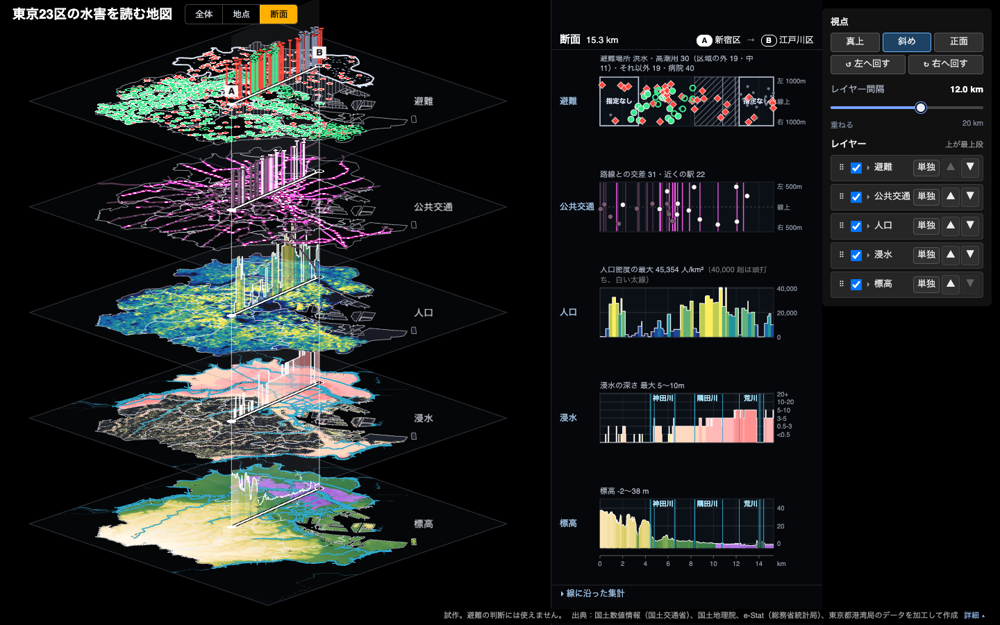

+++
author = "Yuichi Yazaki"
title = "A cross-section of flood risk across Tokyo’s 23 wards"
slug = "3d-layered-thematic-map"
date = "2026-11-28"
description = "Cut through five map layers along one line to compare elevation, modeled inundation, population, public transport and evacuation sites from upland to lowland Tokyo."
categories = ["principle"]
tags = ["interactive"]
series = ["interactive-explainers"]
series_weight = 60
work_id = "3d-layered-thematic-map"
image = "images/section.png"
+++

Draw a line across Tokyo and follow it through the layers of this interactive map. Along the same route, you can compare the height of the ground, modeled flood depths and the distribution of residents.

**[Open the Tokyo flood map](https://3d-layered-thematic-map.visualizing.jp/)** (in Japanese).

<!--more-->

## Follow a section east from Shinjuku

Choose **断面** (cross-section) at the top, then **台地から低地へ（新宿 → 江戸川区役所）** (from the uplands to the lowlands, Shinjuku to Edogawa Ward Office). Locate the line on the map at left. On the charts at right, read vertically at the same horizontal position. Where the ground drops, trace how modeled inundation depth and population density change along that stretch.

Expand **浸水** (inundation) to switch between river flooding and storm surge, or to display how long inundation lasts. In **地点** (point) mode, select a location to compare its values with totals for the surrounding area.

This prototype illustrates flood scenarios. For evacuation decisions, follow the relevant ward’s official hazard maps and evacuation information. [Data sources and calculation methods](https://github.com/n1n9-jp/3d-layered-thematic-map#readme)
