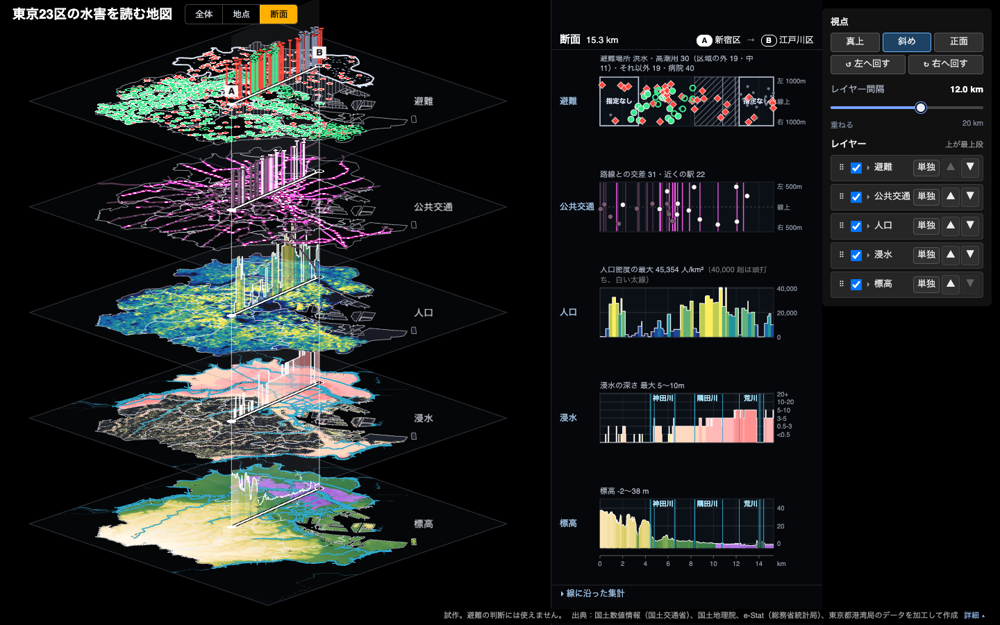

+++
author = "矢崎裕一"
title = "新宿から江戸川区まで、断面で読む東京23区の水害"
slug = "3d-layered-thematic-map"
date = "2026-11-28"
description = "東京23区の標高・浸水想定・人口・公共交通・避難の5層を同じ線で切り、台地から低地へ移るにつれて何が変わるかを読み取れます。"
categories = ["principle"]
tags = ["インタラクティブ"]
series = ["interactive-explainers"]
series_weight = 60
work_id = "3d-layered-thematic-map"
image = "images/section.png"
+++

「東京23区の水害を読む地図」では、地図に引いた1本の線に沿って、地面の高さと想定される浸水の深さ、そこに暮らす人の分布を見比べられます。

**[東京23区の水害を読む地図を開く](https://3d-layered-thematic-map.visualizing.jp/)**

<!--more-->

## 新宿から東へ、地図に断面を引く

画面上部の「断面」を選び、「台地から低地へ（新宿 → 江戸川区役所）」を押します。左の地図で線が通る場所を確かめ、右のグラフを同じ横位置で上から下へ読みます。標高が下がる区間に注目すると、そこで想定される浸水の深さや人口密度の変化も追えます。

「浸水」レイヤーを開くと、洪水と高潮を切り替えたり、水が引くまでの期間を表示したりできます。「地点」では、地図上の一点を選び、その地点の値と周辺の集計を比べられます。

この地図は水害の想定を説明するための試作です。実際の避難は各区のハザードマップと避難情報に従ってください。[データの出典と集計方法](https://github.com/n1n9-jp/3d-layered-thematic-map#readme)
