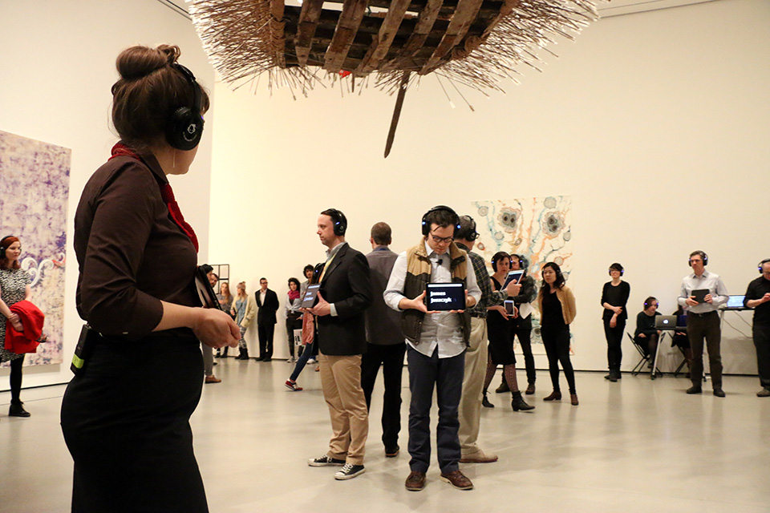
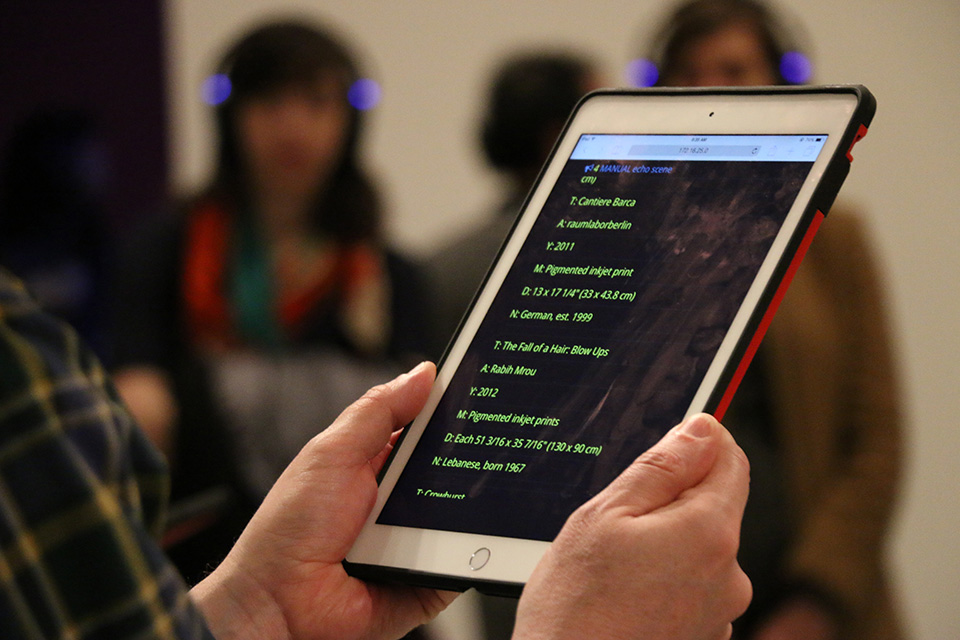
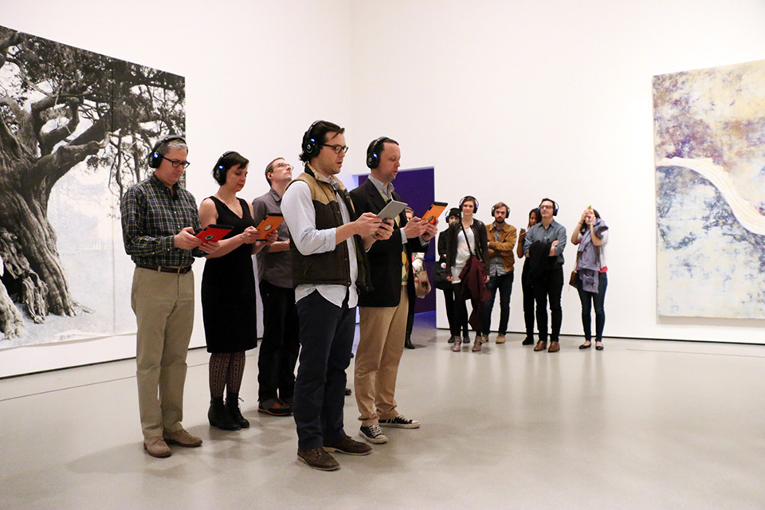

+++
author = "Yuichi Yazaki"
title = "Waiting for the First Woman's Name: Reading a Scene from A Sort of Joy"
slug = "a-sort-of-joy"
date = "2026-11-07"
description = "Data Feminism describes a scene from A Sort of Joy (2015) in which first names of artists are read aloud and the audience waits more than three minutes for the first woman's name. This article checks that description against primary sources."
categories = [
    "consume"
]
tags = [
    "sonification",
    "gender"
]
image = "images/performers-with-ipads-gallery.jpg"
series = ["data-sonification"]
series_weight = 25
seriesByline = "Elevator Repair Service et al."
seriesTitle = "Waiting for the First Woman's Name: A Sort of Joy"
+++

A Sort of Joy (Thousands of Exhausted Things) is a collaboration between the theater company Elevator Repair Service (ERS) and The Office for Creative Research (OCR). Its script was generated from the Museum of Modern Art (MoMA) collection data (123,951 works), and it was performed in April 2015 in the second-floor galleries of MoMA. *Data Feminism* describes one scene from this performance: the first names of artists are read out in order, with male performers voicing male names and female performers voicing female names. It takes more than three minutes to reach the first female name, "Mary," and the authors argue that this wait is an experience of feeling a bias rather than seeing it. This description could not be confirmed in the primary sources.

The performance was one of the Artists Experiment projects run by MoMA's education department. What follows draws on the official descriptions from OCR and Vimeo, an interview with the director, and Chapter 3, pp. 85–87, of *Data Feminism* by Catherine D'Ignazio and Lauren F. Klein (MIT Press, 2020). *Data Feminism* is the only source that describes the names scene, and it differs from the primary sources on three points, which are set side by side below.

<!--more-->

## April 2015: performing collection data on MoMA's second floor

The performance took place on April 4 and 7, 2015, in MoMA's second-floor contemporary galleries, during regular opening hours (Visionaire World). According to the Vimeo credits, it was directed by John Collins, founder of ERS. The concept was by Collins and the four OCR members Mark Hansen, Ben Rubin, and Jer Thorp, with six performers.

OCR's project page describes the form of the performance this way:

> "... a variable performance script that is delivered to actors electronically as they roam throughout the second floor galleries of the museum. ... this spoken text and the ambient sound that accompanies it is experienced through wireless stereo headphones worn by audience members."

In other words, a script made from the 123,951 works in the collection data was delivered electronically to actors roaming the second-floor galleries, and the audience listened to the voices and ambient sound through headphones. The same text calls the performance an "extended audio tour."

Photo by Manuel Martagon, © 2015 The Museum of Modern Art, New York. Source: The Office for Creative Research project page

Each run lasted about 45 minutes and was repeated twice within the scheduled time, and the audience was free to come and go. The script was generated for each run (EAR Studio). The official description states that every word spoken was taken from the database.

## Replacing the wall label with voices and order

The data used was each work's title, artist name, medium, dimensions, year of production, and so on. In an interview with Visionaire World, Collins explains that this is the information printed on the small card next to a work (the tombstone).

According to the Vimeo description, the work titles were classified by grammar, vocabulary, stress, and so on, and rules for sorting and filtering were applied to generate sequences of sentences. Some of these sentences were delivered as they were, and others were put together by the artists by hand.

Photo by Manuel Martagon, © 2015 The Museum of Modern Art, New York. Source: The Office for Creative Research project page

On the screen in the photo, under work titles such as "Cantiere Barca" and "The Fall of a Hair: Blow Ups," the artist name, year, medium, dimensions, and nationality are lined up. The fields of the wall label appear to have become the lines of the script.

The table below summarizes, source by source, what data was mapped to what. The first four rows are *Data Feminism*'s description of the names scene, which could not be confirmed in the primary sources.

| Data | Mapped to | Source |
|---|---|---|
| Artists' first names | The words spoken aloud. The iPad shows the full names of artists with that first name | *Data Feminism* p. 86 (not confirmed in primary sources) |
| Size of each group of names | The order of reading. Larger names come first (the criterion is examined in a later section) | Same, p. 86 (not confirmed in primary sources) |
| Gender of the name | Who speaks. Male performers for male names, female performers for female names | Same, pp. 86–87 (not confirmed in primary sources) |
| The gap between male and female names | How long the female performers walk in silence. More than three minutes until "Mary" | Same, p. 87 (not confirmed in primary sources) |
| Work titles | Chains of association linked by words ("boy" → "boy holding shovel" …) | Visionaire World (Collins) |
| Medium | A list of medium names read aloud for works in the same medium | Visionaire World (Collins) |
| Syllables and stress of artist and medium names | Fitted to the melody of a familiar song (e.g., "My Favorite Things") | Visionaire World (Collins) |
| The volume of the whole dataset | Many scenes sounding at once, making "the voice of the whole museum" | Visionaire World (Collins) |

## The names scene as Data Feminism describes it

In the section "Data Visceralization" in Chapter 3, *Data Feminism* takes up this performance in connection with a feminist critique of museum collecting policy. It places the piece alongside the Guerrilla Girls' 1989 poster as another tactic with the same aim.

In the authors' description, a group of white men stands in a circle in the middle of the room, facing outward toward the audience. When the men say "John" in unison, the iPads show John Baldessari, John Cage, and so on. Three female performers keep walking silently around the circle. Male names follow, "Robert" and "David," and eventually "Mary" comes as the first voice of the women.

> "It takes more than three minutes for "Mary" to be spoken, and the next female name, "Joan," doesn't come for a full minute longer."

The description says it took more than three minutes to reach Mary, and a full minute more to reach the next female name, Joan. "Barbara" follows soon after, and then the names return to male ones.

The authors also write that, as analysis, this is simple.

> "From a data analysis perspective, A Sort of Joy consists of simple operations: counting and grouping. A bar chart or a tree map of first names could easily have represented the same results. But presenting the dataset as a time-based experience makes the audience wait and listen and experience."

Their claim is that a bar chart could show the same result, but placing it in time makes the audience wait, listen, and experience. The authors call this the opposite of Ben Shneiderman's "Overview first": the listener hears one point at a time and builds up the whole gradually.

> "We start to anticipate when the next woman's name will arise. We feel the gender differential, rather than see it."

The line says that we start waiting for the next woman's name, and feel the difference rather than see it. The authors call this feeling affect, and include even the urge to leave for another room because it goes on too long.

## Three points where Data Feminism and the primary sources differ

*Data Feminism*'s description and the primary sources differ on the following three points.

| Point | *Data Feminism* | Primary sources |
|---|---|---|
| How the names are ordered (whether it is described) | In the order of "which first name has the most works in the collection." John, Robert, and David come first because they have the most works (p. 86) | No description in the sources I could read (OCR, Vimeo, EAR, Visionaire). Thorp's Medium post was not read |
| Description of the performance | The audience surrounds a circle of men in the middle of the room, and three women walk around it. The performers wear the headphones (p. 86) | Six performers roam the second-floor galleries in an "audio tour." The audience wears the headphones (OCR, Vimeo) |
| Video | Note 30 says "the full performance" can be seen on Vimeo | The Vimeo title is "A Sort of Joy at MoMA (excerpts)." The description opens with "[ ROUGH CUT ]," and the running time is 8 min 04 s |

The two descriptions of the performance can also be read as compatible, if the names scene was one scene within a performance that moved through the galleries. In the photos, the people holding tablets also appear to be wearing headphones. However, where in the 45 minutes the names scene fell and who took part could not be confirmed in the primary sources.

Photo by Manuel Martagon, © 2015 The Museum of Modern Art, New York. Source: The Office for Creative Research project page

The ordering of the names can be recounted with today's data. **The numbers below are not the makers'; they were counted for this article.** The data used is MoMA's GitHub data as of November 2026 (160,928 works, 15,999 artists). It was published on GitHub in July 2015, after the performance. Cuseum writes that the performance used "an earlier version of the dataset." It is not the version from the 2015 performance.

| Ordering criterion | Top names | Position of female names |
|---|---|---|
| Number of artists with the name | John 254, Robert 197, David 152, Paul 141, William 124 … | Mary is 46th (33 artists). Barbara is 54th, Maria 65th, Joan 66th |
| Number of works by artists with the name | Ludwig 16,406 works, Eugène, Louise, Robert, John … | Louise is 3rd. Mary has 91 works, far lower |

Ordered by number of works, Ludwig comes first, because of the Mies van der Rohe architecture archive the museum holds. The order by number of artists matches the John, Robert, David sequence in *Data Feminism* well. This suggests that the actual criterion was probably the number of artists with the name. Note that the ranking by artist count also includes words such as "The" that are not names, and how the gender of each name was determined is not known.

## How other writers saw the performance

In 2017, Mindy Seu cited the performance as an example of digital poetry in "The Poetry of Tools" on Are.na Editorial. She does not mention gender.

> "Removed from the context of the artwork, the performance focused on the data itself and reshaped how it can be consumed."

Her assessment is that it turned attention to the data itself, away from the artworks, and reshaped how the data is received. Seu also writes that OCR turned the data into a script after its publication on GitHub, but the script must have been made before the April performance, so the order appears to be reversed.

Pablo Helguera, who was then in MoMA's education department, cited it in 2021 as an example of practice that uses artwork titles as material.

> "The piece was a combination of conceptual poetry, theater of the absurd, Kurt Schwitter-esque verbal experiments and musical delight"

He describes it as a mixture of conceptual poetry, theater of the absurd, Schwitters-style verbal experiments, and musical delight.

In "A sort of joy" (2020), Zana Fauzi widened the question to race and intersectionality.

> "We never heard a 'Khalil', a 'Salama', a 'Dinesh' ..."

The point is that no Khalil, Salama, or Dinesh was heard.

## Takeaways

There are four judgments to take back to visualization work.

The first is to turn quantity into time. In *Data Feminism*'s description, a difference in numbers that a bar chart could show becomes waiting time when names are read one at a time. Like [Two Trains](/en/data-driven-dj-two-trains/), which turned the distance between stations into the length of a song, this can be read as an example of using time as an axis.

The second is to assign a classification to "who speaks." In *Data Feminism*'s description, the gender of a name is carried by the speaker's voice and body rather than by the content of the words. This is a different place to put it from [Quotidian Record](/en/quotidian-record/), which maps the frequency of visited places to consonant and dissonant intervals, or [Chemo Singing Bowl](/en/chemo-singing-bowl/), which maps it to the shape of an object.

The third is the cost of showing the whole at the end. The listener is kept waiting for a long time. *Data Feminism* argues that affect includes even the urge to leave for another room because it goes on too long. Whether to show the whole first comes down to whether you want people to feel it or to read off the values.

The fourth is to write down the ordering criterion. Whether the order is by number of artists or number of works, the first name could be John or Ludwig. A work known from secondary sources also has to be checked again against the primary sources. In this performance, the introductions and the records differed on three points: the ordering of the names, the setup of the space, and the video.

## References

**Primary sources**

- The Office for Creative Research, “A Sort of Joy (Thousands of Exhausted Things),” 2015. [Project page](https://o-c-r.github.io/public-space-interventions/2015/03/30/a-sort-of-joy)
- Ben Rubin, “A Sort of Joy at MoMA (excerpts),” Vimeo, 2015-07-17 (8 min 04 s). [Video](https://vimeo.com/133815147) / [oEmbed (description)](https://vimeo.com/api/oembed.json?url=https://vimeo.com/133815147)
- EAR Studio (Ben Rubin), “A Sort of Joy (Thousands of Exhausted Things).” [Project page](https://www.earstudio.com/projects/project-page/a-sort-of-joy-(thousands-of-exhausted-things))
- Jer Thorp, “A Sort of Joy.” [Project page](https://www.jerthorp.me/asortofjoy)
- Alessandro Magania, “Elevator Repair Service's Sort of Joy” (interview with John Collins), Visionaire World. [Article](https://visionaireworld.com/blogs/imported/elevator-repair-service-s-sort-of-joy)
- The Museum of Modern Art, “The Museum of Modern Art (MoMA) Collection,” GitHub (CC0). [Repository](https://github.com/MuseumofModernArt/collection)

**Secondary sources**

- Catherine D'Ignazio and Lauren F. Klein, *Data Feminism*, MIT Press, 2020, ch.3, pp.85–87, 96, notes 30, 34, 35. [Internet Archive](https://archive.org/details/mit_press_book_9780262358521)
- Mindy Seu, “The Poetry of Tools,” Are.na Editorial, 2017-08-10. [Article](https://www.are.na/editorial/the-poetry-of-tools)
- Pablo Helguera, “Untitled (On Titles),” Beautiful Eccentrics, 2021-12-09. [Article](https://pablohelguera.substack.com/p/untitled-on-titles)
- Zana Fauzi, “A sort of joy,” Two Kinds of Intelligence, 2020-09-27. [Article](https://twokindsofintelligence.substack.com/p/a-sort-of-joy)
- Cuseum, “MoMA and the exciting possibilities with museum metadata,” 2015-09-25. [Article](https://cuseum.com/blog/moma-and-the-exciting-possibilities-with-museum)
- Quim Gil, “The MoMa, CSV, GitHub, and CC0,” Wikidata mailing list, 2015-07-29. [Post](https://lists.wikimedia.org/hyperkitty/list/wikidata@lists.wikimedia.org/thread/5Q6KEXQPKF5OIVOSAWISJQEGR3NLFZHS/)
