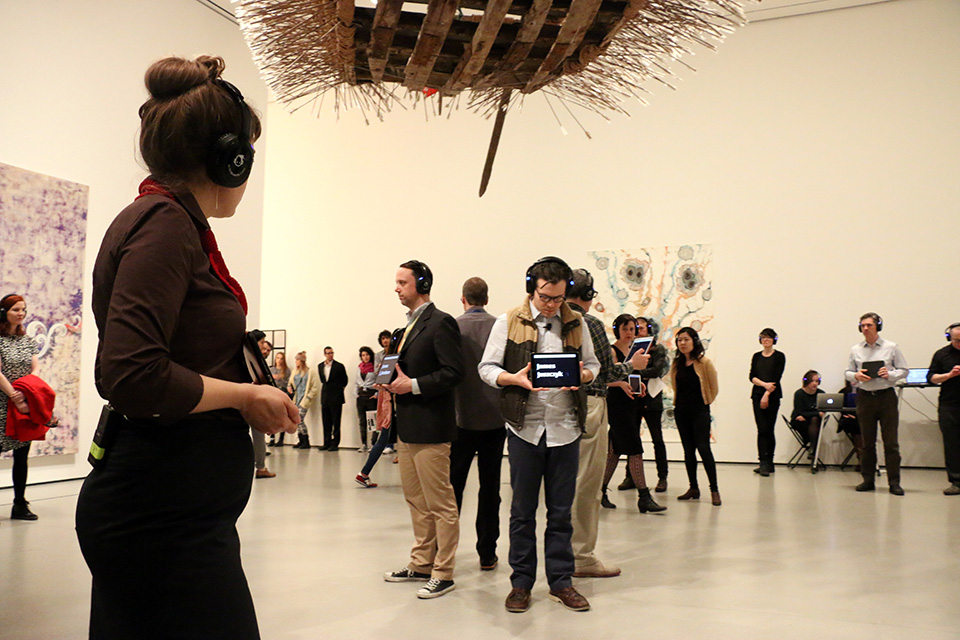
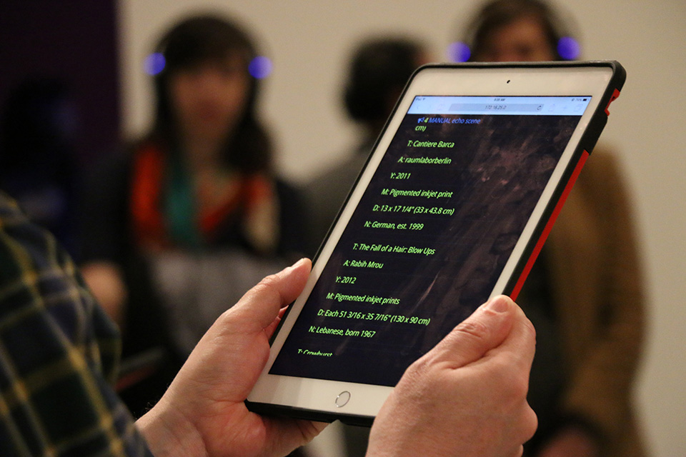
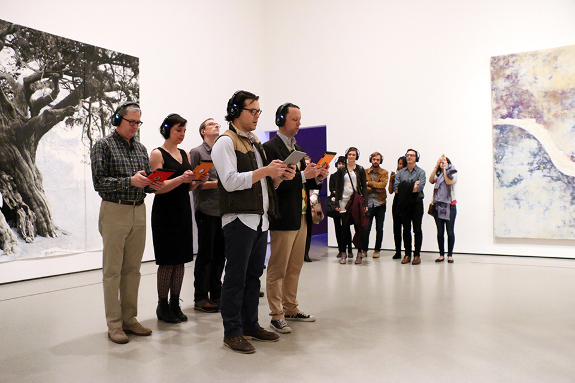

+++
author = "矢崎裕一"
title = "最初の女性の名が出るまでの待ち時間で、偏りを聞かせる──A Sort of Joy"
slug = "a-sort-of-joy"
date = "2026-11-07"
description = "A Sort of Joy は、MoMA の所蔵データの作家の名を順に読み上げた2015年の上演です。男性名は男性、女性名は女性の俳優が言い、性別の偏りを最初の女性名までの待ち時間で聞かせました。"
categories = [
    "consume"
]
tags = [
    "ソニフィケーション",
    "ジェンダー"
]
image = "images/performers-with-ipads-gallery.jpg"
series = ["data-sonification"]
series_weight = 99
seriesByline = "Elevator Repair Service ほか"
seriesTitle = "女性の名が出るまで待たせる──A Sort of Joy"
+++

A Sort of Joy (Thousands of Exhausted Things)（ア・ソート・オブ・ジョイ）は、ニューヨーク近代美術館（MoMA）の所蔵データにある作家のファーストネームを順に読み上げ、男性名は男性の俳優、女性名は女性の俳優が声にした2015年の上演です。性別の偏りを、最初の女性名が出るまでの待ち時間として聞かせました。『Data Feminism』の記述では、John、Robert、David と男性名が続き、最初の女性名「Mary」が出るまでに3分以上かかります。

上演は、劇団 Elevator Repair Service（エレベーター・リペア・サービス、ERS）と The Office for Creative Research（OCR）の共同制作で、MoMA 教育部門の企画 Artists Experiment の一つです。以下は、OCR と Vimeo の公式の説明文、演出家のインタビュー、Catherine D'Ignazio（キャサリン・ディグナツィオ）と Lauren F. Klein（ローレン・クライン）の『Data Feminism』（MIT Press、2020）第3章 pp.85–87 に沿います。名前の場面を詳しく描いたのは『Data Feminism』で、一次資料とは3つの点で書き方が違うため、並べて示します。

<!--more-->

## 2015年4月、MoMA の2階で所蔵データを上演する

上演は2015年4月4日と7日、MoMA 2階の現代美術の展示室で、通常の開館時間中に行われました（Visionaire World）。Vimeo のクレジットでは、演出は ERS 創設者の John Collins（ジョン・コリンズ）です。構想は Collins と、OCR の Mark Hansen、Ben Rubin（ベン・ルービン）、Jer Thorp（ジェア・ソープ）の4人で、出演者は6人です。

OCR の作品ページは、上演の形をこう説明しています。

> "... a variable performance script that is delivered to actors electronically as they roam throughout the second floor galleries of the museum. ... this spoken text and the ambient sound that accompanies it is experienced through wireless stereo headphones worn by audience members."

12万3,951点の所蔵データから作った台本は、2階の展示室を歩き回る俳優に電子的に届き、声と環境音は観客がヘッドホンで聴く、という説明です。同じ文は、上演を「extended audio tour」（長い音声ツアー）と呼んでいます。

Manuel Martagon 撮影、© 2015 The Museum of Modern Art, New York／The Office for Creative Research の作品ページより引用

1回はおよそ45分で、予定の時間内に2回繰り返し、観客は出入り自由でした。台本は回ごとに生成しました（EAR Studio）。口にする言葉はすべてデータベースから取った、と公式の説明文は書いています。

## 作品の解説カードを、声と順番に置き換える

使ったデータは、作品ごとのタイトル、作家名、素材、寸法、制作年などです。Collins は Visionaire World のインタビューで、作品の横に貼る小さなカード（tombstone）に載る情報だと説明しています。

Vimeo の説明文によると、作品タイトルを文法や語彙、強勢などで分類し、並べ替えや絞り込みの規則を当てて文の列を生成しました。その文をそのまま配る部分と、作家が手で組んだ部分があります。

Manuel Martagon 撮影、© 2015 The Museum of Modern Art, New York／The Office for Creative Research の作品ページより引用

写真の画面には、「Cantiere Barca」「The Fall of a Hair: Blow Ups」といった作品名の下に、作家名・年・素材・寸法・国籍が並んでいます。解説カードの項目が、そのまま台本の行になっていると読めます。

データをどこに対応させたかを、資料ごとにまとめます。上の4行は『Data Feminism』による名前の場面の記述で、一次資料では確かめられていません。

| データ | 対応させた先 | 出典 |
|---|---|---|
| 作家のファーストネーム | 声に出す語。iPad にはその名の作家のフルネームが流れる | 『Data Feminism』p.86 |
| 名の集まりの大きさ | 読み上げる順番。大きい名ほど先（基準は後の節で検討） | 同 p.86 |
| 名の性別 | 誰が言うか。男性名は男性の俳優、女性名は女性の俳優 | 同 pp.86–87 |
| 男性名と女性名の数の差 | 女性の俳優が黙って歩く時間。「Mary」まで3分以上 | 同 p.87 |
| 作品タイトル | 語でつないだ連想の鎖（"boy" → "boy holding shovel" …） | Visionaire World（Collins） |
| 素材 | 同じ素材の作品の素材名を、リストで朗読する | Visionaire World（Collins） |
| 作家名・素材名の音節と強勢 | 知っている歌の旋律にはめる（例：「My Favorite Things」） | Visionaire World（Collins） |
| データ全体の量 | いくつもの場面を同時に鳴らし、「美術館全体の声」にする | Visionaire World（Collins） |

## 『Data Feminism』が描いた名前の場面

『Data Feminism』は第3章の節「Data Visceralization」で、美術館の収集方針へのフェミニズムの批評につなげて、この上演を取り上げます。同じ目的の別の戦術として、Guerrilla Girls の1989年のポスターと並べています。

著者の描写では、部屋の中央で白人男性の一団が円陣を組み、外の観客を向いています。男性たちが声をそろえて「John」と言うと、iPad に John Baldessari、John Cage、John Lennon、John Waters と流れます。女性の出演者3人は、黙って円陣の周りを歩き続けます。「Robert」「David」と男性名が続き、やがて「Mary」が、女性たちの最初の声として出ます。

> "It takes more than three minutes for "Mary" to be spoken, and the next female name, "Joan," doesn't come for a full minute longer."

Mary まで3分以上、次の女性名 Joan まではさらに丸1分かかった、という記述です。すぐ後に「Barbara」が続き、また男性名に戻ります。著者は Mary を、聴き方が変わる「aha moment」と呼んでいます。

著者は、分析としては単純だとも書きます。

> "From a data analysis perspective, A Sort of Joy consists of simple operations: counting and grouping. A bar chart or a tree map of first names could easily have represented the same results. But presenting the dataset as a time-based experience makes the audience wait and listen and experience."

棒グラフでも同じ結果を示せるが、時間の中に置くと観客は待ち、聴き、体験する、という主張です。著者はこれを、Ben Shneiderman（ベン・シュナイダーマン）の「Overview first」の逆だとします。点を一つずつ聴き、全体は少しずつ組み立てるからです。

> "We start to anticipate when the next woman's name will arise. We feel the gender differential, rather than see it."

次の女性の名を待ち始め、差を見るのではなく感じる、という一文です。著者はこの感じを affect（情動）と呼び、長すぎて別の部屋へ行きたくなる気持ちまで含めています。

## 一次資料と食い違う3点

『Data Feminism』の記述は、一次資料と次の3点で違います。

| 点 | 『Data Feminism』 | 一次資料 |
|---|---|---|
| 名前の並べ方 | 「which first name has the most works in the collection」の順。John、Robert、David が先なのは作品数が多いから（p.86） | OCR・Vimeo・EAR Studio・インタビューは、名前の場面の規則を書いていない |
| 上演の描写 | 部屋の中央の男性の円陣を観客が囲み、女性3人が周りを歩く。ヘッドホンを着けているのは出演者（p.86） | 6人の出演者が2階の展示室を歩き回る「audio tour」。ヘッドホンを着けるのは観客（OCR・Vimeo） |
| 映像 | 注30で「the full performance」を Vimeo で見られるとする | Vimeo の題は「A Sort of Joy at MoMA (excerpts)」。説明文の冒頭は「[ ROUGH CUT ]」で、長さは8分04秒 |

上演の描写は、名前の場面が展示室を巡る上演の一場面だったとすれば、両立するとも読めます。写真では、タブレットを持つ人もヘッドホンを着けているように見えます。ただし、名前の場面が45分のどこにあり、誰が出たかは、一次資料では確かめられませんでした。

Manuel Martagon 撮影、© 2015 The Museum of Modern Art, New York／The Office for Creative Research の作品ページより引用

名前の並べ方は、今のデータで数え直せます。**次の数字は作り手のものではなく、この記事の調査で数えたものです。** 使ったのは、2026年11月時点の MoMA の GitHub のデータ（作品160,928件、作家15,999人）です。GitHub での公開は2015年7月で、上演より後です。Cuseum は、上演が「an earlier version of the dataset」を使ったと書いています。2015年の上演の版ではありません。

| 並べる基準 | 上位の名 | 女性名の位置 |
|---|---|---|
| その名を持つ作家の人数 | John 254人、Robert 197人、David 152人、Paul 141人、William 124人… | Mary が46位（33人）。Barbara 54位、Maria 65位、Joan 66位 |
| その名の作家の作品数 | Ludwig 16,406点、Eugène、Louise、Robert、John… | Louise が3位。Mary は91点で、ずっと下 |

作品数で並べると、Mies van der Rohe の建築アーカイブを抱える Ludwig が先頭になります。作家の人数の順は、『Data Feminism』の John、Robert、David の並びとよく合います。実際の基準は、その名を持つ作家の人数だった可能性が高いと読めます。なお人数の順位には「The」のような名でない語も入り、名の性別を何で決めたかも分かっていません。

## ほかの書き手はこの上演をどう見たか

Mindy Seu（ミンディ・スー）は2017年、Are.na Editorial の「The Poetry of Tools」で、この上演をデジタル詩の例に挙げました。性別には触れていません。

> "Removed from the context of the artwork, the performance focused on the data itself and reshaped how it can be consumed."

作品から切り離してデータそのものに目を向け、その受け取り方を作り変えた、という評価です。なお Seu は、GitHub での公開の後に上演したと書いていますが、日付の記録では順序が逆です。

当時 MoMA 教育部門にいた Pablo Helguera（パブロ・エルゲラ）は2021年、作品タイトルを素材にした実践の例に挙げました。

> "The piece was a combination of conceptual poetry, theater of the absurd, Kurt Schwitter-esque verbal experiments and musical delight"

概念詩、不条理劇、Schwitters 風の言葉の実験、音楽の楽しみが混ざったもの、という評です。

Zana Fauzi は2020年の「A sort of joy」で、論点を人種と交差性に広げました。

> "We never heard a 'Khalil', a 'Salama', a 'Dinesh' ..."

Khalil も Salama も Dinesh も聞こえなかった、という指摘です。ただし Fauzi の場面の描写は、『Data Feminism』の言い換えにとどまると読めます。

## 使い道

可視化の仕事に持ち帰れる判断は、四つあります。

一つ目は、量を時間に置き換えることです。棒グラフでも示せる数の差が、名を一つずつ読むと待つ時間になります。[Two Trains](/data-driven-dj-two-trains/) が駅の間の距離を曲の長さにしたのと同じく、時間を軸に使った例と読めます。

二つ目は、分類を「誰が言うか」に割り当てることです。名の性別を、語の中身ではなく話し手の声と身体に載せました。訪れた場所の頻度を協和と不協和の音程に載せる [Quotidian Record](/quotidian-record/) や、物の形に載せる [Chemo Singing Bowl](/chemo-singing-bowl/) とは別の置き場所です。

三つ目は、全体を最後に見せる代償です。聴き手は長く待たされ、部屋を出たくなる人もいます。感じさせたいのか、値を引かせたいのかで、全体を先に出すかを決めることになります。

四つ目は、並べる基準を書き残すことです。作家の人数か作品数かで、先頭は John にも Ludwig にもなります。二次資料で知った作品は、一次資料に当たり直すことも要ります。この上演では、名前の並べ方、場の作り、映像の3点で、紹介と記録が違っていました。

## 参考・出典

**一次情報**

- The Office for Creative Research, “A Sort of Joy (Thousands of Exhausted Things),” 2015. [作品ページ](https://o-c-r.github.io/public-space-interventions/2015/03/30/a-sort-of-joy)
- Ben Rubin, “A Sort of Joy at MoMA (excerpts),” Vimeo, 2015-07-17（8分04秒）. [動画](https://vimeo.com/133815147) / [oEmbed（説明文）](https://vimeo.com/api/oembed.json?url=https://vimeo.com/133815147)
- EAR Studio（Ben Rubin）, “A Sort of Joy (Thousands of Exhausted Things).” [作品ページ](https://www.earstudio.com/projects/project-page/a-sort-of-joy-(thousands-of-exhausted-things))
- Jer Thorp, “A Sort of Joy.” [作品ページ](https://www.jerthorp.me/asortofjoy)
- Alessandro Magania, “Elevator Repair Service's Sort of Joy”（John Collins へのインタビュー）, Visionaire World. [記事](https://visionaireworld.com/blogs/imported/elevator-repair-service-s-sort-of-joy)
- The Museum of Modern Art, “The Museum of Modern Art (MoMA) Collection,” GitHub（CC0）. [リポジトリ](https://github.com/MuseumofModernArt/collection)

**第三者評価**

- Catherine D'Ignazio and Lauren F. Klein, *Data Feminism*, MIT Press, 2020, ch.3, pp.85–87, 96, notes 30, 34, 35. [Internet Archive](https://archive.org/details/mit_press_book_9780262358521)
- Mindy Seu, “The Poetry of Tools,” Are.na Editorial, 2017-08-10. [記事](https://www.are.na/editorial/the-poetry-of-tools)
- Pablo Helguera, “Untitled (On Titles),” Beautiful Eccentrics, 2021-12-09. [記事](https://pablohelguera.substack.com/p/untitled-on-titles)
- Zana Fauzi, “A sort of joy,” Two Kinds of Intelligence, 2020-09-27. [記事](https://twokindsofintelligence.substack.com/p/a-sort-of-joy)
- Cuseum, “MoMA and the exciting possibilities with museum metadata,” 2015-09-25. [記事](https://cuseum.com/blog/moma-and-the-exciting-possibilities-with-museum)
- Quim Gil, “The MoMa, CSV, GitHub, and CC0,” Wikidata mailing list, 2015-07-29. [投稿](https://lists.wikimedia.org/hyperkitty/list/wikidata@lists.wikimedia.org/thread/5Q6KEXQPKF5OIVOSAWISJQEGR3NLFZHS/)
