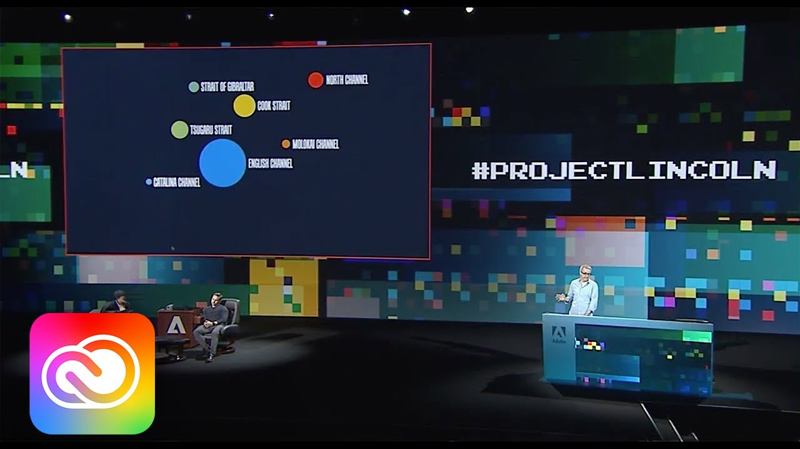
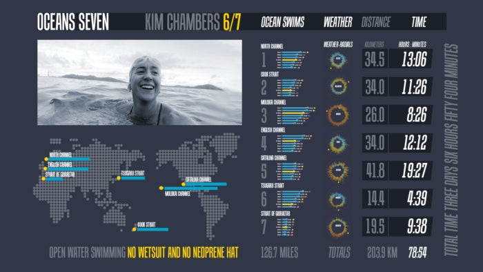
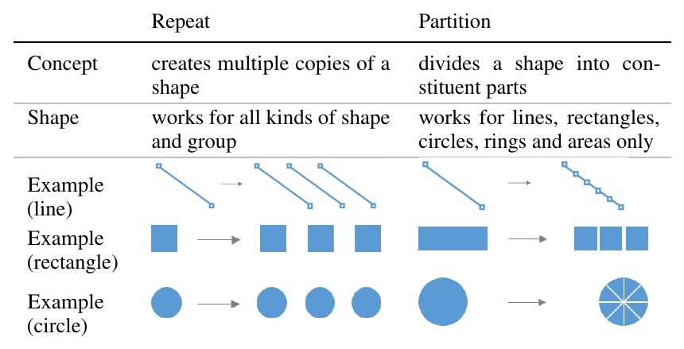
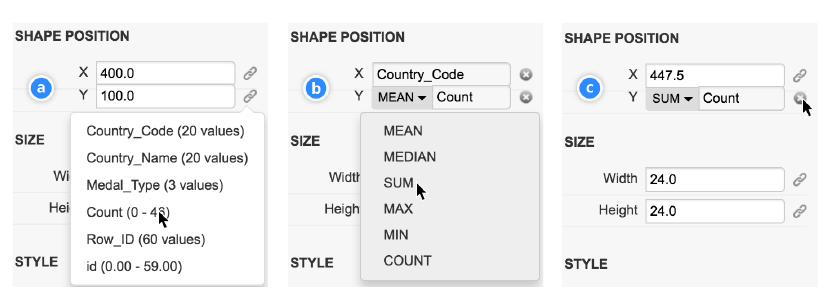
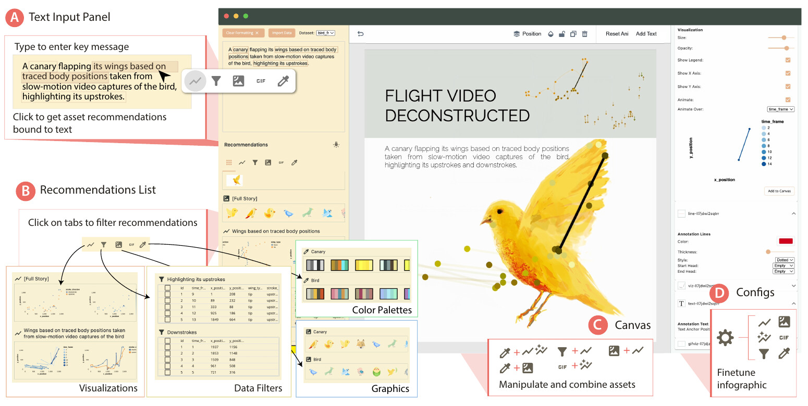
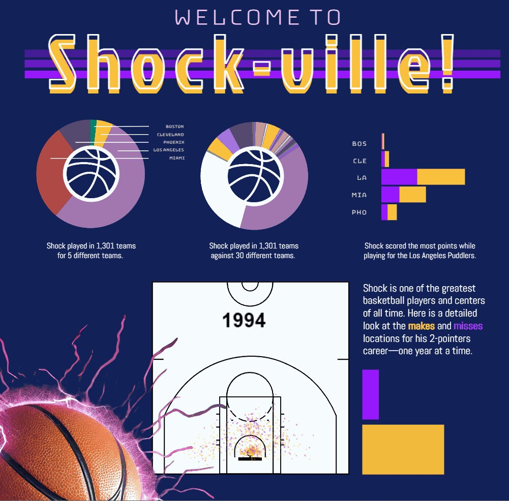
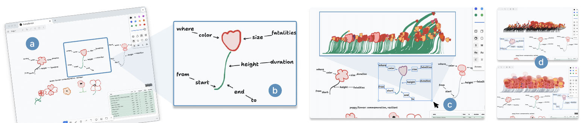

+++
author = "Yuichi Yazaki"
title = "Why Did the Tools That Draw First and Bind Data Later Never Become Products? Adobe's Five Prototypes"
slug = "adobe-unreleased-infographic-tools"
date = "2026-11-04"
description = "Between 2016 and 2025, Adobe announced at least five infographics tools in which you draw shapes and then bind data to them. None became a product, and Adobe has not publicly explained why."
categories = [
    "consume"
]
tags = [
    "Adobe",
    "infographics",
    "Data Illustrator",
    "Project Lincoln",
    "Adobe Sneaks"
]
image = "images/lincoln-oceans-seven-poster.jpg"
+++

Between 2016 and 2025, Adobe announced at least five infographics authoring tools in which you draw shapes and bind data to them: Data-Driven Guides, Project Lincoln, Data Illustrator, Project Infograph It (the paper is called Epigraphics), and CompSketch. None of them has become a product. Adobe has not publicly explained why. All it says officially is that Sneaks technologies are not buyable now, and that the more popular a feature is, the better its chance of reaching a product.

The sources are four papers (IEEE InfoVis 2016; ACM CHI 2018, 2024 and 2025), articles from the Adobe Blog and Adobe Research, posts by the tools' authors, and Google Patents records. Below, I follow the five tools in order of year, and at the end write what the primary sources allow us to say about "why."

<!--more-->

## 2016: Drawing Rulers from Data — Data-Driven Guides

Data-Driven Guides (DDG) was presented at IEEE InfoVis 2016. The lead author was Nam Wook Kim, then a doctoral student at Harvard, and the work came out of his internship at Adobe Research. Four researchers from Adobe Research joined him, including Zhicheng (Leo) Liu and Mira Dontcheva.

The idea is to make "guides" from data. A guide is an auxiliary line whose value becomes the length of a line or the area of a circle as it is.

> Instead of being confined by predefined templates or marks, designers can generate guides from data and use the guides to draw, place and measure custom shapes.

In short: free from templates, designers can use guides to draw, place and measure their own shapes. When the data changes, the shapes deform around the guides as a skeleton.

Source: Nam Wook Kim et al. (original figure by Nigel Holmes), Fig. 1 of the paper "Data-Driven Guides"

In the evaluation, many participants asked "when can we use this?" The paper says that most of the limitations lay in the "maturity of the tool," and Kim's page describes the prototype as an "experimental prototype." As of November 4, 2026, the host of the prototype does not resolve.

## 2017–2018: Draw First, Bind Later — Project Lincoln and Data Illustrator

In October 2017, at the Sneaks of Adobe MAX (a stage for showing technology in development), Bernard Kerr of Adobe Design Lab presented Project Lincoln. This is how the Adobe Blog (2018-01-03) describes it.

> Rather than starting with a tool that grabs data and spits out a visualization, #ProjectLincoln's tools give designers the power to sketch first and then bind these shapes to data.

In short: instead of producing a figure from data, you bind shapes you drew first to data. The post goes on to say that size, color, position and text can be bound.

Source: thumbnail of Adobe Creative Cloud / YouTube, "#ProjectLincoln: Adobe MAX 2017 (Sneak Peeks)"

The subject was marathon swimmer Kim Chambers's crossings of seven channels. In under four minutes, Kerr made 14 visualizations and combined them into a poster. The mechanism for lining them up borrows Adobe XD's Repeat Grid. The demo can be watched on [YouTube](https://www.youtube.com/watch?v=lX1BBMyY1bc).

Source: Adobe / Adobe Blog, "Peek Behind the Sneaks: #ProjectLincoln"

Half a year later, at CHI 2018, the Data Illustrator paper received a Best Paper award. The lead author is Liu of Adobe Research; researchers from Georgia Tech are co-authors, and so is Kerr. There are two operations. Repeat duplicates a shape and maps it to rows of data; partition divides a shape so that each part carries its own data.

Source: Zhicheng Liu et al., Table 2 of the paper "Data Illustrator"

Binding is done afterward, property by property of a shape (lazy data binding). Only the bound properties are locked; the rest can be moved by hand.

Source: Zhicheng Liu et al., Figure 10 of the paper "Data Illustrator"

Data Illustrator was released as a free web app, and v1.1 (2018-05-30) still runs on a University of Maryland server. In December 2018, co-author John Thompson answered in a Google Group:

> Data Illustrator is currently a research prototype supported by a small, dedicated team of researchers.

In short: it is a research prototype from a small research team. He goes on to say that it is not an ordinary commercial product with a roadmap to show its users. Liu left Adobe in 2020 and moved to the University of Maryland.

Lincoln and Data Illustrator overlap in co-authors, in Repeat Grid, and in the idea of "drawing first." They can be read as two ways of presenting a current that came out of the same company, but no primary source explains the relationship.

## 2024–2025: From a Sentence, From a Sketch — Epigraphics and CompSketch

In March 2024, Project Infograph It was shown at the Sneaks of Adobe Summit. Tongyu Zhou, a doctoral student at Brown University, built it during an internship in the summer of 2023. The paper is Epigraphics at CHI 2024 (Best Paper Honorable Mention).

The starting point is not a shape but the sentence you want to convey (the epigraph). When you select part of the sentence, GPT-3.5 picks columns and builds a Vega-Lite chart, then recommends imagery, filtering, color schemes and animation.

Source: Tongyu Zhou, Jeff Huang, Gromit Yeuk-Yin Chan, Figure 1 of the paper "Epigraphics" (arXiv)

Source: Adobe Research, "An innovative summer project landed this Adobe Research intern on the SUMMIT stage" (first frame of the GIF)

The above is an example Zhou showed at Summit. The Sneak can be watched on [YouTube](https://www.youtube.com/watch?v=XSMO9-7pcq8). The paper lists as a limitation participants' comments that it cannot be tuned as finely as Illustrator or Figma, and it says the approach could also become a plugin for existing tools. Zhou became a full-time Adobe Research employee in 2025 and still works on this technology (article of 2026-09-01).

In April 2025, the University of Waterloo and Adobe Research presented CompSketch in a short paper at CHI 2025. You sketch several alternatives side by side and bind columns to the appearance of glyphs with arrows. A data-bound preview appears only for the part enclosed with a lasso. I could not confirm a public tool.

Source: Xinyu Shi et al., Figure 1 of the paper "Comprehensive Sketching"

Here are the five, lined up by what the data is bound to.

| Tool | Starting point | What the data is bound to | How it is bound |
|---|---|---|---|
| Data-Driven Guides | Guides made from data | Length, area, position | Shapes drawn along the guides deform |
| Project Lincoln | Drawn shapes | Size, color, position, text | Bound to columns and lined up with Repeat Grid |
| Data Illustrator | Drawn shapes | Color, height, position of anchor points, etc. | After repeat/partition, pick a column and an aggregation for each property |
| Epigraphics | The sentence to convey | Chart, imagery, color scheme, motion | Candidates are recommended from part of the sentence |
| CompSketch | Multiple sketches | Color, size and height of glyphs | Bound with arrows and previewed with a lasso |

## Why Did They Not Become Products?

The official roundup of the Lincoln session (Adobe Blog, 2017-10-20) positions Sneaks like this:

> None of these technologies are currently buyable or incorporated into an Adobe app ... if certain potential features are popular, there's a stronger chance they make it into Adobe products.

In short: they cannot be bought now, and the more popular a feature is, the better its chance of reaching a product. That is as far as Adobe writes about it. In this research, I found no material in which either Adobe or Kerr explains why the tools were not turned into products. From 2019 to 2023, posts asking about the status continued on Adobe Community and elsewhere, but I could find no reply from Adobe.

Three other things can be said.

- **The author of Data Illustrator himself calls it a research prototype.** He does not mention any plan by Adobe to productize it.
- On October 9, 2017, an administrator of Illustrator's feature-request board asked users whether the graph feature should be "a separate app dedicated to graphs, or built inside Illustrator." The name Lincoln does not appear.
- US 10,290,128, a patent by Adobe inventors including Liu (covering nested containers that hold layouts), lapsed in 2023 for non-payment of maintenance fees according to the Google Patents record. No reason is given. Its content can be read as corresponding to Data Illustrator's nested layouts.

As speculation and hearsay: a volunteer expert on Adobe Community, prefacing it with "as far as i'm informed," wrote that there was no agreement inside the company on whether to make it a standalone product or a part of Illustrator (March 2021; no source is given). The post was recommending a third-party plugin, Datylon.

Separately, eight researchers including Liu and Thompson wrote a self-assessment of three systems, Lyra, Data Illustrator and Charticulator, in "Critical Reflections on Visualization Authoring Systems" at IEEE VIS 2019.

> We acknowledge that these priorities likely hindered the adoption of these deployed systems to some extent.

In short: prioritizing expressiveness and novelty probably hindered the adoption of the research versions they released. This is about adoption, not an explanation of why the tools were not made into products. That no reason is given can be read as consistent with the Sneaks positioning of "depends on popularity."

## How Did Third Parties See It?

- Andy Kirk (2017-10-24) wrote that Lincoln was a "potential tool and not product," and judged that whether it becomes a product depends on whether it gets serious attention inside the company.
- Lisa Charlotte Rost (2018-10-18) wrote that it was "a bit weird" that Data Illustrator appeared seven months after Lincoln, saying the two are unrelated yet do almost the same thing. No basis is given, and she notes that she works at Datawrapper.
- Datylon, a company that makes chart plugins, relays voices saying Illustrator's built-in chart tools are too basic. It is also advertising for its own product.

For comparison, Microsoft's Charticulator (InfoVis 2018) is released under the MIT license and can export to Power BI custom visuals. DataToon (CHI 2019), whose paper can be read on the Microsoft Research site, is research on creating data comics from network data.

## How to Use This

The "what the data is bound to" column in the table above can serve as a checklist for making figures by hand. Write down first which column is bound to which property of which shape. Do not move the bound properties by hand, and draw everything else freely. That is the idea behind Data Illustrator's lazy data binding.

Data Illustrator still runs free at v1.1, so trying repeat and partition will give you a feel for "draw first, bind later."

The other point is not to build your work on Sneaks or research versions. Adobe itself writes that they are "not buyable now." If you build something into your workflow, choose a product, or something whose source is public such as Charticulator. What those of us who want to use these tools can do is, as Adobe's own words put it, give feedback.

## References

**Primary sources**

- Adobe Blog, "Peek Behind the Sneaks: #ProjectLincoln— Super Powered Data Visualization," 2018-01-03. [Adobe Blog](https://blog.adobe.com/en/publish/2018/01/03/peek-behind-sneaks-projectlincoln-super-powered-data-visualization)
- Adobe Blog, "Top 11 Tech Sneak Peeks from MAX 2017 that Wow'ed," 2017-10-20. [Adobe Blog](https://blog.adobe.com/en/publish/2017/10/20/top-tech-sneak-peeks-max-2017-that-wowed)
- YouTube, "#ProjectLincoln: Adobe MAX 2017 (Sneak Peeks) | Adobe Creative Cloud." [YouTube](https://www.youtube.com/watch?v=lX1BBMyY1bc)
- YouTube, "#ProjectInfographIt | Adobe Summit Sneaks 2024 | Adobe." [YouTube](https://www.youtube.com/watch?v=XSMO9-7pcq8)
- Adobe Research, "Adobe Research Shares Future Tech in Sneaks." [Adobe Research](https://research.adobe.com/video/adobe-research-shares-future-tech-in-sneaks/)
- Adobe Research, "Adobe Research at Summit 2024," 2024-04-12. [Adobe Research](https://research.adobe.com/news/adobe-research-at-summit-2024/)
- Adobe Research, "An innovative summer project landed this Adobe Research intern on the SUMMIT stage," 2024-07-15. [Adobe Research](https://research.adobe.com/news/adobe-research-interns-work-featured-on-the-summit-stage/)
- Adobe Research, "Adobe Research intern follows her mentor's footsteps onto the Adobe Summit stage," 2026-09-01. [Adobe Research](https://research.adobe.com/news/adobe-research-intern-follows-her-mentors-footsteps/)
- Illustrator UserVoice, "Improve Graph / Chart tool" (administrator reply 2017-10-09, among others). [UserVoice](https://illustrator.uservoice.com/forums/333657-illustrator-feature-requests/suggestions/31150012-improve-graph-chart-tool)
- Nam Wook Kim, Eston Schweickart, Zhicheng Liu, Mira Dontcheva, Wilmot Li, Jovan Popović, Hanspeter Pfister, "Data-Driven Guides: Supporting Expressive Design for Information Graphics," *IEEE TVCG* 23(1), 2017 (InfoVis 2016). [PDF](https://www.zcliu.cs.umd.edu/ddg/DDG-InfoVis16.pdf) / [Adobe Research](https://research.adobe.com/publication/data-driven-guides-supporting-expressive-design-for-information-graphics/) / [Project page](https://ddg.namwkim.org/)
- Information is Beautiful Awards 2017, Data-Driven Guides. [IIB](https://www.informationisbeautifulawards.com/showcase/2575)
- Zhicheng Liu, John Thompson, Alan Wilson, Mira Dontcheva, James Delorey, Sam Grigg, Bernard Kerr, John Stasko, "Data Illustrator: Augmenting Vector Design Tools with Lazy Data Binding for Expressive Visualization Authoring," CHI 2018. [doi:10.1145/3173574.3173697](https://doi.org/10.1145/3173574.3173697) / [PDF](https://data-illustrator.cs.umd.edu/papers/DataIllustratorCHI18.pdf)
- Data Illustrator (site, About, release notes). [Site](https://data-illustrator.cs.umd.edu/) / [About](https://data-illustrator.cs.umd.edu/about.php) / [Versions](https://data-illustrator.cs.umd.edu/versions.php)
- John Thompson's reply, Google Groups "Data Illustrator," 2018-12-17. [Google Groups](https://groups.google.com/g/data-illustrator/c/Sat9ZkAxZeU)
- Zhicheng Liu's personal page and CV. [Personal page](https://www.zcliu.cs.umd.edu/) / [CV](https://www.zcliu.cs.umd.edu/CV_Liu.pdf)
- Patents US 10,096,139 B2 / US 10,290,128 B2 (Google Patents). [US10096139B2](https://patents.google.com/patent/US10096139B2/en) / [US10290128B2](https://patents.google.com/patent/US10290128B2/en)
- Arvind Satyanarayan, Bongshin Lee, Donghao Ren, Jeffrey Heer, John Stasko, John Thompson, Matthew Brehmer, Zhicheng Liu, "Critical Reflections on Visualization Authoring Systems," IEEE VIS 2019. [PDF](https://hdi.cs.umd.edu/papers/Reflections_VIS19.pdf)
- Tongyu Zhou, Jeff Huang, Gromit Yeuk-Yin Chan, "Epigraphics: Message-Driven Infographics Authoring," CHI 2024. [arXiv:2404.10152](https://arxiv.org/abs/2404.10152)
- Xinyu Shi et al., "Comprehensive Sketching: Exploring Infographic Design Alternatives in Parallel," CHI 2025 Extended Abstracts. [PDF](https://xinyu-shi.github.io/uploads/CompSketch.pdf) / [Adobe Research](https://research.adobe.com/publication/comprehensive-sketching-exploring-infographic-design-alternatives-in-parallel/)
- Charticulator (GitHub). [GitHub](https://github.com/microsoft/charticulator)
- DataToon. [Site](https://datatoon.github.io/)

**Secondary sources**

- Andy Kirk, "Adobe sneak peak: Project Lincoln," *Visualising Data*, 2017-10-24. [Visualising Data](https://visualisingdata.com/2017/10/adobe-sneak-peak-project-lincoln/)
- Lisa Charlotte Rost (Muth), "One Chart, Nine Tools – Revisited," 2018-10-18. [Article](https://lisacharlottemuth.com/datavistools-revisited)
- Datylon, "Data visualization within Adobe Illustrator." [Datylon](https://www.datylon.com/blog/data-visualization-within-adobe-illustrator)
- Adobe Community, "Project Lincoln - status?" (2019–2023, posts by users and volunteers). [Adobe Community](https://community.adobe.com/questions-652/project-lincoln-status-767256)
- Creative Bloq (Julia Sagar), 2017-10-20. [Creative Bloq](https://www.creativebloq.com/news/new-tool-gives-designers-data-visualisation-super-powers)
- TechCrunch (Frederic Lardinois), 2017-10-19. [TechCrunch](https://techcrunch.com/2017/10/19/adobe-wants-to-let-you-draw-data-visualizations-by-letting-you-draw-data-visualizations/)
