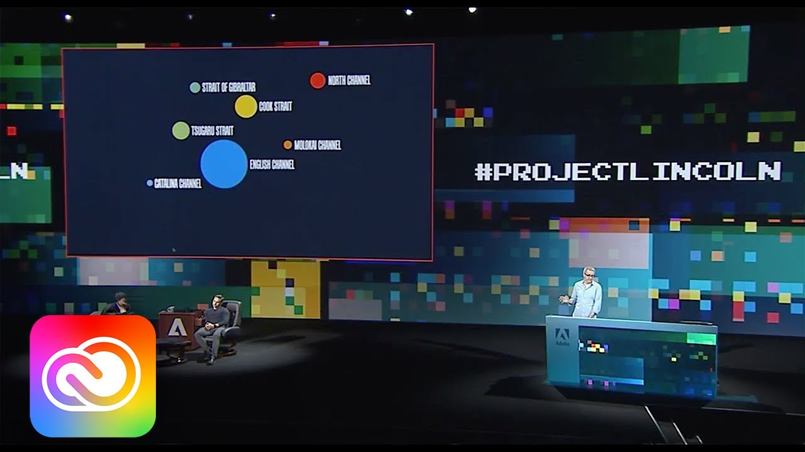
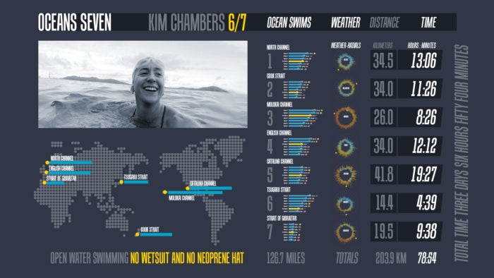
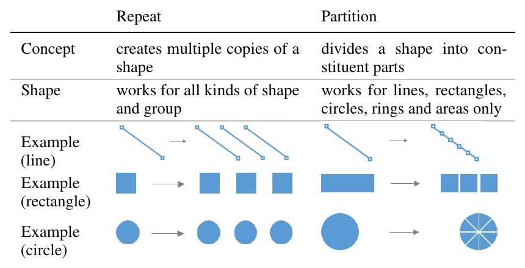
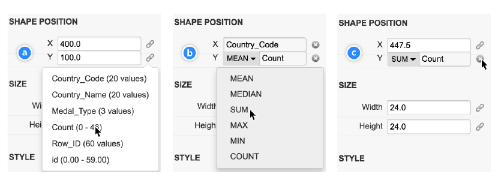
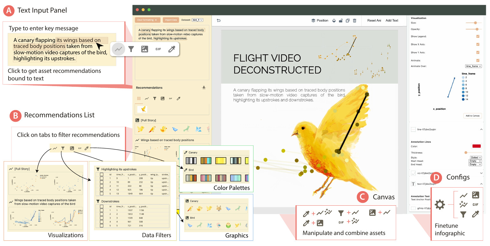
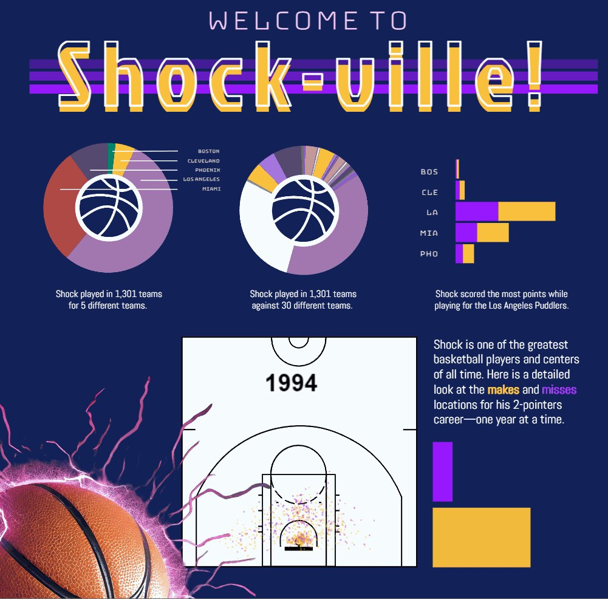
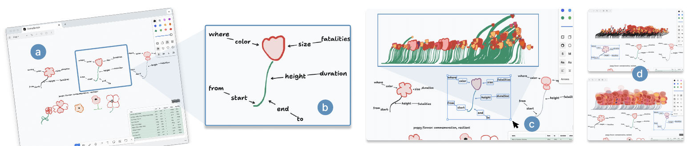

+++
author = "矢崎裕一"
title = "先に描いてデータを対応づける道具は、なぜ製品にならなかったのか──アドビの5つの試作"
slug = "adobe-unreleased-infographic-tools"
date = "2026-11-04"
description = "アドビは2016〜2025年に、図形を描いてデータを対応づけるインフォグラフィックス作成ツールを少なくとも5つ発表しましたが、どれも製品になっていません。理由は公に説明されていません。"
categories = [
    "consume"
]
tags = [
    "Adobe",
    "インフォグラフィックス",
    "Data Illustrator",
    "Project Lincoln",
    "Adobe Sneaks"
]
image = "images/lincoln-oceans-seven-poster.jpg"
+++

アドビは2016年から2025年にかけて、図形を描いてデータを対応づけるインフォグラフィックス作成ツールを、少なくとも5つ発表しました。Data-Driven Guides、Project Lincoln、Data Illustrator、Project Infograph It（論文名は Epigraphics）、CompSketch です。どれも製品にはなっていません。アドビはその理由を公に説明しておらず、公式に書いているのは「Sneaks の技術はいまは買えず、人気が出れば製品に入る可能性が上がる」という位置づけだけです。

出典は、4本の論文（IEEE InfoVis 2016、ACM CHI 2018・2024・2025）、Adobe Blog と Adobe Research の記事、作者の書き込み、Google Patents の記録です。以下、年の順に5つを追い、最後に一次情報で言える範囲で「なぜ」を書きます。

<!--more-->

## 2016年、データから定規を引く──Data-Driven Guides

Data-Driven Guides（DDG）は IEEE InfoVis 2016 で発表されました。筆頭は Harvard の博士課程にいた Nam Wook Kim で、Adobe Research でのインターンの研究です。Zhicheng (Leo) Liu、Mira Dontcheva ら4人が Adobe Research から加わっています。

データから「ガイド」を作るのが考え方です。ガイドは補助線で、値がそのまま線の長さや円の面積になっています。

> Instead of being confined by predefined templates or marks, designers can generate guides from data and use the guides to draw, place and measure custom shapes.

テンプレートに縛られず、ガイドを使って自分の図形を描き、置き、測れる、という要旨です。データが変わると、ガイドを骨組みに図形が変形します。

Nam Wook Kim ほか（元の図は Nigel Holmes）／論文「Data-Driven Guides」Fig. 1 より引用

評価では、参加者の多くが「いつ使えるのか」と尋ねました。論文は限界の多くが「ツールの成熟度」にあったと書き、Kim のページは試作版を "experimental prototype" と断っています。試作版のホストは、2026年11月4日時点で名前解決できません。

## 2017〜2018年、先に描いて、あとからデータを対応づける──Project Lincoln と Data Illustrator

2017年10月、Adobe MAX の Sneaks（開発中の技術を見せるステージ）で、Adobe Design Lab の Bernard Kerr が Project Lincoln を披露しました。Adobe Blog（2018-01-03）の説明です。

> Rather than starting with a tool that grabs data and spits out a visualization, #ProjectLincoln's tools give designers the power to sketch first and then bind these shapes to data.

データから図を出すのではなく、先に描いた図形にデータを対応づける、という要旨です。大きさ、色、位置、テキストにデータを対応づけられると続きます。

Adobe Creative Cloud／YouTube「#ProjectLincoln: Adobe MAX 2017 (Sneak Peeks)」のサムネイルより引用

題材は、マラソンスイマー Kim Chambers の7つの海峡横断でした。Kerr は4分足らずで14枚の可視化を作り、ポスターにまとめます。並べる仕組みは Adobe XD の Repeat Grid を借りています。デモは [YouTube](https://www.youtube.com/watch?v=lX1BBMyY1bc) で見られます。

Adobe／Adobe Blog「Peek Behind the Sneaks: #ProjectLincoln」より引用

半年後、CHI 2018 で Data Illustrator の論文が Best Paper を受けます。筆頭は Adobe Research の Liu で、Georgia Tech の研究者と、Kerr も共著者です。操作は二つあります。repeat は図形を複製してデータの行に対応させ、partition は図形を分割して部品ごとにデータを持たせます。

Zhicheng Liu ほか／論文「Data Illustrator」Table 2 より引用

対応づけは、図形の性質ごとに後から行います（lazy data binding）。対応づけた性質はロックされ、ほかは手で動かせます。

Zhicheng Liu ほか／論文「Data Illustrator」Figure 10 より引用

Data Illustrator は無料の Web アプリとして公開され、v1.1（2018-05-30）がいまもメリーランド大学のサーバーで動きます。2018年12月、共著者の John Thompson は Google グループでこう答えました。

> Data Illustrator is currently a research prototype supported by a small, dedicated team of researchers.

小さな研究チームの研究用プロトタイプだ、という要旨です。利用者に示せるロードマップを持つ、ふつうの営利製品ではない、とも続けています。Liu は2020年にアドビを辞め、メリーランド大学に移りました。

Lincoln と Data Illustrator は、共著者も Repeat Grid も「先に描く」発想も重なります。同じ社内の流れから出た二つの見せ方だと読めますが、関係を説明した一次情報はありません。

## 2024〜2025年、一文から、スケッチから──Epigraphics と CompSketch

2024年3月、Adobe Summit の Sneaks で Project Infograph It が披露されました。Brown 大学の博士課程の Tongyu Zhou が、2023年夏のインターンで作ったものです。論文は CHI 2024 の Epigraphics（Best Paper Honorable Mention）です。

出発点は図形ではなく、伝えたい一文（epigraph）です。文の一部を選ぶと、GPT-3.5 が列を選んで Vega-Lite のグラフを作り、図像、絞り込み、配色、アニメーションを推薦します。

Tongyu Zhou, Jeff Huang, Gromit Yeuk-Yin Chan／論文「Epigraphics」（arXiv）Figure 1 より引用

Adobe Research／Adobe Research「An innovative summer project landed this Adobe Research intern on the SUMMIT stage」より引用（GIF の最初のコマ）

上は Zhou が Summit で見せた作例です。Sneak は [YouTube](https://www.youtube.com/watch?v=XSMO9-7pcq8) で見られます。論文は、Illustrator や Figma ほど細かく調整できないという参加者の声を限界に挙げ、既存ツールのプラグインにもなりうると書いています。Zhou は2025年に Adobe Research の正社員になり、この技術にいまも取り組んでいます（2026-09-01 の記事）。

2025年4月には、ウォータールー大学と Adobe Research が CompSketch を CHI 2025 の短い論文で発表しました。複数の案を並べてスケッチし、矢印で列とグリフの見た目を対応づけます。投げ縄で囲んだ部分だけ、データを対応づけたプレビューが出ます。公開ツールは確認できません。

Xinyu Shi ほか／論文「Comprehensive Sketching」Figure 1 より引用

5つの対応づけ先を並べます。

| ツール | 出発点 | データの対応づけ先 | 対応づけ方 |
|---|---|---|---|
| Data-Driven Guides | データから作るガイド | 長さ・面積・位置 | ガイドに沿って描いた図形が変形する |
| Project Lincoln | 描いた図形 | 大きさ・色・位置・テキスト | 列を対応づけ、Repeat Grid で並べる |
| Data Illustrator | 描いた図形 | 色・高さ・アンカーポイントの位置など | repeat／partition の後、性質ごとに列と集計を選ぶ |
| Epigraphics | 伝えたい一文 | グラフ・図像・配色・動き | 文の一部から候補を推薦する |
| CompSketch | 複数のスケッチ | グリフの色・大きさ・高さ | 矢印で対応づけ、投げ縄でプレビューする |

## なぜ製品にならなかったのか

Lincoln が出た回の公式まとめ（Adobe Blog、2017-10-20）は、Sneaks をこう位置づけています。

> None of these technologies are currently buyable or incorporated into an Adobe app ... if certain potential features are popular, there's a stronger chance they make it into Adobe products.

いまは買えず、人気が出れば製品に入る可能性が上がる、という要旨です。製品にしなかった理由についてアドビが書いているのは、ここまでです。今回の調査では、アドビも Kerr も、製品にしなかった理由を説明した資料は見つかりませんでした。2019〜2023年に Adobe Community などで状況を尋ねる投稿が続きましたが、アドビ側の回答は見当たりません。

ほかに言えることは次の3つです。

- **Data Illustrator は、作者自身が研究用プロトタイプだと言っています。** アドビの製品化の計画には触れていません。
- 2017年10月9日、Illustrator の要望掲示板の管理者は「グラフ専用の別アプリか、Illustrator の中に作るか」を利用者に尋ねています。Lincoln の名前は出てきません。
- Liu らアドビの発明者による特許 US 10,290,128（入れ子のコンテナにレイアウトを持たせる内容）は、Google Patents の記録では2023年に維持費の不払いで失効しています。理由は書かれていません。Data Illustrator の入れ子のレイアウトにあたる内容と読めます。

推測・伝聞としては、Adobe Community のボランティアのエキスパートが、"as far as i'm informed" と前置きして、社内で独立製品にするか Illustrator の一部にするかの合意がなかったと書いています（2021年3月、情報源は示されていない）。他社のプラグイン Datylon を勧める投稿でした。

これとは別に、Liu と Thompson を含む研究者8人は IEEE VIS 2019 の「Critical Reflections on Visualization Authoring Systems」で、Lyra、Data Illustrator、Charticulator の3つについて自己評価を書いています。

> We acknowledge that these priorities likely hindered the adoption of these deployed systems to some extent.

表現力と新しさを優先したことが、公開した研究版の普及を妨げたのだろう、という要旨です。これは普及の話で、製品にしなかった理由の説明ではありません。理由が語られないこと自体は、「人気次第」という Sneaks の位置づけと矛盾しない、と読めます。

## 第三者はどう見たか

- Andy Kirk（2017-10-24）は Lincoln を "potential tool and not product" と書き、製品になるかは社内で本気の注目を得られるかしだいだと見ました。
- Lisa Charlotte Rost（2018-10-18）は、Lincoln の7か月後に Data Illustrator が出たことを "a bit weird" と書き、両者は関係ないのにほぼ同じ働きだとしています。根拠は書かれておらず、本人は Datawrapper 勤務だと断っています。
- グラフプラグインの会社 Datylon は、Illustrator 標準のグラフツールは基本的すぎるという声を紹介しています。自社の宣伝でもあります。

比較すると、Microsoft の Charticulator（InfoVis 2018）は MIT ライセンスで公開され、Power BI のカスタムビジュアルに書き出せます。Microsoft Research のサイトで論文が読める DataToon（CHI 2019）は、ネットワークのデータコミックを作る研究です。

## 使い道

上の表の「データの対応づけ先」は、手で図を作るときの確認表になります。どの列をどの図形のどの性質に対応づけるかを先に書き出し、その性質は手で動かさない。Data Illustrator の lazy data binding の考え方です。

無料で動く Data Illustrator v1.1 で repeat と partition を試すと、この感覚がつかめます。

もう一つは、Sneaks や研究版を仕事の前提にしないことです。アドビ自身が「いまは買えない」と書いています。作業に組み込むなら、製品か、Charticulator のようにソースが公開されたものを選ぶ。使いたい側にできるのは、反応を返すことです。

## 参考・出典

**一次情報**

- Adobe Blog「Peek Behind the Sneaks: #ProjectLincoln— Super Powered Data Visualization」2018-01-03. [Adobe Blog](https://blog.adobe.com/en/publish/2018/01/03/peek-behind-sneaks-projectlincoln-super-powered-data-visualization)
- Adobe Blog「Top 11 Tech Sneak Peeks from MAX 2017 that Wow'ed」2017-10-20. [Adobe Blog](https://blog.adobe.com/en/publish/2017/10/20/top-tech-sneak-peeks-max-2017-that-wowed)
- YouTube「#ProjectLincoln: Adobe MAX 2017 (Sneak Peeks) | Adobe Creative Cloud」. [YouTube](https://www.youtube.com/watch?v=lX1BBMyY1bc)
- YouTube「#ProjectInfographIt | Adobe Summit Sneaks 2024 | Adobe」. [YouTube](https://www.youtube.com/watch?v=XSMO9-7pcq8)
- Adobe Research「Adobe Research Shares Future Tech in Sneaks」. [Adobe Research](https://research.adobe.com/video/adobe-research-shares-future-tech-in-sneaks/)
- Adobe Research「Adobe Research at Summit 2024」2024-04-12. [Adobe Research](https://research.adobe.com/news/adobe-research-at-summit-2024/)
- Adobe Research「An innovative summer project landed this Adobe Research intern on the SUMMIT stage」2024-07-15. [Adobe Research](https://research.adobe.com/news/adobe-research-interns-work-featured-on-the-summit-stage/)
- Adobe Research「Adobe Research intern follows her mentor's footsteps onto the Adobe Summit stage」2026-09-01. [Adobe Research](https://research.adobe.com/news/adobe-research-intern-follows-her-mentors-footsteps/)
- Illustrator UserVoice「Improve Graph / Chart tool」（管理者回答 2017-10-09 ほか）. [UserVoice](https://illustrator.uservoice.com/forums/333657-illustrator-feature-requests/suggestions/31150012-improve-graph-chart-tool)
- Nam Wook Kim, Eston Schweickart, Zhicheng Liu, Mira Dontcheva, Wilmot Li, Jovan Popović, Hanspeter Pfister, "Data-Driven Guides: Supporting Expressive Design for Information Graphics," *IEEE TVCG* 23(1), 2017（InfoVis 2016）. [PDF](https://www.zcliu.cs.umd.edu/ddg/DDG-InfoVis16.pdf) / [Adobe Research](https://research.adobe.com/publication/data-driven-guides-supporting-expressive-design-for-information-graphics/) / [プロジェクトページ](https://ddg.namwkim.org/)
- Information is Beautiful Awards 2017, Data-Driven Guides. [IIB](https://www.informationisbeautifulawards.com/showcase/2575)
- Zhicheng Liu, John Thompson, Alan Wilson, Mira Dontcheva, James Delorey, Sam Grigg, Bernard Kerr, John Stasko, "Data Illustrator: Augmenting Vector Design Tools with Lazy Data Binding for Expressive Visualization Authoring," CHI 2018. [doi:10.1145/3173574.3173697](https://doi.org/10.1145/3173574.3173697) / [PDF](https://data-illustrator.cs.umd.edu/papers/DataIllustratorCHI18.pdf)
- Data Illustrator（サイト、About、リリースノート）. [サイト](https://data-illustrator.cs.umd.edu/) / [About](https://data-illustrator.cs.umd.edu/about.php) / [Versions](https://data-illustrator.cs.umd.edu/versions.php)
- John Thompson の回答、Google グループ「Data Illustrator」2018-12-17. [Google グループ](https://groups.google.com/g/data-illustrator/c/Sat9ZkAxZeU)
- Zhicheng Liu の個人ページと CV. [個人ページ](https://www.zcliu.cs.umd.edu/) / [CV](https://www.zcliu.cs.umd.edu/CV_Liu.pdf)
- 特許 US 10,096,139 B2 / US 10,290,128 B2（Google Patents）. [US10096139B2](https://patents.google.com/patent/US10096139B2/en) / [US10290128B2](https://patents.google.com/patent/US10290128B2/en)
- Arvind Satyanarayan, Bongshin Lee, Donghao Ren, Jeffrey Heer, John Stasko, John Thompson, Matthew Brehmer, Zhicheng Liu, "Critical Reflections on Visualization Authoring Systems," IEEE VIS 2019. [PDF](https://hdi.cs.umd.edu/papers/Reflections_VIS19.pdf)
- Tongyu Zhou, Jeff Huang, Gromit Yeuk-Yin Chan, "Epigraphics: Message-Driven Infographics Authoring," CHI 2024. [arXiv:2404.10152](https://arxiv.org/abs/2404.10152)
- Xinyu Shi ほか, "Comprehensive Sketching: Exploring Infographic Design Alternatives in Parallel," CHI 2025 Extended Abstracts. [PDF](https://xinyu-shi.github.io/uploads/CompSketch.pdf) / [Adobe Research](https://research.adobe.com/publication/comprehensive-sketching-exploring-infographic-design-alternatives-in-parallel/)
- Charticulator（GitHub）. [GitHub](https://github.com/microsoft/charticulator)
- DataToon. [サイト](https://datatoon.github.io/)

**第三者評価**

- Andy Kirk, "Adobe sneak peak: Project Lincoln," *Visualising Data*, 2017-10-24. [Visualising Data](https://visualisingdata.com/2017/10/adobe-sneak-peak-project-lincoln/)
- Lisa Charlotte Rost（Muth）, "One Chart, Nine Tools – Revisited," 2018-10-18. [記事](https://lisacharlottemuth.com/datavistools-revisited)
- Datylon, "Data visualization within Adobe Illustrator." [Datylon](https://www.datylon.com/blog/data-visualization-within-adobe-illustrator)
- Adobe Community「Project Lincoln - status?」（2019〜2023、利用者とボランティアの書き込み）. [Adobe Community](https://community.adobe.com/questions-652/project-lincoln-status-767256)
- Creative Bloq（Julia Sagar）, 2017-10-20. [Creative Bloq](https://www.creativebloq.com/news/new-tool-gives-designers-data-visualisation-super-powers)
- TechCrunch（Frederic Lardinois）, 2017-10-19. [TechCrunch](https://techcrunch.com/2017/10/19/adobe-wants-to-let-you-draw-data-visualizations-by-letting-you-draw-data-visualizations/)
