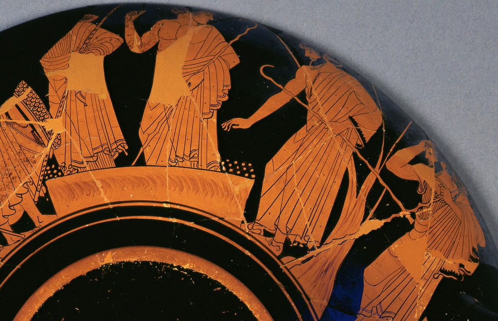
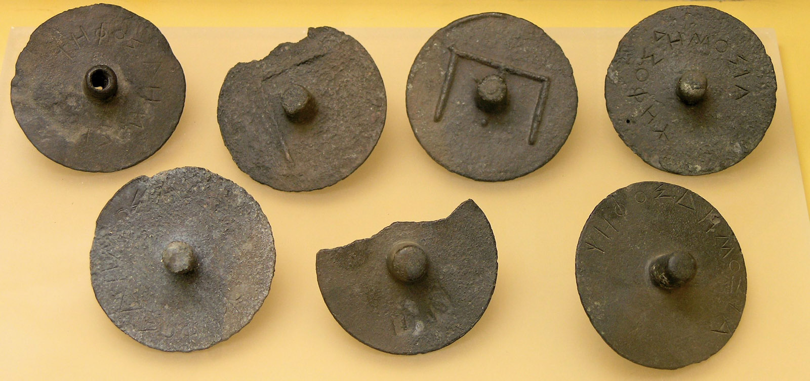
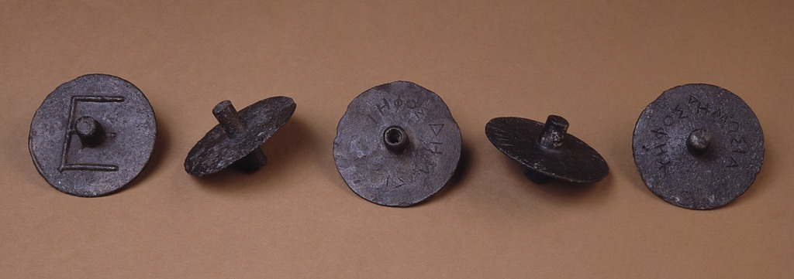
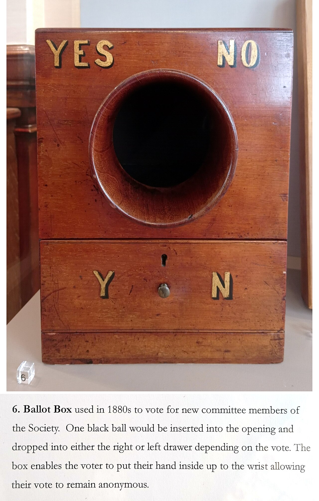
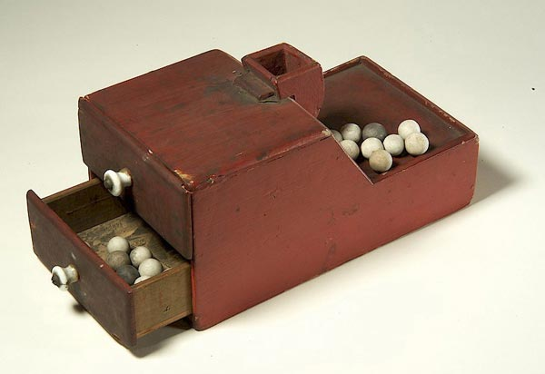

+++
author = "Yuichi Yazaki"
title = "Hollow or Solid Stems Sorted the Votes, and a Counting Board Laid Them Out: Voting Tokens in Athenian Courts"
slug = "ancient-pebble-voting"
date = "2026-11-03"
description = "In the Athenian courts of the 4th century BC, bronze voting tokens separated plaintiff from defendant by whether the stem was hollow or solid. At the count, the tokens were set into a reckoning-board, rearranged so that they could be seen clearly and counted easily."
categories = [
    "consume"
]
tags = [
    "data physicalization",
    "voting",
    "ancient Greece"
]
image = "images/bronze-ballots-agora-museum.jpg"
series = ["data-physicalization"]
series_weight = 2
seriesByline = "Courts of Ancient Athens"
seriesTitle = "Sorting Votes by Hollow or Solid Stems, Laid on a Board: Pebble Voting"
+++

In the Athenian courts of the 4th century BC, bronze voting tokens separated plaintiff from defendant by whether the stem was hollow or solid. At the count, the tokens were set into a reckoning-board and rearranged into a form that was "visible and easy to count." This procedure appears in chapters 68–69 of *The Constitution of the Athenians* (*Athenaion Politeia*), attributed to Aristotle (or his school).

The case-collection site dataphys.org lists it as "500 BC – Pebble Voting." But this is not the work of a single author: it is an entry that bundles together 5th-century BC vase painting and courts, 4th-century BC courts, and the ballot boxes of modern societies. The dataphys.org description, "a white pebble meant yes and a black pebble meant no," cannot be found in *The Constitution of the Athenians*, in Boegehold, in the Getty's commentary, or in the Agora records. What follows reads the sources one by one, following *The Constitution of the Athenians*, the records of the objects excavated in the Agora, the cup in the Getty Museum, and the 1963 paper by Alan L. Boegehold.

<!--more-->

## A Cup with Two Mounds of Pebbles

The oldest source is a red-figure kylix (wine cup), 86.AE.286, in the J. Paul Getty Museum. It was made in Athens, is attributed to the Brygos Painter, and dates to around 490 BC. One side of the exterior shows the quarrel between Ajax and Odysseus; the other shows the Greek leaders voting with stones.

Source: J. Paul Getty Museum (86.AE.286), from Getty, "Voting with the Ancient Greeks"

> The number of pebbles on Ajax's side, at right, falls short of the more politically savvy Odysseus's by one, causing Ajax to grasp his head in despair.

The Getty's commentary takes the dots on either side of the pedestal to be two mounds of stones, one for Odysseus and one for Ajax. The mound on the right, Ajax's, is one short, and Ajax clutches his head. One pebble was one vote; which mound it sat in stood for the candidate, and the size of the mound stood for the number of votes.

Boegehold saw the distinctive feature of such scenes in the fact that pebbles are used and yet no secrecy is kept at all. The pebbles are simply "counting stones," which can be counted slowly and accurately after everyone has voted, an advantage that shouts and show of hands do not have. This is his reading. He also writes, however, that it would be rash to claim that the painter copied the procedure of the time in every detail.

In the 5th-century BC courts, a juror held a single pebble (or shell) and put it into one of two urns, one for the plaintiff and one for the defendant (Boegehold; Getty). The vote was distinguished by position: which urn it went into. The contents of the urn were emptied onto a board and counted.

## Hiding the Stem Hole Under the Fingers

In the 4th century BC, the voting tokens used in the courts changed into bronze discs. Boegehold dates the court described in *The Constitution of the Athenians* to "around 325 B.C." The description is in chapter 68 (Kenyon translation).

> The ballot balls are made of brass with stems running through the centre, half of them having the stem pierced and the other half solid.

A stem runs through the center; half of the tokens have a stem with a hole through it, hollow, and the other half have a solid stem. Hollow meant a vote for the plaintiff, solid a vote for the defendant.

Source: Marsyas (Wikimedia Commons contributor), Ancient Agora Museum of Athens, from Wikimedia Commons, "AGMA Jetons vote.jpg" (CC BY-SA 2.5)

Actual specimens have come out of the Agora in Athens. In the excavation records, B 728 is hollow with a diameter of 0.063 m, and B 1055 is solid with a diameter of 0.065 m. B 1055 bears the inscription "ΨΗΦΟΣ ΔΗΜΟΣΙΑ" on its face. According to Boegehold, all the published tokens are dated to the 4th century BC on the basis of letter forms.

Photo: Craig Mauzy. Source: American School of Classical Studies at Athens: Agora Excavations, "Agora Image 2007.10.0080" (© ASCSA)

The photograph shows, from left, B 1056, B 146, B 728, B 1058, and B 1055. The discs look almost the same; only the inside of the stem differs.

> the juror, taking his two ballot balls from the stand, with his hand closed over the stem so as not to show either the pierced or the solid ballot to the litigants, casts the one which is to count into the brazen urn, and the other into the wooden urn.

The procedure is this: the juror receives two tokens and, keeping the stem covered by his hand so that the litigants see nothing, drops the one that is to count into the bronze urn and the other into the wooden urn. The hole in the lid of the bronze urn admitted only one token, so that no one could put in two (Rackham translation).

dataphys.org describes these tokens as ones "whose difference could only be felt by touch." The center of the design can be read as **making the tokens look alike and hiding the difference under the fingers**. Because both tokens always go into one urn or the other, the hand's movement does not reveal the choice either, which can also be read from the procedure.

## Setting the Tokens into a Counting Board and Laying Them Out

The counting procedure is in chapter 69 (Rackham translation).

> empty it out on to a reckoning-board with as many holes in it as there are pebbles, in order that they may be set out visibly and be easy to count, and that the perforated and the whole ones may be clearly seen by the litigants.

The contents of the bronze urn are emptied onto a reckoning-board with as many holes as there are tokens. The explanation is that this lets them be set out clearly and counted easily, and lets the litigants clearly see the hollow ones and the solid ones.

According to Boegehold, on the board the stem is pushed into a hole and keeps the disc from falling. He calls this "a second function" of the tokens' peculiar shape. The stem is the place that hides the type of vote at the time of voting, and at the count it becomes the foot that stands the token on the board.

The counting was done by jurors chosen by lot. A herald announced the totals; the side with more votes won, and a tie went to the defendant. Penalties were decided by the same method, with a second vote in which hollow stood for the plaintiff's proposal and solid for the defendant's. The number of jurors was normally 201, 401, or 501 (Boegehold). If several hundred tokens are sorted into hollow and solid and stood in the holes, the two totals can be compared by the lengths of the rows; this is a reading.

The table below summarizes, source by source, how data corresponds to the properties of objects.

| Scene (source) | Data | Property of the object | How it is read |
|---|---|---|---|
| Cup of around 490 BC (Getty) | Votes per candidate | Position (which mound) and size of the mound | Compare the two mounds |
| 5th-century BC courts (Boegehold, Getty) | Plaintiff or defendant | Position (which urn) | Empty onto a board and count |
| 4th-century BC courts, voting (ch. 68) | Plaintiff or defendant | Shape (stem hollow or solid), hidden by the fingers | The counted token goes into the bronze urn |
| 4th-century BC courts, counting (ch. 69) | Number of plaintiff and defendant votes | Arrangement stood in the holes of the counting board | Sort, lay out, and announce the totals |
| *Metamorphoses*, book 15 | Guilty or not guilty | Color (white = not guilty, black = guilty) | Empty the urn and count |
| Society ballot boxes (Mackey) | Admit or not | Color (white ball = yes, black ball or black cube = no) | Whether even one black is present |
| RPSL ballot box (late 19th century) | Yes or no | Position (left and right drawers); black balls only | Open the drawers and count |

In the 4th-century BC courts, the difference in shape is hidden at the vote and laid out in view at the count. This can be read as a design that switches the encoding of the same vote to a different way of showing at each stage.

## White Pebbles and Black Balls Come from Other Sources

### Ovid's White and Black Pebbles

The dataphys.org entry says "a white pebble meant "yes" and a black pebble meant "no"." But a description of telling votes apart by color appears in none of *The Constitution of the Athenians*, Boegehold, the Getty's commentary, or the Agora records.

White and black pebbles appear in Roman-era Latin poetry, in Ovid's *Metamorphoses*, book 15.

> Mos erat antiquus niveis atrisque lapillis, / his damnare reos, illis absolvere culpa

The line says that there was an old custom of using white and black pebbles, black to condemn the accused and white to acquit. It comes from the story of the trial of Myscelus of Argos, in which a black stone in the urn is changed to white by divine power. The meaning is "guilty / not guilty," not "yes / no." The explanation in circulation seems closer to something a Roman poem told as an old custom of Argos; this is a reading.

Furthermore, votes in the Assembly were normally taken by show of hands (χειροτονία) (Carbon et al.). Pebble voting was not voting in general.

### A Society's Box Is Checked for "Clear" or "Foul," Not Counted

Voting by putting white and black balls into a box belongs to later societies and clubs. The Encyclopedia Masonica, which carries the text of Mackey's encyclopedia, writes that lodges voted with white and black balls, and that some Grand Lodges also admitted black cubes. The box was divided into two compartments, and its opening was built so that the hand could not be seen.

At the count, the Senior Deacon shows the box to the Junior Warden, the Senior Warden, and the Master in that order, and each reports either "the box is clear" or "the box is foul." If there is no black at all it is clear; if there is even one it is foul. What is read is not the number of votes but whether any black is mixed in. Regulation VI of the General Regulations in the 1723 edition of the *Constitutions of the Free-Masons* provides that no one is to be admitted without the unanimous consent of the members present, but does not specify balls or a box.

Source: Photo by Philafrenzy, Royal Philatelic Society London collection, from Wikimedia Commons, "Royal Philatelic Society London committee voting box 1880s" (CC BY-SA 4.0)

The box of the Royal Philatelic Society London (RPSL) from the late 19th century was used to elect committee members. According to the Society's description, a Victorian box normally had one drawer into which white (yes) or black (no) balls were put, to be counted later. This box uses only black balls, and the vote is divided by whether the ball is dropped into the left or the right drawer. The opening is large enough to admit a hand up to the wrist.

Source: Smithsonian National Museum of American History (exhibition "Vote: The Machinery of Democracy"), from Wikimedia Commons, "Ballotboxballs.jpg" (public domain)

dataphys.org writes that when the box was opened, everyone could see the result at once. In Mackey's procedure, the box is viewed by three officers and the result is conveyed orally. When the white-and-black-ball box began is also something that the sources used here could not establish.

## How Third Parties Have Seen This Voting

Boegehold's 1963 paper placed the pebble first as a tool for counting, before it was a tool for secrecy.

> the men who first conceived of polling an assembly needed to have an accurate count before the more sophisticated notion of perverting the count occurred to them.

His conclusion is that the people who first thought of taking a vote needed an accurate count before the more elaborate idea of corruption occurred to them. He also notes that the 5th-century BC "two urns and one pebble" and the 4th-century BC "two tokens and two urns" have been confused.

The 2026 paper by Carbon, Isager, and Pedersen states that accurate vote counts seem to have come only from secret ballots in which the votes were counted. The Assembly normally voted by show of hands, and cases in which vote counts survive in inscriptions are few, mostly from the Hellenistic period onward. To the view that the pebble was a "countable vote," they add a limit on the settings in which it was used.

Annelisa Stephan of the Getty introduced the cup in a 2012 article as "one of the earliest depictions of voting in art." She also notes that the pebble, *psephos*, is the root of *psephology* (the study of elections), and that *ballot* comes from the medieval French *ballotte* (a small ball).

## Uses

The first is assigning a single vote a different way of showing at each stage. What was needed at the time of voting was secrecy, and the discs looked the same. What was needed at the time of counting was an appearance that the litigants could accept, and the same discs were stood on a board and laid out. This can be read as an example of changing the property used between input and display.

The second is choosing the form to suit the task of reading. The counting board is an arrangement for comparing two numbers, and the society's box is built to judge "is even one black present?" In data physicalization too, deciding first what the viewer is to judge makes it easier to decide whether to use color, position, or shape.

The third is checking where a well-known explanation comes from. "White means yes, black means no" seems to be told in a way that overlaps not with Athenian sources but with a Roman poem (guilty / not guilty) and with the white and black balls of later societies. Writing about an old case by separating which period and which source it comes from keeps one from mixing up the correspondence between the properties of objects and their meanings.

## References

**Primary sources**

- Aristotle, *The Constitution of the Athenians*, ch. 68 (Rackham translation, Perseus): https://www.perseus.tufts.edu/hopper/text?doc=Perseus%3Atext%3A1999.01.0046%3Achapter%3D68
- Same, ch. 69 (Rackham translation, Perseus): https://www.perseus.tufts.edu/hopper/text?doc=Perseus%3Atext%3A1999.01.0046%3Achapter%3D69
- Same (Kenyon translation, MIT Internet Classics Archive): https://classics.mit.edu/Aristotle/athenian_const.mb.txt
- American School of Classical Studies at Athens, Agora Excavations, B 728: https://agora.ascsa.net/id/agora/object/b%20728
- Same, B 1055: https://agora.ascsa.net/id/agora/object/b%201055
- Same, Agora Image 2007.10.0080 (photo by Craig Mauzy): https://agora.ascsa.net/id/agora/image/2007.10.0080
- J. Paul Getty Museum, "Wine Cup with the Suicide of Ajax" (86.AE.286, Google Arts & Culture): https://artsandculture.google.com/asset/wine-cup-with-the-suicide-of-ajax/tAEB2kodFlg3DA?hl=en (object page: https://www.getty.edu/art/collection/object/103W7A )
- Ovid, *Metamorphoses*, book 15 (Latin, Perseus): https://www.perseus.tufts.edu/hopper/text?doc=Perseus%3Atext%3A1999.02.0029%3Abook%3D15%3Acard%3D1 (English translation: https://www.perseus.tufts.edu/hopper/text?doc=Perseus%3Atext%3A1999.02.0028%3Abook%3D15%3Acard%3D1 )
- *The Constitutions of the Free-Masons*, 1723 edition, General Regulations VI (full text): https://distantreader.org/stacks/trust/uc2/uc2_ark+=13960=t6ww7bd0n.txt
- Encyclopedia Masonica (text of Mackey's encyclopedia), "Ballot": https://www.universalfreemasonry.org/en/entry/ballot
- Same, "Ballot-box": https://www.universalfreemasonry.org/en/entry/ballot-box
- Royal Philatelic Society London, "The Ballot Box": https://www.rpsl.org.uk/Museum/Explore/U3A-Project/emodule/798/egallery/28
- dataphys.org, "500 BC – Pebble Voting" (added by Pierre Dragicevic): https://dataphys.org/list/visualizing-opinions-with-pebbles/
- Wikimedia Commons, "AGMA Jetons vote.jpg" (Marsyas (contributor), CC BY-SA 2.5): https://commons.wikimedia.org/wiki/File:AGMA_Jetons_vote.jpg
- Wikimedia Commons, "Royal Philatelic Society London committee voting box 1880s.jpg" (Philafrenzy, CC BY-SA 4.0): https://commons.wikimedia.org/wiki/File:Royal_Philatelic_Society_London_committee_voting_box_1880s.jpg
- Wikimedia Commons, "Ballotboxballs.jpg" (public domain): https://commons.wikimedia.org/wiki/File:Ballotboxballs.jpg

**Secondary sources**

- Alan L. Boegehold, "Toward a Study of Athenian Voting Procedure," *Hesperia* 32(4), 1963, pp. 366–374: https://www.ascsa.edu.gr/uploads/media/hesperia/147360.pdf
- Jan-Mathieu Carbon, Signe Isager, Poul Pedersen, "Vote Counts, Quorum, and Unanimous Decisions at Halikarnassos," *C&M Supplementum* 4, 2026, pp. 177–201: https://tidsskrift.dk/classicaetmediaevalia/article/download/169641/210370/380240
- Annelisa Stephan, "Voting with the Ancient Greeks," Getty, 2012-11-06: https://www.getty.edu/news/voting-with-the-ancient-greeks/
- Wikipedia, "Blackballing" (as a supplement): https://en.wikipedia.org/wiki/Blackballing
