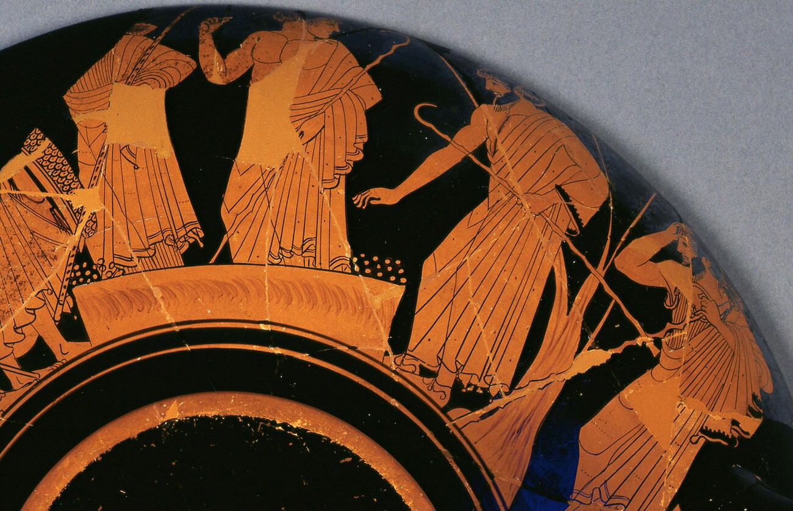
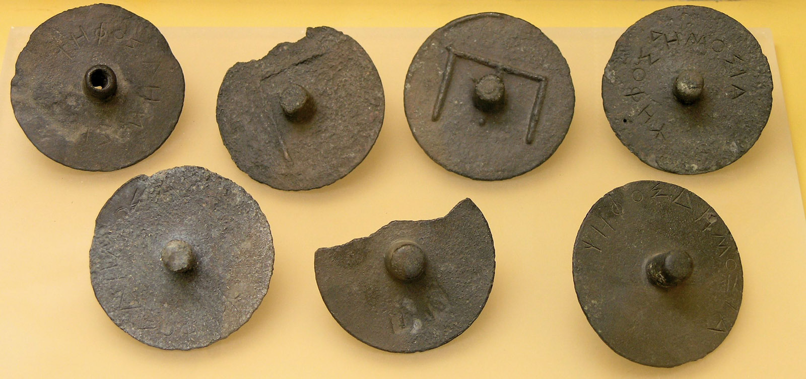
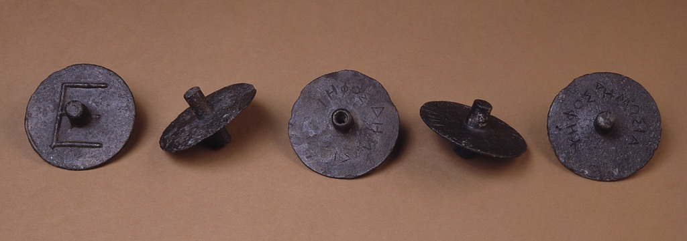
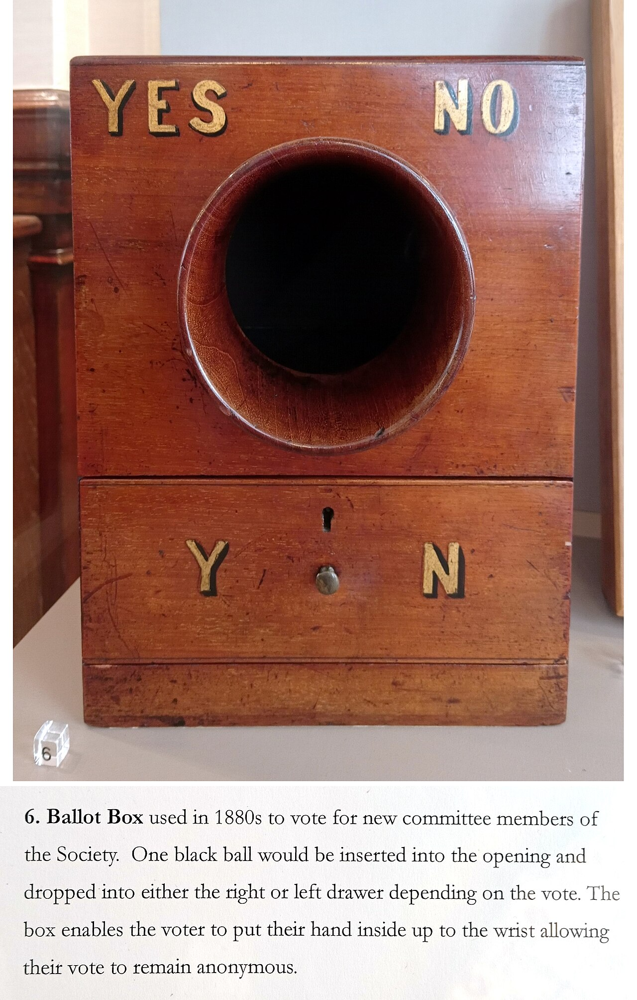
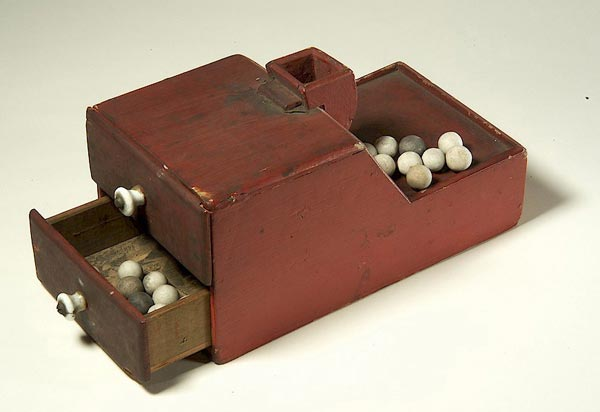

+++
author = "矢崎裕一"
title = "軸が中空か中実かで票を分け、計数盤に並べて数える──アテナイ法廷の投票具"
slug = "ancient-pebble-voting"
date = "2026-11-03"
description = "前4世紀アテナイの法廷では、青銅の投票具の軸が中空か中実かで原告と被告を分けました。開票では投票具を計数盤に差し込み、誰の目にもはっきり見え、数えやすい形に並べ直しました。"
categories = [
    "consume"
]
tags = [
    "データ物質化",
    "投票",
    "古代ギリシャ"
]
image = "images/bronze-ballots-agora-museum.jpg"
series = ["data-physicalization"]
series_weight = 2
seriesByline = "古代アテナイの法廷"
seriesTitle = "軸の穴で票を分け、盤に並べる──Pebble Voting"
+++

前4世紀アテナイの法廷では、青銅の投票具の軸が中空か中実かで、原告と被告を分けました。開票のときは、投票具を計数盤に差し込み、「誰の目にもはっきり見え、数えやすい」形に並べ直しました。アリストテレス（またはその学派）の『アテナイ人の国制』68〜69章にある手順です。

事例集 dataphys.org には「500 BC – Pebble Voting」として載っています。ただしこれは一人の作者の作品ではなく、前5世紀の陶器画と法廷、前4世紀の法廷、近代の結社の投票箱をまとめた項目です。dataphys.org の紹介文にある「白い小石が賛成、黒い小石が反対」という説明は、『アテナイ人の国制』、Boegehold、ゲティの解説、アゴラの記録のどれにも見当たりません。以下は『アテナイ人の国制』、アゴラ出土品の記録、ゲティ美術館の杯、Alan L. Boegehold（アラン・ボーゲホールド）の1963年の論文に沿い、資料ごとに分けて読みます。

<!--more-->

## 杯に描かれた、二つの小石の山

いちばん古い資料は、ゲティ美術館（J. Paul Getty Museum）所蔵の赤像式キュリクス（酒杯）、86.AE.286 です。アテナイ製で、Brygos Painter（ブリュゴスの画家）の作とされ、前490年ごろのものです。外側の一面にアイアスとオデュッセウスの口論が、もう一面に、ギリシャの将たちが石で投票する場面が描かれています。

J. Paul Getty Museum 所蔵（86.AE.286）／Getty「Voting with the Ancient Greeks」より引用

> The number of pebbles on Ajax's side, at right, falls short of the more politically savvy Odysseus's by one, causing Ajax to grasp his head in despair.

ゲティの解説は、台座の両脇の点を、オデュッセウスとアイアスのための二つの石の山だとしています。右のアイアス側が1個少なく、アイアスは頭を抱えている、という説明です。小石は1票1個で、どちらの山かが候補を、山の大きさが票数を表しています。

Boegehold は、こうした場面の特徴を、小石を使いながら秘密がまったく守られていない点に見ました。小石は単に「数え石」で、全員が入れたあとにゆっくり正確に数えられる。歓声や挙手にはない利点だ、という読みです。ただし、画家が当時の手続きを細部まで写したと言い張るのは軽率だ、とも書いています。

前5世紀の法廷では、陪審員は小石（または貝殻）を1個持ち、原告用と被告用の二つの壺のどちらかに入れました（Boegehold、ゲティ）。票の区別は、どちらの壺に入れたかという位置です。壺の中身は板の上にあけて数えました。

## 軸の穴を指で隠して入れる

前4世紀には、法廷の投票具が青銅の円盤に変わります。Boegehold は『アテナイ人の国制』の法廷を「around 325 B.C.」のものとしています。68章（Kenyon 訳）の説明です。

> The ballot balls are made of brass with stems running through the centre, half of them having the stem pierced and the other half solid.

中心を軸が貫き、半分は軸に穴が通った中空、残り半分は中実だ、という記述です。中空が原告、中実が被告への票でした。

Marsyas（Wikimedia Commons 投稿者）・アテネ古代アゴラ博物館所蔵／Wikimedia Commons「AGMA Jetons vote.jpg」より引用（CC BY-SA 2.5）

実物はアテネのアゴラから出ています。発掘記録では、B 728 は中空で直径 0.063 m、B 1055 は中実で直径 0.065 m です。B 1055 は表に「ΨΗΦΟΣ ΔΗΜΟΣΙΑ」の銘があります。Boegehold によれば、公刊された投票具はすべて字形から前4世紀と判断されています。

Craig Mauzy 撮影／American School of Classical Studies at Athens: Agora Excavations「Agora Image 2007.10.0080」より引用（© ASCSA）

写真は左から B 1056、B 146、B 728、B 1058、B 1055 です。円盤の見た目はほぼ同じで、違うのは軸の中だけです。

> the juror, taking his two ballot balls from the stand, with his hand closed over the stem so as not to show either the pierced or the solid ballot to the litigants, casts the one which is to count into the brazen urn, and the other into the wooden urn.

陪審員は2枚を受け取り、軸を手で覆って当事者に見せないまま、数に入れるほうを青銅の壺へ、もう一方を木の壺へ入れる、という手順です。青銅の壺の蓋の穴は1枚しか通らず、一人が2枚入れられないようになっていました（Rackham 訳）。

dataphys.org は、この投票具を「whose difference could only be felt by touch」と紹介しています。**見た目を揃え、違いを指の下に隠したこと**が設計の中心だと読めます。2枚とも必ずどちらかの壺に入るので、手の動きからも選択はわからない、と読めます。

## 計数盤に差し込み、並べて見せる

開票の手順は69章（Rackham 訳）にあります。

> empty it out on to a reckoning-board with as many holes in it as there are pebbles, in order that they may be set out visibly and be easy to count, and that the perforated and the whole ones may be clearly seen by the litigants.

投票具と同じ数の穴がある計数盤に、青銅の壺の中身をあける。はっきり並べて数えやすくし、中空と中実が当事者にはっきり見えるようにするためだ、という説明です。

Boegehold によれば、計数盤では軸を穴に差し、円盤が落ちるのを止めます。彼はこれを、投票具の独特な形の「a second function」と呼びました。軸は、投票では票の種類を隠す場所になり、開票では盤に立てる足になります。

数えるのは、くじで選ばれた陪審員です。触れ役が票数を告げ、多いほうが勝ち、同数なら被告の勝ちでした。量刑も同じ方法で、中空が原告の案、中実が被告の案として、もう一度投票しました。陪審員は通常201人、401人、501人です（Boegehold）。数百枚を中空と中実に分けて穴に立てれば、二つの数を並びの長さで見比べられる、と読めます。

資料ごとに、データと物の性質の対応をまとめます。

| 場面（資料） | データ | 物の性質 | 読み取り方 |
|---|---|---|---|
| 前490年ごろの杯（ゲティ） | 候補ごとの得票数 | 位置（どちらの山か）と山の大きさ | 二つの山を見比べる |
| 前5世紀の法廷（Boegehold、ゲティ） | 原告か被告か | 位置（どちらの壺か） | 板にあけて数える |
| 前4世紀の法廷・投票（68章） | 原告か被告か | 形（軸が中空か中実か）。指で隠す | 有効票は青銅の壺へ |
| 前4世紀の法廷・開票（69章） | 原告票と被告票の数 | 計数盤の穴に立てた並び | 分けて並べ、数を告げる |
| 『変身物語』15巻 | 有罪か無罪か | 色（白＝無罪、黒＝有罪） | 壺をあけて数える |
| 結社の投票箱（Mackey） | 入会の可否 | 色（白球＝賛成、黒球か黒い立方体＝反対） | 黒が一つでもあるか |
| RPSL の投票箱（19世紀末） | 賛成か反対か | 位置（左右の引き出し）。黒球だけ | 引き出しを開けて数える |

前4世紀の法廷は、投票では形の違いを隠し、開票では並べて見せています。同じ票の符号を、段階ごとに別の見せ方へ切り替えた設計だと読めます。

## 白い小石と黒い球は、別の資料から来ている

### オウィディウスの白と黒の小石

dataphys.org の項目は「a white pebble meant "yes" and a black pebble meant "no"」と書いています。しかし色で区別したという記述は、『アテナイ人の国制』、Boegehold、ゲティの解説、アゴラの記録のどれにもありません。

白と黒の小石が出てくるのは、ローマ時代のラテン詩、オウィディウスの『変身物語』15巻です。

> Mos erat antiquus niveis atrisque lapillis, / his damnare reos, illis absolvere culpa

白と黒の小石で、黒なら有罪、白なら無罪とする古い慣習があった、という詩句です。アルゴスの人ミュスケロスの裁判の話で、壺の黒い石が神の力で白に変わります。意味は「有罪／無罪」で、「賛成／反対」ではありません。流布している説明は、ローマの詩がアルゴスの昔の慣習として語ったものに近い、と読めます。

また、民会の採決は普通は挙手（χειροτονία）でした（Carbon ほか）。小石の投票は投票全般ではありません。

### 結社の箱は、数えずに「clear」か「foul」かを見る

白黒の球を箱に入れる投票は、のちの結社やクラブのものです。Mackey（マッキー）の百科事典の本文を載せた Encyclopedia Masonica は、ロッジが白と黒の球で投票し、黒い立方体を認める大ロッジもあったと書いています。箱は二つに仕切られ、受け口は手元が見えない作りでした。

開票では、Senior Deacon が箱を Junior Warden、Senior Warden、Master の順に見せ、それぞれが「the box is clear」か「the box is foul」と報告します。黒が一つもなければ clear、一つでもあれば foul です。読み取るのは票数ではなく、黒が混じっているかどうかです。1723年版『フリーメイソン憲章』の一般規定 VI は、その場の会員全員の同意なしに入会させないと定めていますが、球や箱は指定していません。

Philafrenzy 撮影・Royal Philatelic Society London 所蔵／Wikimedia Commons「Royal Philatelic Society London committee voting box 1880s」より引用（CC BY-SA 4.0）

ロンドン王立郵趣協会（RPSL）の19世紀末の箱は、委員の選出に使われました。協会の説明では、ヴィクトリア朝の箱は普通、引き出し一つに白（賛成）か黒（反対）の球を入れ、あとで数えました。この箱は黒い球だけを使い、左右どちらの引き出しに落とすかで賛否を分けます。開口部は手首まで入る大きさです。

Smithsonian National Museum of American History（展示「Vote: The Machinery of Democracy」）／Wikimedia Commons「Ballotboxballs.jpg」より引用（パブリックドメイン）

dataphys.org は、箱を開けると全員がすぐ結果を見られた、と書いています。Mackey の手順では、箱を見るのは三人の役職者で、結果は口頭で伝わります。白黒球の箱がいつ始まったかも、今回の資料では確かめられませんでした。

## 第三者はこの投票をどう見たか

Boegehold の1963年の論文は、小石を秘密の道具より先に、数える道具として位置づけました。

> the men who first conceived of polling an assembly needed to have an accurate count before the more sophisticated notion of perverting the count occurred to them.

票を取ることを思いついた人々には、不正という手の込んだ考えより先に、正確な票数が必要だった、という結論です。彼は、前5世紀の「二つの壺と1個の小石」と、前4世紀の「2枚の投票具と二つの壺」が混同されてきた、とも注記しています。

Carbon、Isager、Pedersen の2026年の論文は、正確な票数が出たのは票を数える秘密投票だけだったようだ、と述べます。民会は普通は挙手で、票数が碑文に残る例は少なく、多くはヘレニズム期以降だといいます。小石は「数えられる票」だった、という見方に、使われた場面の限定を加えています。

ゲティの Annelisa Stephan（アネリサ・ステファン）は2012年の記事で、杯を「one of the earliest depictions of voting in art」と紹介しました。小石 psephos が psephology（選挙学）の語源であり、ballot が中世フランス語の ballotte（小さな球）から来ていることにも触れています。

## 使い道

一つ目は、一つの票に、段階ごとに違う見せ方を割り当てることです。投票の時点で必要なのは秘密で、円盤は見た目が同じでした。開票の時点で必要なのは当事者が納得できる見え方で、同じ円盤を盤に立てて並べました。入力と表示で使う性質を変えた例として読めます。

二つ目は、読み取る課題に合わせて形を選ぶことです。計数盤は二つの数を比べるための並べ方で、結社の箱は「黒が一つでもあるか」を判定する作りです。データ物理化でも、見る人が何を判定するかを先に決めると、色・位置・形のどれを使うかが決めやすくなります。

三つ目は、よく知られた説明の出どころを確かめることです。「白は賛成、黒は反対」は、アテナイの資料ではなく、ローマの詩（有罪／無罪）や、のちの結社の白黒球と重なって語られているように読めます。古い事例は、どの時代のどの資料かを分けて書くと、物の性質と意味の対応を取り違えずに済みます。

## 参考・出典

**一次情報**

- アリストテレス『アテナイ人の国制』68章（Rackham 訳、Perseus）：https://www.perseus.tufts.edu/hopper/text?doc=Perseus%3Atext%3A1999.01.0046%3Achapter%3D68
- 同 69章（Rackham 訳、Perseus）：https://www.perseus.tufts.edu/hopper/text?doc=Perseus%3Atext%3A1999.01.0046%3Achapter%3D69
- 同（Kenyon 訳、MIT Internet Classics Archive）：https://classics.mit.edu/Aristotle/athenian_const.mb.txt
- American School of Classical Studies at Athens, Agora Excavations, B 728：https://agora.ascsa.net/id/agora/object/b%20728
- 同 B 1055：https://agora.ascsa.net/id/agora/object/b%201055
- 同 Agora Image 2007.10.0080（Craig Mauzy 撮影）：https://agora.ascsa.net/id/agora/image/2007.10.0080
- J. Paul Getty Museum, "Wine Cup with the Suicide of Ajax"（86.AE.286、Google Arts & Culture）：https://artsandculture.google.com/asset/wine-cup-with-the-suicide-of-ajax/tAEB2kodFlg3DA?hl=en （作品ページ：https://www.getty.edu/art/collection/object/103W7A ）
- オウィディウス『変身物語』15巻（ラテン語、Perseus）：https://www.perseus.tufts.edu/hopper/text?doc=Perseus%3Atext%3A1999.02.0029%3Abook%3D15%3Acard%3D1 （英訳：https://www.perseus.tufts.edu/hopper/text?doc=Perseus%3Atext%3A1999.02.0028%3Abook%3D15%3Acard%3D1 ）
- 『フリーメイソン憲章』1723年版、一般規定 VI（全文テキスト）：https://distantreader.org/stacks/trust/uc2/uc2_ark+=13960=t6ww7bd0n.txt
- Encyclopedia Masonica（Mackey の百科事典の本文）「Ballot」：https://www.universalfreemasonry.org/en/entry/ballot
- 同「Ballot-box」：https://www.universalfreemasonry.org/en/entry/ballot-box
- Royal Philatelic Society London, "The Ballot Box"：https://www.rpsl.org.uk/Museum/Explore/U3A-Project/emodule/798/egallery/28
- dataphys.org, "500 BC – Pebble Voting"（Pierre Dragicevic 追加）：https://dataphys.org/list/visualizing-opinions-with-pebbles/
- Wikimedia Commons, "AGMA Jetons vote.jpg"（Marsyas（投稿者）、CC BY-SA 2.5）：https://commons.wikimedia.org/wiki/File:AGMA_Jetons_vote.jpg
- Wikimedia Commons, "Royal Philatelic Society London committee voting box 1880s.jpg"（Philafrenzy、CC BY-SA 4.0）：https://commons.wikimedia.org/wiki/File:Royal_Philatelic_Society_London_committee_voting_box_1880s.jpg
- Wikimedia Commons, "Ballotboxballs.jpg"（パブリックドメイン）：https://commons.wikimedia.org/wiki/File:Ballotboxballs.jpg

**第三者評価**

- Alan L. Boegehold, "Toward a Study of Athenian Voting Procedure," *Hesperia* 32(4), 1963, pp.366–374：https://www.ascsa.edu.gr/uploads/media/hesperia/147360.pdf
- Jan-Mathieu Carbon, Signe Isager, Poul Pedersen, "Vote Counts, Quorum, and Unanimous Decisions at Halikarnassos," *C&M Supplementum* 4, 2026, pp.177–201：https://tidsskrift.dk/classicaetmediaevalia/article/download/169641/210370/380240
- Annelisa Stephan, "Voting with the Ancient Greeks," Getty, 2012-11-06：https://www.getty.edu/news/voting-with-the-ancient-greeks/
- Wikipedia「Blackballing」（補助として）：https://en.wikipedia.org/wiki/Blackballing
