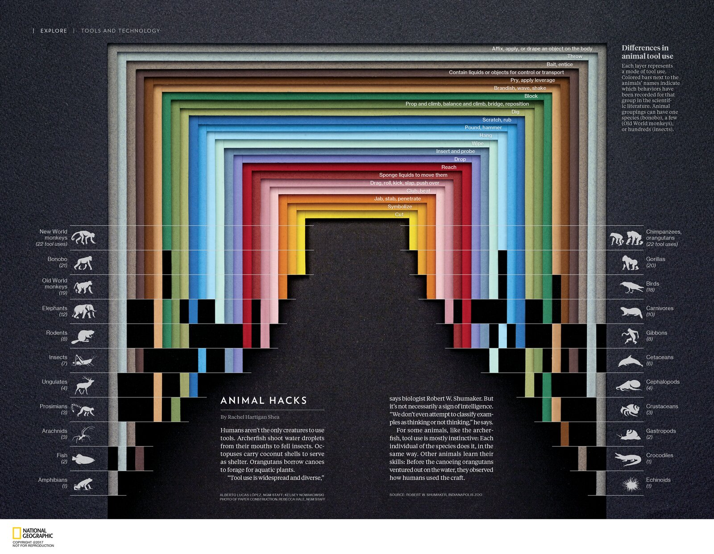
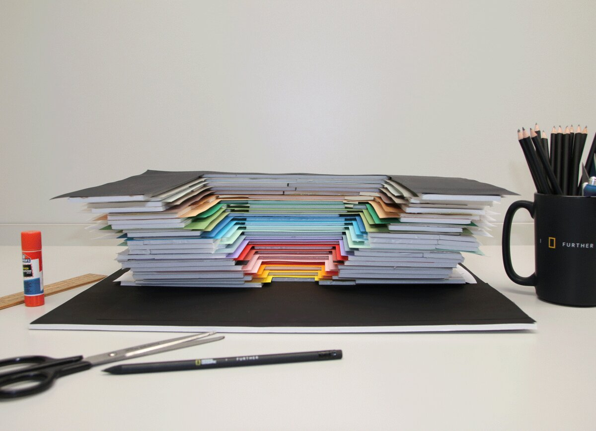
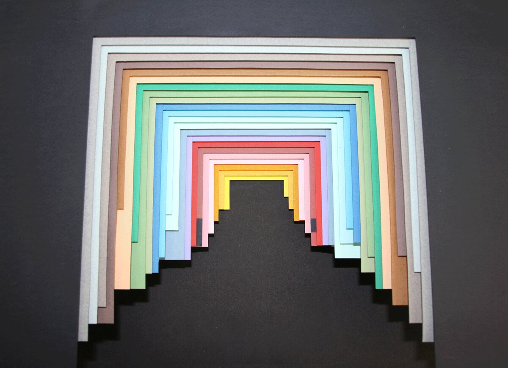
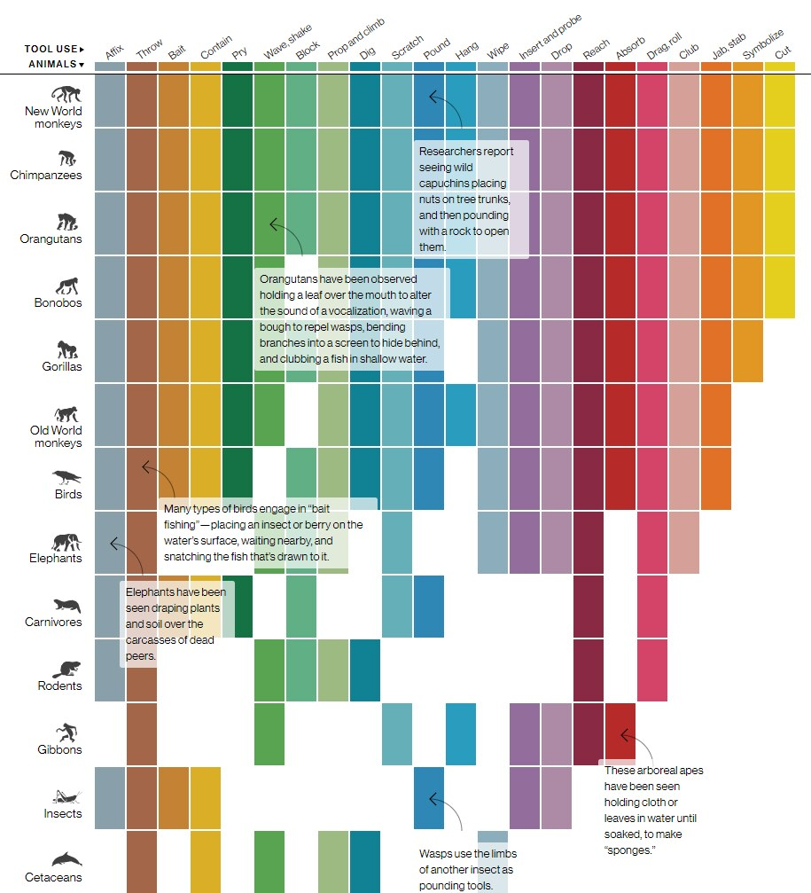

+++
author = "Yuichi Yazaki"
title = "Counting Animal Tool Use in Layers of Colored Paper: National Geographic's \"Animal Hacks\""
slug = "animal-hacks-paper-infographic"
date = "2026-11-01"
description = "A paper construction maps each mode of tool use to a layer of colored paper, and whether a mode has been recorded to whether the layer's leg is visible. The magazine's credit line names the photographer of the paper construction."
categories = [
    "consume"
]
tags = [
    "data physicalization",
    "infographic",
    "Alberto Lucas López",
    "National Geographic"
]
image = "images/magazine-spread.jpg"
series = ["data-physicalization"]
series_weight = 38
seriesByline = "Alberto Lucas López et al."
seriesTitle = "Counting in Layers of Colored Paper: Animal Hacks"
+++

"Animal Hacks" is a graphic that shows how animals use tools, built as a three-dimensional stack of colored paper. It maps 22 modes of tool use to layers of colored paper, and whether each animal group has a recorded instance to whether a layer's leg is visible or hidden. The magazine's credits list a photographer for the "photo of paper construction," and the author writes that he made the graphic with tools and real materials. It can be read that the photograph, overlaid with labels and text, became the printed graphic as it was. The paper model can be read as the raw material of the finished graphic, not a draft for it.

It ran in the March 2017 issue of *National Geographic Magazine*. The graphic was made by Alberto Lucas López and others. What follows draws on the magazine-spread image and description in the author's portfolio, the GIF of the making process, and the credit lines on the page. dataphys.org, which collects works of data physicalization, lists it under the name "Hand-Crafted Magazine Infographics."

<!--more-->

## A spread in the EXPLORE section, March 2017

The graphic appeared in the EXPLORE section of the March 2017 issue. The header band reads "TOOLS AND TECHNOLOGY" and the article is titled "ANIMAL HACKS." The text was written by Rachel Hartigan Shea. The graphic's title is "Differences in animal tool use."

Source: Alberto Lucas López, NGM Staff; Kelsey Nowakowski (graphic), Rebecca Hale, NGM Staff (photo of paper construction) © 2017 National Geographic Partners / Alberto Lucas López, "Animal tools"

The text begins with the point that humans are not the only ones who use tools.

> Humans aren't the only creatures to use tools. Archerfish shoot water droplets from their mouths to fell insects. Octopuses carry coconut shells to serve as shelter. Orangutans borrow canoes to forage for aquatic plants.

These are the examples of archerfish, octopuses, and orangutans. The text then quotes the biologist Robert W. Shumaker, "Tool use is widespread and diverse," and goes on to say that tool use is not necessarily a sign of intelligence.

Beneath the graphic there are two credit lines.

> ALBERTO LUCAS LÓPEZ, NGM STAFF; KELSEY NOWAKOWSKI / PHOTO OF PAPER CONSTRUCTION: REBECCA HALE, NGM STAFF

> SOURCE: ROBERT W. SHUMAKER, INDIANAPOLIS ZOO

Two names are listed as the graphic's authors, and Rebecca Hale's name appears as the photographer of the **"photo of paper construction."** This line shows that the paper model made it into the magazine. The sources do not say how the two authors divided their roles. López is a Spanish designer who, after serving as graphics director at the South China Morning Post, moved to National Geographic in 2016 as Senior Graphics Editor.

## 22 layers and 22 animal groups

The data is whether each animal group has a recorded mode of tool use in the scientific literature. There are 22 modes of use and 22 animal groups. The description on the page reads as follows.

> Each layer represents a mode of tool use. Colored bars next to the animals' names indicate which behaviors have been recorded for that group in the scientific literature. Animal groupings can have one species (bonobo), a few (Old World monkeys), or hundreds (insects).

Each layer stands for one mode of use, and the colored bars beside the animal names show the behaviors recorded for that group. A group may contain a single species or several hundred.

As the source of the data, the magazine names only Shumaker. The number 22 matches the "22 modes of tool use" classified in Shumaker, Walkup & Beck's *Animal Tool Behavior* (2011). The magazine does not cite the book, so it cannot be confirmed that the book's classification was used as is. Because the name and the number match, it can be read as likely based on this book.

The correspondence between the data and the appearance is as follows.

| Data | Appearance in paper and photo | How to check |
|---|---|---|
| Mode of tool use (22) | One layer of colored paper, cut out in a gate shape and nested. Color distinguishes the modes | Description on the page, magazine-spread image |
| Order of modes | From the outside of the layers to the inside. The outermost is Affix (attach to the body, wear), the innermost is Cut | Label positions in the magazine-spread image |
| Animal group (22) | A horizontal band (row). 11 groups each on the left and right. Icon and name, with the number of recorded modes in parentheses | Magazine-spread image |
| The mode is recorded | In that row, the leg (vertical color band) of that layer is visible | Description on the page |
| Not recorded | In that row, the leg of that layer is hidden in black | Magazine-spread image |
| Number of recorded modes | A numeric note and the number of color bands visible in the row | Magazine-spread image |
| Stacking of layers | White board-like spacers are placed between the sheets of colored paper to create steps and shadows | GIF of the making process |

The left column runs from New World monkeys (22) to Amphibians (1), and the right column from Chimpanzees, orangutans (22) to Echinoids (1), both in descending order of the number. The lower the row, the more black there is, and the dark area in the center appears to widen in steps.

The left leg of the gate is used as the column of the 11 groups on the left, and the right leg as the column of the 11 groups on the right. A single layer can be read as doubling as two columns, left and right. The order of the layers also shows a tendency. The outer layers appear to be modes recorded in many groups, and the inner layers appear to be modes found only in great apes and New World monkeys. In the Amphibians (1) row, only the outermost layer, Affix, reaches the bottom. The page gives no basis for this ordering. On the other hand, the steps and shadows of the layers do not represent quantity, and can be read as there to tell the layers apart.

## From paper on a desk to a magazine spread

The author's portfolio includes a 13-frame GIF of the making process. On March 24, 2017, the author tweeted the same GIF with the words "Handmade #dataviz."

The first frame shows the structure on a white desk, shot from the side. Colored paper and white spacers are stacked, with scissors, a pencil, a ruler, and a glue stick in front. A National Geographic mug is also in the frame.

Source: Alberto Lucas López, Kelsey Nowakowski (graphic), Rebecca Hale (photo of paper construction) © 2017 National Geographic Partners / Alberto Lucas López, from the making-process GIF of "Animal tools"

From there the camera moves to directly overhead. The gate-shaped layers nest and begin to look like a passage leading to the back. In the top-down frame, the tips of the legs have already been cut to uneven lengths. Roughly, the outer layers have longer legs and the inner layers shorter ones. On both sides the leg tips line up in steps.

Source: Alberto Lucas López, Kelsey Nowakowski (graphic), Rebecca Hale (photo of paper construction) © 2017 National Geographic Partners / Alberto Lucas López, from the making-process GIF of "Animal tools"

Each leg can be read as cut so that it reaches the lowest row among the groups in which that mode is recorded. In the next frame, a large black section is added beneath the legs. The sources do not confirm whether this black part is paper or was painted on the image.

In the frame after that, the layout carries labels and text, and the last frame shows the printed magazine spread. The paper construction was photographed and became the graphic itself. The order of the GIF and the credit lines suggest this reading.

The author himself writes this in his portfolio.

> To support the information shown, the infographic was made with tools and real materials, looking for a parallelism between the visual side and the exposed theme. This was the first papercraft infographic published in National Geographic Magazine.

In other words, he made the graphic with tools and real materials to set the visuals parallel to the theme, and it was the first papercraft infographic in the magazine. A graphic about animals' tools was made with scissors, a ruler, and glue.

## The same data, as a table on the web

The web version was published on February 15, 2017, under the title "The Tools Animals Use." The credits are Alberto Lucas Lopez and Kennedy Elliott. It shows the same "animal groups x 22 modes of use" data as a colored matrix.

Source: Alberto Lucas Lopez, Kennedy Elliott © National Geographic / Information is Beautiful Awards, "The Tools Animals Use"

The order of the columns runs from Affix to Cut, the same as the outside-to-inside order of the layers in the magazine. Chimpanzees and Orangutans, combined into one in the magazine, are split into separate rows in the web version.

Callouts add concrete examples. For instance, "Elephants have been seen draping plants and soil over the carcasses of dead peers." The magazine graphic includes no such examples; the text carries them instead.

The web version is a 2D table with columns and rows at right angles. The magazine version turns those columns into layers and the rows into bands, and makes it a photograph of a three-dimensional object. The structure of the data is the same, and it can be read as only the form being chosen anew to suit each medium.

There is also an example of researchers charting the same kind of data. The paper by Johnston et al. (*iScience*, 2020) used Shumaker et al.'s 22 classifications and made a black-and-white pixel table of animal groups x modes of use. Black is observed in the wild, gray is observed with human influence not ruled out, and white is no record. The table was used to estimate the order in which modes of use are acquired. The same type of data thus takes three forms, depending on purpose.

## How third parties saw this work

dataphys.org is an entry added by Aurélien Tabard and Pierre Dragicevic on April 30, 2017. It is classified as Passive physical visualization. The description reads as follows.

> Infographic designers at the National Geographic crafted a 3D physical visualization out of paper and colored cardboard in order to prepare a 2D infographic.

The summary says the 3D object was made of paper and colored cardboard in order to prepare a 2D graphic. Dragicevic also reposted the author's GIF on YouTube.

The phrase "in order to prepare" conflicts with the author-side materials. The magazine's credits list a "photo of paper construction," and the author writes that he made the graphic "with tools and real materials." The paper model can be read as the content of the graphic itself, not a stage before the 2D graphic. "Colored cardboard" also cannot be confirmed in the author-side materials, which say "papercraft," and the magazine says "paper construction."

Gestalten's profile of the author, "The Infographic Is Mightier Than The Sword," mentions it as a challenge in materials.

> He recently decided to create the magazine's first infographic using Kraft paper.

It then quotes López.

> If we are not willing to create content beyond what is conventional, we will end up killing journalism.

That is, if one is not willing to make something beyond the conventional, one ends up killing journalism. The article does not name the work. But because "the magazine's first paper infographic" matches the portfolio, it can be read as referring to this work.

At the Kantar Information is Beautiful Awards 2017, the web version "The Tools Animals Use" made the longlist in the Science, Technology & Health category. What was judged was the web version's matrix, not the paper magazine version.

## Takeaways

What this work offers is a way of treating a physical model as "material for the finished piece." A three-dimensional object may be built for prototyping, or it may be photographed and become the final graphic. In the latter case, even the steps and shadows of the paper reach the reader's eye as they are.

In that case, decide in advance which properties carry data and which do not. In "Animal Hacks," layers correspond to modes of use and whether a leg is visible corresponds to whether a mode is recorded, while depth and shadow can be read as left to the job of telling the layers apart.

The arrangement also seems to matter. The modes recorded in many groups appear to sit in the outer layers, and by ordering the groups from the largest number down, the unrecorded parts gather in the center and take the shape of a staircase.

Another point is matching theme and method. The author gave making a graphic about tools with tools as his reason for the expression. The same data is a table on the web and a photograph of paper in the magazine. It is an example of choosing the form anew for each medium.

Finally, the credits. The magazine prints the name of the person who photographed the paper construction alongside the graphic's authors. If a physical graphic is photographed and printed, the photography is part of making the graphic.

## References

**Primary sources**

- Alberto Lucas López, "Animal tools" (portfolio; description, magazine-spread image, making-process GIF, rights notice). [lucasinfografia.com](https://lucasinfografia.com/Animal-tools)
- Magazine-spread image "ANIMAL HACKS" (including the credit lines, source line, and description). [Image](https://payload.cargocollective.com/1/9/310126/13691133/Animal_Hacks_1000.png)
- Making-process GIF. [Image](https://payload.cargocollective.com/1/9/310126/13691133/Animal_hacks_GIF_1400.gif)
- Alberto Lucas López, "Handmade #dataviz. National Geographic Magazine - March, 2017," X (Twitter), 2017-03-24. [Post](https://twitter.com/aLucasLopez/status/845289828707192832)
- National Geographic, "The Tools Animals Use" (web version), 2017-02-15. [National Geographic](https://www.nationalgeographic.com/magazine/graphics/animal-tools)
- *National Geographic Magazine*, March 2017, "ANIMAL HACKS" (issue table of contents and article excerpt). [Zinio](https://www.zinio.com/publications/national-geographic-interactive/2820/issues/369764)
- Shumaker, R. W., Walkup, K. R., & Beck, B. B., *Animal Tool Behavior: The Use and Manufacture of Tools by Animals*, Johns Hopkins University Press, 2011. [Johns Hopkins University Press](https://press.jhu.edu/books/title/12826/animal-tool-behavior)

**Secondary sources**

- Aurélien Tabard & Pierre Dragicevic, "2017 – Hand-Crafted Magazine Infographics," List of Physical Visualizations, dataphys.org, 2017-04-30. [dataphys.org](https://dataphys.org/list/animal-hacks-hand-crafted-infographics/)
- Pierre Dragicevic, "animal hacks" (repost of the author's GIF), YouTube. [Video](https://www.youtube.com/watch?v=p1riHODVk2U)
- Gestalten, "The Infographic Is Mightier Than The Sword," Gestalten Journal. [Article](https://gestalten.com/blogs/journal/the-infographic-is-mightier-than-the-sword)
- Kantar Information is Beautiful Awards 2017, "The Tools Animals Use" (Science, Technology & Health category longlist). [Showcase](https://informationisbeautifulawards.com/showcase/1740-the-tools-animals-use)
- Johnston et al., "Data-Driven Inference Reveals Distinct and Conserved Dynamic Pathways of Tool Use Emergence across Animal Taxa," *iScience*, 2020. [doi:10.1016/j.isci.2020.101245](https://doi.org/10.1016/j.isci.2020.101245) / [PMC](https://pmc.ncbi.nlm.nih.gov/articles/PMC7306607/)
