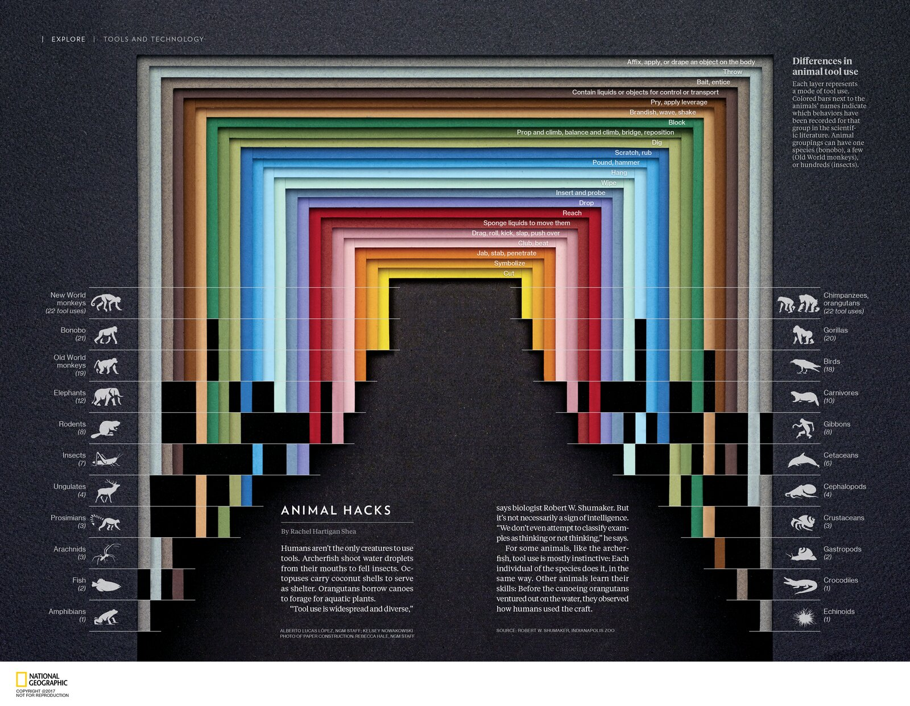
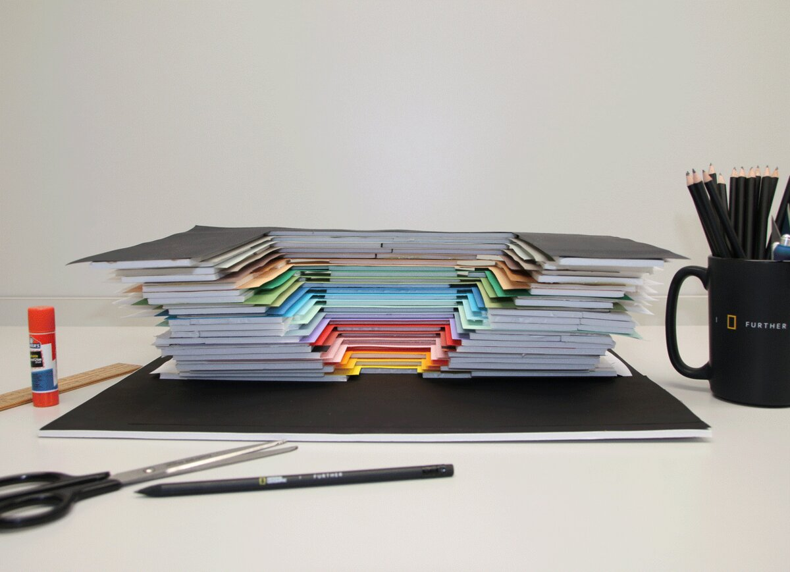
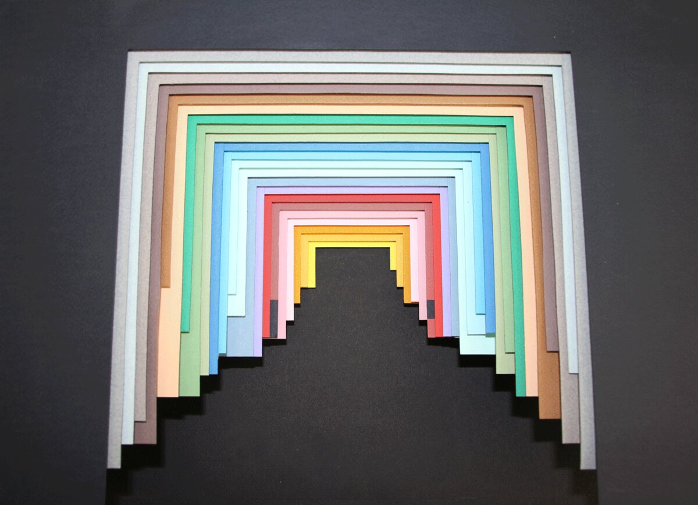
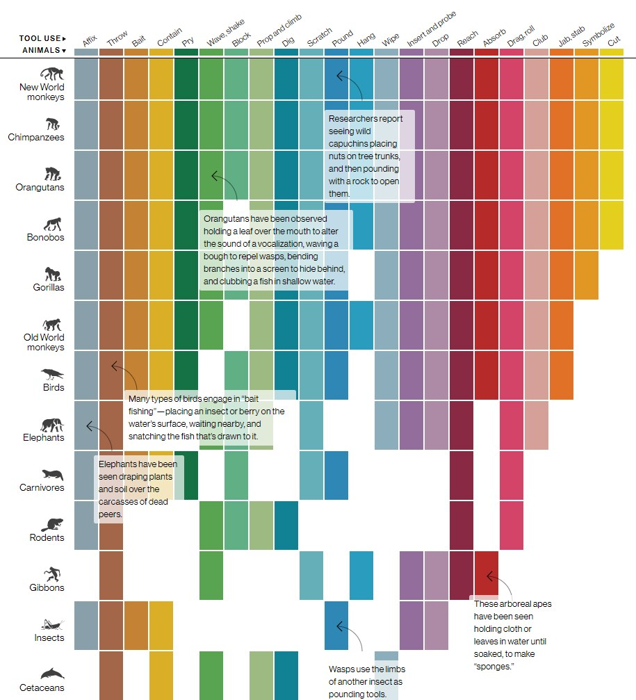

+++
author = "矢崎裕一"
title = "色紙の層で、動物の道具の使い方を数える──National Geographic「Animal Hacks」"
slug = "animal-hacks-paper-infographic"
date = "2026-11-01"
description = "道具の使い方を色紙の層に、記録の有無を層の脚が見えるかどうかに対応させた紙の構造物です。誌面の図には、その構造物の写真の撮影者がクレジットされています。"
categories = [
    "consume"
]
tags = [
    "データ物理化",
    "インフォグラフィック",
    "Alberto Lucas López",
    "National Geographic"
]
image = "images/magazine-spread.jpg"
series = ["data-physicalization"]
series_weight = 33
seriesByline = "Alberto Lucas López ほか"
seriesTitle = "色紙の層で数える──Animal Hacks"
+++

「Animal Hacks」は、動物が道具をどう使うかを、色紙を重ねた立体で見せた図です。22種類の道具の使い方を色紙の層に、動物群ごとの記録の有無を、層の脚が見えるか隠れるかに対応させました。誌面のクレジットには「紙の構造物の写真」の撮影者が載り、作者は図を道具と本物の素材でつくったと書いています。その写真が、ラベルと本文を重ねてそのまま誌面の図になったと読めます。紙の立体は下書きではなく、完成した図の素材だったと読めます。

掲載は *National Geographic Magazine* 2017年3月号です。図は Alberto Lucas López（アルベルト・ルーカス・ロペス）らが手がけました。以下は、作者のポートフォリオに載った誌面画像と説明文、制作過程のGIF、誌面のクレジット行に沿います。データ物理化の作品を集めた dataphys.org には、"Hand-Crafted Magazine Infographics" の名で収録されています。

<!--more-->

## 2017年3月号、EXPLORE欄の見開き

図が載ったのは、2017年3月号の EXPLORE 欄です。見出し帯には「TOOLS AND TECHNOLOGY」とあり、記事名は「ANIMAL HACKS」。本文は Rachel Hartigan Shea が書いています。図の題は "Differences in animal tool use" です。

Alberto Lucas López, NGM Staff; Kelsey Nowakowski（図）、Rebecca Hale, NGM Staff（紙の構造物の写真）© 2017 National Geographic Partners／Alberto Lucas López「Animal tools」より引用

本文は、人間だけが道具を使うわけではない、という話から始まります。

> Humans aren't the only creatures to use tools. Archerfish shoot water droplets from their mouths to fell insects. Octopuses carry coconut shells to serve as shelter. Orangutans borrow canoes to forage for aquatic plants.

テッポウウオ、タコ、オランウータンの例です。続けて生物学者 Robert W. Shumaker の "Tool use is widespread and diverse."（道具の使用は広く、多様だ）を引き、道具の使用は知性のしるしとは限らない、と話を進めます。

図の下には、二つのクレジット行があります。

> ALBERTO LUCAS LÓPEZ, NGM STAFF; KELSEY NOWAKOWSKI / PHOTO OF PAPER CONSTRUCTION: REBECCA HALE, NGM STAFF

> SOURCE: ROBERT W. SHUMAKER, INDIANAPOLIS ZOO

図の作者として2人、そして**「紙の構造物の写真」の撮影者**として Rebecca Hale の名が並びます。紙の立体が誌面に入ったことを、この行が示しています。2人の作者の役割分担は、資料には書かれていません。López は South China Morning Post のグラフィックス・ディレクターを経て、2016年にナショナル ジオグラフィックへ Senior Graphics Editor として移った、スペイン出身のデザイナーです。

## 22の層と、22の動物群

データは、動物群ごとに、科学文献で記録された「道具の使い方」の有無です。使い方は22種類、動物群も22群あります。誌面の説明文はこう書いています。

> Each layer represents a mode of tool use. Colored bars next to the animals' names indicate which behaviors have been recorded for that group in the scientific literature. Animal groupings can have one species (bonobo), a few (Old World monkeys), or hundreds (insects).

層の1枚が使い方一つにあたり、動物名の横に見える色の帯が、その群で記録された行動です。群は1種だけのものから、数百種を含むものまであります。

データの出典は、誌面では Shumaker の名前だけです。22という数は、Shumaker, Walkup & Beck の『Animal Tool Behavior』（2011）が分類した「22 modes of tool use」と一致します。誌面は書名を挙げていないので、この本の分類をそのまま使ったかは確かめられません。名前と数が一致するので、この本に基づく可能性が高い、と読めます。

データと見た目の対応は、次のとおりです。

| データ | 紙と写真の上での見た目 | 確認のしかた |
|---|---|---|
| 道具の使い方（22種） | 色紙の層1枚。門の形に切り抜き、入れ子に重ねる。色で使い方を区別する | 誌面の説明文、誌面画像 |
| 使い方の並び | 層の外から内への順。最も外が Affix（体に付ける・まとう）、最も内が Cut（切る） | 誌面画像のラベル位置 |
| 動物群（22群） | 横の帯（行）。左右に11群ずつ。アイコンと名前、括弧内に記録された使い方の数 | 誌面画像 |
| その使い方が記録されている | その行で、その層の脚（縦の色帯）が見える | 誌面の説明文 |
| 記録されていない | その行で、その層の脚が黒で隠れる | 誌面画像 |
| 記録された使い方の数 | 数字の注記と、行に見える色帯の本数 | 誌面画像 |
| 層の重なり | 色紙の間に白い板状のスペーサーを挟み、段差と影をつける | 制作過程GIF |

左の列は New World monkeys（22）から Amphibians（1）まで、右の列は Chimpanzees, orangutans（22）から Echinoids（1）まで、数の多い順に並びます。下の行ほど黒が増え、中央の暗い部分が階段状に広がって見えます。

門の左脚は左の11群、右脚は右の11群の列として使われています。1枚の層が、左右2本の列を兼ねている、と読めます。層の順にも傾向があります。外側の層ほど多くの群で記録された使い方で、内側の層ほど大型類人猿や新世界ザルだけの使い方になっているように見えます。Amphibians（1）の行では、最も外の Affix の層だけが下まで届いています。並べた根拠は、誌面には書かれていません。一方、層の段差と影は量を表さず、層を見分けるためのものと読めます。

## 机の上の紙から、誌面の見開きへ

作者のポートフォリオには、13コマの制作過程GIFが載っています。作者は2017年3月24日、同じGIFを "Handmade #dataviz." という言葉とともにツイートしました。

最初のコマは、白い机の上の構造物を横から撮っています。色紙と白いスペーサーが積まれ、手前にはハサミ、鉛筆、定規、スティックのりが置かれています。ナショナル ジオグラフィックのマグカップも写っています。

Alberto Lucas López, Kelsey Nowakowski（図）、Rebecca Hale（紙の構造物の写真）© 2017 National Geographic Partners／Alberto Lucas López「Animal tools」の制作過程GIFより引用

カメラはそこから真上へ回ります。門形の層が入れ子になり、奥へ続く通路のように見えてきます。真上から撮ったコマでは、脚の先がすでに長さをそろえずに切られています。おおむね外側の層ほど脚が長く、内側の層ほど短い。左右とも、脚の先が階段状に並びます。

Alberto Lucas López, Kelsey Nowakowski（図）、Rebecca Hale（紙の構造物の写真）© 2017 National Geographic Partners／Alberto Lucas López「Animal tools」の制作過程GIFより引用

脚の長さは、その使い方が記録された群のうち、いちばん下の行まで届くように切られている、と読めます。次のコマで、脚の下側に大きな黒い区画が加わります。この黒い部分が紙なのか、画像の上で塗ったものなのかは、資料からは確かめられません。

その次のコマで、ラベルと本文を載せたレイアウトになり、最後に印刷された雑誌の見開きが映ります。紙の構造物は、写真に撮られて、誌面の図そのものになった。GIFの順番とクレジット行から、そう読めます。

作者自身も、ポートフォリオでこう書いています。

> To support the information shown, the infographic was made with tools and real materials, looking for a parallelism between the visual side and the exposed theme. This was the first papercraft infographic published in National Geographic Magazine.

見た目とテーマを並行させるために、図を道具と本物の素材でつくった。同誌に載った最初のペーパークラフトのインフォグラフィックだった、という説明です。動物の道具の図が、ハサミと定規とのりでつくられました。

## 同じデータを、ウェブでは表にした

ウェブ版は "The Tools Animals Use" という題で、2017年2月15日に公開されました。クレジットは Alberto Lucas Lopez と Kennedy Elliott です。同じ「動物群×22の使い方」のデータを、こちらは色付きのマトリクスで見せています。

Alberto Lucas Lopez, Kennedy Elliott © National Geographic／Information is Beautiful Awards「The Tools Animals Use」より引用

列の順は Affix から Cut までで、誌面の層の外から内への順と同じです。誌面では一つにまとめた Chimpanzees と Orangutans を、ウェブ版では別の行に分けています。

吹き出しで、具体例も添えています。たとえば "Elephants have been seen draping plants and soil over the carcasses of dead peers."（ゾウが、死んだ仲間の亡骸に植物や土をかけるのが見られている）。誌面の図には、こうした例は入っていません。例は本文の側が受け持っています。

ウェブ版は、列と行を直交させた2Dの表です。誌面版は、その列を層に、行を帯に変えて、立体の写真にしています。データの構造は同じで、媒体に合わせて形だけを選び直した、と読めます。

同じ種類のデータを、研究者が図にした例もあります。Johnston らの論文（*iScience*, 2020）は、Shumaker らの22分類を使い、動物群×使い方を白黒のピクセルの表にしました。黒は野生で観察、灰は人の影響を除けない観察、白は記録なしです。表は使い方が身につく順序の推定に使われました。同じ型のデータが、目的に応じて三つの形になっています。

## 第三者はこの作品をどう見たか

dataphys.org は、Aurélien Tabard と Pierre Dragicevic が2017年4月30日に追加した項目です。分類は Passive physical visualization（動かない物理可視化）です。説明文はこうです。

> Infographic designers at the National Geographic crafted a 3D physical visualization out of paper and colored cardboard in order to prepare a 2D infographic.

2Dの図を準備するために、紙と色付きの厚紙で立体をつくった、という要約です。Dragicevic は作者のGIFを YouTube にも再掲しています。

この「準備するために」という言い方は、作者側の資料と食い違います。誌面のクレジットは「紙の構造物の写真」を挙げ、作者は図を「道具と本物の素材でつくった」と書いています。紙の立体は、2Dの図の手前の段階ではなく、図そのものの中身だったと読めます。「色付きの厚紙」も作者側の資料では確かめられず、作者側は "papercraft"、誌面は "paper construction" と書いています。

Gestalten の作者紹介記事「The Infographic Is Mightier Than The Sword」は、素材への挑戦として触れています。

> He recently decided to create the magazine's first infographic using Kraft paper.

続けて、López の言葉を引きます。

> If we are not willing to create content beyond what is conventional, we will end up killing journalism.

型どおりを超えたものをつくる気がなければ、ジャーナリズムを殺してしまう、という言葉です。記事は作品名を書いていません。ただ「誌の最初の紙のインフォグラフィック」という点がポートフォリオと一致するので、この作品を指していると読めます。

Kantar Information is Beautiful Awards 2017 では、ウェブ版「The Tools Animals Use」が、Science, Technology & Health 部門のロングリストに入りました。評価の対象はウェブ版のマトリクスで、紙の誌面版ではありません。

## 使い道

この作品から持ち帰れるのは、物理的な模型を「完成品の素材」として扱う考え方です。立体は、試作のために組むこともあれば、撮って最終の図にすることもあります。後者なら、紙の段差や影も、そのまま読者の目に入ります。

そのとき、どの性質にデータを載せ、どれを載せないかを決めておきます。「Animal Hacks」では、層が使い方に、脚が見えるかどうかが記録の有無に対応し、奥行きと影は層を見分ける役に回っている、と読めます。

並べ方も効いていると読めます。外の層ほど多くの群で記録された使い方が置かれているように見え、群を数の多い順に並べることで、記録のない部分が中央にまとまり、階段の形になっていると読めます。

もう一つは、テーマと手法をそろえることです。作者は、道具の図を道具でつくることを、表現の理由に挙げていました。同じデータを、ウェブでは表に、誌面では紙の写真にしています。媒体ごとに形を選び直した例です。

最後に、クレジットです。誌面は図の作者と並べて、紙の構造物を撮った人の名を載せています。物理的な図を撮って載せるなら、撮影も図の制作の一部です。

## 参考・出典

**一次情報**

- Alberto Lucas López「Animal tools」（ポートフォリオ。説明文、誌面画像、制作過程GIF、権利表記）. [lucasinfografia.com](https://lucasinfografia.com/Animal-tools)
- 誌面画像「ANIMAL HACKS」（クレジット行・出典行・説明文を含む）. [画像](https://payload.cargocollective.com/1/9/310126/13691133/Animal_Hacks_1000.png)
- 制作過程GIF. [画像](https://payload.cargocollective.com/1/9/310126/13691133/Animal_hacks_GIF_1400.gif)
- Alberto Lucas López, "Handmade #dataviz. National Geographic Magazine - March, 2017," X（Twitter）, 2017-03-24. [投稿](https://twitter.com/aLucasLopez/status/845289828707192832)
- National Geographic, "The Tools Animals Use"（ウェブ版）, 2017-02-15. [National Geographic](https://www.nationalgeographic.com/magazine/graphics/animal-tools)
- *National Geographic Magazine*, March 2017, "ANIMAL HACKS"（号の目次と記事抜粋）. [Zinio](https://www.zinio.com/publications/national-geographic-interactive/2820/issues/369764)
- Shumaker, R. W., Walkup, K. R., & Beck, B. B., *Animal Tool Behavior: The Use and Manufacture of Tools by Animals*, Johns Hopkins University Press, 2011. [Johns Hopkins University Press](https://press.jhu.edu/books/title/12826/animal-tool-behavior)

**第三者評価**

- Aurélien Tabard & Pierre Dragicevic, "2017 – Hand-Crafted Magazine Infographics," List of Physical Visualizations, dataphys.org, 2017-04-30. [dataphys.org](https://dataphys.org/list/animal-hacks-hand-crafted-infographics/)
- Pierre Dragicevic, "animal hacks"（作者GIFの再掲）, YouTube. [動画](https://www.youtube.com/watch?v=p1riHODVk2U)
- Gestalten, "The Infographic Is Mightier Than The Sword," Gestalten Journal. [記事](https://gestalten.com/blogs/journal/the-infographic-is-mightier-than-the-sword)
- Kantar Information is Beautiful Awards 2017, "The Tools Animals Use"（Science, Technology & Health 部門ロングリスト）. [ショーケース](https://informationisbeautifulawards.com/showcase/1740-the-tools-animals-use)
- Johnston et al., "Data-Driven Inference Reveals Distinct and Conserved Dynamic Pathways of Tool Use Emergence across Animal Taxa," *iScience*, 2020. [doi:10.1016/j.isci.2020.101245](https://doi.org/10.1016/j.isci.2020.101245) / [PMC](https://pmc.ncbi.nlm.nih.gov/articles/PMC7306607/)
