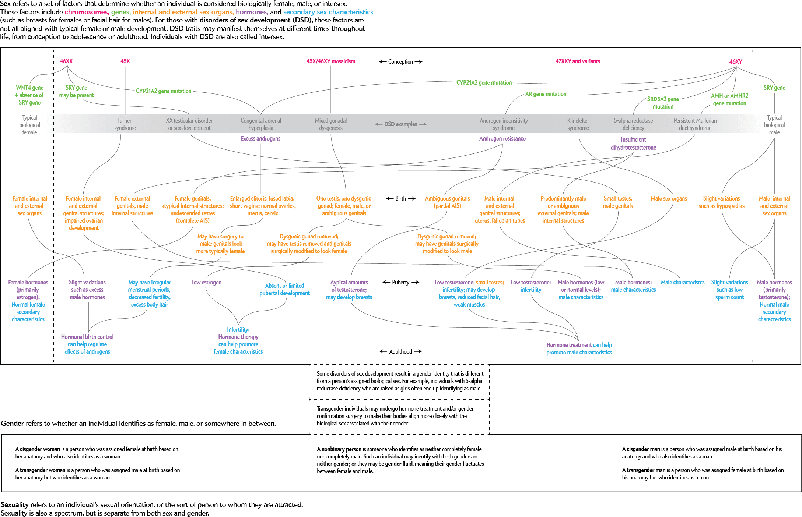
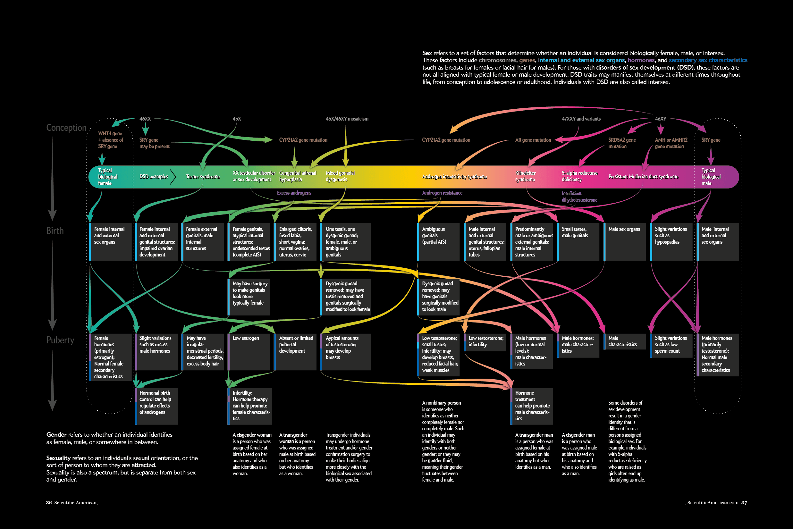

+++
author = "Yuichi Yazaki"
title = "Couldn't Count It, So Drew the Pathways: Beyond XX and XY"
slug = "beyond-xx-and-xy"
date = "2026-11-07"
description = "A graphic that draws sex not as a point on a single line but as a pathway of development, from conception through puberty and beyond. Reliable frequency data could not be found, so the plan shifted from a graphic of numbers to one that shows the complexity itself."
categories = [
    "consume"
]
tags = [
    "data journalism",
    "infographic",
    "flowchart",
    "gender"
]
image = "images/final-print-spread.png"
series = ["dataviz-journalism"]
series_weight = 14
seriesByline = "Amanda Montañez, Pitch Interactive"
seriesTitle = "From Frequency to Pathways: Beyond XX and XY"
+++

Beyond XX and XY is a graphic that ran as a double-page spread in the September 2017 issue of Scientific American. It draws sex not as a point on a single line but as a pathway of development, from conception through puberty and beyond. Its author, Amanda Montañez, first planned a graphic that would show frequencies with data. Because reliable frequency data could not be found, she changed course, from a graphic of numbers to one that shows the complexity itself.

This article follows the printed graphic (pp.50–51) and Montañez's making-of post, "Visualizing Sex as a Spectrum" (August 29, 2017). It also draws on the project page of Pitch Interactive, which handled the design, and on the letters column of the January 2018 issue. Because this graphic touches on medicine and the diversity of sex, I keep the graphic's own text, the author's words, and the criticism separate, so that it is clear whose words each one is.

<!--more-->

## 2017: A graphic that was meant to show numbers

The September 2017 issue was a special issue on sex and gender. The graphic is a spread beginning on page 50. Montañez is a graphics editor at the magazine and has a background as a medical illustrator. According to her making-of post, the original plan was this.

> "The project was originally conceived as a data-driven graphic exploring the spectra of sex and gender."

In other words, the plan was a graphic that would explore the range of sex and gender through data. She considered whether it could show how frequent transgender and nonbinary people are, what share of people are intersex, and the breakdown by type of DSD (disorders of sex development).

The research was done by researcher Amanda Hobbs. What came back was less an answer than "a series of new questions." Montañez gives two reasons. Surveys tend to lump transgender people together with gay, lesbian, and bisexual people. And DSD is defined differently by different institutions, and a condition may go unfound or be discovered only later.

> "The project abruptly transformed into an exercise in visualizing complexity."

The plan changed at once into **an exercise in showing complexity**, in this sentence's terms. Montañez goes on to write that sex, gender, and sexuality are each a separate spectrum, and that sex cannot be drawn on a one-dimensional scale; she shifted the graphic's main focus to intersex.

That the numbers are not settled also shows in how the figures differ between sources.

| Source | Share of intersex people | Premise / basis |
|---|---|---|
| Montañez's making-of post (2017) | about 1% (about one percent) | When DSD is defined broadly |
| *Data Feminism* (2020) | an estimated 1.7% | Note 55 cites Fausto-Sterling as the source |
| Jerry Coyne's blog (2022) | about 0.018% (1 in 5,600) | Based on Sax (2002) |

The text of the finished graphic contains no figure for the share.

## From a hand-drawn outline to the spread

Montañez first drew the content on paper. Laying out every known DSD proved too "unwieldy" for one spread, so she picked several conditions and made a "visual outline" tracing the paths of development. It was not pretty, she writes, but it captured the tangled feel that the subject calls for.

Source: Amanda Montañez / Scientific American, "Visualizing Sex as a Spectrum" (© Scientific American)

The accuracy of this outline was checked by Amy Wisniewski, a DSD expert at the University of Oklahoma. I follow the spelling in the graphic's credit; in the body of the making-of post it is "Winsiewski." The design was handled by Pitch Interactive, a data visualization studio in Oakland.

Source: Pitch Interactive / Scientific American, "Visualizing Sex as a Spectrum" (© Scientific American)

Even after the look was settled, she says, colleagues kept pointing out confusing spots, and the text and design kept being revised. Comparing the three images in the making-of post shows these differences.

| Item | Outline | Pitch's sketch | Finished printed page |
|---|---|---|---|
| Vertical rows | Conception, birth, puberty, adulthood | Conception, birth, puberty | Conception, birth, puberty |
| Heading of the central band | DSD examples | DSD examples | Intersex conditions |
| Factors that determine sex | In the opening sentence | In the opening sentence | Set up as a column at the left edge |
| 5-alpha reductase deficiency | Treated like the others | Treated like the others | Highlighted with a dotted frame and a circle of explanation |
| Definition of gender | Below the graphic | Below the graphic | Above the graphic |

The heading changed from "DSD" to "intersex." The making-of post does not say why it was changed.

## What the finished graphic puts where

The finished graphic is not a picture of quantitative data. It is a conceptual diagram, a flowchart, that illustrates the factors involved in sex differentiation and the pathways followed by several DSDs.

Source: Pitch Interactive and Amanda Montañez (Research: Amanda Hobbs, Expert review: Amy Wisniewski) / Scientific American, September 2017 (© 2017 Scientific American)

| Element of the graphic | What it represents | Basis |
|---|---|---|
| Vertical direction | Developmental time. Three rows: CONCEPTION, BIRTH, PUBERTY | Printed page; Pitch (three pivotal milestones) |
| Left-hand column | Factors that determine sex: chromosomes, genes, hormones, internal and external genitalia, secondary sex characteristics | Printed page |
| Horizontal band | The two ends are Typical biological female and male. The names of conditions lie in between. There is no scale | Printed page; Pitch |
| Change of color along the band | The spectrum of sex | *Data Feminism* |
| Boxes of explanation | The condition at each row. The line at the left edge of a box can be read as corresponding to a factor in the left-hand column | Printed page |
| Branching arrows | The pathway each condition follows | Printed page; *Data Feminism* |
| Boxes for medical intervention | Surgery and hormone therapy. Example: "Genitals can be modified to look more typically female" | Printed page |
| Dotted frame and the circle at upper right | Follows 5-alpha reductase deficiency through the graphic as a single example | Printed page |

According to the circle at upper right, a person with 5-alpha reductase deficiency is 46XY, the appearance at birth varies from person to person, and the person can be assigned to either sex. At puberty testosterone rises and male characteristics appear, and the circle says that people raised as girls often come to identify as male. By having the reader follow one condition row by row, the graphic can be read as showing a change that cannot be drawn with a single point.

## Words in the graphic, words of the author, words of the studio

Three sources of words are at work in this graphic. Statements of different strength sit side by side, so I set them out separately.

| Whose words | Where | What it says |
|---|---|---|
| Text of the graphic (signed by Montañez) | Printed page | What it shows is "A small cross section." Sex and gender "appear to exist on a spectrum" |
| Pitch Interactive | Project page | "sex assignment and gender identity lies on a spectrum" |
| Montañez | Making-of post | DSD is an "evidence-based argument" against fixed assignment of sex and gender. If understanding spreads, policy could also follow "social justice" |
| Montañez | BBMRI-ERIC webinar announcement (2022) | A subject for which she had never seen a visualized example, and which was more complex than she had imagined |

The graphic's text is restrained, saying "appear to," and states that it shows only a cross section. Pitch asserts "lies on." The claims about society and policy are on the making-of post's side, and they carry a note that these are the author's personal views. The criticism discussed below can be read as aimed at different ones of these three.

## How third parties saw the graphic

The evaluations each point at a different aspect. Except for the book, all of them are letters, blog posts, or social media posts, not peer-reviewed papers.

The first is chapter 4 of *Data Feminism* (Catherine D'Ignazio and Lauren F. Klein, 2020). Just before this graphic, the book gives two examples of rearranging binary data from the inside: The Telegraph's ["Born Equal. Treated Unequally."](/en/telegraph-born-equal-gender-colors/) and a Guardian piece. It then takes up this graphic as a question of how to draw gender itself.

> "Visualization is often thought of as a way to reduce complexity, but here it operates in the reverse" (p.115)

The assessment is that visualization is usually thought of as a way to reduce complexity, but this graphic works the other way around. The book also writes that it made visible to a wide audience what scientists already knew.

The second is a letter from Kimberly Zieselman, executive director of the advocacy group interACT (January 2018 issue). She acknowledged that the graphic helps the visibility of intersex people, and then wrote this.

> "There is just one thing we wish it had shown intersex is not: in need of 'fixing.'"

Her point is that she wished it had shown that intersex is not something to be "fixed." The graphic indicates where surgery can alter the genitals and gonads can be removed, but it does not mention consequences such as scarring, chronic pain, and infertility. She also writes that surgery is not needed to raise a child as a boy or a girl.

In the same column, Montañez answered that the scope of the graphic was the science of the spectrum and that it could not cover health effects. She said she included surgery because many people actually undergo it. In the making-of post, moreover, Montañez cites calls to stop medically unnecessary surgery on infants as one example of a change she would welcome.

The third is the 2022 criticism from the "sex is binary" position. It began on November 14, when the physicist Sean Carroll replied to a post by Colin Wright, "Biological sex is real, immutable, and binary.", with this graphic attached and the words "Actual science would like a word."

Jerry Coyne wrote that what the graphic shows is the complexity of the pathways of sex-related traits, and that gametes are not drawn. Emma Hilton asked why a clearly male condition is placed on the "more female" side of a female condition. Earlier, in August, Zach Elliott had written this on social media.

> "There are no units on this spectrum to quantify it."

The point is that the spectrum has no units. Elliott also raised the lack of an objective way to decide where each condition is placed, and the conflation of the mechanisms of sex determination with sex itself.

| Who criticized | Aimed at | Point | The author's reply |
|---|---|---|---|
| interACT (2018) | The medical-intervention boxes | Does not show the outcomes of surgery. Surgery is not needed for raising a child | It was outside the scope. Included because many people undergo it |
| The "sex is binary" position (2022) | The horizontal band and the surrounding text | Elliott: no units and no objective basis for placement; mechanisms are conflated with sex. Hilton: the left-right placement of conditions. Coyne: gametes are not drawn; the direction of policy and science is reversed | Not found in the sources for this article |

The former questions how the graphic handles the interventions it drew. Of the latter, Elliott and Hilton question what the horizontal band, as an axis, means. Coyne questions what the graphic does not draw, and the claim in the making-of post.

## Takeaways

There are four judgments that can be carried back into visualization work.

The first is to treat the unavailability of data as grounds for changing the graphic's approach. Montañez gave up the frequency graphic and switched to a pathway graphic, and stated the limits of its scope in the text with "A small cross section." When numbers cannot be shown, it can be read that the graphic needs to say what it shows instead.

The second is how to handle an axis that looks like a quantity when it is used in a conceptual diagram. The horizontal band has no scale, but "Typical" is written at both ends and the conditions line up left to right. Elliott's point about units and Hilton's question about placement can be read as aimed at the lack of any stated basis for an axis that looks quantitative. If an ordered axis is used, it can be read that one needs to write down even what the positions do not mean.

The third is that the elements one draws raise questions about what one did not draw. Placing the medical-intervention boxes led to the point that their outcomes are not drawn. Whether to write the line drawn around the scope close to the graphic can be read as part of the design.

The fourth is that the choice of words is also part of the graphic. The band's heading changed from "DSD examples" to "Intersex conditions." The educators' site Gender-Inclusive Biology (2021) recommends "intersex traits" instead. It can be read that a single word of a label may change how the graphic is read.

In its December 2024 issue the same magazine also ran [a visualization of progress toward gender equality](/en/progress-toward-gender-equality/), which turns index values into a graphic. The two can be read side by side, one shown with numbers and the other where numbers could not be shown.

## References

**Primary sources**

- Amanda Montañez, “Beyond XX and XY: The Extraordinary Complexity of Sex Determination,” *Scientific American* 317(3), September 2017, p.50. doi:10.1038/scientificamerican0917-50. [Article](https://www.scientificamerican.com/article/beyond-xx-and-xy-the-extraordinary-complexity-of-sex-determination/)
- Amanda Montañez, “Visualizing Sex as a Spectrum,” SA Visual (Scientific American Blog Network), 2017-08-29. [Blog](https://blogs.scientificamerican.com/sa-visual/visualizing-sex-as-a-spectrum/)
- Table of contents of the September 2017 issue of *Scientific American*. [Table of contents](https://www.scientificamerican.com/issue/sa/2017/09-01/)
- Pitch Interactive, “Beyond XX and XY.” [Project page](https://pitchinteractive.com/work/beyondxxandxy/)
- “Readers Respond to the September 2017 Issue” (Kimberly Zieselman's letter and Montañez's reply), *Scientific American* 318(1), January 2018, p.5. [Article](https://www.scientificamerican.com/article/readers-respond-to-the-september-2017-issue/)
- BBMRI-ERIC, “Visualizing the Complexity of Sex Determination” (webinar announcement, 2022-11-16). [iCal](https://www.bbmri-eric.eu/events/category/webinar/2022-11/?ical=1) / [Date page](https://bbmri-eric.eu/events/2022-11-16)
- An episode of the BBMRI-ERIC Podcast (recording of the webinar, audio). [Episode](https://redcircle.com/shows/bbmri-eric-podcast/ep/4089b82e-ac5f-4daf-85b4-d969091a299d)

**Secondary sources**

- Catherine D'Ignazio and Lauren F. Klein, *Data Feminism*, MIT Press, 2020, ch.4 “What Gets Counted Counts,” pp.113–117, notes 52–55 (CC BY-NC-ND 4.0). [Internet Archive](https://archive.org/details/mit_press_book_9780262358521) / [OCR text](https://archive.org/download/mit_press_book_9780262358521/mit_press_book_9780262358521_djvu.txt)
- Letter by Kimberly Zieselman (interACT: Advocates for Intersex Youth), in the Letters above. [Article](https://www.scientificamerican.com/article/readers-respond-to-the-september-2017-issue/)
- Sam Long, “Scientific American: "Beyond XX and XY",” Gender-Inclusive Biology, 2021-02-25. [Article](https://genderinclusivebiology.squarespace.com/newsletter/poster-beyond-xx-and-xy)
- Jerry Coyne, “Stephen Knight on Sean Carroll, Colin Wright, and the binary of sex,” *Why Evolution Is True*, 2022-11-16 (quotes posts by Sean Carroll and Emma Hilton). [Article](https://whyevolutionistrue.com/2022/11/16/stephen-knight/)
- Jerry Coyne, “Once again, the binary nature of biological sex: Colin Wright and Sean Carroll,” *Why Evolution Is True*, 2022-12-06. [Article](https://whyevolutionistrue.com/2022/12/06/once-again-the-binary-nature-of-biological-sex-colin-wright-and-sean-carroll/)
- Thread by Zach Elliott (@zaelefty), August 2022. [Thread Reader](https://threadreaderapp.com/thread/1556317815807873026.html)
- Post by Sean Carroll (2022-11-14). [X](https://twitter.com/seanmcarroll/status/1592168158865281025) / Post by Emma Hilton (2022-11-14). [X](https://twitter.com/FondOfBeetles/status/1592213002530525186)
