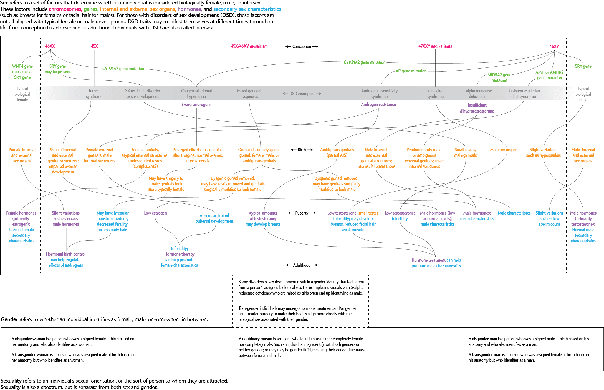
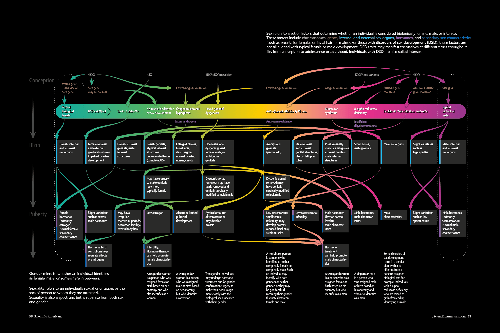
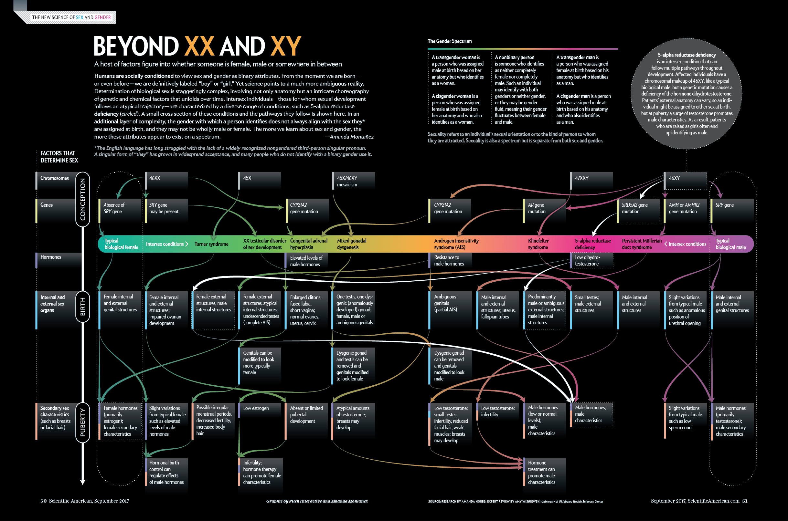

+++
author = "矢崎裕一"
title = "数えられなかったから、経路を描いた──Beyond XX and XY"
slug = "beyond-xx-and-xy"
date = "2026-11-07"
description = "性を1本の線の上の点ではなく、受精から思春期以降までの発達の経路として描いた図です。頻度のデータが得られず、数値の図から複雑さそのものを見せる図に方針を変えて作られました。"
categories = [
    "consume"
]
tags = [
    "データジャーナリズム",
    "インフォグラフィック",
    "フローチャート",
    "ジェンダー"
]
image = "images/final-print-spread.png"
series = ["dataviz-journalism"]
series_weight = 99
seriesByline = "Amanda Montañez・Pitch Interactive"
seriesTitle = "頻度の図から経路の図へ──Beyond XX and XY"
+++

Beyond XX and XY（ビヨンド XX アンド XY）は、Scientific American 2017年9月号の見開きに載った図です。性を1本の線の上の点ではなく、受精から思春期以降までの発達の経路として描いています。作者の Amanda Montañez（アマンダ・モンタニェス）は、はじめ頻度をデータで示す図を考えていました。確かな頻度のデータが得られなかったため、数値を示す図から、複雑さそのものを見せる図に方針を変えて作りました。

以下は、誌面の図（pp.50–51）と、Montañez の制作解説「Visualizing Sex as a Spectrum」（2017年8月29日）に沿います。デザインを担当した Pitch Interactive の作品ページと、2018年1月号の読者投稿欄も使います。医学と性の多様性に関わる図なので、図の文、作者の言葉、批判を、誰の言葉か分かる形で分けて書きます。

<!--more-->

## 2017年、数を示すはずだった図

2017年9月号は、性とジェンダーの特集号でした。表紙には「THE SEX CONTINUUM PAGE 50」とあり、その50ページからの見開きがこの図です。Montañez は同誌のグラフィックス・エディターで、医学イラストレーターの経歴があります。制作解説によると、最初の構想はこうでした。

> "The project was originally conceived as a data-driven graphic exploring the spectra of sex and gender."

性とジェンダーの幅を、データで探る図にするつもりだった、という話です。トランスジェンダーやノンバイナリーの人の頻度、インターセックスの人の割合、DSD（disorders of sex development）の種類ごとの内訳を示せるかを考えていました。

調べたのは、リサーチャーの Amanda Hobbs（アマンダ・ホッブズ）です。返ってきたのは、答えより「a series of new questions」でした。Montañez は理由を二つ挙げます。調査がトランスジェンダーを、ゲイ・レズビアン・バイセクシュアルとひとまとめにしがちなこと。DSD は機関ごとに定義が違い、見つからないことも、後で分かることもあることです。

> "The project abruptly transformed into an exercise in visualizing complexity."

計画は、**複雑さを見せる練習**に一気に変わった、という一文です。Montañez は続けて、性・ジェンダー・セクシュアリティはそれぞれ別のスペクトラムで、性は1次元の尺度では描けないと書き、図の主眼をインターセックスに移しました。

数が定まらないことは、資料どうしの数字の違いにも表れています。

| 出典 | インターセックスの割合 | 前提・根拠 |
|---|---|---|
| Montañez の制作解説（2017） | 約1%（about one percent） | DSD を広く定義した場合 |
| 『Data Feminism』（2020） | 推定1.7% | 注55で Fausto-Sterling を出典とする |
| Jerry Coyne のブログ（2022） | 約0.018%（5,600人に1人） | Sax（2002）による |

完成した図の本文には、割合の数字は出てきません。

## 手描きのアウトラインから見開きへ

Montañez はまず内容を紙に描きました。知られている DSD を全部並べると、見開き1つには収まらない（「unwieldy」）と分かり、いくつかの状態を選んで、発達の道筋を描く「visual outline」を作りました。きれいではないが、題材が求める入り組んだ感じはとらえていた、と本人は書いています。

Amanda Montañez／Scientific American「Visualizing Sex as a Spectrum」より引用（© Scientific American）

このアウトラインの正確さを、Oklahoma 大学の DSD の専門家、Amy Wisniewski（エイミー・ウィズニュースキー）が確かめました。綴りは図のクレジットに従います。制作解説の本文では「Winsiewski」です。デザインは、Oakland のデータ可視化スタジオ Pitch Interactive（ピッチ・インタラクティブ）が担いました。

Pitch Interactive／Scientific American「Visualizing Sex as a Spectrum」より引用（© Scientific American）

見た目が決まった後も、同僚から分かりにくい箇所を指摘してもらい、文とデザインを直し続けたといいます。制作解説の3枚を見比べると、次の違いがあります。

| 項目 | アウトライン | Pitch のスケッチ | 完成した誌面 |
|---|---|---|---|
| 縦の段 | 受精・出生・思春期・成人 | 受精・出生・思春期 | 受精・出生・思春期 |
| 中央の帯の見出し | DSD examples | DSD examples | Intersex conditions |
| 性を決める要因 | 冒頭の文の中 | 冒頭の文の中 | 左端に列として立てる |
| 5-alpha reductase deficiency | 他と同じ扱い | 他と同じ扱い | 点線の枠と円の説明で強調 |
| ジェンダーの定義 | 図の下 | 図の下 | 図の上 |

見出しの語は「DSD」から「intersex」に替わりました。替えた理由は、制作解説には書かれていません。

## 完成した図は、何をどこに置いたか

完成した図は、数量のデータを図にしたものではありません。性分化に関わる要因と、いくつかの DSD がたどる道筋を図解した、概念図・フローチャートです。

Pitch Interactive and Amanda Montañez（Research: Amanda Hobbs、Expert review: Amy Wisniewski）／Scientific American 2017年9月号より引用（© 2017 Scientific American）

| 図の要素 | 表しているもの | 根拠 |
|---|---|---|
| 縦方向 | 発達の時間。CONCEPTION・BIRTH・PUBERTY の3段 | 誌面、Pitch（three pivotal milestones） |
| 左端の列 | 性を決める要因。染色体・遺伝子・ホルモン・内外の性器・二次性徴 | 誌面 |
| 横方向の帯 | 両端が Typical biological female と male。間に状態の名前。目盛りはない | 誌面、Pitch |
| 帯の色の変化 | 性のスペクトラム | 『Data Feminism』 |
| 説明の箱 | 各段での状態。箱の左端の線は、左の列の要因に対応すると読めます | 誌面 |
| 分岐する矢印 | 各状態がたどる経路 | 誌面、『Data Feminism』 |
| 医療介入の箱 | 手術やホルモン療法。例「Genitals can be modified to look more typically female」 | 誌面 |
| 点線の枠と右上の円 | 5-alpha reductase deficiency を一つの例として通して見せる | 誌面 |

右上の円によると、5-alpha reductase deficiency の人は 46XY で、出生時の外見は人によって違い、どちらの性にも割り当てられえます。思春期にテストステロンが増えて男性的な特徴が出て、女の子として育った人が男性と自認するようになることが多い、と円は書いています。一つの状態を段ごとに追わせることで、1点では描けない変化を見せていると読めます。

## 図の文、作者の文、制作会社の文

この図には、言葉の出どころが三つあります。強さの違う言い方が並んでいるので、分けて示します。

| 誰の言葉か | どこで | 言っていること |
|---|---|---|
| 図の本文（Montañez の署名入り） | 誌面 | 示したのは「A small cross section」。性とジェンダーは「appear to exist on a spectrum」 |
| Pitch Interactive | 作品ページ | 「sex assignment and gender identity lies on a spectrum」 |
| Montañez | 制作解説 | DSD は性とジェンダーの固定的な割り当てを退ける「evidence-based argument」だ。理解が広がれば政策が「social justice」にも沿う |
| Montañez | BBMRI-ERIC ウェビナー告知（2022） | 見たことのない題材で、想像以上に複雑だった |

図の本文は「appear to」と控えめに言い、一部の断面だと断っています。Pitch は「lies on」と言い切ります。社会や政策への主張は制作解説の側にあり、そこには作者個人の見解だという但し書きが付いています。後で見る批判も、この三つのどれに向けたものかが違うと読めます。

## 第三者はこの図をどう見たか

評価は、それぞれ別の点に向いています。書籍を除き、どれも投書・ブログ・SNS の投稿で、査読のある論文ではありません。

一つ目は、『Data Feminism』（Catherine D'Ignazio〈キャサリン・ディグナツィオ〉と Lauren F. Klein〈ローレン・クライン〉、2020）第4章です。

> "Visualization is often thought of as a way to reduce complexity, but here it operates in the reverse" (p.115)

可視化はふつう複雑さを減らすものとされるが、この図は逆に働いている、という評価です。科学者がすでに知っていたことを、広く見えるものにしたとも書いています。

二つ目は、当事者支援団体 interACT の事務局長、Kimberly Zieselman（キンバリー・ジーセルマン）の投書です（2018年1月号）。図がインターセックスの可視性に役立つと認めたうえで、こう書きました。

> "There is just one thing we wish it had shown intersex is not: in need of 'fixing.'"

インターセックスは「直す」ものではないと示してほしかった、という指摘です。図は手術で性器を変え、性腺を取れる箇所を示すが、瘢痕・慢性の痛み・不妊などの結果に触れていない。子を男の子・女の子として育てるのに手術は要らない、とも書いています。

Montañez は同じ欄で、図の範囲は科学としてのスペクトラムで、健康への影響は扱えなかったと答えました。手術を入れたのは、実際に多くの人が受けているからだとしています。なお、制作解説で Montañez は、乳児への医学的に不要な手術をやめるよう求める声を、望ましい変化の一例に挙げています。

三つ目は、2022年の「性は二値」とする立場からの批判です。11月14日、物理学者 Sean Carroll（ショーン・キャロル）が、Colin Wright（コリン・ライト）の「Biological sex is real, immutable, and binary.」という投稿に、この図を添えて「Actual science would like a word.」と返したことがきっかけです。

Jerry Coyne（ジェリー・コイン）は、図が示すのは性に関わる形質の経路の複雑さで、配偶子は描かれていない、と書きました。Emma Hilton（エマ・ヒルトン）は、明確な男性の状態を、女性の状態より「more female」の側に置くのはなぜか、と問いました。その前の8月には、Zach Elliott（ザック・エリオット）が SNS でこう書いていました。

> "There are no units on this spectrum to quantify it."

スペクトラムに単位がない、という指摘です。Elliott は、各状態の位置を決める客観的な方法がないこと、性決定の仕組みと性そのものの混同も挙げています。

| 批判した側 | 向けた先 | 論点 | 作者の返答 |
|---|---|---|---|
| interACT（2018） | 医療介入の箱 | 手術の結果を示していない。養育に手術は要らない | 範囲外だった。多くの人が受けているので入れた |
| 「性は二値」の立場（2022） | 横の帯と周りの文 | 単位も配置の根拠もない。配偶子がない。仕組みと性を混同している | 本記事の出典には見当たらない |

前者は描いた介入の扱いを、後者は横の帯という軸の意味を問うています。

## 使い道

可視化の仕事に持ち帰れる判断は、四つあります。

一つ目は、データが得られないことを、図の方針を変える材料にすることです。Montañez は頻度の図を諦めて経路の図に切り替え、本文で「A small cross section」と範囲を断りました。数を出せないとき、代わりに何を見せるのかを図の中で言うことが要ると読めます。

二つ目は、量に見える軸を概念図に使うときの扱いです。横の帯に目盛りはありませんが、両端に「Typical」と書かれ、状態が左右に並びます。2022年の批判は、単位と位置の根拠に集まりました。順序のある軸を置くなら、位置が何を意味しないかまで書く必要があると読めます。

三つ目は、描いた要素が、描かなかったことへの問いを生むことです。医療介入の箱を置いたことで、その結果が描かれていないという指摘が出ました。範囲の線引きを図の近くに書くかどうかも、設計の一部と読めます。

四つ目は、語の選択も図の一部だということです。帯の見出しは「DSD examples」から「Intersex conditions」に替わりました。教育者向けサイト Gender-Inclusive Biology（2021）は、さらに「intersex traits」を勧めています。ラベルの一語で読まれ方が変わりうると読めます。

同誌は2024年12月号で、指標の数値を図にした[ジェンダー平等への進展の可視化](/progress-toward-gender-equality/)も載せています。数で示した図と、数で示せなかった図として並べて読めます。

## 参考・出典

**一次情報**

- Amanda Montañez, “Beyond XX and XY: The Extraordinary Complexity of Sex Determination,” *Scientific American* 317(3), September 2017, p.50. doi:10.1038/scientificamerican0917-50. [記事](https://www.scientificamerican.com/article/beyond-xx-and-xy-the-extraordinary-complexity-of-sex-determination/)
- Amanda Montañez, “Visualizing Sex as a Spectrum,” SA Visual（Scientific American Blog Network）, 2017-08-29. [ブログ](https://blogs.scientificamerican.com/sa-visual/visualizing-sex-as-a-spectrum/)
- *Scientific American* 2017年9月号の目次. [目次](https://www.scientificamerican.com/issue/sa/2017/09-01/)
- Pitch Interactive, “Beyond XX and XY.” [作品ページ](https://pitchinteractive.com/work/beyondxxandxy/)
- “Readers Respond to the September 2017 Issue”（Kimberly Zieselman の投書と Montañez の返答）, *Scientific American* 318(1), January 2018, p.5. [記事](https://www.scientificamerican.com/article/readers-respond-to-the-september-2017-issue/)
- BBMRI-ERIC, “Visualizing the Complexity of Sex Determination”（ウェビナー告知、2022-11-16）. [iCal](https://www.bbmri-eric.eu/events/category/webinar/2022-11/?ical=1) / [日付ページ](https://bbmri-eric.eu/events/2022-11-16)
- BBMRI-ERIC Podcast のエピソード（ウェビナーの録音、音声）. [エピソード](https://redcircle.com/shows/bbmri-eric-podcast/ep/4089b82e-ac5f-4daf-85b4-d969091a299d)

**第三者評価**

- Catherine D'Ignazio and Lauren F. Klein, *Data Feminism*, MIT Press, 2020, ch.4 “What Gets Counted Counts,” pp.113–117, notes 52–55（CC BY-NC-ND 4.0）. [Internet Archive](https://archive.org/details/mit_press_book_9780262358521) / [OCR テキスト](https://archive.org/download/mit_press_book_9780262358521/mit_press_book_9780262358521_djvu.txt)
- Kimberly Zieselman（interACT: Advocates for Intersex Youth）の投書、上記 Letters. [記事](https://www.scientificamerican.com/article/readers-respond-to-the-september-2017-issue/)
- Sam Long, “Scientific American: "Beyond XX and XY",” Gender-Inclusive Biology, 2021-02-25. [記事](https://genderinclusivebiology.squarespace.com/newsletter/poster-beyond-xx-and-xy)
- Jerry Coyne, “Stephen Knight on Sean Carroll, Colin Wright, and the binary of sex,” *Why Evolution Is True*, 2022-11-16（Sean Carroll と Emma Hilton の投稿を引用）. [記事](https://whyevolutionistrue.com/2022/11/16/stephen-knight/)
- Jerry Coyne, “Once again, the binary nature of biological sex: Colin Wright and Sean Carroll,” *Why Evolution Is True*, 2022-12-06. [記事](https://whyevolutionistrue.com/2022/12/06/once-again-the-binary-nature-of-biological-sex-colin-wright-and-sean-carroll/)
- Zach Elliott（@zaelefty）のスレッド, 2022年8月. [Thread Reader](https://threadreaderapp.com/thread/1556317815807873026.html)
- Sean Carroll の投稿（2022-11-14）. [X](https://twitter.com/seanmcarroll/status/1592168158865281025) / Emma Hilton の投稿（2022-11-14）. [X](https://twitter.com/FondOfBeetles/status/1592213002530525186)
