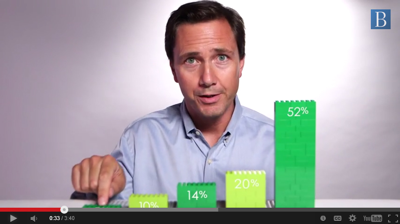
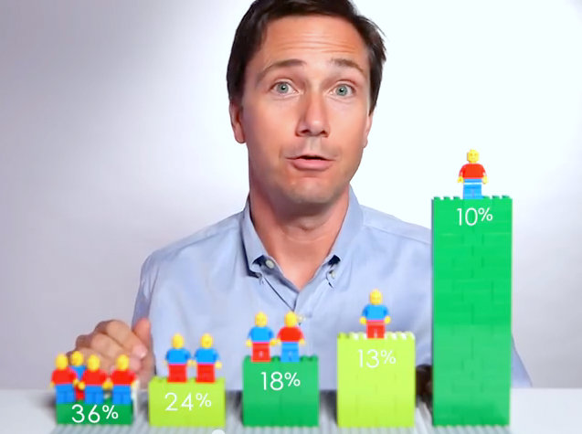
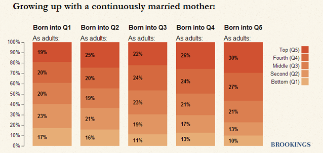
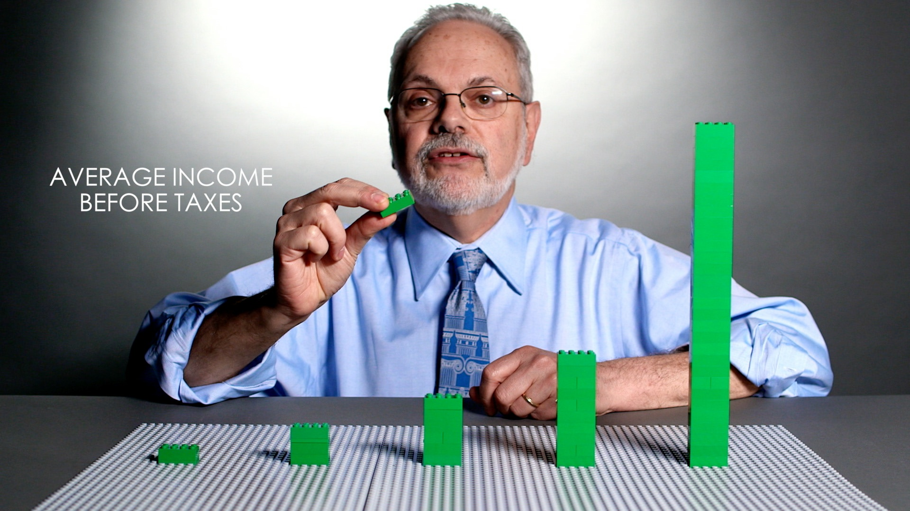

+++
author = "Yuichi Yazaki"
title = "Five Stacks as a Base: Remove, Move, Compare in Brookings' LEGO Videos"
slug = "brookings-lego-data-stories"
date = "2026-11-01"
description = "Brookings used five LEGO stacks to represent five income tiers, then removed bricks and moved figures to compare income before and after taxes and movement between tiers."
categories = [
    "consume"
]
tags = [
    "data physicalization",
    "Brookings Institution"
]
image = "images/lego-taxes-still.jpg"
+++

The US think tank Brookings Institution represented five income tiers with five LEGO stacks. In a 2014 video, a LEGO figure was moved up and down the rungs of society. In a 2015 video, bricks were removed to account for taxes, and the heights before and after tax were compared. Both are videos of about three minutes in which a researcher moves the LEGO in front of the camera.

This article looks at one entry in the dataphys.org catalog of physicalizations, "2014 – Data Storytelling with LEGOs". The entry is not a single work but a bundle of two separate Brookings videos. The first is Richard V. Reeves's video on social mobility (August 2014); the second is David Wessel's video on taxes and income inequality (April 2015). I have not been able to check the videos themselves, so what follows is a reading based on what Brookings' own articles and the press coverage of the time say.

<!--more-->

## One dataphys.org entry, two videos

dataphys.org is a catalog of physical visualizations compiled by researchers. This entry was registered by Fanny Chevalier, and its tags are "LEGO", "rearrangeable", and "storytelling". The description begins as follows.

> LEGO blocks are convenient tools to progressively construct a physical visualization while unfolding a story.

In short, LEGO is a handy tool for building a physical visualization step by step as the story unfolds. The entry goes on to say that this follows the same flow as Hans Rosling's talks, and names two subjects: how much taxes reduce inequality, and the prospects of someone born on the bottom rung.

The "2014" in the entry title is the year of the social mobility video. The tax video was released in 2015, so it does not match the year in the title.

| | Video A | Video B |
|---|---|---|
| Title | Is America Dreaming?: Understanding Social Mobility | Do Federal Taxes Reduce Income Inequality? |
| Presenter | Richard V. Reeves | David Wessel |
| Released | August 20, 2014 | April 9, 2015 |
| What is compared | The tier a person is born into, and the tier they reach as an adult | Average income before and after taxes |
| Data | NLSY79 and C-NLSY (surveys by the US Bureau of Labor Statistics) | Estimates from the Urban-Brookings Tax Policy Center |

## 2014: Where the figure ends up

Video A was published on August 20, 2014, embedded in the Brookings article "Watch: A Snapshot of Social Mobility in America" (Fred Dews). Dews's article introduces it as a video to watch before reading Reeves's long essay "Saving Horatio Alger," published the same month.

Source: Brookings Institution / Brookings, "Watch: A Snapshot of Social Mobility in America"

According to the local outlet Baltimore Brew, Reeves stands behind five stacks of green LEGO. Each of the five is a tier covering 20% of the population. The story starts from a perfectly mobile society.

> In a perfectly mobile society, an opportunity utopia, being born down here in the bottom quintile would have no effect on where you ended up. ... But now I want to show you what it's really like...

In a perfectly mobile society, being born in the bottom tier would have no effect on where you end up; now he will show what it is really like (transcript by Baltimore Brew). The order is to place the baseline state first, then rearrange the pieces into reality.

Source: Brookings Institution (video screenshot) / Baltimore Brew, "A lesson in Legos about social mobility in America"

Baltimore Brew writes that Reeves moves a LEGO figure up and down the rungs of society. According to press reports, of the people born in the bottom tier, a little over one in three stays in the bottom tier, and one in ten reaches the top tier (Gizmodo, Yahoo Finance). The 36% at the far left and the 10% at the far right of the image above match these figures.

The video then rearranges the lineup of figures by group. According to Yahoo Finance, 3% of Black Americans born in the bottom tier reach the top tier, compared with 1% of high school dropouts and 20% of college graduates.

The source of the data is in an article that Reeves and Joanna Venator wrote the next day.

> In both the video and the essay, we've created a series of 'mobility matrices' showing how income status in one generation influences income status in the next.

That is, in both the video and the essay they built "mobility matrices" showing how a parent generation's income position affects the children's. The sample was 5,783 children, and the matrices came in three kinds: by race, by education, and by mother's marital status.

Source: Richard V. Reeves & Joanna Venator / Brookings, "Saving Horatio Alger: The Data Behind the Words (and the Lego Bricks)"

The same article presents the mobility matrices as stacked bar charts. The figure above is the matrix for children whose mothers were continuously married. In the bar for those born in the bottom tier, 17% stay in the bottom tier and 19% reach the top tier.

The underlying data is a 5×5 table. The video can be read as taking just one row of it, "those born in the bottom tier," and showing it by group through the lineup of figures. Since I have not watched the video, I have not checked whether it touched on the other rows.

## 2015: Removing bricks for taxes

Video B was published on April 9, 2015, embedded in Wessel's article "How much does the tax code reduce inequality?" It came just before April 15, the US tax filing deadline.

> And you can tell it with tables of numbers, charts and graphs—or you can tell with Legos.

You can tell it with tables of numbers, charts, and graphs, or you can tell it with LEGO. Wessel goes on to write that he made a three-minute video with LEGO.

Source: Brookings Institution / Brookings, "How much does the tax code reduce inequality?"

Upworthy writes that each stack represents the average pre-tax income of each 20% of the population. In the still, the leftmost stack is about one brick tall, and the rightmost rises above Wessel's shoulder.

According to Wessel's article, the figures are 2014 estimates from the Urban-Brookings Tax Policy Center. The average pre-tax income of the top 20% is $306,320, more than 21 times that of the bottom 20%. After federal taxes, it is $229,360, about 17 times the bottom.

Taxes were shown by removing bricks from the stacks. The Week writes that 70 bricks are taken from the top 1%, while only one thin brick is taken from the bottom 20%. For the top 1%, Deseret News writes that showing them on screen would take more than 200 bricks. In Wessel's article, the top 1%'s income is a little over $2 million before taxes and $1.34 million after.

The two encodings are summarized below.

| Data | Physical representation | Video | Source |
|---|---|---|---|
| Income quintiles (20% of the population each) | Five stacks of green LEGO | A, B | Baltimore Brew, Upworthy |
| Children by group | LEGO figures | A | Baltimore Brew, Gizmodo |
| Adult tier | Position of the stack (rung) the figure is placed on | A | Baltimore Brew |
| Group (race, education, etc.) | Rearranging the lineup of figures | A | Gizmodo, Yahoo Finance |
| Average pre-tax income | Height of the stack | B | Upworthy |
| Federal taxes | Bricks removed from the stack | B | The Week |
| Average post-tax income | Height remaining after removal | B | Wessel's article, The Week |
| Income of the top 1% | Not made into a stack; the video says it would take more than 200 bricks | B | Deseret News |

**Going by the press coverage, both videos can be read as using five stacks, differing in what moves: a figure in one, bricks in the other.** In Video A the figure moves; in Video B the bricks decrease. The dataphys.org tag "rearrangeable" can be read as pointing to this stacking, removing, and moving.

One caution. Wessel's article gives the bottom 20%'s average income as $13,809 both before and after taxes, which also does not line up with the figures in the press reports. For that reason, I use only the ratios and the top-tier amounts here.

## "Animation would be too sterile"

The director of Video A was George Burroughs of Brookings' communications office. Video B is listed as one of the productions of the Brookings Creative Lab, which Burroughs leads. Baltimore Brew quotes from Burroughs's production notes.

> Animation would be too sterile, Richard explaining two-dimensional charts would be visually mind-numbing, nothing felt right,

Animation would be too sterile, Reeves explaining two-dimensional charts would be visually mind-numbing, and nothing felt right. Burroughs goes back to why people watch videos online, and writes that it is "emotion and story."

The credits for Video A that Baltimore Brew published include a director of photography and graphics, as well as someone who operated a motion control slider. This can be read as footage shot with controlled camera movement.

On July 20, 2015, Brookings launched the "Brookings Creative Lab," led by Burroughs, and listed the tax video among its productions. Burroughs's words are "We're trying to give a face to the numbers."

The same data was not released only as a video. The social mobility data came out in three forms: the essay (a long text with an interactive matrix), a blog post explaining the data, and the LEGO video. Reeves and colleagues present the video as something you can watch in "three minutes." The LEGO video can be read as placed there as an entry point that leads people to the more detailed materials.

## How third parties saw the videos

The press praised different things.

Baltimore Brew (Fern Shen, October 16, 2014) called the social mobility video "a clever approach to visual storytelling" and spent much of its space introducing the production team. It is an article that looks at how the video was made rather than at what it says.

The Week (Peter Weber, April 14, 2015) wrote that the tax video is "a pretty helpful way to visualize a fairly dry data set." The point is that it helps to show plain data. It reads taxes as "the number of bricks removed," contrasting 70 bricks with a single thin one.

Upworthy (Parker Molloy, April 13, 2015) used the tax video as material for its own argument. It writes that for the tax system to have a large effect on the distribution of wealth, it would have to become much more progressive. The Wessel in the video went no further than saying that taxes narrow the gap but that things remain quite unequal after taxes (as quoted by The Week). This can be read as showing that even when a physical form makes things easier to grasp, room for interpretation remains.

As for scholarly assessment, I found no literature that discusses these two videos individually. Mentions from the research side are mainly the dataphys.org entry.

## Takeaways

What we can take from these two videos is, first, to fix the base. Going by the press coverage, both videos can be read as using five stacks, differing in what moves: a figure in one, bricks in the other. With the same base, viewers can compare the next state while remembering the previous one.

Second, decide the order of comparison first. Video A proceeds from a "perfectly mobile society" to "reality," and then to groups. Video B proceeds from "before taxes" to "after taxes." In a visualization that uses motion, which state moves to which becomes the argument itself.

Third, do not turn everything into objects. For the top 1%, Deseret News writes that making a stack would take more than 200 bricks. Decide the range to show with objects, and hand numbers that do not fit over to words and articles. Using the video as an entry point and having people read the rest in the essay and blog can be read as an extension of this.

Finally, checking the numbers. As in Wessel's article, even the original text can have figures that do not line up. Before converting values into the height of an object, it is worth confirming which values to use.

## References

**Primary sources**

- dataphys.org, "2014 – Data Storytelling with LEGOs" (registered by Fanny Chevalier): https://dataphys.org/list/data-storytelling-with-lego/
- Fred Dews, "Watch: A Snapshot of Social Mobility in America," Brookings, 2014-08-20: https://www.brookings.edu/articles/watch-a-snapshot-of-social-mobility-in-america/
- Richard V. Reeves & Joanna Venator, "Saving Horatio Alger: The Data Behind the Words (and the Lego Bricks)," Brookings Social Mobility Memos, 2014-08-21: https://www.brookings.edu/articles/saving-horatio-alger-the-data-behind-the-words-and-the-lego-bricks/
- Richard V. Reeves, "Saving Horatio Alger: Equality, Opportunity, and the American Dream," Brookings Essay, 2014 (full text not checked): https://www.brookings.edu/essay/saving-horatio-alger-equality-opportunity-and-the-american-dream/
- David Wessel, "How much does the tax code reduce inequality?," Brookings, 2015-04-09: https://www.brookings.edu/articles/how-much-does-the-tax-code-reduce-inequality/
- Fred Dews, "Brookings launches "Brookings Creative Lab" to show the stories behind the research," Brookings, 2015-07-20: https://www.brookings.edu/articles/brookings-launches-brookings-creative-lab-to-show-the-stories-behind-the-research/
- Brookings Institution, "Is America Dreaming?: Understanding Social Mobility" (YouTube, video itself not checked): https://www.youtube.com/watch?v=t2XFh_tD2RA
- Brookings Institution, "Do Federal Taxes Reduce Income Inequality?" (YouTube, video itself not checked): https://www.youtube.com/watch?v=7fgtE-AJs-A

**Secondary sources**

- Fern Shen, "A lesson in Legos about social mobility in America," *Baltimore Brew*, 2014-10-16: https://www.baltimorebrew.com/2014/10/16/a-lesson-in-legos-about-social-mobility-in-america
- "Economist Uses Lego Bricks to Show the Ugly Truth of Social Mobility," *Gizmodo*, 2014: https://gizmodo.com/economist-uses-lego-bricks-to-show-the-ugly-truth-of-so-1627881169
- Mandi Woodruff, "The dying American dream, perfectly illustrated with Legos," *Yahoo Finance*, 2014-08-22: https://ca.finance.yahoo.com/news/american-dream-illustrated-with-legos-brookings-200611923.html
- Peter Weber, "Watch an economist use Legos to explain how taxes affect U.S. income distribution," *The Week*, 2015-04-14: https://theweek.com/speedreads/549534/watch-economist-use-legos-explain-how-taxes-affect-income-distribution
- Parker Molloy, "Using Lego bricks, an economist demonstrates how taxes affect income inequality.," *Upworthy*, 2015-04-13: https://www.upworthy.com/using-lego-bricks-an-economist-demonstrates-how-taxes-affect-income-inequality
- Herb Scribner, "Do taxes help income inequality? These Legos hold the answer," *Great Bend Tribune* (reprint of Deseret News), 2015-04-15: https://www.gbtribune.com/news/trending-topics/do-taxes-help-income-inequality-these-legos-hold-the-answer/
