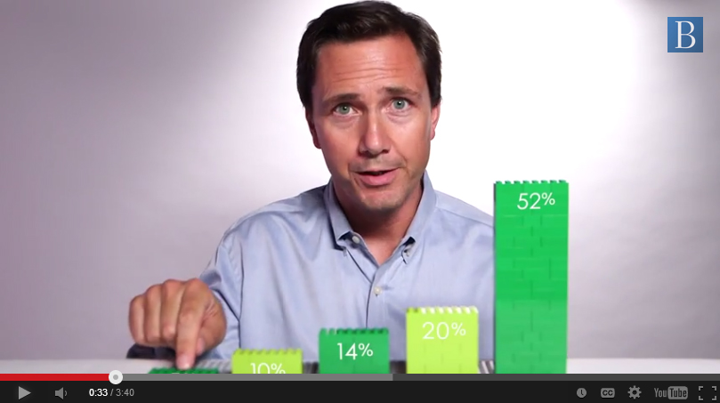
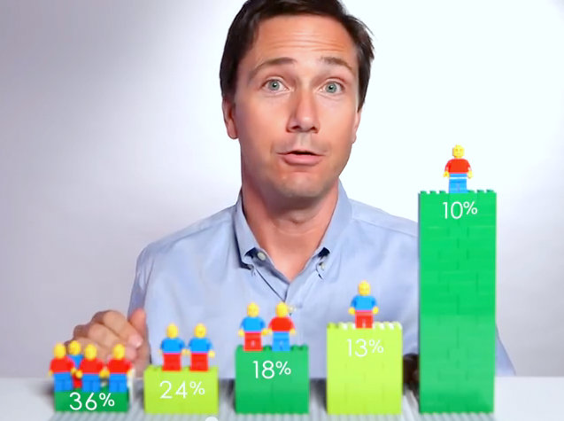
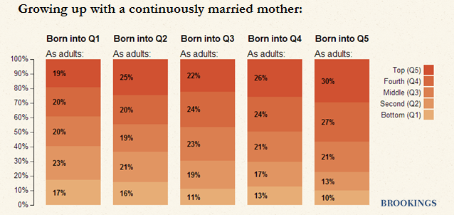
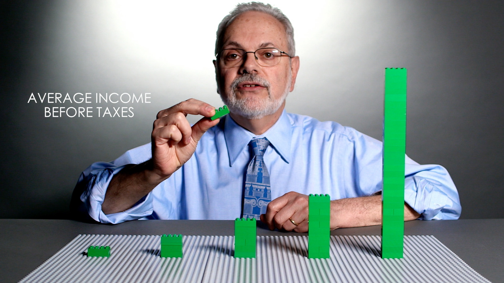

+++
author = "矢崎裕一"
title = "5本の積み上げを土台に、取り除いて、動かして比べる──Brookings のレゴ動画"
slug = "brookings-lego-data-stories"
date = "2026-11-01"
description = "Brookings は所得の5つの階層をレゴの積み上げ5本で表し、ブロックを取り除いたり人形を動かしたりして、税の前後や階層の移動を比べて見せました。"
categories = [
    "consume"
]
tags = [
    "データ物質化",
    "Brookings Institution"
]
image = "images/lego-taxes-still.jpg"
series = ["data-physicalization"]
series_weight = 19
seriesByline = "Brookings（Richard V. Reeves・David Wessel）"
seriesTitle = "5本の積み上げで税と移動を比べる──Brookings のレゴ動画"
+++

米国のシンクタンク Brookings Institution（ブルッキングス研究所）は、所得の5つの階層をレゴの積み上げ5本で表しました。2014年の動画では、レゴの人形を、社会の段の上下へ動かしました。2015年の動画では、税の分だけブロックを取り除き、税の前と後の高さを比べました。どちらも、研究者本人がカメラの前でレゴを動かす、3分ほどの動画です。

この記事が扱うのは、データ物理化の事例集 dataphys.org の一項目「2014 – Data Storytelling with LEGOs」です。この項目は一つの作品ではなく、Brookings の別々の動画2本をまとめたものです。1本目は Richard V. Reeves（リチャード・V・リーブス）の社会移動の動画（2014年8月）、2本目は David Wessel（デビッド・ウェッセル）の税と所得格差の動画（2015年4月）です。筆者は動画の本編を確かめられていないため、以下は Brookings 自身の記事と、当時の報道に書かれた範囲で読みます。

<!--more-->

## dataphys.org の一項目に、2本の動画

dataphys.org は、研究者が集めた物理的な可視化の目録です。この項目は Fanny Chevalier（ファニー・シュヴァリエ）が登録し、タグは "LEGO"、"rearrangeable"、"storytelling" です。説明文はこう始まります。

> LEGO blocks are convenient tools to progressively construct a physical visualization while unfolding a story.

レゴは、話を進めながら少しずつ物理的な可視化を組み立てるのに便利な道具だ、という説明です。続けて Hans Rosling（ハンス・ロスリング）の語りと同じ流れだとし、税が格差をどれだけ縮めるか、最下段に生まれた人の見込み、という二つの題材を挙げています。

見出しの「2014」は、社会移動の動画の年です。税の動画は2015年の公開で、見出しの年とは合いません。

| | 動画 A | 動画 B |
|---|---|---|
| 題名 | Is America Dreaming?: Understanding Social Mobility | Do Federal Taxes Reduce Income Inequality? |
| 出演 | Richard V. Reeves | David Wessel |
| 公開 | 2014年8月20日 | 2015年4月9日 |
| 比べるもの | 生まれた階層と、大人になってからの階層 | 税の前と後の平均所得 |
| データ | NLSY79 と C-NLSY（米国労働統計局の調査） | Urban-Brookings Tax Policy Center の推計 |

## 2014年、人形の行き先

動画 A は2014年8月20日、Brookings の記事 "Watch: A Snapshot of Social Mobility in America"（Fred Dews）に埋め込まれて公開されました。Dews の記事は、同じ月に出た Reeves の長文エッセイ "Saving Horatio Alger" を読む前に見る動画として紹介しています。

Brookings Institution／Brookings「Watch: A Snapshot of Social Mobility in America」より引用

地元メディアの Baltimore Brew によれば、Reeves は緑のレゴを積んだ5本のスタックの後ろに立ちます。5本はそれぞれ、人口を20%ずつに区切った階層です。話の起点は、完全に移動できる社会です。

> In a perfectly mobile society, an opportunity utopia, being born down here in the bottom quintile would have no effect on where you ended up. ... But now I want to show you what it's really like...

完全に移動できる社会では、最下層に生まれても行き着く先に影響しない。では現実を見せよう、という流れです（Baltimore Brew による書き起こし）。基準の状態を先に置き、そこから現実へ並べ替える順序です。

Brookings Institution（動画のスクリーンショット）／Baltimore Brew「A lesson in Legos about social mobility in America」より引用

Baltimore Brew は、Reeves がレゴの人形を社会の段の上下に動かす、と書いています。報道によれば、最下層に生まれた人のうち最下層にとどまるのは3人に1人強、最上層に届くのは10人に1人です（Gizmodo、Yahoo Finance）。上の画像の左端の36%と右端の10%は、この数と合います。

動画は続いて、属性ごとに人形の並びを組み直します。Yahoo Finance によれば、黒人で最上層に届くのは3%、高校中退では1%、大卒では20%でした。

データの出どころは、Reeves と Joanna Venator が翌日に書いた記事にあります。

> In both the video and the essay, we've created a series of 'mobility matrices' showing how income status in one generation influences income status in the next.

動画でもエッセイでも、親の世代の所得の位置が子の世代にどう影響するかを示す「移動行列」を作った、という説明です。標本は子ども5,783人で、行列は人種、学歴、母親の婚姻状態の3種類でした。

Richard V. Reeves & Joanna Venator／Brookings「Saving Horatio Alger: The Data Behind the Words (and the Lego Bricks)」より引用

同じ記事は、移動行列を積み上げ棒グラフで載せています。上の図は、母親がずっと結婚していた子の行列です。最下層に生まれた棒では、最下層にとどまるのが17%、最上層に届くのが19%です。

元のデータは5×5の表です。動画はそのうち「最下層に生まれた行」を取り出し、属性ごとに人形の並びで見せた、と読めます。ただし動画を見ていないので、ほかの行に触れたかどうかは確かめていません。

## 2015年、税の分だけブロックを取り除く

動画 B は2015年4月9日、Wessel の記事 "How much does the tax code reduce inequality?" に埋め込まれて公開されました。米国の確定申告の期限、4月15日の直前です。

> And you can tell it with tables of numbers, charts and graphs—or you can tell with Legos.

数字の表やチャートでも語れるし、レゴでも語れる、という一文です。Wessel は続けて、3分の動画をレゴで作ったと書いています。

Brookings Institution／Brookings「How much does the tax code reduce inequality?」より引用

Upworthy は、それぞれのスタックが人口20%ごとの税引前の平均所得を表す、と書いています。スチルでは、いちばん左はブロック1個ほどで、いちばん右は Wessel の肩の高さを超えています。

Wessel の記事によれば、数値は Urban-Brookings Tax Policy Center の2014年の推計です。上位20%の税引前の平均所得は306,320ドルで、下位20%の21倍を超えます。連邦税を引いた後は229,360ドルで、下位の約17倍になります。

税は、スタックからブロックを取り除く動きで示されました。The Week は、上位1%からは70個のブロックが取られ、下位20%からは薄いブロック1枚だけ、と書いています。上位1%については、画面に出すには200個以上のブロックが要る、と Deseret News は書いています。Wessel の記事では、上位1%の所得は税引前で200万ドル強、税引後で134万ドルです。

2本のエンコーディングをまとめると、次のとおりです。

| データ | 物理的な表し方 | 動画 | 出典 |
|---|---|---|---|
| 所得の5分位（人口20%ずつ） | 緑のレゴを積んだ5本のスタック | A・B | Baltimore Brew、Upworthy |
| 属性ごとの子ども | レゴの人形 | A | Baltimore Brew、Gizmodo |
| 大人になってからの階層 | 人形を置くスタック（段）の位置 | A | Baltimore Brew |
| 属性（人種、学歴など） | 人形の並びを組み直す | A | Gizmodo、Yahoo Finance |
| 税引前の平均所得 | スタックの高さ | B | Upworthy |
| 連邦税 | スタックから取り除くブロック | B | The Week |
| 税引後の平均所得 | 取り除いた後に残る高さ | B | Wessel の記事、The Week |
| 上位1%の所得 | スタックにせず、200個以上のブロックが要ると述べる | B | Deseret News |

**報道に書かれた範囲では、2本とも5本のスタックを使い、動かすものが人形とブロックで違う、と読めます。** 動画 A では人形が動き、動画 B ではブロックが減ります。dataphys.org のタグ "rearrangeable"（組み替えられる）は、この「積む・取る・動かす」を指していると読めます。

一つ注意があります。Wessel の記事では、下位20%の平均所得が税引前・税引後とも13,809ドルと書かれており、報道各社の数字とも揃いません。そのため、ここでは倍率と上位の金額だけを使いました。

## 「アニメーションは無機質すぎる」

動画 A のディレクターは、Brookings 広報部門の George Burroughs（ジョージ・バローズ）でした。動画 B は、Burroughs が率いる Brookings Creative Lab が制作物の一つに挙げています。Baltimore Brew は、Burroughs の制作記からこう引いています。

> Animation would be too sterile, Richard explaining two-dimensional charts would be visually mind-numbing, nothing felt right,

アニメーションは無機質すぎる。Reeves が2次元のチャートを説明するのは見ていて退屈だ。どれもしっくりこなかった、という言葉です。Burroughs は、人がオンラインで動画を見る理由に立ち返り、「感情と物語」だと書いています。

Baltimore Brew が載せた動画 A のクレジットには、撮影監督やグラフィックスのほか、モーションコントロール・スライダーの操作担当がいます。カメラの動きを制御して撮った映像と読めます。

2015年7月20日、Brookings は Burroughs が率いる「Brookings Creative Lab」を立ち上げ、制作物の一つに税の動画を挙げました。Burroughs の言葉は "We're trying to give a face to the numbers" です。数字に顔を与えようとしている、という意味です。

同じデータは、動画だけで出されたわけではありません。社会移動のデータは、エッセイ（長文とインタラクティブな行列）、データを解説したブログ記事、レゴの動画の三つで出ました。Reeves らは動画を「3分」で見られるものとして紹介しています。レゴの動画は、詳しい資料へ人を連れていく入口として置かれている、と読めます。

## 第三者はこの動画をどう見たか

報道は、それぞれ違うところを評価しています。

Baltimore Brew（Fern Shen、2014年10月16日）は、社会移動の動画を "a clever approach to visual storytelling" と評し、紙面の多くを制作陣の紹介に使いました。中身よりも、どう作ったかに目を向けた記事です。

The Week（Peter Weber、2015年4月14日）は、税の動画を "a pretty helpful way to visualize a fairly dry data set" と書きました。味気ないデータを見せるのに役立つ、という評価です。税を「取り除かれるブロックの数」として読み、70個と薄いブロック1枚を対比させています。

Upworthy（Parker Molloy、2015年4月13日）は、税の動画を主張の材料にしました。税制が富の分布に大きく効くには、ずっと累進的にならなければならない、と書いています。動画の Wessel は、税は差を縮めるが税の後もかなり不平等なまま、と述べるにとどめていました（The Week による引用）。物で見せて分かりやすくしても、解釈の余地は残る、と読めます。

研究者による評価では、この2本を個別に論じた文献は見つかりませんでした。研究の側からの言及は、dataphys.org の登録が中心です。

## 使い道

この2本から持ち帰れるのは、まず土台を固定することです。報道に書かれた範囲では、2本とも5本のスタックを使い、動かすものが人形とブロックで違う、と読めます。土台が同じなら、見る人は前の状態を覚えたまま、次の状態と比べられます。

次に、比べる順序を先に決めることです。動画 A は「完全に移動できる社会」から「現実」へ、さらに属性別へと進みます。動画 B は「税の前」から「税の後」へ進みます。動きを使う可視化では、どの状態からどの状態へ移すかが、そのまま論点になります。

三つ目は、全部を物にしないことです。上位1%について、Deseret News は、スタックにするには200個以上のブロックが要ると書いています。物で見せる範囲を決め、収まらない数は言葉や記事に回す。動画を入口にして、エッセイやブログで残りを読ませる構成も、その延長にあると読めます。

最後に、数字の照合です。Wessel の記事のように、元の文章でも数が揃わないことがあります。物の高さに置き換える前に、どの値を使うかを確かめておく価値があります。

## 参考・出典

**一次情報**

- dataphys.org「2014 – Data Storytelling with LEGOs」（Fanny Chevalier 登録）：https://dataphys.org/list/data-storytelling-with-lego/
- Fred Dews, "Watch: A Snapshot of Social Mobility in America," Brookings, 2014-08-20：https://www.brookings.edu/articles/watch-a-snapshot-of-social-mobility-in-america/
- Richard V. Reeves & Joanna Venator, "Saving Horatio Alger: The Data Behind the Words (and the Lego Bricks)," Brookings Social Mobility Memos, 2014-08-21：https://www.brookings.edu/articles/saving-horatio-alger-the-data-behind-the-words-and-the-lego-bricks/
- Richard V. Reeves, "Saving Horatio Alger: Equality, Opportunity, and the American Dream," Brookings Essay, 2014（本文は未確認）：https://www.brookings.edu/essay/saving-horatio-alger-equality-opportunity-and-the-american-dream/
- David Wessel, "How much does the tax code reduce inequality?," Brookings, 2015-04-09：https://www.brookings.edu/articles/how-much-does-the-tax-code-reduce-inequality/
- Fred Dews, "Brookings launches "Brookings Creative Lab" to show the stories behind the research," Brookings, 2015-07-20：https://www.brookings.edu/articles/brookings-launches-brookings-creative-lab-to-show-the-stories-behind-the-research/
- Brookings Institution, "Is America Dreaming?: Understanding Social Mobility"（YouTube、本編は未確認）：https://www.youtube.com/watch?v=t2XFh_tD2RA
- Brookings Institution, "Do Federal Taxes Reduce Income Inequality?"（YouTube、本編は未確認）：https://www.youtube.com/watch?v=7fgtE-AJs-A

**第三者評価**

- Fern Shen, "A lesson in Legos about social mobility in America," *Baltimore Brew*, 2014-10-16：https://www.baltimorebrew.com/2014/10/16/a-lesson-in-legos-about-social-mobility-in-america
- "Economist Uses Lego Bricks to Show the Ugly Truth of Social Mobility," *Gizmodo*, 2014：https://gizmodo.com/economist-uses-lego-bricks-to-show-the-ugly-truth-of-so-1627881169
- Mandi Woodruff, "The dying American dream, perfectly illustrated with Legos," *Yahoo Finance*, 2014-08-22：https://ca.finance.yahoo.com/news/american-dream-illustrated-with-legos-brookings-200611923.html
- Peter Weber, "Watch an economist use Legos to explain how taxes affect U.S. income distribution," *The Week*, 2015-04-14：https://theweek.com/speedreads/549534/watch-economist-use-legos-explain-how-taxes-affect-income-distribution
- Parker Molloy, "Using Lego bricks, an economist demonstrates how taxes affect income inequality.," *Upworthy*, 2015-04-13：https://www.upworthy.com/using-lego-bricks-an-economist-demonstrates-how-taxes-affect-income-inequality
- Herb Scribner, "Do taxes help income inequality? These Legos hold the answer," *Great Bend Tribune*（Deseret News の転載）, 2015-04-15：https://www.gbtribune.com/news/trending-topics/do-taxes-help-income-inequality-these-legos-hold-the-answer/
