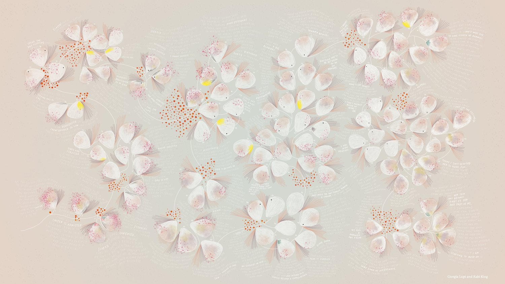
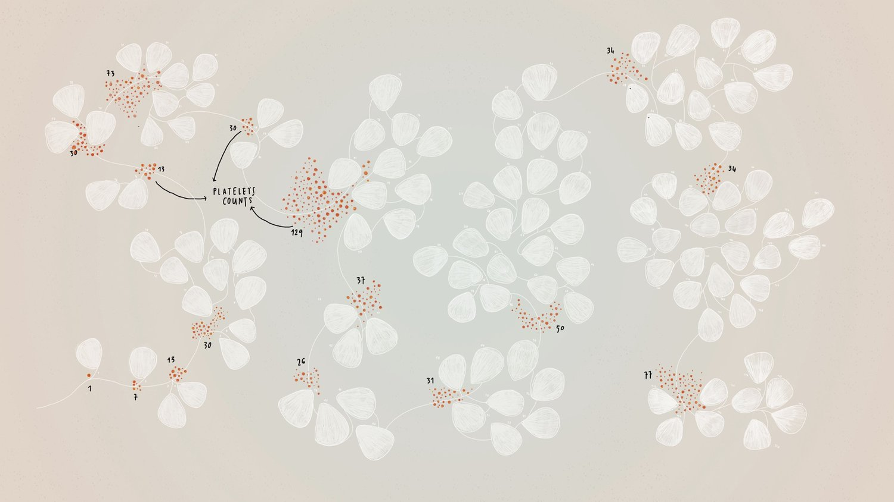
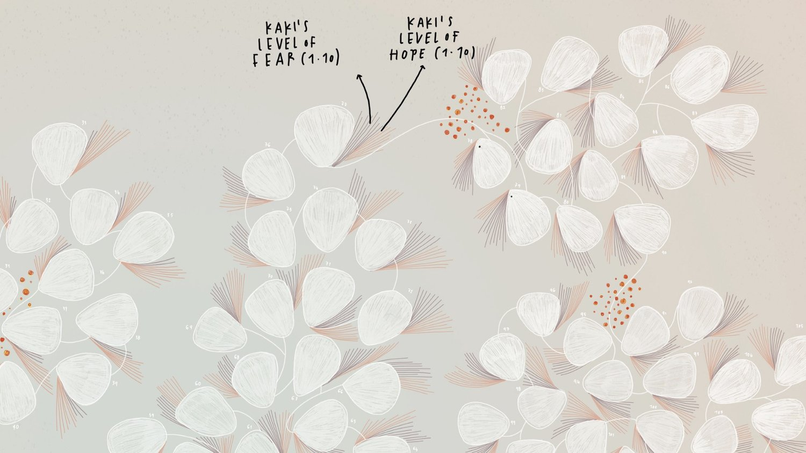
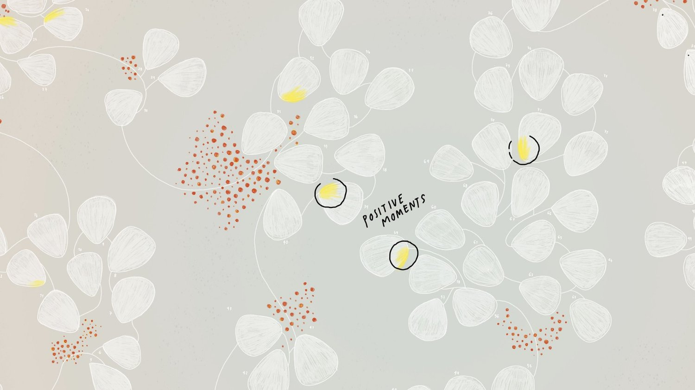
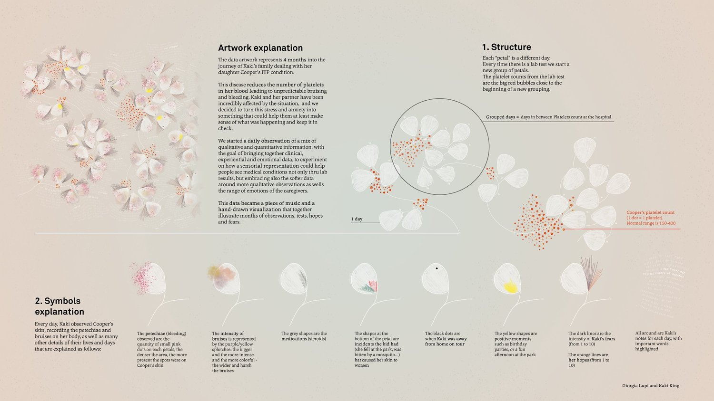

+++
author = "Yuichi Yazaki"
title = "Divided by Blood-Test Days, Not Weeks or Months: Giorgia Lupi and Kaki King's 'Bruises'"
slug = "bruises-the-data-we-dont-see"
date = "2026-11-07"
description = "A work that lays 120 days of records on Kaki King's daughter's illness along one timeline divided by blood-test days, layering test values and the mother's hope and fear on the same day. King also composed a song from the same records."
categories = [
    "consume"
]
tags = [
    "original visual transformation",
    "music",
    "care"
]
image = "images/artwork-full.jpg"
series = ["speculative-design"]
series_weight = 99
seriesByline = "Giorgia Lupi / Kaki King"
seriesTitle = "Divided by Test Days, Layering Hope and Fear: Bruises"
+++

*Bruises — The Data We Don't See* is a work that lays out 120 days of records on the illness of Kaki King's daughter along a single timeline. One white shape is one day, and each blood test starts a new group of days. The platelet count from the test, and the hope and fear that King, the mother, rated from 1 to 10, are layered on the same day. From the same records, King composed a song in 3/4 time and 120 measures, one day per measure.

The drawing is by Giorgia Lupi, and the song and guitar are by King; the work premiered in January 2018. What follows draws on the work page on Lupi's official site, including the complete legend posted there, and on Pentagram's work page. Lupi's work was also read in the articles on [a visualization of brain drain](/en/brain-drain/), which puts countries on axes of two quantities, and on the wallpaper that is read from near and far, [*The Room of Change*](/en/the-room-of-change/). Here I read how time is divided, and the units of the picture and the sound. I do not give the child's name and refer to her as "her daughter," and I include only images of the work that the creators have published.

<!--more-->

Source: Giorgia Lupi and Kaki King, "BRUISES - The Data We Don't See," Giorgia Lupi official site

## August 2017: the records begin with a doctor's instruction

In early August 2017, King found blood in the mouth of her nearly three-year-old daughter. There was a lesion on the tongue the size of a 10-cent coin. After a blood test in the emergency room, the diagnosis was ITP (immune thrombocytopenic purpura), an autoimmune disease in which the body attacks its own platelets and bruises and petechiae appear all over the body.

The records began with a doctor's instruction. These are King's words (from Pentagram's work page; the square brackets are as on that page).

> "The doctor's directive to us was to watch her skin for any significant changes. … I began to write down what I was seeing on [my daughter's] skin, what activities we did that day, what treatments she had, and what her readings were, as well as how I was feeling"

She was told to watch her daughter's skin, and she began to write down the state of the skin, events, treatments, test values and her own feelings. She says she learned personal data collection from her work with Lupi.

The two had previously worked together on Hennessy's brand identity and on "A Dialogue Between Four Hands" in early 2017. In the latter, they used both of their personal data for the song and the drawing.

According to AIGA Eye on Design, King put the records into a spreadsheet, and Lupi assigned an appearance to each type of data in those 120 days. Lupi writes of the question she felt on reading the records: can data visualization work on emotion, and not only on cognition?

## Divided by test days, not weeks or months

Lupi describes how she built the timeline.

> "I structured a fluid timeline, where each one of the white elements indicates a new day."

Each white element is one day. Days form groups between hospital visits for blood tests. Lupi wrote, "a new group of days starts when a lab test was performed."

Source: Giorgia Lupi and Kaki King, "BRUISES - The Data We Don't See," Giorgia Lupi official site

The platelet count from the test is shown by the red dots at the head of each group. The normal range is 150 to 400, and at the start of the record, 1, 7 and 30 appear in a row. The work's complete legend says "1 dot = 1 platelet," so the number of dots stands for the value.

With this division, the size of a group is the number of days until the next test, so the lengths are uneven. King looks back and says her daughter's platelet count ruled their lives. **For the family, the unit of time was not the week but "until the next test"**, it can be read.

Lupi calls the timeline a "fluid timeline" and Pentagram calls it a "non-linear timeline."

## Layering test values and hope and fear on the same day

On the white shape of a day, different kinds of data are layered. The correspondences below come from Lupi's description and the complete legend. In the song column, I list only the units whose correspondence the creators have disclosed.

| Data (records by King) | In the picture | In the song |
|---|---|---|
| One day | One white shape (called a "petal" in the legend) | One measure in 3/4 time |
| Test day | Start of a new group | — |
| Platelet count (clinical value) | Red dots at the head of the group | — |
| Degree of bruising (visual) | Purple and green blurs; the larger and darker, the wider and deeper | — |
| Amount of petechiae (visual) | Density of small pink dots | — |
| Steroid doses | Gray brush strokes | — |
| Events that harmed the skin | Colored-pencil lines | — |
| Days King was away from home | Black dots | — |
| Good moments | Bright yellow spots | — |
| King's hope and fear (1–10) | Lines floating around the day | — |
| King's daily notes | Handwritten around the shapes, with decisive words emphasized | — |

Source: Giorgia Lupi and Kaki King, "BRUISES - The Data We Don't See," Giorgia Lupi official site

The complete legend explains that the dark lines are fear and the orange lines are hope.

Source: Giorgia Lupi and Kaki King, "BRUISES - The Data We Don't See," Giorgia Lupi official site

The platelet count is placed only once, at the head of a group, while skin and feelings are drawn every day. This can be read as a design that puts clinical values and self-ratings, which differ in frequency, onto the same unit of "one day." Lupi herself notes that "this isn't by any means a scientific representation of data."

For the person who kept the records, this way of layering became a tool for looking back. King tells Eye on Design:

> "I could look back at a week and go, 'oh, she had a lot of bruises,' … Or I'd see that things have gotten better, but I'm still falling apart."

Looking back over a week, she could see that there had been many bruises, or that things were better while she herself was falling apart. It can be read that because her daughter's skin and her own feelings sit on the same day, the gap between them becomes visible.

## Making a song of one measure per day from the same records

The drawing is half of the work, and the song is the other half. King explains:

> "The song has 120 measures in 3/4 time, covering the 120 days that I collected data. There are elements that you will hear that reference the amount of petechiae on her skin, my changing mood... And the main guitar part is a musical map of the bruises on her skin"

The song has 120 measures in 3/4 time, matching the 120 days of records. Some elements refer to the amount of petechiae and to her mood, and the main guitar part is a musical map of the bruises.

The only correspondence that can be confirmed is one day per measure. Petechiae and mood are said to be "referenced" and the bruises "mapped," but no assignment to pitch or volume is stated. On the creators' side, the text says "Kaki composed a song based on her data collection," and King calls the work "this visualization and musicalization." The word sonification does not appear in the sources I examined.

[TwoTone](/en/twotone-sonification/) assigns one column of a table to the steps of a musical scale and sounds one row as one beat. In Bruises, the only confirmed correspondence is the unit of time, and it can be read as a song that leaves the content of each measure to the composer's judgment. It is accurate to read it as a composition made from data, not as a sonification that can be reproduced by rules.

The premiere was on January 25, 2018, at the STIR Experience Lab in San Francisco, with King playing live in the venue. On January 27, a full video was published on Lupi's YouTube channel. The animation is by Andrea Bax Bassan. The work was later shown in Cooper Hewitt's design triennial "Nature," and was also incorporated into King's stage work *DATA NOT FOUND* (2019).

## How did third parties see the work?

One extended discussion is in *Data Feminism* (MIT Press, 2020) by Catherine D'Ignazio and Lauren F. Klein. In Chapter 7, "Show Your Work," pp.195–199, it treats the work as a case of making care work and emotional labor visible.

> "She employed a fluid timeline to reflect the subjective nature of what disability studies scholars call crip time."

The reading is that Lupi used a fluid timeline to reflect the subjectivity of what disability studies calls crip time. The book contrasts it with the Atlas of Caregiving, which uses a radial timeline and Gantt charts, and writes that the days are "segmented not by weeks or years but by hospital visits." It is a reading that connects the division by test days to the temporal thinking of disability studies.

At the same time, the book's account of the colors conflicts with the creators' legend. Here they are side by side by source (Pentagram's description is the same as Lupi's work page).

Source: Giorgia Lupi and Kaki King, "BRUISES - The Data We Don't See," Giorgia Lupi official site

| Point | Lupi's work page | The work's complete legend | Eye on Design | *Data Feminism* |
|---|---|---|---|---|
| Shape of a day | "white elements" (Pentagram: "petal-like") | "petal" | "flower petal" | "white aspen-shaped leaves" (leaves shaped like aspen) |
| Black | Black dots = days King was away from home | Black dots = days away from home on tour | Black dots = away on tour | "black corresponding to stress and fear" |
| Yellow | Yellow spots = good moments | Yellow shapes = good times such as birthday parties | "Yellow indicates a good day" | "yellow to signify hope" |
| Hope and fear | Floating lines, 1–10 | Dark lines = fear, orange lines = hope | The more lines, the stronger the emotion | Hand-drawn lines, 1–10 |
| Color of bruises | Purple and green | "purple/yellow" | The more vivid the color, the stronger | Intensity imitated by color (no color names) |

The two agree that hope and fear are shown by lines from 1 to 10; what differs is the meaning of black and yellow. In the complete legend, yellow appears both for good times and for the blur of bruises. With many symbols and yellow carrying two meanings, it can also be read that it became easier for those introducing the work to read it differently.

Liz Stinson of AIGA Eye on Design made the difficulty of reading itself the point. Without the legend it is almost unreadable ("virtually unreadable"). Even so, for King it became shorthand for checking her daughter's health and its effect on herself. Stinson's assessment is that it gave her a sense of agency that is hard to get from information passed through doctors and nurses.

Italy's Frizzi Frizzi introduced it briefly as an example of turning data from numbers into a tool for storytelling.

## Takeaways

There are four judgments to take back to visualization work.

First, decide time divisions by events. Bruises grouped days not by week or month but by test day. For records whose life is set by milestones of treatment or procedures, dividing at the milestones can be read as a picture closer to the time of the people involved.

Second, put data of different frequency and kind on the same unit. Test values came every few days, feelings every day. In looking back, King says she noticed the gap between the number of bruises and her own state. It can be read that the design that puts test values and feelings on the same "day" helped with that. Before splitting them into separate graphs, it is worth considering whether they can be layered on a common unit.

Third, when turning data into sound, distinguish rules from composition. The only correspondence confirmed in Bruises is one day per measure, and the creators call it musicalization. If you write down where the rules end and the maker's judgment begins, listeners are spared misreading.

Fourth, publish the legend with the work, and have those who introduce it go back to the legend to check. Lupi published a complete legend, yet in secondary literature the meanings of black and yellow changed. The creator writes that this work is an attempt to rethink what we call data.

> "radical experimentations of this kind, artistic experimentation of this kind, can be a starting point to reconsider what we define as data in the first place."

The claim is that such radical experiments can be a starting point for reconsidering the definition of data. It can be read that the foothold for others who take up the attempt is the legend the creator published.

## References

**Primary sources**

- Giorgia Lupi, "BRUISES - The Data We Don't See," official site (including the work's complete legend). [Work page](https://giorgialupi.com/bruises-the-data-we-dont-see) / [High-resolution legend (Dropbox)](https://www.dropbox.com/s/dtcor0tfveyllau/01%20ARTWORK%20Legend.jpg?dl=0)
- Giorgia Lupi, "Bruises — The Data We Don't See," Medium, 2018-01-31 (date from note 61 of *Data Feminism*; text not checked). [Article](https://medium.com/@giorgialupi/bruises-the-data-we-dont-see-1fdec00d0036)
- Giorgia Lupi and Kaki King, "Bruises - The Data We Don't See," YouTube (Giorgia Lupi's channel), 2018-01-27. [Video](https://www.youtube.com/watch?v=QvxVWukROTw)
- "Bruises: The Data We Don't See | Kaki King & Giorgia Lupi," Talks at Google, YouTube, 2018-07-16. [Video](https://www.youtube.com/watch?v=zi3jIT8cqgs) / [Repost of the description (Travelin' Librarian)](https://travelinlibrarian.info/2018/08/24/friday-video-kaki-king-giorgia-lupi-bruises-the-data-we-dont-see-talks-at-google)
- Pentagram, "Bruises: The Data We Don't See." [Work page](https://www.pentagram.com/work/bruises-the-data-we-dont-see)
- Krannert Center for the Performing Arts, *Kaki King: DATA NOT FOUND* program, 2019-09-06. [PDF](https://krannertcenter.com/sites/krannertcenter.com/files/krannertcenter_ellnora2019_kakiking_web.pdf)
- Cooper Hewitt, Smithsonian Design Museum, collection record (text not checked). [Collection record](https://collection.cooperhewitt.org/objects/2318798830/)
- Kantar Information is Beautiful Awards 2018, "Bruises – The Data We Don't See." [Showcase](https://www.informationisbeautifulawards.com/showcase/3288-bruises-the-data-we-don-t-see)

**Secondary sources**

- Catherine D'Ignazio and Lauren F. Klein, *Data Feminism*, MIT Press, 2020, Chapter 7 "Show Your Work," pp.195–199, Figure 7.9, notes 61–64. [Open-access edition (Internet Archive)](https://archive.org/details/mit_press_book_9780262358521)
- Liz Stinson, "How Kaki King and Giorgia Lupi Used Data to Make Sense of a Child's Illness," *AIGA Eye on Design*, 2018-02-01. [Article](https://eyeondesign.aiga.org/how-kaki-king-and-giorgia-lupi-used-data-to-make-sense-of-a-childs-illness/)
- "Visualizzare (poeticamente) una malattia autoimmune," *Frizzi Frizzi*, 2018-02-01. [Article](https://www.frizzifrizzi.it/2018/02/01/visualizzare-poeticamente-malattia-autoimmune/)
