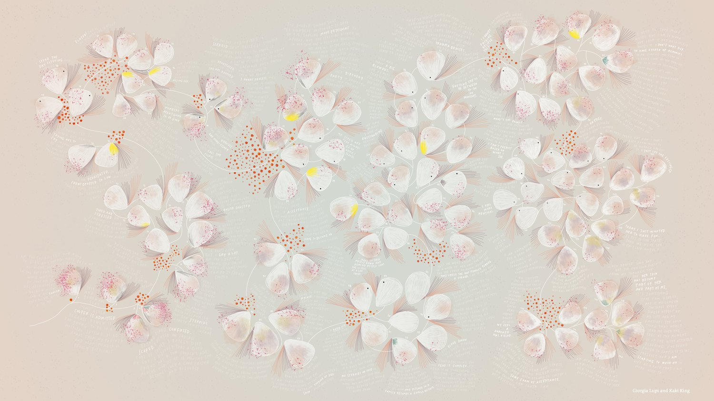
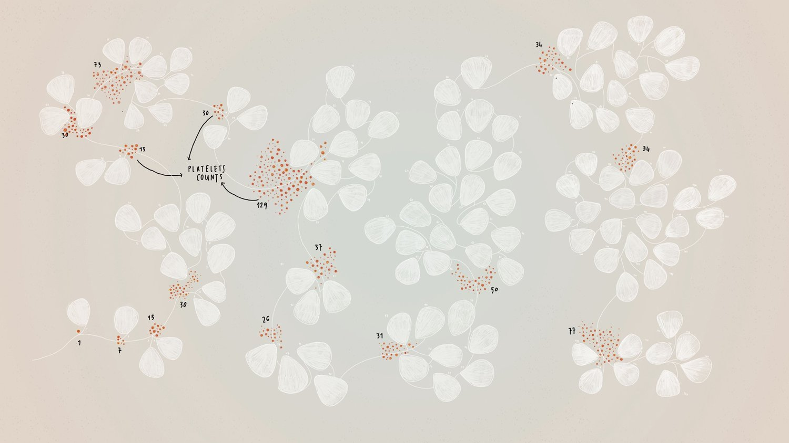
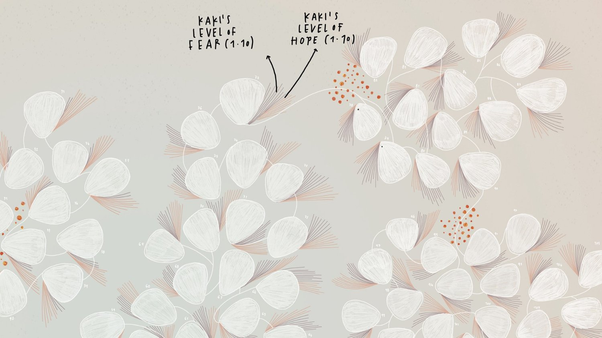
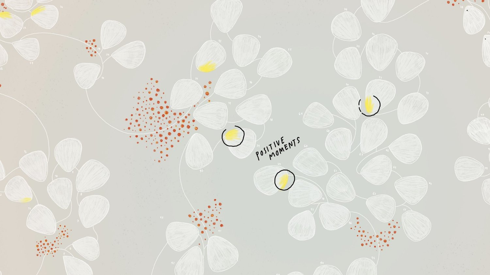
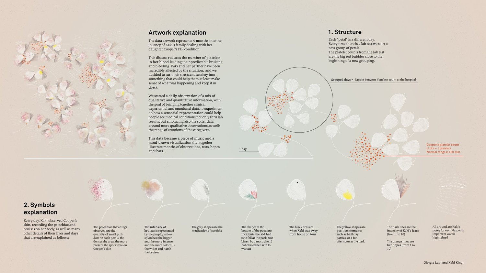

+++
author = "矢崎裕一"
title = "週でも月でもなく、血液検査の日で区切る──Giorgia Lupi と Kaki King『Bruises』"
slug = "bruises-the-data-we-dont-see"
date = "2026-11-07"
description = "Kaki King の娘の病気の120日分の記録を、血液検査の日で区切った1本の時間軸に並べ、検査値と母親の希望・恐れを同じ1日の上に重ねた作品で、同じ記録をもとに King が曲を作りました。"
categories = [
    "consume"
]
tags = [
    "オリジナルのビジュアル変換",
    "音楽",
    "ケア"
]
image = "images/artwork-full.jpg"
series = ["speculative-design"]
series_weight = 99
seriesByline = "Giorgia Lupi / Kaki King"
seriesTitle = "検査の日で区切り、希望と恐れを重ねる──Bruises"
+++

『Bruises — The Data We Don't See』は、Kaki King（カーキ・キング）の娘の病気の120日分の記録を、1本の時間軸に並べた作品です。白い形1つが1日で、血液検査のたびに新しい日のまとまりが始まります。検査で出た血小板数と、母親の King が1〜10で付けた希望と恐れは、同じ1日の上に重ねてあります。同じ記録をもとに、King が3/4拍子・120小節の曲を作りました。1日が1小節です。

絵は Giorgia Lupi（ジョルジア・ルピ）、曲とギターは King で、2018年1月に初演されました。以下は、Lupi の公式サイトの作品ページとそこに載る完全な凡例、Pentagram の作品ページに沿います。Lupi の作品は、国を2つの量の軸に置いた[頭脳流出の可視化](/brain-drain/)と、遠近で読む壁紙[『The Room of Change』](/the-room-of-change/)の記事でも読みました。ここでは、時間の区切り方と、絵と音の単位を読みます。子どもの名前は書かず「娘」とし、作者が公開した作品の画像だけを載せます。

<!--more-->

Giorgia Lupi and Kaki King／Giorgia Lupi 公式サイト「BRUISES - The Data We Don't See」より引用

## 2017年8月、医師の指示から記録が始まる

2017年8月の初め、King は3歳近い娘の口に血を見つけました。舌には10セント硬貨ほどの病変がありました。救急で血液検査を受け、ITP（特発性血小板減少性紫斑病）と診断されます。体が自分の血小板を攻撃する自己免疫の病気で、あざと点状出血（petechiae）が全身に出ます。

記録のきっかけは医師の指示でした。King の言葉です（Pentagram の作品ページ。角括弧は同ページのまま）。

> "The doctor's directive to us was to watch her skin for any significant changes. … I began to write down what I was seeing on [my daughter's] skin, what activities we did that day, what treatments she had, and what her readings were, as well as how I was feeling"

肌の変化を見ているように言われ、肌の様子、出来事、治療、検査値、自分の気持ちを書き留め始めた、という話です。個人のデータ収集は、Lupi との仕事で覚えたと話しています。

2人はこの前に、Hennessy のブランド・アイデンティティと、2017年初めの「A Dialogue Between Four Hands」で組んでいます。後者では、曲と絵の両方に2人の個人データを使いました。

AIGA Eye on Design によれば、King は記録をスプレッドシートに入れ、Lupi はその120日分のデータの種類ごとに見た目を割り当てました。Lupi は、記録を読んで感じた問いをこう書いています。データの可視化は、認知だけでなく感情に働きかけられるか。

## 週でも月でもなく、検査の日で区切る

Lupi は時間軸の組み方をこう書いています。

> "I structured a fluid timeline, where each one of the white elements indicates a new day."

白い要素1つが1日、という説明です。日は、血液検査のための通院と通院のあいだでまとまりになります。Lupi は「a new group of days starts when a lab test was performed」と書きました。

Giorgia Lupi and Kaki King／Giorgia Lupi 公式サイト「BRUISES - The Data We Don't See」より引用

検査の結果の血小板数は、まとまりの先頭の赤い点で表します。正常値は150〜400で、記録の初めには1、7、30が並びます。作品の完全な凡例には「1 dot = 1 platelet」とあり、点の数が値を表します。

この区切り方では、まとまりの大きさが次の検査までの日数になり、長さはそろいません。King は、娘の血小板数が生活を支配していた、と振り返っています。**家族にとっての時間の単位は、週ではなく「次の検査まで」だった**と読めます。

時間軸を、Lupi は「fluid timeline」、Pentagram は「non-linear timeline」と呼んでいます。

## 検査値と希望・恐れを、同じ1日に重ねる

1日の白い形の上に、種類の違うデータが層で重なります。Lupi の説明と完全な凡例による対応は、次のとおりです。曲の列には、作者が対応を明かした単位だけを書きました。

| データ（記録は King） | 絵での表し方 | 曲での表し方 |
|---|---|---|
| 1日 | 白い形1つ（凡例では「petal」） | 3/4拍子の1小節 |
| 検査の日 | 新しいまとまりの始まり | ― |
| 血小板数（臨床値） | まとまりの先頭の赤い点 | ― |
| あざの程度（目視） | 紫と緑のにじみ。大きく濃いほど広く深い | ― |
| 点状出血の量（目視） | 小さなピンクの点の密度 | ― |
| ステロイドの服用 | 灰色の筆跡 | ― |
| 肌を悪くした出来事 | 色鉛筆の線 | ― |
| King が家を離れた日 | 黒い点 | ― |
| 良かった時間 | 明るい黄色の斑点 | ― |
| King の希望と恐れ（1〜10） | 日を囲んで浮かぶ線 | ― |
| King の毎日のメモ | 周りに手書きし、決定的な語を強調 | ― |

Giorgia Lupi and Kaki King／Giorgia Lupi 公式サイト「BRUISES - The Data We Don't See」より引用

完全な凡例は、暗い線が恐れ、オレンジの線が希望だと説明しています。

Giorgia Lupi and Kaki King／Giorgia Lupi 公式サイト「BRUISES - The Data We Don't See」より引用

血小板数はまとまりの先頭に1回だけ置かれ、肌と気持ちは毎日描かれます。頻度の違う臨床値と自己評価を、「1日」という同じ単位に並べた設計と読めます。Lupi は「this isn't by any means a scientific representation of data」と、科学的な表現ではないことを自分で断っています。

記録した本人には、この重ね方が振り返りの道具になりました。King は Eye on Design にこう話しています。

> "I could look back at a week and go, 'oh, she had a lot of bruises,' … Or I'd see that things have gotten better, but I'm still falling apart."

1週間を振り返ると、あざの多さや、状態は良いのに自分は崩れていることが分かった、という話です。娘の値と自分の気持ちが同じ日に載るから、両者のずれが見えたと読めます。

## 同じ記録から、1日1小節の曲を作る

絵は作品の半分で、残りの半分が曲です。King はこう説明しています。

> "The song has 120 measures in 3/4 time, covering the 120 days that I collected data. There are elements that you will hear that reference the amount of petechiae on her skin, my changing mood... And the main guitar part is a musical map of the bruises on her skin"

曲は3/4拍子の120小節で、記録した120日に対応する。点状出血の量や気分を参照する要素があり、メインのギターはあざの音楽の地図だ、という説明です。

確かめられる対応は、1日が1小節であることだけです。点状出血や気分は「reference」（参照する）、あざは「map」と言われていますが、音の高さや音量への割り当ては書かれていません。作者側は「Kaki composed a song based on her data collection」と書き、King は本作を「this visualization and musicalization」と呼びました。調べた資料に、sonification（ソニフィケーション）の語はありません。

[TwoTone](/twotone-sonification/) は、表の1列を音階の段に割り当て、1行を1拍として鳴らします。Bruises は、時間の単位だけを絵とそろえ、小節の中身は作曲家に任せた曲と読めます。データから作った作曲であって、規則で再現できるソニフィケーションではない、と読むのが正確でしょう。

初演は2018年1月25日、サンフランシスコの STIR Experience Lab で、King が会場で生演奏しました。1月27日には、Lupi の YouTube チャンネルに全編の動画が公開されます。アニメーションは Andrea Bax Bassan（アンドレア・バックス・バッサン）です。本作はその後、Cooper Hewitt のデザイン・トリエンナーレ「Nature」に出品され、King の舞台作品『DATA NOT FOUND』（2019年）にも組み込まれました。

## 第三者はこの作品をどう見たか

いちばん詳しく論じたのは、Catherine D'Ignazio（キャサリン・ディグナツィオ）と Lauren F. Klein（ローレン・クライン）の『Data Feminism』（MIT Press、2020）です。第7章「Show Your Work」の pp.195–199 で、ケア労働と感情労働を見えるようにする事例として扱っています。

> "She employed a fluid timeline to reflect the subjective nature of what disability studies scholars call crip time."

Lupi は流れる時間軸で、障害学でいう crip time（クリップ・タイム）の主観性を映した、という読みです。同書は、放射状の時間軸やガントチャートを使う Atlas of Caregiving と対比しています。そして日は「segmented not by weeks or years but by hospital visits」だと書きました。検査の日の区切りを、障害学の時間論につないだ読みです。

一方で、同書の色の説明は、作者の凡例と食い違います。資料ごとに並べます（Pentagram の説明は Lupi の作品ページと同じです）。

Giorgia Lupi and Kaki King／Giorgia Lupi 公式サイト「BRUISES - The Data We Don't See」より引用

| 点 | Lupi の作品ページ | 作品の完全な凡例 | Eye on Design | 『Data Feminism』 |
|---|---|---|---|---|
| 1日の形 | 「white elements」（Pentagram は「petal-like」） | 「petal」 | 「flower petal」 | 「white aspen-shaped leaves」（ポプラの葉の形） |
| 黒 | 黒い点＝King が家を離れた日 | 黒い点＝ツアーで家を離れた日 | 黒い点＝ツアーで不在 | 「black corresponding to stress and fear」 |
| 黄 | 黄色の斑点＝良かった時間 | 黄色い形＝誕生会などの良い時間 | 「Yellow indicates a good day」 | 「yellow to signify hope」 |
| 希望と恐れ | 浮かぶ線、1〜10 | 暗い線＝恐れ、オレンジの線＝希望 | 線が多いほど感情が強い | 手描きの線、1〜10 |
| あざの色 | 紫と緑 | 「purple/yellow」 | 色が鮮やかなほど強い | 色で強さを模す（色名なし） |

希望と恐れを1〜10の線で表す点は一致し、食い違うのは黒と黄の意味です。完全な凡例では、黄色は良い時間とあざのにじみの両方に出てきます。符号が多く、黄色が二つの意味を持つことが、紹介する側の読みを分けやすくしたとも読めます。

AIGA Eye on Design の Liz Stinson（リズ・スティンソン）は、読みにくさそのものを論点にしました。凡例がなければほとんど読めない（「virtually unreadable」）。それでも King には、娘の健康と自分への影響を確かめる略記になった。医師や看護師を通した情報では得にくい主体性を与えた、という評価です。

イタリアの Frizzi Frizzi は、データを数から物語の道具へ変えた例として短く紹介しました。

## 使い道

可視化の仕事に持ち帰れる判断は、四つあります。

一つ目は、時間の区切りを出来事で決めることです。Bruises は、週や月ではなく検査の日で日をまとめました。治療や手続きの節目が暮らしを決めている記録なら、節目で区切るほうが当事者の時間に近い図になると読めます。

二つ目は、頻度と種類の違うデータを、同じ単位に載せることです。検査値は数日おき、気持ちは毎日でした。それを「1日」に重ねたので、King は値と気持ちのずれを振り返れました。別々のグラフに分ける前に、共通の単位で重ねられないかを考える価値があります。

三つ目は、音にするとき、規則と作曲を言い分けることです。Bruises で確かめられる対応は、1日＝1小節だけで、作者は musicalization と呼んでいます。どこまでが規則で、どこからが作り手の判断かを書いておけば、聴き手は読み違えずに済みます。

四つ目は、凡例を作品と一緒に出し、紹介する側は凡例に戻って確かめることです。Lupi は完全な凡例を公開しましたが、二次文献では黒と黄の意味が変わりました。作者は本作を、何をデータと呼ぶかを考え直す試みだと書いています。

> "radical experimentations of this kind, artistic experimentation of this kind, can be a starting point to reconsider what we define as data in the first place."

こうした急進的な試みが、データの定義を考え直す出発点になる、という主張です。その試みを他人が引き継ぐときの足場は、作者が公開した凡例だと読めます。

## 参考・出典

**一次情報**

- Giorgia Lupi, “BRUISES - The Data We Don't See,” 公式サイト（作品の完全な凡例を含む）. [作品ページ](https://giorgialupi.com/bruises-the-data-we-dont-see) / [凡例の高解像度版（Dropbox）](https://www.dropbox.com/s/dtcor0tfveyllau/01%20ARTWORK%20Legend.jpg?dl=0)
- Giorgia Lupi, “Bruises — The Data We Don't See,” Medium, 2018-01-31（日付は『Data Feminism』注61による。本文は未確認）. [記事](https://medium.com/@giorgialupi/bruises-the-data-we-dont-see-1fdec00d0036)
- Giorgia Lupi and Kaki King, “Bruises - The Data We Don't See,” YouTube（Giorgia Lupi のチャンネル）, 2018-01-27. [動画](https://www.youtube.com/watch?v=QvxVWukROTw)
- “Bruises: The Data We Don't See | Kaki King & Giorgia Lupi,” Talks at Google, YouTube, 2018-07-16. [動画](https://www.youtube.com/watch?v=zi3jIT8cqgs) / [概要欄の転載（Travelin' Librarian）](https://travelinlibrarian.info/2018/08/24/friday-video-kaki-king-giorgia-lupi-bruises-the-data-we-dont-see-talks-at-google)
- Pentagram, “Bruises: The Data We Don't See.” [作品ページ](https://www.pentagram.com/work/bruises-the-data-we-dont-see)
- Krannert Center for the Performing Arts, *Kaki King: DATA NOT FOUND* 公演プログラム, 2019-09-06. [PDF](https://krannertcenter.com/sites/krannertcenter.com/files/krannertcenter_ellnora2019_kakiking_web.pdf)
- Cooper Hewitt, Smithsonian Design Museum, 所蔵記録（本文は未確認）. [所蔵記録](https://collection.cooperhewitt.org/objects/2318798830/)
- Kantar Information is Beautiful Awards 2018, “Bruises – The Data We Don't See.” [ショーケース](https://www.informationisbeautifulawards.com/showcase/3288-bruises-the-data-we-don-t-see)

**第三者評価**

- Catherine D'Ignazio and Lauren F. Klein, *Data Feminism*, MIT Press, 2020, Chapter 7 “Show Your Work,” pp.195–199, Figure 7.9, notes 61–64. [オープンアクセス版（Internet Archive）](https://archive.org/details/mit_press_book_9780262358521)
- Liz Stinson, “How Kaki King and Giorgia Lupi Used Data to Make Sense of a Child's Illness,” *AIGA Eye on Design*, 2018-02-01. [記事](https://eyeondesign.aiga.org/how-kaki-king-and-giorgia-lupi-used-data-to-make-sense-of-a-childs-illness/)
- “Visualizzare (poeticamente) una malattia autoimmune,” *Frizzi Frizzi*, 2018-02-01. [記事](https://www.frizzifrizzi.it/2018/02/01/visualizzare-poeticamente-malattia-autoimmune/)
