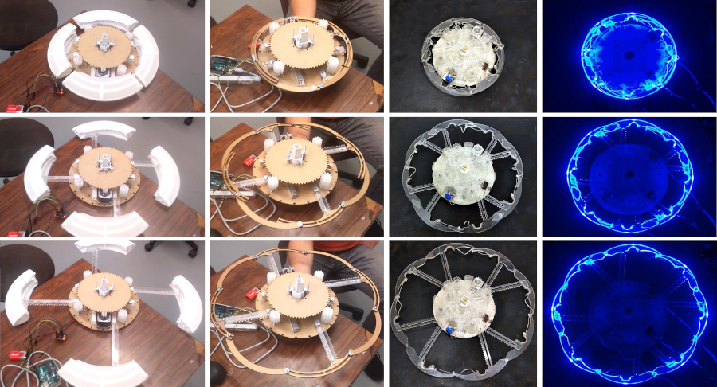
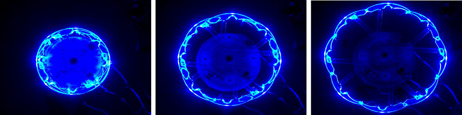
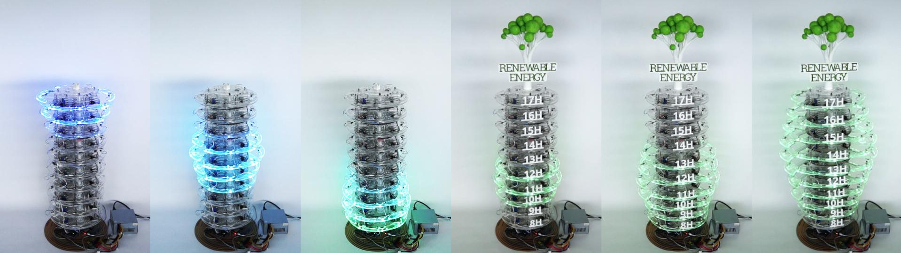

+++
author = "Yuichi Yazaki"
title = "90% for Range and Peak, 50% for Order: CairnFORM's Ring Chart"
slug = "cairnform"
date = "2026-11-03"
description = "CairnFORM is a cylindrical physical chart that shows hourly renewable energy as the diameters of stacked rings. In a test with 90 visitors, over 90% answered the range and peak questions correctly, and 52.2% got the order question right."
categories = [
    "consume"
]
tags = [
    "data physicalization",
    "bar chart"
]
image = "images/ring-chart-blue-and-green.jpg"
+++

CairnFORM is a cylindrical physical chart that shows the hourly amount of renewable energy as the diameters of stacked rings. It has 10 rings, and each ring stands for one hour from 8:00 to 17:59. In December 2017, a test was held at a public event where 90 visitors read the chart. The question asking for the hours with generation (range) was answered correctly by 93.3%, and the question asking for the time of the peak by 92.2%. The question asking visitors to put the hours in order of quantity was answered correctly by 52.2%.

It was made by Maxime Daniel, Guillaume Rivière, and Nadine Couture of ESTIA and LaBRI (University of Bordeaux) in Bidart, France. It is a prototype from Daniel's doctoral research (2016–2018), and the dataphys.org list carries it as a 2018 work. Below I read it in the order it was made, following the author version of the main paper (TEI 2019), the long French paper (JIPS, 2020 issue), and the lab's project page.

<!--more-->

## A vertical bar chart, rotated around its axis

The starting point was not saving energy but "shifting when electricity is used." In JIPS, the authors write that they aim to get people at work to use electricity when renewable energy is plentiful. The means is the habit of shifting when to charge a laptop's battery. When they asked in the lab, 15 of the 18 people who use laptops kept them plugged in almost all the time (JIPS 2.1).

To shift charging, people at work need to know when the day's renewable peak will be. The authors considered shared spaces as the place to put a display. The TEI 2018 paper says that in a vertical bar chart, the bars in front hide the ones behind, so you cannot read it without walking around it, and goes on:

> "train stations, public places, airports, roundabouts are public spaces where people are in a hurry and do not have time to change their point of view."

The point is that in stations, squares, airports, and intersections people are in a hurry and have no time to change their viewpoint.

So the authors built, as a physical object, a vertical bar chart rotated around its axis. This is how TEI 2019 puts it:

> "We designed CairnFORM as an illuminated and dynamic vertical bar chart with cylindrical symmetry that allows 360˚-readability."

It is a glowing, moving vertical bar chart, and its cylindrical symmetry lets it be read from 360°. The "ring chart" of the title is not a doughnut-shaped pie chart. It is a vertical bar chart in which each bar has become a ring. The name comes from the cairn, a pile of stacked stones (TEI 2018).

The hard part was the ring itself. Electronics sit inside it, it must stay round while expanding, and its diameter must grow to about twice its size. A Hoberman-type mechanism turns into a star shape midway, and the Weather Lamp, which uses six arcs, left gaps between the arcs. The authors went through prototypes with four arms and four arcs, four arms and eight arcs, and eight arms and eight arcs, and added lighting to the last design (TEI 2018, JIPS 5.1).

Source: Maxime Daniel, Guillaume Rivière, Nadine Couture (ESTIA) / tangible.estia.fr, "CairnFORM" project page

The finished device has 10 rings and is 105 cm tall (TEI 2019). Each ring weighs 2.3 kg, and its diameter expands from 35 cm to 62 cm. The arcs are transparent PMMA (acrylic). The cost of materials was about 2,350 euros.

PATSTEC, a catalog of scientific and technical heritage, gives the diameter as "30–60 cm," which differs from the papers. The later study by Bouzekri & Rivière (2026) gives the height of the chart part of the revised version as 92.5 cm. This can be read as 105 cm being the height of the whole device and 92.5 cm the height of the span where the rings are lined up.

## One ring is one hour, and the diameter is the renewable amount

TEI 2019 describes the correspondence between rings and quantity this way:

> "a fully retracted ring with light off represents a 0 W availability and a fully expanded ring with full blue brightness represents a max W availability."

The most contracted, unlit ring stands for 0 W, and the most expanded ring at full blue brightness stands for the upper limit of generation capacity (max W). Diameter and brightness redundantly encode the same quantity.

| Data | Physical property | How it is mapped / values |
|---|---|---|
| Time (8:00–17:59, one hour at a time) | Ring position in the stack | 10 rings = 10 hours. 8:00 at the bottom, 17:00 at the top |
| Average renewable amount for that hour | Ring diameter | 0 W = 35 cm, max W = 62 cm (a width of 1.8 times) |
| The same amount (redundant encoding) | Brightness | 0 W = off, max W = maximum blue brightness |
| Range shown | Cut-out of time | One daily peak (valley → peak → valley) shown at a time, in sequence |
| The arrival of the next peak | Motion of the rings expanding and contracting | Animated over 6 seconds |
| Hue | Does not represent data | Changed from blue to green after the public test |
| What the data is | Wooden tree model on top and the words "Renewable Energy" | Added as a removable legend |

Source: TEI 2019, JIPS (5.2, 6.1, 7.9.1).

There were two reasons for the one-hour step (JIPS 3.4.4). A time window such as "unplug from 15:00 to 16:00" is easier to remember as an instruction. And generation forecasts are more reliable as hourly averages than at minute resolution.

Another rule is not to show a whole day's peaks at once. In a test with printed paper charts, with 3 groups of 7 people, when all the peaks were drawn together, most people could find only the highest peak (TEI 2019). When the peaks were shown one at a time in sequence, they found all the peaks.

Source: Maxime Daniel, Guillaume Rivière, Nadine Couture (ESTIA) / tangible.estia.fr, "CairnFORM" project page

## December 2017, Biarritz: 90 people read it

On December 1–2, 2017, the authors set up the 10-ring version at a public event, the "24h de l'innovation," in Biarritz (JIPS chapter 7). They gathered 90 visitors who stopped by and divided them into 3 groups of 30. What they showed was neither measured nor forecast data but synthetic data built so that the smallest difference in diameter was 1 cm (JIPS 7.3). The peak lengths were 3 hours (V3h), 6 hours (V6h), and 9 hours (V9h), one per group.

There were three questions. Name the hours with generation (range). Name the time of the peak (compare). Put the hours in order from smallest to largest quantity (order). The results are in Table 3 of TEI 2019.

| Peak shown | Range | Peak | Order |
|---|---|---|---|
| V3h (3 hours) | 100% | 93.3% | 80.0% |
| V6h (6 hours) | 93.3% | 93.3% | 63.3% |
| V9h (9 hours) | 86.6% | 90.0% | 13.3% |
| Average | 93.3% | 92.2% | 52.2% |

**Accuracy for range and peak was around 90% regardless of the peak length** (p = .12, p = .85). Accuracy for order fell as the peak got longer (p = .001). The authors hypothesize that this is due to the limit on how much information people can handle at once (Miller, 1956). It is because one has to compare values many times before and after the peak and keep them in mind.

> "physical bar charts and physical ring charts (i.e., physical vertical bar charts with cylindrical symmetry) seem better suited to range tasks and compare tasks, rather than order tasks."

This is the summary from TEI 2019: physical bar charts, and the ring charts that turn them into cylinders, seem suited to range and compare tasks, not to order tasks.

The test also led to a redesign. One visitor thought it was a clock, and another thought it was a countdown to the end of the event (JIPS 7.8). Some said green would suit renewable energy better than blue. The authors changed the rings to green and put a wooden tree model and the words "Renewable Energy" on top.

Source: Maxime Daniel / dataphys.org, "CairnFORM: a Physical Ring Chart Showing Renewable Energy Data"

The redundant encoding with brightness did not work well. 9 of the 90 people said they could not tell the differences in brightness. Light spilled between the overlapping transparent arcs and made the whole thing too bright (TEI 2019).

Five people also said the differences in diameter were hard to see. The sources disagree on the step value: JIPS gives the smallest diameter difference as 1 cm (30 levels), while TEI 2019 says "the radius granularity was 9 mm." Since 27 cm divided by 30 is about 0.9 cm, "radius" can be read as meaning the diameter step. JIPS writes that it was later made coarser, to 2 cm (15 levels).

On the UEQ-S, the hedonic quality scored 2.25 and the pragmatic quality 1.67 (on a scale of −3 to 3). The body text of TEI 2019 has the labels "excellent" and "good" the opposite way from JIPS, and judging by the order of the scores, JIPS can be read as correct.

## Noticing an expanding ring at the edge of vision

Next is the workplace. The authors tested in the lab whether a person working at a desk could notice the movement of a ring at the edge of their vision (TEI 2019). There were 30 participants and a single ring, placed about 2.6 m away at a 45° angle.

Every movement took 6 seconds, and three ways of varying the speed were compared. The share of people who noticed the movement while concentrating on another task was highest for the exponential type, which starts slowly and accelerates, at 72.2%; constant speed gave 60.5%, and the logarithmic type, which starts fast and decelerates, gave 66.5% (TEI 2019). The results section of JIPS writes 129/167 = 77.2%, and the conclusion gives 72.2%. Either way, the exponential type has the highest value.

After that, a two-month test was run in actual workplaces. However, all I could check is the abstract of a short TEI '21 paper.

> "Six participants had to shift energy consumption by using energy storage. To do so, they were notified about local energy forecasts. Compared with flat-screen animations, early results show that cylindrical shape-change animations keep a better attractiveness over time."

Six people used energy storage to shift their consumption and were notified of local energy forecasts. These are early results: compared with flat-screen animations, the cylindrical shape-change animations kept their attractiveness better over time.

The summaries differ between sources. The abstract of the doctoral thesis says "as practical as, and more hedonic than" the flat screen. The project page says that in an 8-week experiment both qualities were above the screen. I have not seen the full text, and I have not checked which is accurate.

## How did third parties see this work?

Bae et al. (CHI 2022), in a paper on a design space for physicalization that classifies 47 works, take up CairnFORM.

> "Two such examples include Bookly [45] and CairnFORM [13] which both encode data using volume. ... studies in visualization show that people have trouble reasoning over changes in volume and are better at reasoning over other visual variables such as surface area"

CairnFORM is given as an example of encoding by volume, and the point is that people are better at reading changes in area than in volume. The authors themselves write "diameter (and brightness)," so there is a mismatch in classification. It can be read that which perceptual findings apply depends on whether the ring is read as the size of a circle or as the swelling of a solid.

Bouzekri & Rivière (2026) compared a revised CairnFORM with PlantFORM, a plant-shaped device made of paper and wood, and with a screen version (28 people). It is a follow-up study by the co-author Rivière, so it is not a fully independent evaluation. Across the six questions asking for charging and discharging times, CairnFORM's accuracy was highest at 96% (the difference from the screen version CairnSCREEN's 94% was not significant, p=.187), and 54% of people also chose it as "most innovative." On the other hand, one participant pointed out a mismatch between the material and the theme.

> "We are talking about renewable energy; it affects me enormously, so all this Plexiglass [of CairnFORM] [...], if we are in renewable energy, we must go all the way in the product we offer."

The opinion is that if the subject is renewable energy, the product should go all the way, not be this mass of acrylic.

PATSTEC (a program preserving France's contemporary scientific and technical heritage) has registered CairnFORM in its catalog as an object worth keeping. It notes that the prototype is now at ESTIA.

## Uses

The first is to decide the form from the place where it will stand. The cylinder was a form for places with many people who have no time to walk around, so that the bars do not hide each other. Writing out first from which directions people come and how long they stop can narrow down the candidate forms, it seems.

The second is to choose the display from the question you want answered. Only 13.3% could put the 9-hour peak in order of size. For "when should I charge," being able to read the peak is enough, and conveying a ranking as well would need something like numeric labels, it seems.

The third is to reduce the amount shown at once. When peaks were shown one at a time, even small peaks were not overlooked. In a physical chart with a limited number of rings, switching in sequence may suit the question better.

The fourth is that the material breaks the encoding. Brightness became hard to tell apart because light spilled over, and a glowing, moving cylinder was mistaken for a clock. For a physical chart, the design needs to include the behavior of the material and the cues for "what the data is."

## References

**Primary sources**

- dataphys.org, "CairnFORM: a Physical Ring Chart Showing Renewable Energy Data" (registered by Maxime Daniel, 2019-06-05): https://dataphys.org/list/cairnform-a-physical-ring-chart-showing-renewable-energy-data/ (tag list: https://dataphys.org/list/tags/self-actuated/ )
- Maxime Daniel, Guillaume Rivière, Nadine Couture, "CairnFORM: a Shape-Changing Ring Chart Notifying Renewable Energy Availability in Peripheral Locations," TEI '19, pp. 275–286, 2019. Author version: https://tangible.estia.fr/prototypes/cairnform/pub/papers/cairnform-peripheral_tei2019.pdf / DOI: https://doi.org/10.1145/3294109.3295634 / HAL: https://hal.science/hal-01976793
- Maxime Daniel, Guillaume Rivière, Nadine Couture, "Designing an Expandable Illuminated Ring to Build an Actuated Ring Chart," TEI 2018 Work in Progress, 2018. Author version: https://tangible.estia.fr/prototypes/cairnform/pub/papers/illuminated-ring_tei18_wip.pdf / DOI: https://doi.org/10.1145/3173225.3173294
- Maxime Daniel, Guillaume Rivière, Nadine Couture, "CairnFORM," IHM 2018 Démonstrations, 2018: https://tangible.estia.fr/prototypes/cairnform/pub/papers/cairnform-demonstration_IHM2018.pdf (HAL: https://hal.science/hal-01900064 )
- Maxime Daniel, Guillaume Rivière, Nadine Couture, "Un histogramme cylindrique à changement de forme pour afficher des prévisions de disponibilité de l'énergie," *Journal d'Interaction Personne-Système*, Vol. 9, No. 1, 2020: https://jips.episciences.org/articles/7102 (PDF: https://jips.episciences.org/en/articles/7102/download / DOI: https://doi.org/10.46298/jips.7102 )
- ESTIA, CairnFORM project page: https://tangible.estia.fr/prototypes/cairnform/
- Maxime Daniel, CairnFORM (control software, GPL-3.0): https://github.com/maximedaniel/CairnFORM
- Maxime Daniel, "CairnFORM: a Shape-Changing Ring Chart Notifying Renewable Energy Availability" (YouTube): https://youtu.be/wZ_3CtDllbA
- Checked for the abstract only
  - Maxime Daniel, Guillaume Rivière, "Exploring Axisymmetric Shape-Change's Purposes and Allure for Ambient Display," TEI '21 Work in Progress, 2021: https://hal.science/hal-03040877
  - Maxime Daniel, doctoral thesis "Afficheurs cylindriques à changement de forme," Université de Bordeaux, 2018: https://theses.hal.science/tel-02371620
  - IHM 2017 Travaux en cours (CAIRNS): https://hal.science/hal-01578006
  - ETIS 2017: https://hal.science/hal-01685710

**Secondary sources**

- S. Sandra Bae et al., "Making Data Tangible: A Cross-disciplinary Design Space for Data Physicalization," CHI 2022: https://arxiv.org/abs/2202.10520
- Élodie Bouzekri, Guillaume Rivière, "Shaping Plant-Like Shape-Changing Interfaces as Vertical Charts," arXiv, 2026 (follow-up study by co-author Rivière): https://arxiv.org/abs/2604.15902
- PATSTEC, CairnFORM (Fiche N° 4104): https://www.patstec.fr/ressources/objets/detail?id=35997
- (Mentioned by name only) Zhang, Ilić, Signer, arXiv, 2025: https://arxiv.org/abs/2503.06583
