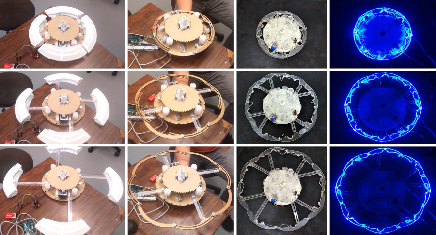
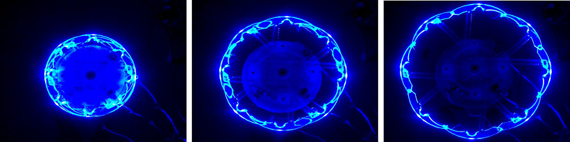
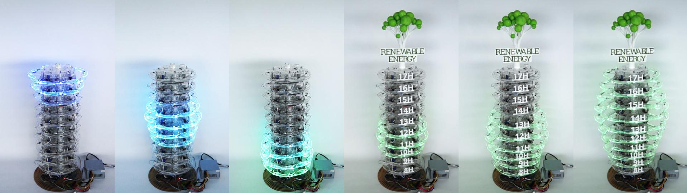

+++
author = "矢崎裕一"
title = "範囲とピークは9割、大小順は5割──CairnFORM のリングチャート"
slug = "cairnform"
date = "2026-11-03"
description = "1時間ごとの再エネ量を、積み重ねたリングの直径で示す円筒形の物理チャートです。来場者90人の試験で、範囲とピークの問いは9割以上が正解し、大小順は52.2%でした。"
categories = [
    "consume"
]
tags = [
    "データ物質化",
    "棒グラフ"
]
image = "images/ring-chart-blue-and-green.jpg"
series = ["data-physicalization"]
series_weight = 41
seriesByline = "Maxime Daniel・Guillaume Rivière・Nadine Couture"
seriesTitle = "リングの直径で1時間ごとの再エネ量を示す──CairnFORM"
+++

CairnFORM（ケルンフォーム）は、1時間ごとの再生可能エネルギーの量を、積み重ねたリングの直径で示す円筒形の物理チャートです。リングは10段で、1段が8時台から17時台までの1時間に当たります。2017年12月、公共イベントで来場者90人に読んでもらう試験が行われました。発電のある時間帯（範囲）を答える問いは93.3%、ピークの時刻を答える問いは92.2%が正解しました。時間帯を量の大小順に並べる問いの正解は、52.2%でした。

作ったのは、フランス・ビダールの ESTIA と LaBRI（ボルドー大学）の Maxime Daniel（マキシム・ダニエル）、Guillaume Rivière（ギヨーム・リヴィエール）、Nadine Couture（ナディーヌ・クチュール）です。Daniel の博士研究（2016〜2018年）の試作で、dataphys.org の一覧には2018年の作品として載っています。以下は、主論文（TEI 2019）の著者版、仏語の長い論文（JIPS、2020年号）、研究室のプロジェクトページに沿い、作られた順に読みます。

<!--more-->

## 縦棒グラフを、軸のまわりに回す

出発点は、省エネではなく「使う時間をずらす」ことでした。作者たちは JIPS で、職場で再エネが多い時間に電気を使うことを狙う、と書いています。手段は、ノートPC のバッテリーで充電の時間をずらす習慣です。研究室で聞くと、ノートPC を使う18人のうち15人が、ほぼ常に電源につないだままでした（JIPS 2.1）。

ずらすには、その日の再エネのピークがいつかを、職場の人が知っている必要があります。表示を置く場所として、作者たちは共用の場所を考えました。TEI 2018 の論文は、縦棒は手前の棒が奥を隠すので、回り込まないと読めないと書き、こう続けます。

> "train stations, public places, airports, roundabouts are public spaces where people are in a hurry and do not have time to change their point of view."

駅や広場、空港、交差点では、人は急いでいて視点を変える時間がない、という指摘です。

そこで作者たちは、縦棒グラフを軸のまわりに回した形を、物として作りました。TEI 2019 の言い方です。

> "We designed CairnFORM as an illuminated and dynamic vertical bar chart with cylindrical symmetry that allows 360˚-readability."

光って動く縦棒グラフで、円筒の対称性があるので360°から読める、という説明です。題にある "ring chart" は、ドーナツ型の円グラフではありません。棒の1本1本がリングになった縦棒グラフです。名前は、石を積んだケルンから取っています（TEI 2018）。

難しかったのはリングそのものでした。中に電子部品が入り、広げる途中も丸く、直径が約2倍まで広がること。Hoberman 式の機構は途中で星形になり、6本の弧を使う Weather Lamp は弧の間にすき間ができました。作者たちは4本アーム・4弧、4本アーム・8弧、8本アーム・8弧と試作を重ね、最後の方式に照明を足しています（TEI 2018、JIPS 5.1）。

Maxime Daniel・Guillaume Rivière・Nadine Couture（ESTIA）／tangible.estia.fr「CairnFORM」プロジェクトページより引用

完成した装置は、リング10段で高さ105 cm です（TEI 2019）。1リングは2.3 kg で、直径は35 cm から62 cm まで広がります。弧は透明な PMMA（アクリル）です。材料費は約2,350ユーロでした。

科学技術遺産の目録 PATSTEC は、直径を「30〜60 cm」と書いていて、論文と違います。後続研究の Bouzekri & Rivière（2026）は、改修版のグラフ部分の高さを92.5 cm としています。105 cm は装置全体、92.5 cm はリングが並ぶ範囲の高さと読めます。

## 1リングが1時間、直径が再エネ量

TEI 2019 は、リングと量の対応をこう書いています。

> "a fully retracted ring with light off represents a 0 W availability and a fully expanded ring with full blue brightness represents a max W availability."

いちばん縮んで消灯したリングが0 W、いちばん広がって青く最大に光るリングが発電容量の上限（max W）を表します。直径と明るさの二つで、同じ量を重ねて表しています。

| データ | 物理的な性質 | 対応のしかた・数値 |
|---|---|---|
| 時刻（8:00〜17:59 を1時間ずつ） | リングの段 | 10段＝10時間。下が8時、上が17時 |
| その1時間の再エネの平均量 | リングの直径 | 0 W＝35 cm、max W＝62 cm（幅は1.8倍） |
| 同じ量（重ねて符号化） | 明るさ | 0 W＝消灯、max W＝青の最大の明るさ |
| 表示する範囲 | 時間の切り出し | 1日の山（谷→山→谷）を一つずつ順に見せる |
| 次の山が来たこと | リングが広がる・縮む動き | 6秒で動かす |
| 色相 | データは表さない | 公開試験の後、青から緑に変えた |
| 何のデータか | 頂上の木の模型と "Renewable Energy" の文字 | 取り外せる凡例として足した |

出典：TEI 2019、JIPS（5.2、6.1、7.9.1）。

1時間刻みにした理由は二つです（JIPS 3.4.4）。「15時から16時に抜く」のような時間帯の方が、指示として覚えやすいこと。発電の予報は、分単位より1時間平均の方が信頼できること。

もう一つの決まりは、1日の山を一度に全部は見せないことです。紙に印刷したグラフで3グループ×7人に試すと、山を全部いっしょに描いた場合、多くの人がいちばん高いピークしか見つけられませんでした（TEI 2019）。山を一つずつ順に見せると、全部のピークを見つけています。

Maxime Daniel・Guillaume Rivière・Nadine Couture（ESTIA）／tangible.estia.fr「CairnFORM」プロジェクトページより引用

## 2017年12月、ビアリッツで90人に読んでもらう

2017年12月1〜2日、作者たちはビアリッツの公共イベント「24h de l'innovation」に10リング版を置きました（JIPS 7章）。足を止めた来場者から90人を集め、30人ずつ3グループに分けています。見せたのは実測でも予報でもなく、直径差が最小1 cm になるように作った合成データでした（JIPS 7.3）。山の長さは、グループごとに3時間（V3h）、6時間（V6h）、9時間（V9h）です。

問いは三つです。発電がある時間帯を答える（範囲）。ピークの時刻を答える（比較）。時間帯を量の小さい順に並べる（順序）。結果は TEI 2019 の Table 3 にあります。

| 見せた山 | 範囲 | ピーク | 大小順 |
|---|---|---|---|
| V3h（3時間） | 100% | 93.3% | 80.0% |
| V6h（6時間） | 93.3% | 93.3% | 63.3% |
| V9h（9時間） | 86.6% | 90.0% | 13.3% |
| 平均 | 93.3% | 92.2% | 52.2% |

**範囲とピークの正解率は、山の長さによらず9割前後でした**（p = .12、p = .85）。大小順は山が長いほど下がりました（p = .001）。作者たちは、人が一度に扱える情報量の限界（Miller, 1956）による、と仮説を立てています。ピークの前後で値を何度も見比べ、覚えておく必要があるからです。

> "physical bar charts and physical ring charts (i.e., physical vertical bar charts with cylindrical symmetry) seem better suited to range tasks and compare tasks, rather than order tasks."

物理的な棒グラフも、それを円筒にしたリングチャートも、範囲と比較には向き、順序には向かないようだ、という TEI 2019 のまとめです。

試験は、作り直しにもつながりました。来場者の一人は時計だと思い、別の一人はイベントの終わりまでのカウントダウンだと思いました（JIPS 7.8）。「再エネなら青より緑」という声もありました。作者たちはリングを緑に変え、頂上に木の模型と "Renewable Energy" の文字を載せています。

Maxime Daniel／dataphys.org「CairnFORM: a Physical Ring Chart Showing Renewable Energy Data」より引用

明るさの重ね符号化は、うまく働きませんでした。90人中9人が、明るさの違いが分からないと答えています。重なった透明な弧どうしで光が回り込み、全体が明るくなりすぎたためです（TEI 2019）。

直径の違いが分かりにくいと答えた人も、5人いました。刻みの値は資料で食い違い、JIPS は直径差の最小を1 cm（30段階）、TEI 2019 は "the radius granularity was 9 mm" とします。27 cm を30で割ると約0.9 cm なので、"radius" は直径の刻みとも読めます。JIPS は、その後2 cm（15段階）に粗くしたと書いています。

UEQ-S の評価は、快楽的な質が2.25点、実用的な質が1.67点でした（−3〜3）。TEI 2019 の本文は excellent と good のラベルが JIPS と逆で、点数の順から JIPS が正しいと読めます。

## 視界の端で、広がるリングに気づくか

次は職場です。机で仕事をする人が、視界の端でリングの動きに気づけるかを、作者たちは研究室で試しました（TEI 2019）。参加者は30人、リングは1個で、約2.6 m 先の斜め45°に置いています。

動きはどれも6秒で、速さの変え方を3種類比べました。別の作業に集中している間に動きに気づけた割合は、ゆっくり始めて加速する指数型が72.2%で最も高く、等速は60.5%、速く始めて減速する対数型は66.5%でした（TEI 2019）。JIPS の結果の節は129/167＝77.2%と書き、結論の節では72.2%としています。どちらでも指数型が最も高い値です。

その後、実際の職場で2か月の試験が行われました。ただし筆者が確かめられたのは、TEI '21 の短い論文の要旨だけです。

> "Six participants had to shift energy consumption by using energy storage. To do so, they were notified about local energy forecasts. Compared with flat-screen animations, early results show that cylindrical shape-change animations keep a better attractiveness over time."

6人が蓄電を使って消費をずらし、地域のエネルギー予報の通知を受けた。平らな画面のアニメーションより、円筒の形の変化の方が、時間がたっても魅力を保った、という初期結果です。

要約は資料で違います。博士論文の要旨は、平らな画面と「同じくらい実用的で、より快楽的」とします。プロジェクトページは、8週間の実験で両方の質が画面より上だったとします。本文は未確認で、どちらが正確かは確かめていません。

## 第三者はこの作品をどう見たか

Bae ら（CHI 2022）は、47作品を分類した物理化の設計空間の論文で、CairnFORM を取り上げています。

> "Two such examples include Bookly [45] and CairnFORM [13] which both encode data using volume. ... studies in visualization show that people have trouble reasoning over changes in volume and are better at reasoning over other visual variables such as surface area"

CairnFORM は体積で表す例で、人は体積より面積の変化を読むのが得意だ、という指摘です。作者自身は「直径（と明るさ）」と書いているので、分類にずれがあります。円の大きさとして読むか、立体のふくらみとして読むかで、当てはまる知覚の知見が変わる、と読めます。

Bouzekri & Rivière（2026）は、改修した CairnFORM を、紙と木で作った植物型の PlantFORM や画面版と比べました（28人）。共著者 Rivière の後続研究なので、完全に独立した評価ではありません。充電・放電の時刻を答える6問全体で、CairnFORM の正答率は96%と最も高く（画面版 CairnSCREEN の94%との差は有意ではない、p=.187）、「最も革新的」に選んだ人も54%でした。一方で、ある参加者は素材とテーマのずれを指摘しています。

> "We are talking about renewable energy; it affects me enormously, so all this Plexiglass [of CairnFORM] [...], if we are in renewable energy, we must go all the way in the product we offer."

再エネを扱うなら、このアクリルの塊ではなく、製品まで徹底すべきだ、という意見です。

PATSTEC（フランスの現代科学技術遺産の保存事業）は、CairnFORM を、残す価値のある物として目録に登録しています。試作機は現在 ESTIA にあると書かれています。

## 使い道

一つ目は、置き場所から形を決めることです。円筒形は、回り込む時間のない人が多い場所で、棒が隠れ合わないための形でした。人がどの方向から来て、どれだけ立ち止まるかを先に書き出すと、形の候補が絞れると読めます。

二つ目は、答えてほしい問いから表示を選ぶことです。9時間の山を大小順に並べられた人は13.3%でした。「いつ充電するか」ならピークが読めれば足り、順位まで伝えるなら数値のラベルなどを添える必要があると読めます。

三つ目は、一度に見せる量を減らすことです。山を一つずつ見せると、小さなピークも見落とされませんでした。段の数が限られる物理チャートでは、順に切り替える方が問いに合う場合があります。

四つ目は、素材が符号を崩すことです。明るさは光の回り込みで見分けにくくなり、光って動く円筒は時計と間違われました。物理チャートでは、素材のふるまいと「何のデータか」の手がかりまで設計に含める必要がある、と読めます。

## 参考・出典

**一次情報**

- dataphys.org, "CairnFORM: a Physical Ring Chart Showing Renewable Energy Data"（Maxime Daniel 登録、2019-06-05）：https://dataphys.org/list/cairnform-a-physical-ring-chart-showing-renewable-energy-data/ （タグ一覧：https://dataphys.org/list/tags/self-actuated/ ）
- Maxime Daniel, Guillaume Rivière, Nadine Couture, "CairnFORM: a Shape-Changing Ring Chart Notifying Renewable Energy Availability in Peripheral Locations," TEI '19, pp. 275–286, 2019. 著者版：https://tangible.estia.fr/prototypes/cairnform/pub/papers/cairnform-peripheral_tei2019.pdf ／ DOI：https://doi.org/10.1145/3294109.3295634 ／ HAL：https://hal.science/hal-01976793
- Maxime Daniel, Guillaume Rivière, Nadine Couture, "Designing an Expandable Illuminated Ring to Build an Actuated Ring Chart," TEI 2018 Work in Progress, 2018. 著者版：https://tangible.estia.fr/prototypes/cairnform/pub/papers/illuminated-ring_tei18_wip.pdf ／ DOI：https://doi.org/10.1145/3173225.3173294
- Maxime Daniel, Guillaume Rivière, Nadine Couture, "CairnFORM," IHM 2018 Démonstrations, 2018：https://tangible.estia.fr/prototypes/cairnform/pub/papers/cairnform-demonstration_IHM2018.pdf （HAL：https://hal.science/hal-01900064 ）
- Maxime Daniel, Guillaume Rivière, Nadine Couture, "Un histogramme cylindrique à changement de forme pour afficher des prévisions de disponibilité de l'énergie," *Journal d'Interaction Personne-Système*, Vol. 9, No. 1, 2020：https://jips.episciences.org/articles/7102 （PDF：https://jips.episciences.org/en/articles/7102/download ／ DOI：https://doi.org/10.46298/jips.7102 ）
- ESTIA, CairnFORM プロジェクトページ：https://tangible.estia.fr/prototypes/cairnform/
- Maxime Daniel, CairnFORM（制御ソフト、GPL-3.0）：https://github.com/maximedaniel/CairnFORM
- Maxime Daniel, "CairnFORM: a Shape-Changing Ring Chart Notifying Renewable Energy Availability"（YouTube）：https://youtu.be/wZ_3CtDllbA
- 要旨のみ確認したもの
  - Maxime Daniel, Guillaume Rivière, "Exploring Axisymmetric Shape-Change's Purposes and Allure for Ambient Display," TEI '21 Work in Progress, 2021：https://hal.science/hal-03040877
  - Maxime Daniel, 博士論文 "Afficheurs cylindriques à changement de forme," Université de Bordeaux, 2018：https://theses.hal.science/tel-02371620
  - IHM 2017 Travaux en cours（CAIRNS）：https://hal.science/hal-01578006
  - ETIS 2017：https://hal.science/hal-01685710

**第三者評価**

- S. Sandra Bae ほか, "Making Data Tangible: A Cross-disciplinary Design Space for Data Physicalization," CHI 2022：https://arxiv.org/abs/2202.10520
- Élodie Bouzekri, Guillaume Rivière, "Shaping Plant-Like Shape-Changing Interfaces as Vertical Charts," arXiv, 2026（共著者 Rivière による後続研究）：https://arxiv.org/abs/2604.15902
- PATSTEC, CairnFORM（Fiche N° 4104）：https://www.patstec.fr/ressources/objets/detail?id=35997
- （名前が挙がるだけ）Zhang, Ilić, Signer, arXiv, 2025：https://arxiv.org/abs/2503.06583
