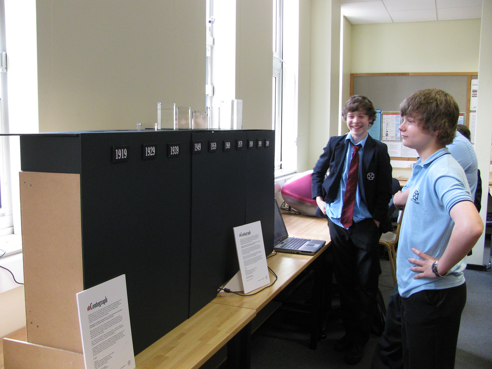
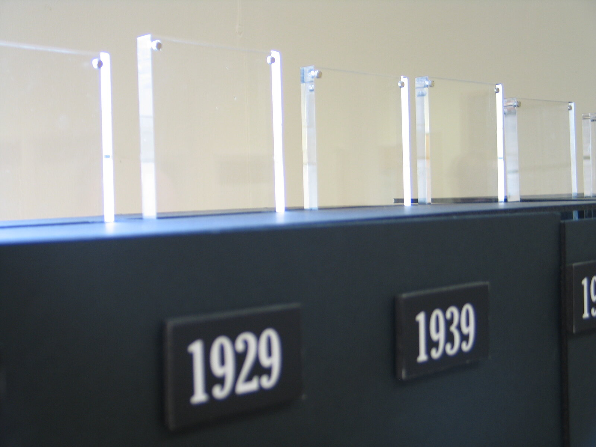
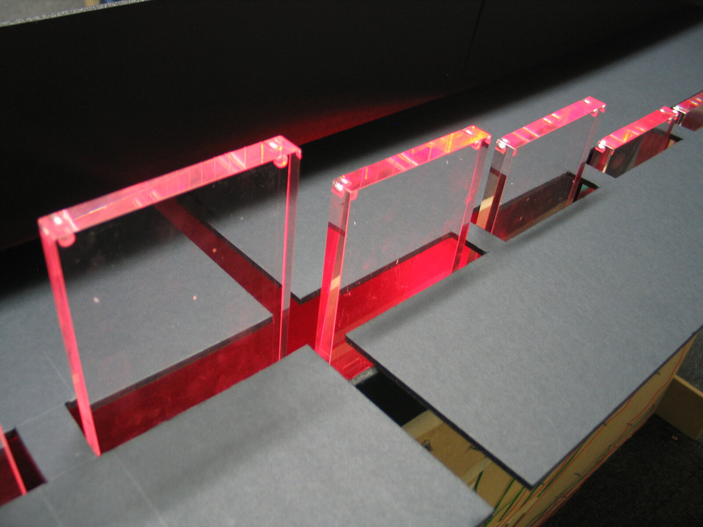
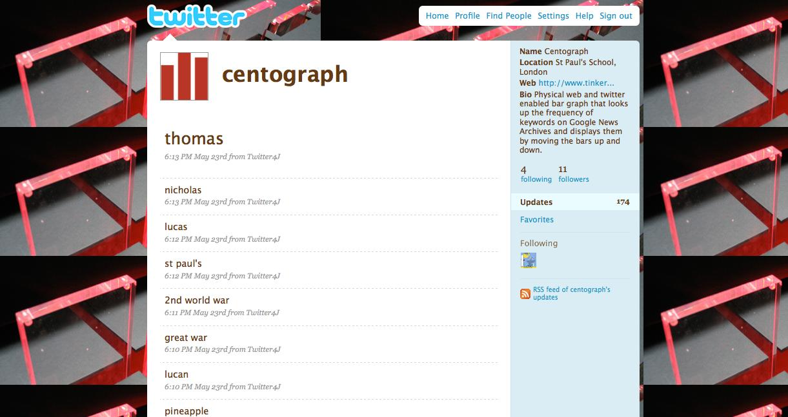

+++
author = "Yuichi Yazaki"
title = "A Century of Search Terms as the Height of Ten Moving Bars: Centograph"
slug = "centograph"
date = "2026-11-03"
description = "Centograph is a 2009 work that shows the relative number of Google News Archive articles mentioning a search term, with one moving bar for each decade from 1909 to 2009, ten bars in all."
categories = [
    "consume"
]
tags = [
    "data physicalization"
]
image = "images/centograph-at-school.jpg"
+++

Centograph is a moving bar graph made in 2009 by the London studio Tinker. It shows the relative number of Google News Archive articles that mention a search term, as the height of ten moving bars. Each bar is assigned to one of the ten decades from 1909 to 2009.

The client was St Paul's School for Boys in London. The work was made for the school's 500th anniversary celebration and was later installed permanently in its Computing Department. What follows draws on the Tinker London project page, the description of the video Tinker posted on Vimeo, and the description of the Flickr album. All of them are short texts, and I could not find any technical documentation that explains how the work operates.

<!--more-->

## May 2009, at the 500th-anniversary Open Day

The Tinker London project page gives the date of the work as "May 2009" and the client as "St Paul's School for Boys". The collaborator is Ben Burry, credited with web programming. No individual designer is named. In the Vimeo description, the maker is given as "Tinker.it!".

The school was founded in 1509, so 2009 was its 500th anniversary (Wikipedia). The project page states the purpose of the work as follows.

> Centograph is a kinetic bar graph that was developed for the 500th anniversary celebration of St. Paul's School for Boys. It was designed to encourage users to reflect on possible connections between new and emerging technologies and other academic and social disciplines.

In short, it is a moving bar graph made for the school's 500th-anniversary celebration, designed to get users thinking about connections between new technologies and other academic and social fields.

According to the Flickr album description, the commission was for the 500th-anniversary "Open Day".

Source: Tinker.it! (Flickr: tinker_it) / Tinker London, "Centograph" project page

The Flickr photo was taken between May 20 and 25, 2009. The Vimeo video (49 seconds) was posted on June 2, 2009. The project page says "Centograph is now a permanent fixture in St Paul's School for Boys Computing Department.", so the work was installed at the school permanently.

## Type a search term, and ten bars rise and fall

The project page describes how it works as follows.

> When users enter a search term on an online interface, Google News Archive is queried for related news articles from the past 100 years and returns a histogram of articles sorted according to date. That graph is then made physical by pushing and pulling the bars on the graph.

When a term is entered, Google News Archive is queried for related articles from the past 100 years, and what comes back is a histogram of the articles sorted by date. That graph is then made physical by pushing and pulling the bars.

The Vimeo description is clearer about what the height of a bar means.

> The bars on the graph then change height to display a histogram of the relative number of news articles for each decade.

The bars change height to show a histogram of the "relative number" of news articles for each decade. The Flickr photo description says how many years one bar covers.

> Each bar represents a decade from 1909 to 2009.

Each bar represents one decade between 1909 and 2009. The number of bars is given as "Ten" in the dataphys.org introduction (quoted in the section on third-party views).

Source: Tinker London, "Centograph" project page

Taken together with the opening photo, labels with the years 1919, 1929 and 1939, ten years apart, line the front of the base (from 1949 on, the labels cannot be read in the photos). The Flickr description says "from 1909", but the leftmost label legible in the photos is 1919. The sources do not say whether a label's year marks the start or the end of its decade.

Source: Tinker London, "Centograph" project page

The bars come up through slits cut in the base. You can see them move in Tinker's [Vimeo video](https://vimeo.com/4961482).

The correspondence between data and object that the sources let us establish is summarized below.

| Data | Property of the object | Description | Source |
|---|---|---|---|
| Decades (1909 to 2009, ten years each) | The row of bars; one bar = one decade | "Each bar represents a decade from 1909 to 2009." The count is "Ten" in dataphys.org | Flickr, dataphys.org |
| The relative number of news articles related to the search term in that decade | Height of the bar | "the relative number of news articles for each decade" | Vimeo |
| Switching the search term | Up-and-down movement of the same ten bars | "pushing and pulling the bars", "moving the bars up and down" | Tinker London, Flickr |
| The whole period | The row of ten bars as a whole | "over the past 100 years" | Tinker London, Vimeo |
| Marker for each decade | Year labels on the front of the base | 1919, 1929, 1939 (1949 onward cannot be read in the photos) | Photos of the work |
| Input | A search screen separate from the object; Twitter | "an online interface", "twitter enabled" | Tinker London, Flickr |

**Some things are not in the sources.** They do not say how the relative number was calculated, which value was mapped to the maximum height, what range the bar heights cover, or how the bars are moved. Because the normalization is unknown, you cannot read the article count back from the height of a bar.

## Terms also arrive from Twitter

The place where search terms are entered was separate from the object. The Vimeo description says "When you enter a search term into the computer", and dataphys.org says "A separate search interface is provided on a regular desktop computer". In the opening photo, too, a laptop sits on a desk beside the base.

The Flickr photo description mentions another way in.

> Physical web and twitter enabled bar graph that looks up the frequency of keywords on Google News Archives and displays them by moving the bars up and down.

It is a physical bar graph connected to the web and Twitter, which looks up how often keywords appear in Google News Archive and shows the result by moving the bars up and down.

Source: Tinker London, "Centograph" project page

A screenshot on the project page shows a Twitter account named centograph. Its location is "St Paul's School, London", and its bio is the same as the Flickr sentence above. The posts include terms such as "thomas", "nicholas", "st paul's", "2nd world war", "great war" and "pineapple", all posted from Twitter4J on the evening of May 23.

The sources do not say whether these posts are terms that reached the work from Twitter, or a record of terms the work had received. Nor do they say who entered these terms, or on what occasion.

## Not the numbers, but the "shape" of a century

The project page and the Vimeo description contain almost the same sentence.

> This allows users to view the 'shape' of the past century in relation to different key words—from progression in computing technology to times of war and peace to changing sources of energy.

Users can view the "shape" of the past century for different keywords, from progress in computing technology, to times of war and peace, to changing sources of energy.

All three subjects the makers name are terms whose article counts would probably vary a great deal from decade to decade. Centograph can be read as a tool conceived less for reading off numbers than for comparing where each term's peaks and valleys fall among the decades. The ten decades along the horizontal axis stay fixed, and only the heights change. Tinker writes the height as a "relative number" and names what it wants viewers to see as the "shape". This suggests a design that put comparing shapes ahead of letting viewers read exact counts.

The data source, Google News Archive, is a newspaper-archive search that opened in September 2006. A blog post in Information World Review at the time introduced one of its features this way.

> Another striking innovation is a Show Timeline option, which categorises results according to their publication dates.

The archive had a feature called "Show Timeline" that sorted search results by publication date. The project page's "returns a histogram of articles sorted according to date" can also be read as describing counts received per decade in this way. Centograph can be read as moving the on-screen timeline into the height of bars. That said, it has not been confirmed that the work used this feature.

The sources also do not say why the period was set at the 100 years from 1909 to 2009. It can be read as fitting the framing of looking back on "the past century" at a 500th-anniversary celebration.

## How third parties saw the work

The researcher Pierre Dragicevic has listed this work in the List of Physical Visualizations on dataphys.org. It is categorized as "Active physical visualization", with the tags bar charts, news and temporal data. The description reads as follows.

> Ten actuated bar charts that show the popularity of keywords of interest in news articles over time, made by the company Tinker from London.

It introduces the work as ten moving bar charts showing how the popularity of keywords changes in news articles over time. It differs from the primary sources in two points, however. Tinker writes "a physical bar graph", a single bar graph with ten bars. And Tinker's own words are "frequency" and "relative number of news articles"; it does not use "popularity". dataphys cites an infosthetics article (August 2009) as its source, but I have not been able to check its text.

A student blog from Carnegie Mellon University's course 15-104 (Fall 2017) draws attention to where the work is placed.

> By turning data from something esoteric into something tangible and cool, it helps to incite a level of interest in the areas of computation and data visualization, especially in students.

The evaluation is that turning obscure data into something touchable raises interest in computation and data visualization, especially among students. The author counts it as a strength that the work is a permanent installation made for an educational setting. Since this is a student assignment, it is weak as an expert assessment. Still, the factual part, bars every ten years starting in 1909, agrees with the primary sources.

I found no newspaper or magazine coverage. The 2009 press items listed on Tinker London's Press page do not mention Centograph either.

## What to take from it

The first thing to take from this work is fixing the axis and swapping only the heights. The bars are always assigned to the same decades. Because the row does not change when the term changes, viewers can compare differences in shape.

Second is separating input from display. Search terms come in from a separate screen or from Twitter, and what moves on the object's side is the height of ten bars. Each time a viewer tries a term, the same object becomes a different graph.

Last is the lifespan of a physicalization that relies on web data. According to Wikipedia, Google announced in 2011 that it would stop adding material to News Archive. Whether the work keeps running in the same form as back then has not been confirmed. For a work whose data source lies outside it, you need to consider what happens after the source stops being updated, as I read it.

## References

**Primary sources**

- Tinker London, "Centograph" project page: https://tinkerlondon.com/what-we-do-centograph.html
- Tinker, "Centograph" (Vimeo, 2009-06-02, 49 seconds): https://vimeo.com/4961482 (description and metadata: https://vimeo.com/api/oembed.json?url=https://vimeo.com/4961482 )
- Tinker.it!, "Centograph (work)" (Flickr album): https://www.flickr.com/photos/tinker_it/sets/72157618662102020/
- Tinker.it!, "Centograph" (Flickr photo): https://www.flickr.com/photos/tinker_it/3555602327/
- Tinker London, "Press": https://tinkerlondon.com/press.html

**Secondary sources**

- dataphys.org, "2009 – Centograph: Dynamic Bar Charts Show Keyword Popularity" (listed by Pierre Dragicevic): https://dataphys.org/list/centograph-dynamic-bar-charts-show-keyword-popularity/
- mmiller5, "Looking Outwards-07" (Carnegie Mellon University 15-104, Fall 2017): https://courses.ideate.cmu.edu/15-104/f2017/index.html%3Fp=17742.html
- infosthetics, "centograph: physical bar graph" (August 2009; text not checked): http://infosthetics.com/archives/2009/08/centograph_physical_bar_graph.html

**Background sources**

- Information World Review, "Historic perspectives in Google News" (2006-09-11): https://informationworldreview.blogspot.com/2006/09/historic-perspectives-in-google-news.html
- Wikipedia, "Google News Archive": https://en.wikipedia.org/wiki/Google_News_Archive
- Wikipedia, "St Paul's School, London": https://en.wikipedia.org/wiki/St_Paul%27s_School,_London
