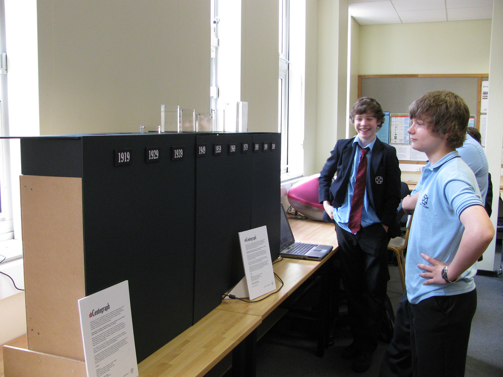
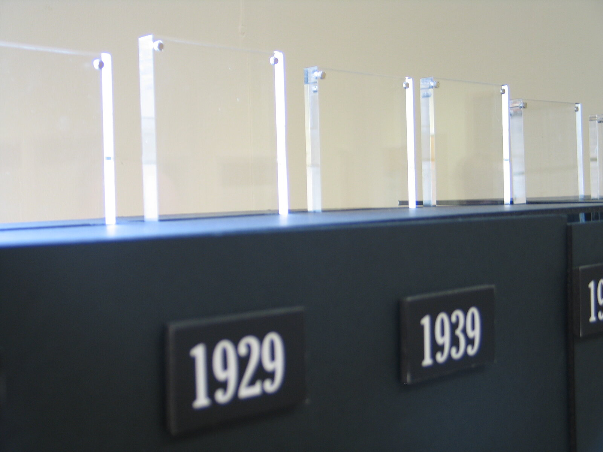
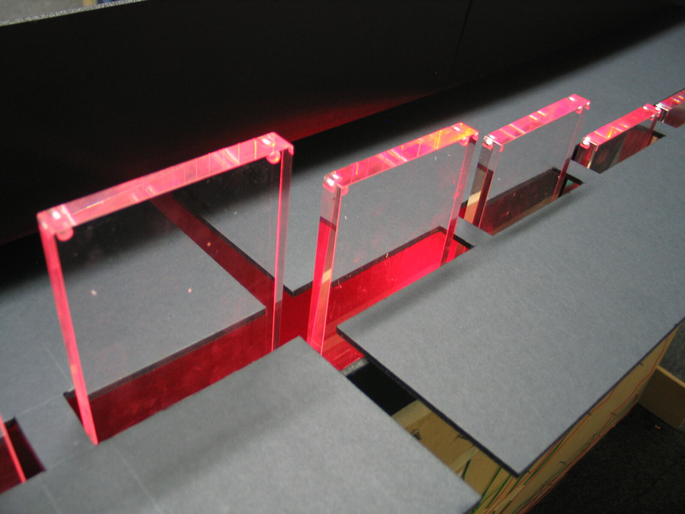
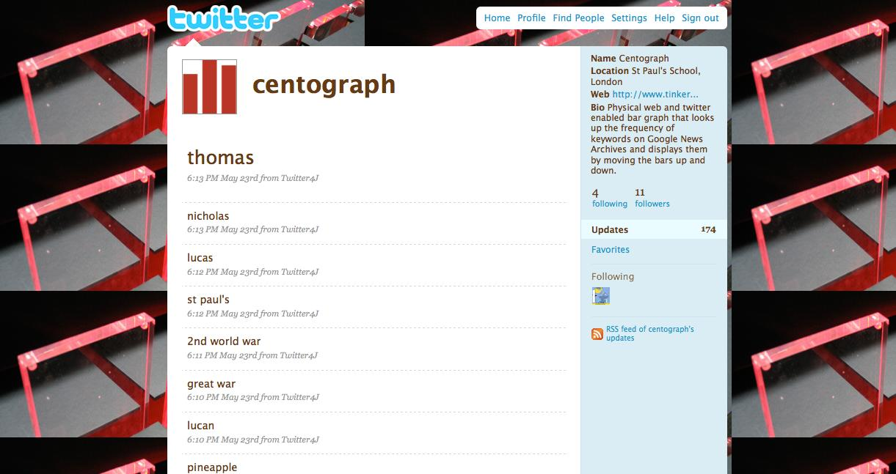

+++
author = "矢崎裕一"
title = "検索語の100年を、10本の動く棒の高さにする──Centograph"
slug = "centograph"
date = "2026-11-03"
description = "検索語が Google News Archive の記事に出てくる相対的な数を、1909〜2009年の年代ごとに1本、計10本の動く棒の高さで示した作品です。"
categories = [
    "consume"
]
tags = [
    "データ物質化"
]
image = "images/centograph-at-school.jpg"
series = ["data-physicalization"]
series_weight = 16
seriesByline = "Tinker London"
seriesTitle = "検索語の100年を10本の棒に──Centograph"
+++

Centograph（セントグラフ）は、2009年にロンドンのスタジオ Tinker（ティンカー）が作った、動く棒グラフです。検索語が Google News Archive の記事に出てくる相対的な数を、10本の動く棒の高さで示しました。棒は1909〜2009年の10の年代に1本ずつ割り当てています。

依頼主は、ロンドンの男子校 St Paul's School for Boys（セント・ポールズ・スクール）です。創立500周年の祝典のために作られ、のちに同校の Computing Department に常設されました。以下は、Tinker London の作品ページ、Tinker が投稿した Vimeo 動画の説明文、Flickr アルバムの説明文に沿います。どれも短い文章で、仕組みを書いた技術資料は見つかっていません。

<!--more-->

## 2009年5月、創立500周年のオープンデーに

Tinker London の作品ページには、作品の日付が「May 2009」、依頼主が「St Paul's School for Boys」と書かれています。協力者は Ben Burry（ベン・バリー）で、担当は web programming です。個人の設計者の名前は載っていません。Vimeo の説明文では、制作者の名前は「Tinker.it!」です。

同校は1509年の創立で、2009年が500周年にあたります（Wikipedia）。作品ページは、作品の目的をこう書いています。

> Centograph is a kinetic bar graph that was developed for the 500th anniversary celebration of St. Paul's School for Boys. It was designed to encourage users to reflect on possible connections between new and emerging technologies and other academic and social disciplines.

Centograph は、同校の創立500周年の祝典のために作った動く棒グラフだ。新しい技術と、ほかの学問や社会の分野とのつながりを、使う人に考えてもらうために設計した、という説明です。

Flickr アルバムの説明文によれば、依頼は500周年の「Open Day」のためでした。

Tinker.it!（Flickr: tinker_it）／Tinker London「Centograph」作品ページより引用

Flickr の写真の撮影日は、2009年5月20〜25日です。Vimeo の動画（49秒）は、2009年6月2日に投稿されました。作品ページには「Centograph is now a permanent fixture in St Paul's School for Boys Computing Department.」とあり、同校に常設されました。

## 検索語を打つと、10本の棒が上下する

仕組みについて、作品ページは次のように書いています。

> When users enter a search term on an online interface, Google News Archive is queried for related news articles from the past 100 years and returns a histogram of articles sorted according to date. That graph is then made physical by pushing and pulling the bars on the graph.

検索語を入れると、Google News Archive に過去100年の関連記事を問い合わせる。返ってくるのは、記事を日付で分けたヒストグラムだ。そのグラフを、棒を押し上げたり引き下げたりして物にする、という説明です。

棒の高さが何を表すかは、Vimeo の説明文のほうがはっきりしています。

> The bars on the graph then change height to display a histogram of the relative number of news articles for each decade.

棒は高さを変え、年代ごとのニュース記事の「相対的な数」のヒストグラムを示す、という説明です。棒1本が何年分かは、Flickr の写真の説明文にあります。

> Each bar represents a decade from 1909 to 2009.

1本の棒が、1909〜2009年の1つの年代を表します。棒の本数は、dataphys.org の紹介文が「Ten」と書いています（第三者評価の節で引用します）。

Tinker London／「Centograph」作品ページより引用

冒頭の写真と合わせると、台の前面に 1919、1929、1939 と、10年おきの年を書いたラベルが並んでいます（1949 以降は写真からは読めません）。Flickr の説明文は「from 1909」と書いていますが、写真で読めるいちばん左のラベルは 1919 です。ラベルの年が年代の始まりと終わりのどちらを指すのかは、資料には書かれていません。

Tinker London／「Centograph」作品ページより引用

棒は、台に開いた切り込みから上に出てきます。動く様子は、Tinker の [Vimeo の動画](https://vimeo.com/4961482)で見られます。

資料から分かる、データと物の対応をまとめると、次のようになります。

| データ | 物の性質 | 説明 | 出典 |
|---|---|---|---|
| 年代（1909〜2009年を10年ずつ） | 棒の並び。1本＝1つの年代 | 「Each bar represents a decade from 1909 to 2009.」。本数は dataphys.org の「Ten」 | Flickr、dataphys.org |
| その年代の、検索語に関係するニュース記事の相対的な数 | 棒の高さ | 「the relative number of news articles for each decade」 | Vimeo |
| 検索語の切り替え | 同じ10本の棒の上下の動き | 「pushing and pulling the bars」「moving the bars up and down」 | Tinker London、Flickr |
| 期間全体 | 10本の並び全体 | 「over the past 100 years」 | Tinker London、Vimeo |
| 年代の目印 | 台の前面の年のラベル | 1919、1929、1939（1949 以降は写真から読めない） | 作品の写真 |
| 入力 | 物とは別の検索画面、Twitter | 「an online interface」「twitter enabled」 | Tinker London、Flickr |

**資料に書かれていないこともあります。** 相対的な数をどう計算したか、どの値を最大の高さにしたか、棒の高さの範囲、棒を動かす仕組みです。正規化の方法が分からないので、棒の高さから記事の件数を読み戻すことはできません。

## Twitter からも語を受け取る

検索語を入れる場所は、物とは別にありました。Vimeo の説明文は「When you enter a search term into the computer」と書き、dataphys.org は「A separate search interface is provided on a regular desktop computer」と書いています。冒頭の写真でも、台の横の机にノートパソコンが置かれています。

Flickr の写真の説明文には、もう一つの入り口が書かれています。

> Physical web and twitter enabled bar graph that looks up the frequency of keywords on Google News Archives and displays them by moving the bars up and down.

ウェブと Twitter につながった物理的な棒グラフで、キーワードの頻度を Google News Archive で調べ、棒を上下させて示す、という説明です。

Tinker London／「Centograph」作品ページより引用

作品ページに載っている画面写真には、Twitter の centograph というアカウントが写っています。所在地は「St Paul's School, London」、自己紹介は上の Flickr の文と同じです。投稿には「thomas」「nicholas」「st paul's」「2nd world war」「great war」「pineapple」といった語が並び、どれも5月23日の夕方に Twitter4J から投稿されています。

これらの投稿が、Twitter から作品に届いた語なのか、作品が受け取った語を書き出したものなのかは、資料からは分かりません。誰が、どの場面で入力した語なのかも分かりません。

## 数値ではなく、100年の「形」を見る

作品ページと Vimeo の説明文には、ほぼ同じ一文があります。

> This allows users to view the 'shape' of the past century in relation to different key words—from progression in computing technology to times of war and peace to changing sources of energy.

さまざまなキーワードについて、過去100年の「形」を見られる。コンピュータ技術の進歩から、戦争と平和の時代、エネルギー源の移り変わりまで、という説明です。

制作者が挙げた三つの題材は、どれも年代によって記事の量が大きく変わりそうな語です。Centograph は数値を読む道具というより、語ごとの山や谷がどの年代にあるかを比べる道具として考えられていた、と読めます。横に並ぶ10の年代は動かず、変わるのは高さだけです。Tinker は高さを「相対的な数」と書き、見てほしいものを「形」と書いています。件数を正確に読ませるより、形を比べさせることを優先した作りだと読めます。

データ源の Google News Archive は、2006年9月に公開された新聞アーカイブの検索です。当時の Information World Review のブログは、その機能をこう紹介しています。

> Another striking innovation is a Show Timeline option, which categorises results according to their publication dates.

検索結果を発行日で分けて示す「Show Timeline」という機能があった、という紹介です。作品ページの「returns a histogram of articles sorted according to date」も、この年代別の件数を受け取ったと読める書き方です。Centograph は、画面上のタイムラインを棒の高さに移したもの、と読めます。ただし、作品がこの機能を使ったことは確かめられていません。

期間を1909〜2009年の100年にした理由も、資料には書かれていません。創立500周年の祝典で「過去の1世紀」を振り返る、という枠組みとは合っている、と読めます。

## 第三者はこの作品をどう見たか

研究者の Pierre Dragicevic（ピエール・ドラギセヴィック）は、dataphys.org の List of Physical Visualizations にこの作品を登録しています。分類は「Active physical visualization」、タグは bar charts、news、temporal data です。説明文は次のとおりです。

> Ten actuated bar charts that show the popularity of keywords of interest in news articles over time, made by the company Tinker from London.

ニュース記事でのキーワードの人気の推移を示す、10個の動く棒グラフ、という紹介です。ただし、一次情報の言い方とは二点で違います。Tinker は「a physical bar graph」と書き、1つの棒グラフに10本の棒がある作りです。また、Tinker の言葉は「frequency」と「relative number of news articles」で、「popularity」は使っていません。dataphys は出典に infosthetics の記事（2009年8月）を挙げていますが、筆者はその本文を確認できていません。

カーネギーメロン大学の授業 15-104（2017年秋）の学生ブログは、置かれた場所に注目しています。

> By turning data from something esoteric into something tangible and cool, it helps to incite a level of interest in the areas of computation and data visualization, especially in students.

分かりにくいデータを触れられる形にして、計算やデータ可視化への関心を、とくに学生のあいだで高める、という評価です。投稿者は、教育の場のために作られた常設作品であることを良い点に挙げています。学生の課題なので、専門家の評価としては弱いものです。ただ、1909年から10年ごとの棒、という事実の部分は一次情報と合っています。

新聞や雑誌の報道は見つかりませんでした。Tinker London の Press ページに並ぶ2009年の報道にも、Centograph の名前はありません。

## 使い道

この作品から持ち帰れるのは、まず、軸を固定して高さだけを入れ替えることです。棒は、いつも同じ年代に割り当てられています。語を替えても並びは変わらないので、見る人は形の違いを比べられます。

次に、入力と表示を分けることです。検索語は別の画面や Twitter から入り、物の側で動くのは10本の棒の高さです。見る人が語を試すたびに、同じ物が別のグラフになります。

最後に、ウェブのデータに頼る物理化の寿命です。Wikipedia によれば、Google は2011年に News Archive への資料の追加をやめると発表しています。作品が当時と同じ形で動き続けているかは、確かめられていません。データ源が外にある作品では、源の更新が止まったあとのことも考えておく必要がある、と筆者は読みます。

## 参考・出典

**一次情報**

- Tinker London「Centograph」作品ページ：https://tinkerlondon.com/what-we-do-centograph.html
- Tinker「Centograph」（Vimeo、2009-06-02、49秒）：https://vimeo.com/4961482 （説明文とメタデータ：https://vimeo.com/api/oembed.json?url=https://vimeo.com/4961482 ）
- Tinker.it!「Centograph (work)」（Flickr アルバム）：https://www.flickr.com/photos/tinker_it/sets/72157618662102020/
- Tinker.it!「Centograph」（Flickr 写真）：https://www.flickr.com/photos/tinker_it/3555602327/
- Tinker London「Press」：https://tinkerlondon.com/press.html

**第三者評価**

- dataphys.org「2009 – Centograph: Dynamic Bar Charts Show Keyword Popularity」（Pierre Dragicevic 登録）：https://dataphys.org/list/centograph-dynamic-bar-charts-show-keyword-popularity/
- mmiller5「Looking Outwards-07」（Carnegie Mellon University 15-104, Fall 2017）：https://courses.ideate.cmu.edu/15-104/f2017/index.html%3Fp=17742.html
- infosthetics「centograph: physical bar graph」（2009年8月、本文は未確認）：http://infosthetics.com/archives/2009/08/centograph_physical_bar_graph.html

**背景資料**

- Information World Review「Historic perspectives in Google News」（2006-09-11）：https://informationworldreview.blogspot.com/2006/09/historic-perspectives-in-google-news.html
- Wikipedia「Google News Archive」：https://en.wikipedia.org/wiki/Google_News_Archive
- Wikipedia「St Paul's School, London」：https://en.wikipedia.org/wiki/St_Paul%27s_School,_London
