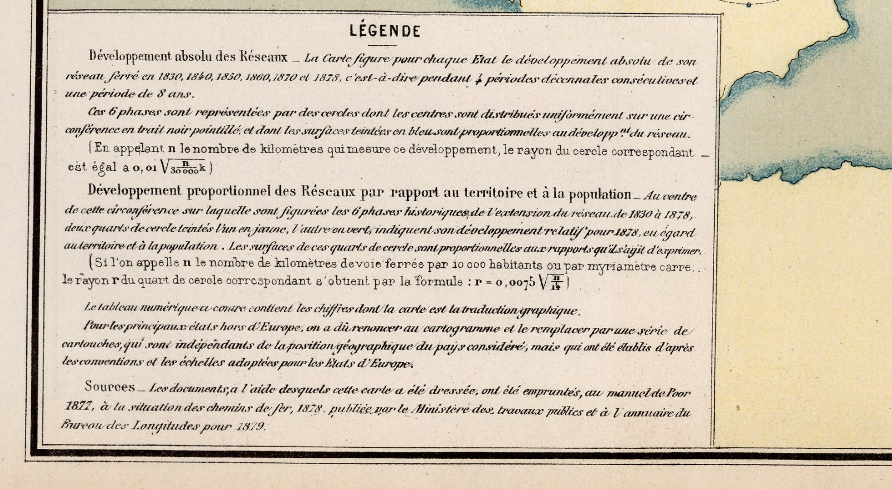
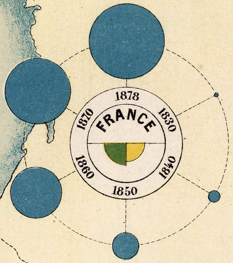
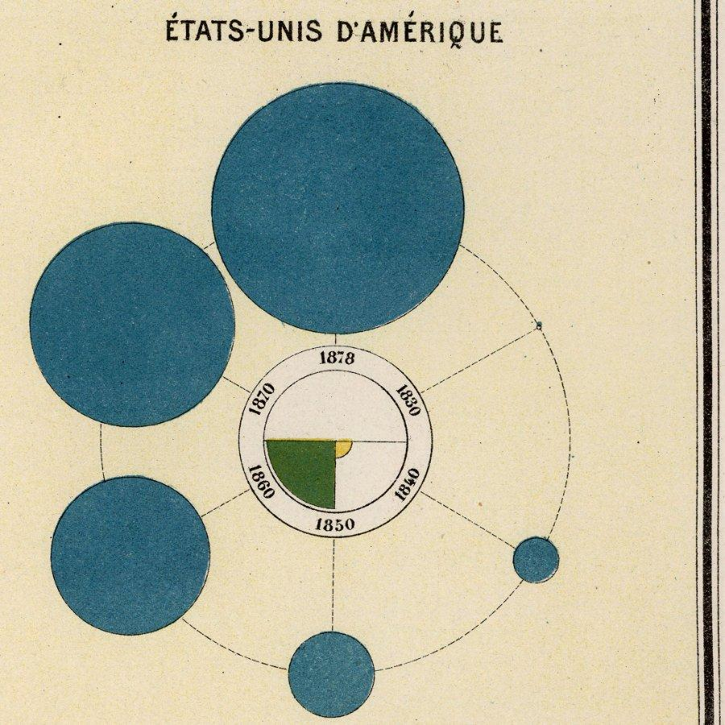
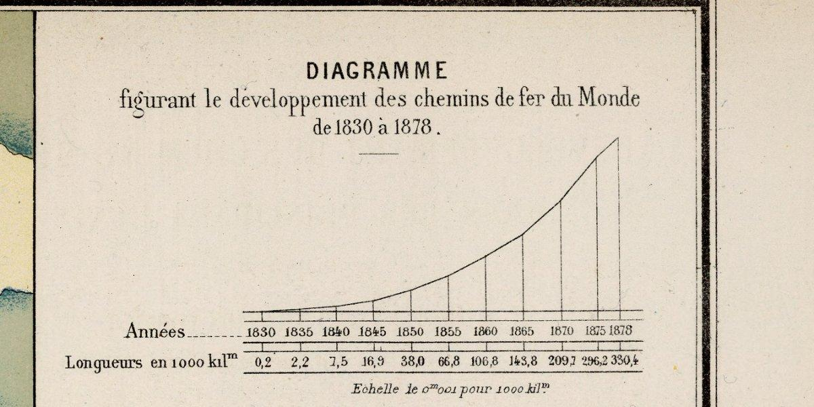
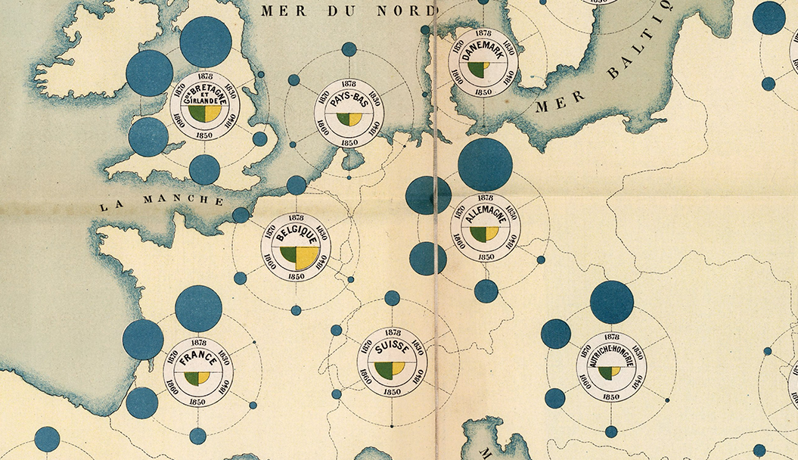

+++
author = "Yuichi Yazaki"
title = "Six Circles Around a Country Chart the Growth of Railways: The 1880 Railway Development Map"
slug = "chart-map-railway"
date = "2025-09-15"
description = "Plate 16 of the 1880 Album de statistique graphique shows each country's total railway length from 1830 to 1878 as the area of blue circles, with one circle per year spaced 60 degrees apart around the country's center."
categories = [
    "technology"
]
tags = [
    "maps",
    "Émile Cheysson",
    "Album de statistique graphique",
    "proportional circles",
    "railways",
    "French Ministry of Public Works"
]
image = "images/12511022_closeup.png"
series = ["dataviz-classics"]
series_weight = 6
seriesByline = "French Ministry of Public Works (Émile Cheysson)"
seriesTitle = "Year Circles Around a Country: The 1880 Railway Development Map"
+++

In July 1880, the French Ministry of Public Works issued the 1880 edition of the *Album de statistique graphique* (Album of Graphic Statistics). Its last plate, no. 16, shows each country's total railway length from 1830 to 1878 as the area of blue circles. The circles for each year are spaced 60 degrees apart around the center of the country. Length per 10,000 inhabitants (green) and per 100 km² (yellow) is added as quarter-circles in the middle.

The original title is "Carte figurative du développement des chemins de fer dans les principaux États de 1830 à 1878". The catalog names Émile Cheysson as its author. What follows draws on the images that the David Rumsey Map Collection has published (legend, data table, sources) and on the preface to the album. The preface was reprinted in the 1881 *Journal de la Société de statistique de Paris*.

<!--more-->

Source: Ministère des Travaux Publics (1880) / David Rumsey Map Collection. CC BY-NC-SA 3.0

## The Last Plate of the 1880 Album

According to the preface, the album is an annual collection of plates established by a ministerial order of March 12, 1878. The order required that statistics on passenger and freight flows on transport routes, and on their construction and operation, be turned into diagrams and published every year. The 1880 edition is the second. The previous year's edition had 12 plates; the 1880 edition has 16, all of them large-format. Plate 16 is the last of these, a 49 × 62 cm sheet folded into the album.

The person in charge was Cheysson. According to Michael Friendly, the Ministry's Bureau of Graphic Statistics was created in March 1878 and headed by Cheysson (1836–1910), an engineer of the École nationale des ponts et chaussées (ENPC). How the album came about, and its plate 1, are covered in [the statistical map of the breakdown of transport infrastructure](/en/chart-map-transportation-infrastructure/), in the same series.

The preface groups plates 1, 2, and 16 as "cartogrammes à foyers diagraphiques": maps in which a small diagram is placed around a point (foyer) on the map. The preface notes that plates 1 and 2 use sectors, and it describes plate 16 as follows.

> Enfin, la dernière planche n° 16 se rapporte à l'accroissement du réseau ferré des grands États de l'Europe, de dix en dix ans, depuis 1830, et le figure par des cercles proportionnels distribués régulièrement sur une circonférence dont le centre est le chef-lieu de chaque État.

The last plate, no. 16, concerns the growth of the railway networks of the major European states, every ten years since 1830. It represents this with proportional circles spaced evenly along a circumference whose center is each state's capital.

The preface also names the readers. The album is meant "especially" (auxquels il est spécialement destiné) for members of parliament, and it hopes to be read by administrators and economists as well. It adds that each plate comes with its source, a legend stating the drawing conventions, and a table of the underlying figures. Plate 16 has all three.

## What the Legend Says About the Encoding

At lower left of plate 16 is a box titled LÉGENDE. Its first paragraph gives the convention for the blue circles.

Source: Ministère des Travaux Publics (1880), legend detail / David Rumsey Map Collection. CC BY-NC-SA 3.0

> Ces 6 phases sont représentées par des cercles dont les centres sont distribués uniformément sur une circonférence en trait noir pointillé, et dont les surfaces teintées en bleu sont proportionnelles au développ.nt du réseau.

These 6 phases are represented by circles whose centers are spread evenly along a circumference drawn as a dotted black line. The surfaces tinted blue are proportional to the length of the network.

A radius formula follows. With the length as n km, the radius is "0,01 √(n / 30 000k)". The denominator is hard to make out in the image, but the use of the square root is clearly legible. If the radius is made proportional to the square root of the value, the area is proportional to the value. Counting the pixels of the circles in the image, the ratio of France's 1870 and 1878 areas is 0.77, which roughly matches the ratio of the lengths in the data table, 0.73.

| Data | Appearance | Basis |
|---|---|---|
| Total railway length of each country (1830, 1840, 1850, 1860, 1870, 1878) | Area of a blue circle | Legend text and radius formula |
| Which year | Position on the dotted circumference, 60 degrees apart, clockwise | Legend "distribués uniformément", ring printed with the years |
| Which country | Center of the circumference (the capital, per the preface) | Preface "le centre est le chef-lieu" |
| Length per 10,000 inhabitants in 1878 | Area of the green quarter-circle at center left-bottom | Legend checked against the data table |
| Length per 100 km² in 1878 | Area of the yellow quarter-circle at center right-bottom | Legend checked against the data table |
| Countries outside Europe | Separate boxes, removed from their map positions (same scale) | Legend paragraph on "cartouches" |

Source: Ministère des Travaux Publics (1880), glyph for France / David Rumsey Map Collection. CC BY-NC-SA 3.0

Let us confirm the orientation on the glyph for France. 1830 is at the 2 o'clock position at upper right, 1840 is at lower right, and 1850 is straight down. 1860 is at lower left, 1870 at upper left, and 1878 comes at the top, at 12 o'clock. The circles grow larger as they go clockwise.

About the quarter-circles at the center, the legend says only that "one is yellow, one is green" and that they represent length relative to territory and to population. The text does not settle which is which, so I compare against the data table. Belgium has 7.5 km per 10,000 inhabitants and 13.5 km per 100 km², and in the plate the yellow one is larger. The United States has 33.9 km and 1.7 km, and the green one is larger while the yellow one is very small. **Green is per 10,000 inhabitants, and yellow is per 100 km².** The two quarter-circles sit side by side and form a semicircle in the lower half.

Source: Ministère des Travaux Publics (1880), separate box for the United States / David Rumsey Map Collection. CC BY-NC-SA 3.0

## Placed 60 Degrees Apart: Ten Years and Eight Years

The six years are not equally spaced, and the legend says so itself. From 1830 to 1878 there are "4 périodes décennales consécutives et une période de 8 ans": four ten-year periods and one eight-year period. Even so, the circles are placed 60 degrees apart. The preface's "de dix en dix ans" (every ten years) can be read as a rounded way of describing that last eight-year period.

At upper right of the same plate is a line chart of the world's total railway length. Its title is "Diagramme figurant le développement des chemins de fer du Monde de 1830 à 1878".

Source: Ministère des Travaux Publics (1880), line chart of the world's railway length / David Rumsey Map Collection. CC BY-NC-SA 3.0

The horizontal axis here follows the actual intervals between years. The gap between the ticks for 1875 and 1878 is narrower than the others. The value for 1878 is 330.4 (thousand km), so the world's railways had reached about 330,000 km.

Within a single sheet, time is handled in two ways. The glyphs line up points in time as "phases" at equal angles, while the line chart measures time as length. Since the legend itself points out the eight-year interval, it can be read as the makers being aware of the difference in intervals and still equalizing the angles of the glyph. What the glyph was meant to show was not the length of time but the difference in size from one phase to the next.

## Countries Moved Off the Map, and the Data Table

Countries outside Europe cannot be placed on the map. According to the legend, the major ones gave up the map and were moved to separate boxes (cartouches). The legend states that the boxes have nothing to do with position, but that the conventions and the scale are the same as for the European countries.

The United States, British India, and Canada are in the boxes on the right, while Algeria is drawn at its position in North Africa. Because the scale is shared, the circles in the boxes can be compared in size with the circles on the map.

For the data table at lower right, the legend says that "the map is a translation of these figures into a diagram." A few countries are extracted below (unit: km; "—" means not recorded).

| Country | 1830 | 1870 | 1878 | Per 10,000 inhabitants | Per 100 km² |
|---|---|---|---|---|---|
| Great Britain and Ireland | 279 | 24,999 | 27,552 | 8.6 | 8.7 |
| France | 37 | 17,924 | 24,424 | 6.6 | 4.6 |
| Germany | — | 18,560 | 31,556 | 7.4 | 5.8 |
| Belgium | — | 2,979 | 3,980 | 7.5 | 13.5 |
| Europe, total | 316 | 104,120 | 158,157 | 5.3 | 1.7 |
| United States | 65 | 84,637 | 131,681 | 33.9 | 1.7 |

The United States in 1878 had about 130,000 km, a little over five times France and close to the roughly 160,000 km of all Europe. The sources of the data are given under "Sources" in the legend: Poor's Manual (1877), the Ministry's *Situation des chemins de fer* (1878), and the *Annuaire du Bureau des Longitudes pour 1879*.

Source: Ministère des Travaux Publics (1880), Western Europe detail / David Rumsey Map Collection. CC BY-NC-SA 3.0

On the map, the glyphs become larger than the countries. The dotted circumference is about the same size for every country; only the blue circles change. The 1870 and 1878 circles for Great Britain and Germany spill over the sea and neighboring countries. The map seems to serve as a backdrop that shows which country each glyph belongs to, with positional accuracy a secondary concern.

## How Third Parties Have Viewed This Album

In his 2008 paper "The Golden Age of Statistical Graphics," Friendly places the album as a whole at the peak of the golden age of statistical graphics.

> These volumes can be considered the pinnacle of the Golden Age, an exquisite sampler of nearly all known graphical forms, and a few that make their first appearance in these volumes.

Friendly names "planetary" diagrams among the new forms that appear in the album, and he shows plate 9 of the 1897 edition as an example. He does not discuss plate 16 itself. However, the Rumsey catalog notes this plate as a "multi-circle, planetary design," so plate 16 can be read as an early example of that form. Friendly also writes that the album was discontinued in 1897 because of its high production cost.

The geographer Gilles Palsky offered a different view in a 2023 talk at the Ruderman Conference on Cartography.

> In the end, it appears that the series of albums did not really meet their objectives, and this despite its high financial cost, which no doubt explains its extinction at the beginning of the twentieth century.

Palsky argues that the series fell short of its aims despite its cost, which likely explains why it ended in the early twentieth century.

Palsky views the album not from the quality of the plates but from its aims and readers. Together with the preface's naming of members of parliament as the intended readers, this suggests that how well the plates are made and whether their aims were achieved are separate questions.

The third is perceptual research on reading proportional circles. In a 1970 presentation, James J. Flannery reported that even for circles whose areas are properly proportional, readers underestimate the differences in size.

> map users consistently underestimated size differences

Map users consistently underestimated the differences in size.

Plate 16 makes the areas proportional exactly as the formula says. In light of Flannery's result, the difference between the United States and France in 1878 may look smaller than the actual factor of a little over five.

## Takeaways

What we can take away from plate 16 is that it hands the reader the rules of the encoding inside the chart itself.

The first is to write the formula in the legend. Plate 16 says that area is proportional to length, and even adds the radius formula. If you use proportional circles or bubbles, you can add one line saying that you scaled by area.

The second is to attach the underlying figures to the chart. Differences in area tend to be underestimated. Plate 16 has a data table, so the difference between the United States and France can be checked in numbers. The meaning of the colors of the quarter-circles was also settled with this table.

The third is to separate absolute and relative quantities by color and position. The outer blue circles are the total length, and the green and yellow at the center are per capita and per area. A country like Belgium, whose total length is small but whose length per area is large, can be read in a single glyph.

The fourth is to decide whether to equalize time by angle or to measure it by length, and to say which. Plate 16 equalizes the angles in the glyph, notes the eight-year interval in the legend, and shows the actual intervals in the line chart. Countries that do not fit were moved to separate boxes at the same scale. When you place small graphs on a map, you can likewise write in the legend what you kept and what you gave up.

## References

**Primary sources**

- Ministère des Travaux Publics, *Carte figurative du développement des chemins de fer dans les principaux États de 1830 à 1878*, 1880 (*Album de statistique graphique* 1880, pl. 16). David Rumsey Map Collection, List No. 12511.022. [Detail page](https://www.davidrumsey.com/luna/servlet/detail/RUMSEY~8~1~309011~90078926) / [IIIF manifest](https://www.davidrumsey.com/luna/servlet/iiif/m/RUMSEY~8~1~309011~90078926/manifest) / [Catalog (search API)](https://www.davidrumsey.com/luna/servlet/as/search?q=pub_list_no=12511.000&lc=RUMSEY~8~1) / [Internet Archive mirror](https://archive.org/details/dr_carte-figurative-du-developpement-des-chemins-de-fer-dans-les-principaux-et-12511022)
- *Album de statistique graphique* 1880, table of contents (Table des matières). [Internet Archive](https://archive.org/details/dr_index-page-table-des-matieres-12511006)
- *Album de statistique graphique* 1880, preface (Notice). [Page 1](https://archive.org/details/dr_text-page-notice-12511004) / [Page 2](https://archive.org/details/dr_text-page-notice-continued-12511005)
- "Bibliographie. Notice relative à l'album de statistique graphique," *Journal de la Société de statistique de Paris*, 22, 1881, pp. 25–28 (excerpt from the *Bulletin de statistique du Ministère des travaux publics*, August 1880). [numdam](http://www.numdam.org/item?id=JSFS_1881__22__25_0) / [PDF](https://www.numdam.org/item/JSFS_1881__22__25_0.pdf)

**Secondary sources**

- Michael Friendly, "The Golden Age of Statistical Graphics," *Statistical Science*, 23(4), 2008, pp. 502–535. DOI: 10.1214/08-STS268. [Project Euclid](https://projecteuclid.org/euclid.ss/1242049392) / [PDF](https://www.stat.cmu.edu/~brian/nynke/726-2021/misc%20articles/Friendly_2008_The%20Golden%20Age%20of%20Statistical%20Graphics.pdf)
- Michael Friendly, *HistDataVis*, Chapter 7. [Online version](https://friendly.github.io/HistDataVis/ch07-golden.html)
- Gilles Palsky, "Legitimizing administrative statistics in XIXth Century France: The 'Albums de Statistique Graphique' in Context, their Aims and Audiences," Ruderman Conference on Cartography, David Rumsey Map Center, Stanford University, 2023. [Abstract](https://geographie-cites.cnrs.fr/en/barry-lawrence-ruderman-conference-on-cartography/)
- James J. Flannery, "The Relative Effectiveness of Some Common Graduated Point Symbols in the Presentation of Quantitative Data," 1970 (ERIC ED045469). [PDF](https://files.eric.ed.gov/fulltext/ED045469.pdf)
