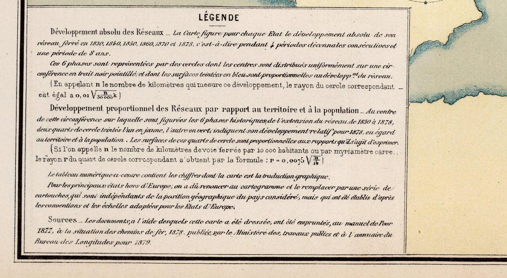
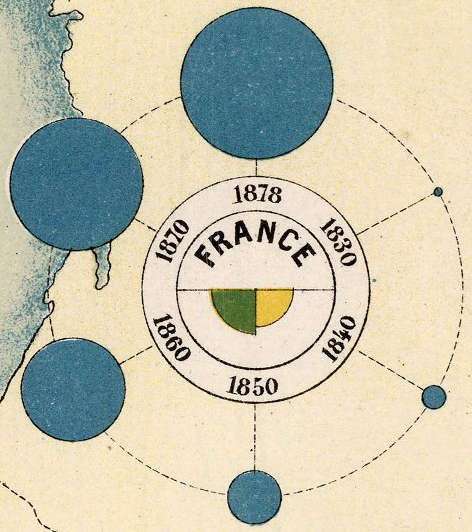
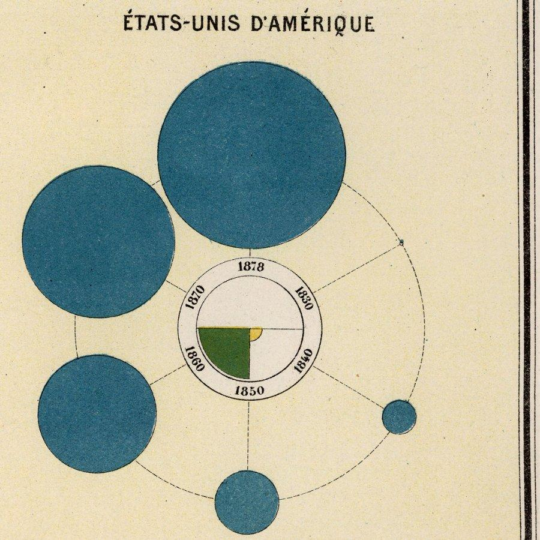
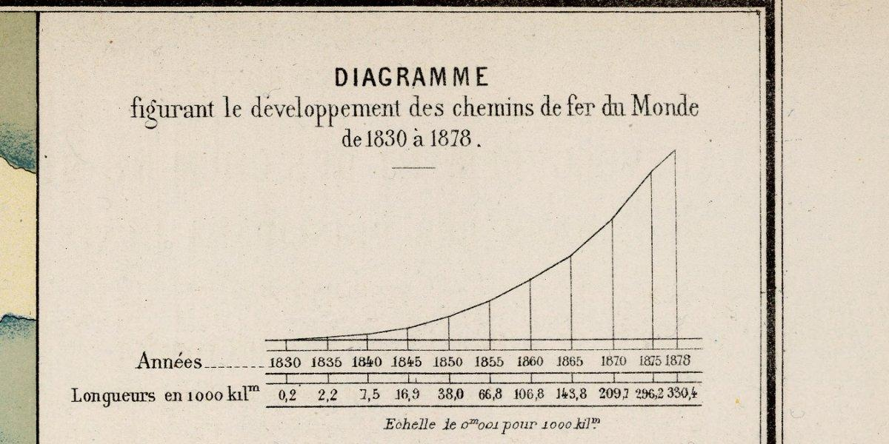
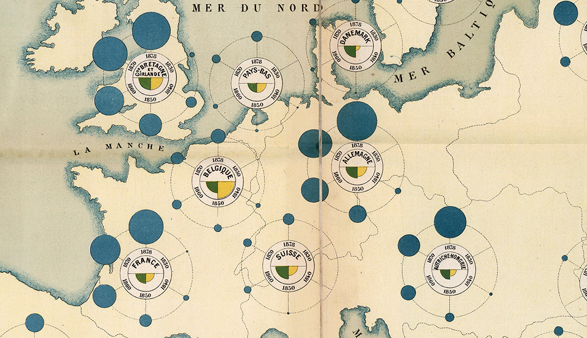

+++
author = "矢崎裕一"
title = "鉄道の伸びを、国のまわりに並べた6つの円で描く──1880年の鉄道発展図"
slug = "chart-map-railway"
date = "2025-09-15"
description = "1880年版の統計図アルバムの第16図は、1830〜1878年の各国の鉄道の総延長を青い円の面積で表し、年ごとの円を国の中心のまわりに60度ずつ並べています。"
categories = [
    "technology"
]
tags = [
    "地図",
    "Émile Cheysson",
    "Album de statistique graphique",
    "比例円",
    "鉄道",
    "フランス公共事業省"
]
image = "images/12511022_closeup.png"
series = ["dataviz-classics"]
series_weight = 6
seriesByline = "フランス公共事業省（Émile Cheysson）"
seriesTitle = "国のまわりに年の円を並べる──鉄道発展図 1880"
+++

1880年7月、フランス公共事業省は『Album de statistique graphique』（統計図アルバム）の1880年版を出しました。その最後の第16図は、1830〜1878年の各国の鉄道の総延長を、青い円の面積で表しています。年ごとの円は、国の中心のまわりに60度ずつ並べてあります。人口1万人あたり（緑）と100km²あたり（黄）の延長は、中央の四分円で添えています。

原題は "Carte figurative du développement des chemins de fer dans les principaux États de 1830 à 1878"。目録は Émile Cheysson（エミール・シェイソン）を著者に挙げています。以下は、David Rumsey Map Collection が公開している図版（凡例・数表・出典）と、アルバムの序文に沿います。序文は1881年の *Journal de la Société de statistique de Paris* に再録されています。

<!--more-->

フランス公共事業省（1880）／David Rumsey Map Collection より引用。CC BY-NC-SA 3.0

## 1880年版アルバムの最後の1枚

序文によれば、アルバムは1878年3月12日の省令による年刊の図集です。交通路の旅客・貨物の流れや、その建設・経営の統計を、図にして毎年出すことが命じられました。1880年版はその2冊目です。前年版は12図でしたが、1880年版は16図で、すべて大判です。第16図はその最後の1枚で、49×62cm の図版がアルバムに折り込まれています。

責任者は Cheysson です。Michael Friendly によれば、公共事業省のグラフィック統計局は1878年3月にでき、国立土木学校（ENPC）の技師 Cheysson（1836–1910）が局を率いました。アルバムの成り立ちと第1図は、同じ特集の[交通インフラの内訳を描いた統計地図](/chart-map-transportation-infrastructure/)で扱います。

序文は、第1図・第2図・第16図を「cartogrammes à foyers diagraphiques」としてまとめています。地図上の地点を中心（foyer）にして小さなダイアグラムを置く地図、という意味です。第1図・第2図は扇形を使う、と序文は書き分け、第16図をこう説明します。

> Enfin, la dernière planche n° 16 se rapporte à l'accroissement du réseau ferré des grands États de l'Europe, de dix en dix ans, depuis 1830, et le figure par des cercles proportionnels distribués régulièrement sur une circonférence dont le centre est le chef-lieu de chaque État.

最後の第16図は、ヨーロッパの主要国の鉄道網が、1830年から10年ごとにどれだけ伸びたかを扱う。各国の首府を中心とする円周の上に、等間隔に並べた比例円で表している。

読者も序文に書いてあります。議会の議員に「特に向けた」（auxquels il est spécialement destiné）図集で、行政官や経済学者にも読まれることを期待する、という書き方です。各図に出典、描き方の約束を書いた凡例、もとの数値の表を付けた、とも書いています。第16図にも、この三つがそろっています。

## 凡例に書かれた対応

第16図の左下に LÉGENDE の枠があります。最初の段落が、青い円の約束です。

フランス公共事業省（1880）、凡例の部分／David Rumsey Map Collection より引用。CC BY-NC-SA 3.0

> Ces 6 phases sont représentées par des cercles dont les centres sont distribués uniformément sur une circonférence en trait noir pointillé, et dont les surfaces teintées en bleu sont proportionnelles au développ.nt du réseau.

6つの段階（phase）を円で表す。円の中心は、黒い点線の円周の上に等間隔に並べる。青く塗った面積は、鉄道網の延長に比例させる。

続けて半径の式があります。延長を n km として、半径は「0,01 √(n / 30 000k)」です。分母は画像では読み切りにくいのですが、√ を使っていることははっきり読めます。半径を値の平方根に比例させれば、面積が値に比例します。画像で円の画素を数えると、フランスの1870年と1878年の面積比は0.77で、数表の延長の比0.73とおおむね合います。

| データ | 見た目 | 根拠 |
|---|---|---|
| 各国の鉄道の総延長（1830・1840・1850・1860・1870・1878年） | 青い円の面積 | 凡例の文と半径の式 |
| どの年か | 点線の円周上の位置。60度ずつ、時計回り | 凡例「distribués uniformément」、年を印字したリング |
| どの国か | 円周の中心（序文では各国の首府） | 序文「le centre est le chef-lieu」 |
| 1878年の人口1万人あたりの延長 | 中央左下の緑の四分円の面積 | 凡例と数表の照合 |
| 1878年の100km²あたりの延長 | 中央右下の黄の四分円の面積 | 凡例と数表の照合 |
| ヨーロッパ外の国 | 位置から外した別枠（尺度は共通） | 凡例の「cartouches」の段落 |

フランス公共事業省（1880）、フランスのグリフの部分／David Rumsey Map Collection より引用。CC BY-NC-SA 3.0

フランスのグリフで向きを確かめます。1830年は右上の2時の方向で、1840年が右下、1850年が真下です。1860年が左下、1870年が左上、1878年が真上の12時に来ます。時計回りに、円が大きくなっていきます。

中央の四分円について、凡例は「一つは黄、一つは緑」で国土と人口に対する延長を表す、と書くだけです。どちらがどちらかは、文からは決まりません。そこで数表と照らします。ベルギーは人口1万人あたり7.5km、100km²あたり13.5km で、図では黄が大きい。合衆国は33.9km と1.7km で、緑が大きく、黄はごく小さい。**緑が人口1万人あたり、黄が100km²あたりです。** 二つの四分円は並んで、下半分の半円の形になります。

フランス公共事業省（1880）、アメリカ合衆国の別枠の部分／David Rumsey Map Collection より引用。CC BY-NC-SA 3.0

## 60度ずつ並ぶ、10年と8年

6つの年は、等しい間隔ではありません。凡例が自分で断っています。1830年から1878年までは「4 périodes décennales consécutives et une période de 8 ans」、つまり10年が四つと、8年が一つです。それでも円は60度ずつ並んでいます。序文の「de dix en dix ans」（10年ごと）は、最後の8年を丸めた言い方だと読めます。

同じ図版の右上には、世界全体の鉄道の延長を描いた折れ線図があります。題は「Diagramme figurant le développement des chemins de fer du Monde de 1830 à 1878」です。

フランス公共事業省（1880）、世界の鉄道延長の折れ線図の部分／David Rumsey Map Collection より引用。CC BY-NC-SA 3.0

こちらの横軸は、実際の年の間隔をとっています。1875年と1878年の目盛りの間は、ほかより狭い。1878年の値は330.4（千km）で、世界の鉄道は約33万km に達していました。

1枚の中で、時間の扱いが二つに分かれています。グリフは時点を等しい角度の「段階」として並べ、折れ線図は時間を長さとして測ります。凡例が8年の区間を断っている以上、作り手は間隔の違いを承知で、グリフの角度をそろえたと読めます。グリフで見せたいのは時間の長さではなく、段階ごとの大きさの違いだった、と読めます。

## 地図の外に出した国と、数表

ヨーロッパの外の国は、地図の上に置けません。凡例によれば、主要国は地図をあきらめて別枠（cartouches）に移しました。別枠は位置とは関係ないが、約束と尺度はヨーロッパの国と同じだ、と凡例は断っています。

アメリカ合衆国・英領インド・カナダが右側の別枠に入り、アルジェリアは北アフリカの位置に描かれています。尺度が共通なので、別枠の円も地図の上の円と大きさを比べられます。

右下の数表について、凡例は「地図はこの数値を図に翻訳したもの」と書いています。いくつかの国を抜き出します（単位は km、「—」は記載なし）。

| 国 | 1830 | 1870 | 1878 | 人口1万人あたり | 100km²あたり |
|---|---|---|---|---|---|
| 英国とアイルランド | 279 | 24,999 | 27,552 | 8.6 | 8.7 |
| フランス | 37 | 17,924 | 24,424 | 6.6 | 4.6 |
| ドイツ | — | 18,560 | 31,556 | 7.4 | 5.8 |
| ベルギー | — | 2,979 | 3,980 | 7.5 | 13.5 |
| ヨーロッパ計 | 316 | 104,120 | 158,157 | 5.3 | 1.7 |
| アメリカ合衆国 | 65 | 84,637 | 131,681 | 33.9 | 1.7 |

1878年の合衆国は約13万km で、フランスの5倍強、ヨーロッパ全体の約16万km に近い値です。データの出典は凡例の「Sources」にあり、Poor's Manual（1877）、公共事業省の *Situation des chemins de fer*（1878）、*Annuaire du Bureau des Longitudes pour 1879* の三つです。

フランス公共事業省（1880）、西ヨーロッパの部分／David Rumsey Map Collection より引用。CC BY-NC-SA 3.0

地図の上のグリフは、国より大きくなります。点線の円周の大きさはどの国でもほぼ同じで、変わるのは青い円だけです。英国やドイツの1870年・1878年の円は、海や隣国の上にはみ出しています。地図は、どの国のグリフかを示す下地として使われ、位置の正確さは二の次になっていると読めます。

## 第三者はこのアルバムをどう見たか

Friendly は2008年の論文 "The Golden Age of Statistical Graphics" で、アルバム全体を統計図の黄金時代の頂点に置きます。

> These volumes can be considered the pinnacle of the Golden Age, an exquisite sampler of nearly all known graphical forms, and a few that make their first appearance in these volumes.

このアルバムは黄金時代の頂点で、知られていたほとんどすべての図法の見本帳だ。いくつかの図法は、ここで初めて現れた。

Friendly は、アルバムで現れた新しい形式として "planetary" diagrams を挙げ、1897年版の第9図を例に載せています。第16図そのものは論じていません。ただ、Rumsey の目録はこの図に「multi-circle, planetary design」と注記しています。第16図は、その形式の早い例と読めます。アルバムは製作費の高さから1897年で打ち切られた、とも Friendly は書いています。

地理学者の Gilles Palsky は、2023年の Ruderman Conference on Cartography の講演で、別の見方を示しました。

> In the end, it appears that the series of albums did not really meet their objectives, and this despite its high financial cost, which no doubt explains its extinction at the beginning of the twentieth century.

結局、このシリーズは目的を十分に果たさなかったように見える。費用も高く、それが20世紀初めに終わった理由だろう。

Palsky は、図の出来ばえではなく、目的と読者の側からアルバムを見ています。序文が議員を特に向けた読者にしていたことと合わせると、図の出来ばえと、目的が果たされたかは、別の問いだと読めます。

三つ目は、比例円の読み取りについての知覚研究です。James J. Flannery は1970年の発表で、面積をきちんと比例させた円でも、読み手は大小の差を小さく見積もると報告しました。

> map users consistently underestimated size differences

第16図は、式どおりに面積を比例させています。Flannery の結果に照らすと、合衆国とフランスの1878年の差は、実際の5倍強より小さく見える可能性があると読めます。

## 使い道

第16図から持ち帰れるのは、対応の決め方を、図の中で読み手に渡していることです。

一つ目は、凡例に式を書くことです。第16図は、面積を延長に比例させると言い、半径の式まで添えました。比例円やバブルを使うなら、面積で比例させたことを一行書けます。

二つ目は、もとの数値を図に付けることです。面積の差は小さく見積もられがちです。第16図には数表があり、合衆国とフランスの差を数字で確かめられます。四分円の色の意味も、この数表で決められました。

三つ目は、絶対量と相対量を、色と位置で分けることです。外側の青い円は総延長、中央の緑と黄は人口あたり・面積あたりです。ベルギーのように、総延長は小さくても面積あたりが大きい国が、一つのグリフで読めます。

四つ目は、時間を角度でそろえるか、長さで測るかを決め、それを書くことです。第16図はグリフで角度をそろえ、凡例で8年の区間を断り、折れ線図で実際の間隔を見せました。収まらない国は、尺度をそろえた別枠に移しています。地図の上に小さなグラフを並べるときも、何を守り、何をゆずったかを凡例に書けます。

## 参考・出典

**一次情報**

- Ministère des Travaux Publics, *Carte figurative du développement des chemins de fer dans les principaux États de 1830 à 1878*, 1880（*Album de statistique graphique* 1880, pl. 16）. David Rumsey Map Collection, List No. 12511.022. [詳細ページ](https://www.davidrumsey.com/luna/servlet/detail/RUMSEY~8~1~309011~90078926) / [IIIF マニフェスト](https://www.davidrumsey.com/luna/servlet/iiif/m/RUMSEY~8~1~309011~90078926/manifest) / [目録（検索 API）](https://www.davidrumsey.com/luna/servlet/as/search?q=pub_list_no=12511.000&lc=RUMSEY~8~1) / [Internet Archive ミラー](https://archive.org/details/dr_carte-figurative-du-developpement-des-chemins-de-fer-dans-les-principaux-et-12511022)
- *Album de statistique graphique* 1880, 目次（Table des matières）. [Internet Archive](https://archive.org/details/dr_index-page-table-des-matieres-12511006)
- *Album de statistique graphique* 1880, 序文（Notice）. [1ページ目](https://archive.org/details/dr_text-page-notice-12511004) / [2ページ目](https://archive.org/details/dr_text-page-notice-continued-12511005)
- "Bibliographie. Notice relative à l'album de statistique graphique," *Journal de la Société de statistique de Paris*, 22, 1881, pp. 25–28（*Bulletin de statistique du Ministère des travaux publics* 1880年8月からの抜粋）. [numdam](http://www.numdam.org/item?id=JSFS_1881__22__25_0) / [PDF](https://www.numdam.org/item/JSFS_1881__22__25_0.pdf)

**第三者評価**

- Michael Friendly, "The Golden Age of Statistical Graphics," *Statistical Science*, 23(4), 2008, pp. 502–535. DOI: 10.1214/08-STS268. [Project Euclid](https://projecteuclid.org/euclid.ss/1242049392) / [PDF](https://www.stat.cmu.edu/~brian/nynke/726-2021/misc%20articles/Friendly_2008_The%20Golden%20Age%20of%20Statistical%20Graphics.pdf)
- Michael Friendly, *HistDataVis*, Chapter 7. [オンライン版](https://friendly.github.io/HistDataVis/ch07-golden.html)
- Gilles Palsky, "Legitimizing administrative statistics in XIXth Century France: The 'Albums de Statistique Graphique' in Context, their Aims and Audiences," Ruderman Conference on Cartography, David Rumsey Map Center, Stanford University, 2023. [要旨](https://geographie-cites.cnrs.fr/en/barry-lawrence-ruderman-conference-on-cartography/)
- James J. Flannery, "The Relative Effectiveness of Some Common Graduated Point Symbols in the Presentation of Quantitative Data," 1970（ERIC ED045469）. [PDF](https://files.eric.ed.gov/fulltext/ED045469.pdf)
