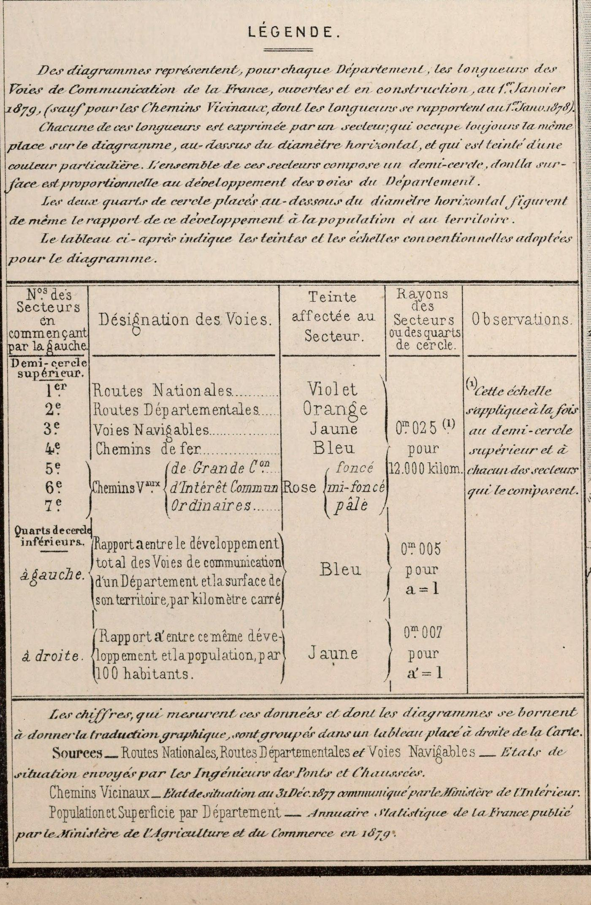
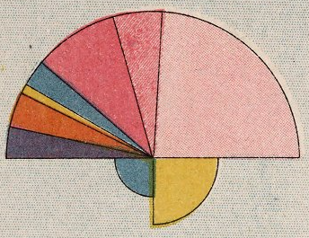
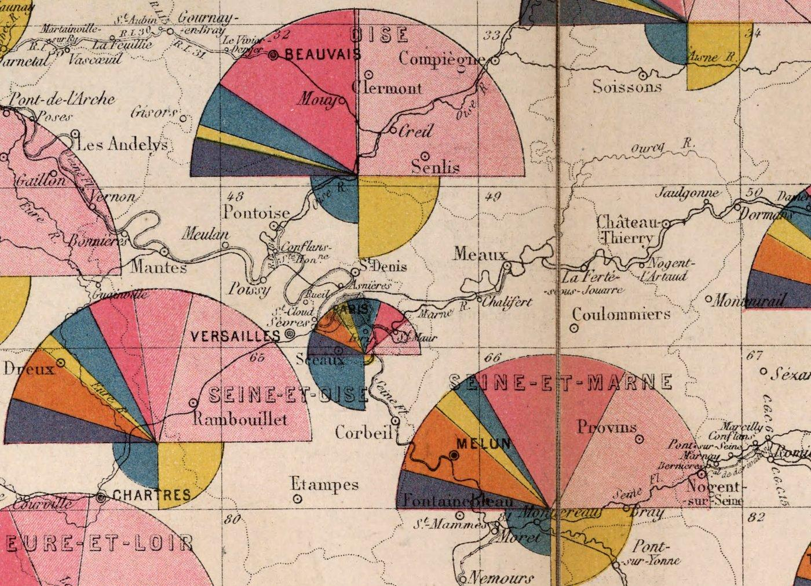

+++
author = "Yuichi Yazaki"
title = "Semicircles for Length and Breakdown, Quarter-Circles for Density: The 1880 Transport Routes Map in the Album de statistique graphique"
slug = "chart-map-transportation-infrastructure"
date = "2025-09-15"
description = "Plate 1 of the 1880 Album de statistique graphique shows each département's total transport route length as the area of a semicircle, the breakdown as seven sectors, and length per area and per inhabitant as two quarter-circles below."
categories = [
    "technology"
]
tags = [
    "Émile Cheysson",
    "Album de statistique graphique",
    "French Ministry of Public Works",
    "cartograms",
    "sector charts",
    "maps"
]
image = "images/12511007_closeup.png"
series = ["dataviz-classics"]
series_weight = 5
seriesByline = "French Ministry of Public Works, Cartography and Drawing Bureau"
seriesTitle = "Semicircles for Length, Quarter-Circles for Density: 1880 Routes Map"
+++

Plate 1 of the 1880 *Album de statistique graphique* (Album of Graphic Statistics) is a map that places one semicircle on each French département. The area of the semicircle represents the total length of transport routes at the end of 1878. The seven sectors inside the semicircle give the breakdown by type of route, and the two quarter-circles below show length per area and length per inhabitant.

The title is "Carte figurative du développement des voies de communication par département au 31 décembre 1878" (Figurative map of the development of communication routes by département at 31 December 1878). It was made by the Direction des Cartes et Plans (Bureau of Maps and Plans) of the French Ministry of Public Works, and no individual is named on the plate. What follows draws on the plate's legend and data table, on the album's preface (reprinted in the 1881 *Journal de la Société statistique de Paris*), and on the writings of Émile Cheysson, who headed the bureau.

<!--more-->

## July 1880: An Album of Statistical Charts for Legislators

It began with a ministerial order of March 12, 1878. The order organized the "Bureau of Maps, Plans, Documents and Graphic Statistics," and Article 2 decided that an album of statistical charts would be published every year. An order of July 3 laid out its contents in detail.

The 1879 edition had 12 plates, and a contemporary review says it was prepared by the Maps and Plans section under Cheysson's direction. In 1890 Cheysson himself signed as "former head of the Ministry of Public Works' Bureau of Maps and Plans" and wrote that the 1879 edition was the first application of the order. Some articles mention a "1878 edition" of wall maps, but by his own count the 1879 edition was number one.

This plate is in the second album, the 1880 edition. Its title page reads "July 1880," and it was published by the Imprimerie nationale in Paris. Of the 16 plates, this map is Plate 1, and Plate 16 depicts the development of railways in the major countries ([the article on the railway development map](/en/chart-map-railway/)). No source names the author of the 1880 edition; the David Rumsey Map Collection, which holds it, registers the Ministry of Public Works and Cheysson as authors.

The whole of Plate 1. The legend is at lower left and the table of figures by département is at right

Source: Ministère des Travaux Publics (1880), David Rumsey Map Collection, held at the David Rumsey Map Center, Stanford Libraries (CC BY-NC-SA 3.0)

According to the preface, all 16 plates are large-format, folded in a special way to fit the format of parliamentary documents. The makers dropped lithography in favor of engraving on stone, and shades of the same color are produced by the density of hatching.

The preface ends by naming the readers.

> le nouvel album pourra être consulté avec profit par les membres du Parlement, auxquels il est spécialement destiné, par les administrateurs, par les économistes …

In short, the new album is intended **especially for members of parliament**, and should also be useful to administrators and economists. The reference date of the data is January 1, 1879, and the album was published in July 1880. Cheysson wrote in 1890 that the figures in the albums are normally those of two years before the year of publication.

## Reading the Legend: Semicircles, Seven Sectors, Two Quarter-Circles

The conventions are written in the legend at lower left of the plate.

The legend (LÉGENDE) of Plate 1

Source: Ministère des Travaux Publics (1880), David Rumsey Map Collection, held at the David Rumsey Map Center, Stanford Libraries (CC BY-NC-SA 3.0)

> Chacune de ces longueurs est exprimée par un secteur, qui occupe toujours la même place sur le diagramme, au-dessus du diamètre horizontal, et qui est teinté d'une couleur particulière. L'ensemble de ces secteurs compose un demi-cercle, dont la surface est proportionnelle au développement des voies du Département.

Each length is expressed by a sector that always occupies the same position above the horizontal diameter and is tinted in its own color. The semicircle made of all the sectors has an area proportional to the length of the département's routes. The legend goes on to say that the two quarter-circles below represent the ratios of length to population and to territory.

The table in the legend, recast as a correspondence between data and appearance, looks like this.

| Data | Appearance | Color (as named in the legend) | Scale (legend) |
|---|---|---|---|
| Total length of the département's transport routes | Area of the upper semicircle | — | Radius 0.025 m = 12,000 km |
| National roads (Routes nationales) | Area of sector 1 (far left) | Purple | Same as above |
| Departmental roads (Routes départementales) | Sector 2 | Orange | Same as above |
| Navigable waterways (Voies navigables) | Sector 3 | Yellow | Same as above |
| Railways (Chemins de fer) | Sector 4 | Blue | Same as above |
| Communal roads, long-distance (de grande communication) | Sector 5 | Rose, dark | Same as above |
| Communal roads, common-interest (d'intérêt commun) | Sector 6 | Rose, medium | Same as above |
| Communal roads, ordinary (ordinaires) | Sector 7 | Rose, light | Same as above |
| Total length ÷ area of territory (per km²) | Area of lower left quarter-circle | Blue | Radius 0.005 m = 1 |
| Total length ÷ population (per 100 inhabitants) | Area of lower right quarter-circle | Yellow | Radius 0.007 m = 1 |
| Département | Where the semicircle is placed | — | Within each département |

There are seven sectors but only five hues. For the communal roads (chemins vicinaux), the three legal categories are separated by shades of rose. According to a note in the legend, the 12,000 km scale applies to both the semicircle and each sector. Within a département the radius is common, so the angle of a sector is also proportional to its length.

The order is the same in the legend and in the columns of the data table, but the reason is nowhere stated. The base map consists of département boundaries, rivers, coastlines, road and railway lines, and place names, with no depiction of relief. Over the sea, a sample diagram is placed.

The sample diagram at sea, "DÉPARTEMENT MOYEN" (average département)

Source: Ministère des Travaux Publics (1880), David Rumsey Map Collection, held at the David Rumsey Map Center, Stanford Libraries (CC BY-NC-SA 3.0)

Below the legend is a column of sources. National roads, departmental roads, and waterways come from the situation tables of the Corps des Ponts et Chaussées (civil engineering corps); communal roads from the situation tables of the Ministry of the Interior; and population and area from the 1879 *Annuaire statistique de la France*. Only the communal roads have a reference date one year earlier (January 1, 1878). The source of the railway figures is not in this column.

## Checking Against the Data Table: National Totals and the Seine Département

The legend also states where the numbers are.

> Les chiffres, qui mesurent ces données et dont les diagrammes se bornent à donner la traduction graphique, sont groupés dans un tableau placé à droite de la Carte.

In other words, the diagrams only translate the numbers into pictures, and the numbers are gathered in a table to the right of the map.

The bottom row of the table, "Total and average," gives national roads 37,279.9 km, departmental roads 38,358.6 km, navigable waterways 13,046.7 km, railways 28,435.0 km, and communal roads 417,264.6 km. The average ratios are 1.01 per km² and 1.45 per 100 inhabitants. Added together, the total is about 534,000 km, of which communal roads are about 78% and railways about 5% (the author's calculation). Of the semicircle's 180°, the blue of the railways is only about 10° (the author's calculation).

Around Paris. The small diagram in the center is the Seine département, and the one at lower left is Seine-et-Oise

Source: Ministère des Travaux Publics (1880), David Rumsey Map Collection, held at the David Rumsey Map Center, Stanford Libraries (CC BY-NC-SA 3.0)

For the Seine département, which includes Paris, the five columns of the table add up to about 1,010 km (the author's calculation), so the semicircle is small. Meanwhile its length per km² is 2.11, among the highest of all départements, and per 100 inhabitants it is 0.04. Calculated with the scale in the legend, the radius of the blue quarter-circle is about 7.3 mm and that of the yellow about 1.4 mm (the author's calculation). A large blue attaches below the small semicircle, and the yellow is almost invisible.

In the neighboring Seine-et-Oise, both ratios are 1.29. Even so, the radius of the yellow quarter-circle comes to about 8.0 mm and that of the blue to about 5.7 mm (the author's calculation), because the scales of the two ratios differ, 0.005 m and 0.007 m. This suggests that **the left and right quarter-circles were not made to be compared in size on the same yardstick**. What can be compared is left with left and right with right, across départements.

## "Fan" and "Foyer": Reading Through Cheysson's Words

The preface to the 1880 edition itself explains the type of this plate.

> Les planches 1 et 2 ont eu recours aux diagrammes par secteurs diversement coloriés, dont chacun est affecté à la représentation d'un élément distinct et dont l'ensemble constitue une sorte d'éventail.

Differently colored sectors each represent a separate element, and together they form "a sort of fan (éventail)." The preface goes on to say that Plate 1 shows, for each département, progress "in absolute terms and in terms of ratios."

The preface classifies Plates 1, 2, and 16 as "cartogrammes à foyers diagraphiques" (cartograms with diagraphic foyers). Most of the others are "band cartograms," in which the width of a band represents the quantity. The name was given by Cheysson in his report on the 1878 Exposition universelle. The method takes the point to be shown as the "foyer" (focal point) and erects a small diagram on it.

In the same 1878 report, Cheysson also touches on the misreading of sectors. A ring diagram from the Marseille Chamber of Commerce represented quantities by the length of the arc.

> si la légende n'y mettait ordre, l'esprit serait tenté de faire intervenir dans la mesure des faits, non la largeur des arcs, mais l'aire des secteurs.

His point is that unless the legend set things right, the reader would be tempted to measure by the area of the sectors rather than by the width of the arcs. The legend of Plate 1 makes "area" the convention from the start. It can be read as choosing, as its convention, the quantity that readers naturally look at.

The 1890 commentary cites Plate 34 of the 1886 edition as an example of dividing a semicircle into sectors, saying that the diagram for each département takes the form of a "colored fan." This can be read as the same construction as Plate 1. The same text also contains a warning.

> Il faut surtout se garder de vouloir trop dire de choses à la fois, et de devenir obscur à force d'être complet. … Si un diagramme est touffu au point de n'être plus clair, mieux vaut le tableau de chiffres dont il est la traduction.

Avoid trying to say too much at once and becoming obscure; if a diagram is so dense that it is no longer clear, the table of figures it translates is better. Plate 1 layers four levels on one symbol, yet puts the data table on the same sheet. It can be read as a design that leaves the density to the table.

Cheysson also writes that the purpose of the administration is to prepare material for study and that it has no obligation to draw conclusions. Reading the values of the day from the order of the categories is something the makers themselves held back from, it seems.

## How Third Parties Have Viewed This Album

Among contemporary reviews is that of the statistician Toussaint Loua on the 1879 edition. Loua sets length beside average tonnage, writing that waterways, at a third of the length of national roads, carry four times as much in relative terms, and that railway tonnage is nine times that of national roads. This is not a comment on Plate 1, but in a chart of length the railways at about 10° far exceed both waterways and national roads in average tonnage. In the 1880 edition, tonnage is handled by the band maps of Plates 5 to 7 at the same scale.

In his 2008 paper, Michael Friendly places the album as a whole at the peak of the "Golden Age" of statistical graphics. He cites the assessment of Funkhouser (1937).

> the Albums present the finest specimens of French graphic work in the century and considerable pride was taken in them by the French people, statisticians and laymen alike.

That is, the albums were the finest specimens of French graphic work of the century, and statisticians and the general public alike took pride in them. Friendly also writes that circles, radial forms, and "pie maps" were favored, but he does not mention Plate 1 itself.

Friendly distinguishes the pie chart as a diagram with "constant radius and varying angle" from the polar area diagram (coxcomb) with "constant angle and varying radius." The Rumsey catalog annotates this plate with "coxcombs," but in Plate 1 the sectors share a radius and vary in angle. By Friendly's definition, it can be read as the semicircle version of a pie chart.

The Rumsey catalog introduces the album as inspired by the work of Charles Joseph Minard. Cheysson himself also begins his 1890 commentary with the name of his predecessor Minard. In 1883 the album, together with the ministry's statistical bulletin, received the Montyon Prize in Statistics of the Academy of Sciences.

## Uses

What we can take away from this plate is how to place conventions when one symbol carries several quantities.

- Separate size from breakdown: the size of the semicircle shows the total, and the angles of the sectors show the breakdown.
- Fix the positions of the categories: the sectors are placed "always in the same position." Even if the colors are hard to tell apart, the position lets you read them.
- If readers will read by area, say so in the legend: if readers want to measure by area, make that the convention.
- If the scales differ, write the scales: when the legend gives numbers, readers can judge which pairs are fair to compare.
- Put in a sample: the "average département" becomes a reference that can be applied to the diagram of any département.
- Put the data table and sources on the same sheet: even a gap in reference dates (only the communal roads are one year earlier) is written in the legend.

Even so, a chart of length **does not show how the routes are used**. As Loua set length beside tonnage, quantity and flow have to be handled in separate charts. This presupposes that the title and legend state plainly what was measured.

## References

**Primary sources**

- Ministère des Travaux Publics, Direction des Cartes et Plans, "Carte figurative du développement des voies de communication par département au 31 décembre 1878," *Album de statistique graphique*, 1880, Pl. 1. David Rumsey Map Collection, List No. 12511.007. [David Rumsey Map Collection](https://www.davidrumsey.com/luna/servlet/detail/RUMSEY~8~1~309764~90078941) / [IIIF manifest](https://www.davidrumsey.com/luna/servlet/iiif/m/RUMSEY~8~1~309764~90078941/manifest) / [Internet Archive](https://archive.org/details/dr_carte-figurative-du-developpment-des-voies-de-communication-par-department-12511007)
- "Bibliographie. Notice relative à l'album de statistique graphique [publié par le Ministère des travaux publics en 1880]," *Journal de la Société statistique de Paris*, 22, 1881, pp. 25–28 (reprint of the preface to the 1880 edition). [Numdam](https://www.numdam.org/item/JSFS_1881__22__25_0/)
- "Notice statistique sur l'album des voies de communication," *Journal de la Société statistique de Paris*, 21, 1880, pp. 6–11. [Numdam](https://www.numdam.org/item/JSFS_1880__21__6_0/)
- É. Cheysson, "L'Album de statistique graphique publié par le ministère des travaux publics," *Journal de la Société statistique de Paris*, 31, 1890, pp. 11–23. [Numdam](https://www.numdam.org/item/JSFS_1890__31__11_0/)
- É. Cheysson, "Les méthodes de statistique graphique à l'Exposition universelle de 1878," *Journal de la Société statistique de Paris*, 19, 1878, pp. 323–333. [Numdam](https://www.numdam.org/item/JSFS_1878__19__323_0/)
- David Rumsey Map Collection, Copyright and Permissions. [Terms of use](https://www.davidrumsey.com/about/copyright-and-permissions)

**Secondary sources**

- T. Loua, "Bibliographie. L'Album de statistique graphique pour 1879," *Journal de la Société statistique de Paris*, 20, 1879, p. 308. [Numdam](https://www.numdam.org/item/JSFS_1879__20__308_0/)
- Michael Friendly, "The Golden Age of Statistical Graphics," *Statistical Science*, 23(4), 2008, pp. 502–535. [doi:10.1214/08-STS268](https://doi.org/10.1214/08-STS268) / [arXiv](https://arxiv.org/abs/0906.3979)
- David Rumsey Map Collection catalog (the plate's "coxcombs" annotation and the description of the album). [Search results](https://www.davidrumsey.com/luna/servlet/as/search?q=pub_list_no=%2212511.000%22&lc=RUMSEY~8~1&os=0&bs=50)
