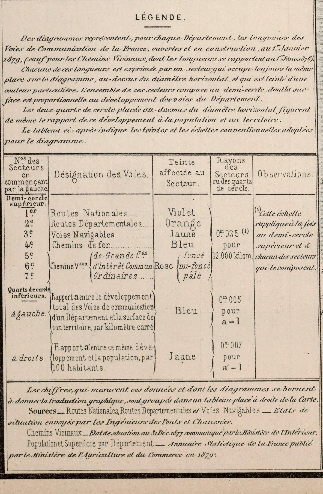
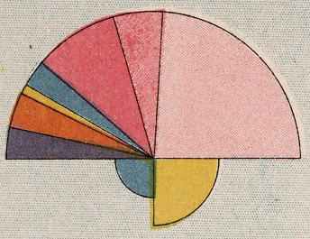
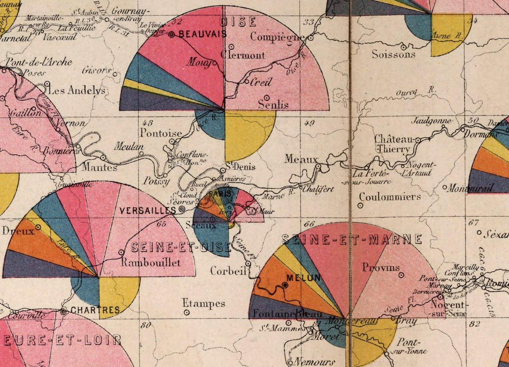

+++
author = "矢崎裕一"
title = "半円に延長と内訳、四分円に密度──1880年『Album de statistique graphique』の交通路地図"
slug = "chart-map-transportation-infrastructure"
date = "2025-09-15"
description = "1880年『Album de statistique graphique』第1図は、県ごとの半円の面積で交通路の総延長を、7つの扇形で内訳を、下の2つの四分円で面積・人口あたりの延長を表します。"
categories = [
    "technology"
]
tags = [
    "Émile Cheysson",
    "Album de statistique graphique",
    "フランス公共事業省",
    "カルトグラム",
    "扇形グラフ",
    "地図"
]
image = "images/12511007_closeup.png"
series = ["dataviz-classics"]
series_weight = 5
seriesByline = "フランス公共事業省 カルト・図面局"
seriesTitle = "半円で延長、四分円で密度──交通路の地図 1880"
+++

1880年の『Album de statistique graphique』（筆者訳：統計図表アルバム）の第1図は、フランスの県ごとに半円を1つ置いた地図です。半円の面積で、1878年末の交通路の総延長を表しています。半円の中の7つの扇形が道の種類ごとの内訳を、下の2つの四分円が、面積あたりと人口あたりの延長を示しています。

題は "Carte figurative du développement des voies de communication par département au 31 décembre 1878"。作ったのはフランス公共事業省のカルト・図面局で、図に個人の名はありません。以下は、図の凡例と数表、アルバムのはしがき（*Journal de la Société statistique de Paris* 1881年に転載）、局を率いた Émile Cheysson（エミール・シェイソン）本人の文章に沿います。

<!--more-->

## 1880年7月、議員のための統計図表アルバム

始まりは、1878年3月12日の省令です。「カルト・図面・文書・図表統計局」を組織し、その第2条で、統計図表アルバムを毎年出すと決めました。7月3日の省令が、内容を詳しく定めています。

1879年版は12図で、同時代の書評は、シェイソンの指揮のもとでカルト・図面課が作成した、と書いています。シェイソン本人は1890年に「元・公共事業省カルト・図面局長」と署名し、1879年版が最初の適用だった、と書きます。壁掛け地図の「1878年版」に触れた記事もありますが、本人の数え方では1879年版が第1号です。

この図は、2冊目の1880年版に入っています。扉には「1880年7月」とあり、発行はパリの国立印刷所です。全16図のうち第1図がこの地図で、第16図は主要国の鉄道の発展を描いた図です（[鉄道発展図の記事](/chart-map-railway/)）。1880年版の作者を明記した資料はなく、所蔵館の David Rumsey Map Collection は、公共事業省とシェイソンを作者として登録しています。

第1図の全体。左下に凡例、右に県別の数表がある

フランス公共事業省（1880）、David Rumsey Map Center, Stanford Libraries 所蔵／David Rumsey Map Collection より引用（CC BY-NC-SA 3.0）

はしがきによると、16図はすべて大判で、特別な折り方で議会資料の判型に収めました。石版をやめて石版彫刻にし、同じ色の濃淡はハッチングの密度で出しています。

読み手は、はしがきの最後に書かれています。

> le nouvel album pourra être consulté avec profit par les membres du Parlement, auxquels il est spécialement destiné, par les administrateurs, par les économistes …

新しいアルバムは**とくに国会議員のため**のもので、行政官や経済学者にも役立つだろう、という趣旨です。データの基準日は1879年1月1日で、刊行は1880年7月。シェイソンは1890年に、アルバムの数値はふつう刊行年の2年前のものだ、と書いています。

## 凡例を読む──半円、7つの扇形、2つの四分円

約束ごとは、図の左下の凡例に書かれています。

第1図の凡例（LÉGENDE）

フランス公共事業省（1880）、David Rumsey Map Center, Stanford Libraries 所蔵／David Rumsey Map Collection より引用（CC BY-NC-SA 3.0）

> Chacune de ces longueurs est exprimée par un secteur, qui occupe toujours la même place sur le diagramme, au-dessus du diamètre horizontal, et qui est teinté d'une couleur particulière. L'ensemble de ces secteurs compose un demi-cercle, dont la surface est proportionnelle au développement des voies du Département.

道の長さは扇形で表し、扇形は直径より上のいつも同じ位置に置いて、決まった色で塗る。扇形を合わせた半円の面積は、県の交通路の延長に比例する。続けて、下の2つの四分円は延長と人口・領土との比率を表す、と書いています。

対照表を、データと見た目の対応に直します。

| データ | 見た目 | 色（凡例の表記） | 縮尺（凡例） |
|---|---|---|---|
| 県の交通路の総延長 | 上の半円の面積 | ― | 半径 0.025 m が 12,000 km |
| 国道（Routes nationales） | 第1扇形（左端）の面積 | 紫 | 同上 |
| 県道（Routes départementales） | 第2扇形 | 橙 | 同上 |
| 可航水路（Voies navigables） | 第3扇形 | 黄 | 同上 |
| 鉄道（Chemins de fer） | 第4扇形 | 青 | 同上 |
| 広域連絡町村道（de grande communication） | 第5扇形 | ばら色・濃 | 同上 |
| 共同利益町村道（d'intérêt commun） | 第6扇形 | ばら色・中 | 同上 |
| 普通町村道（ordinaires） | 第7扇形 | ばら色・淡 | 同上 |
| 総延長 ÷ 領土の面積（km²あたり） | 下・左の四分円の面積 | 青 | 半径 0.005 m が 1 |
| 総延長 ÷ 人口（住民100人あたり） | 下・右の四分円の面積 | 黄 | 半径 0.007 m が 1 |
| 県 | 半円を置く位置 | ― | 各県の中 |

扇形は7つ、色相は5つです。町村道は法の3区分を、ばら色の濃淡で分けています。凡例の注によると、12,000 km の縮尺は半円と各扇形の両方に当てはまります。県の中では半径が共通なので、扇形の角度も延長に比例します。

並び順は凡例も数表の列も同じですが、その理由はどこにも書かれていません。下地は県境、川、海岸線、道路と鉄道の線、地名で、起伏の表現はありません。海の上には、見本の図が1つ置かれています。

海上の見本図「DÉPARTEMENT MOYEN（平均的な県）」

フランス公共事業省（1880）、David Rumsey Map Center, Stanford Libraries 所蔵／David Rumsey Map Collection より引用（CC BY-NC-SA 3.0）

凡例の下には出典欄があります。国道・県道・水路は土木技師団の現況表、町村道は内務省の現況表、人口と面積は1879年の『フランス統計年鑑』です。町村道だけ、基準日が1年前（1878年1月1日）です。鉄道の出典は、この欄にはありません。

## 数表と突き合わせる──全国の合計とセーヌ県

凡例は、数字の置き場所も明記しています。

> Les chiffres, qui mesurent ces données et dont les diagrammes se bornent à donner la traduction graphique, sont groupés dans un tableau placé à droite de la Carte.

図は数値を絵に訳しているだけで、数値は地図の右の表にまとめてある、という一文です。

最下行の「合計と平均」は、国道 37,279.9 km、県道 38,358.6 km、可航水路 13,046.7 km、鉄道 28,435.0 km、町村道 417,264.6 km。比率の平均は km²あたり 1.01、100人あたり 1.45 です。足すと約53.4万kmで、町村道が約78%、鉄道は約5%（筆者の計算）。半円の180°のうち、鉄道の青は約10°にすぎません（筆者の計算）。

パリ周辺。中央の小さな図がセーヌ県、左下がセーヌ＝エ＝オワーズ県

フランス公共事業省（1880）、David Rumsey Map Center, Stanford Libraries 所蔵／David Rumsey Map Collection より引用（CC BY-NC-SA 3.0）

パリを含むセーヌ県は、数表の5列を足すと約1,010 km（筆者の計算）で、半円は小さい。いっぽう km²あたりは 2.11 で全県で最も高い水準、100人あたりは 0.04 です。凡例の縮尺で計算すると、青の四分円の半径は約7.3 mm、黄は約1.4 mm（筆者の計算）。小さな半円の下に大きな青がつき、黄はほとんど見えません。

隣のセーヌ＝エ＝オワーズ県は、2つの比率がどちらも 1.29 です。それでも、黄の四分円の半径は約8.0 mm、青は約5.7 mmになります（筆者の計算）。2つの比率の縮尺が、0.005 m と 0.007 m で違うからです。**左右の四分円は、同じ物差しで大きさを比べるようには作られていない**と読めます。比べられるのは、県どうしの左と左、右と右です。

## 「扇」と「フォワイエ」──シェイソンの言葉で読む

1880年版のはしがきは、この図の型を自分で説明しています。

> Les planches 1 et 2 ont eu recours aux diagrammes par secteurs diversement coloriés, dont chacun est affecté à la représentation d'un élément distinct et dont l'ensemble constitue une sorte d'éventail.

色の違う扇形が一つずつ別の要素を表し、全体で「一種の扇（éventail）」になる。続けて第1図を、県ごとの「絶対的な進み具合と、比率で見た進み具合」を示す図だ、と書きます。

はしがきは、第1・2・16図を「カルトグラム・ア・フォワイエ・ディアグラフィック（cartogrammes à foyers diagraphiques）」に分類します。ほかの多くは、帯の幅で量を表す「帯のカルトグラム」です。この名は、シェイソンが1878年の万国博覧会の報告で付けました。示したい点を「フォワイエ（中心）」とし、その上に小さな図を建てる方式です。

同じ1878年の報告で、シェイソンは扇形の読み違いにも触れています。マルセイユ商工会議所の円環図は、量を弧の長さで表していました。

> si la légende n'y mettait ordre, l'esprit serait tenté de faire intervenir dans la mesure des faits, non la largeur des arcs, mais l'aire des secteurs.

凡例が正さなければ、読み手は弧の長さではなく、扇形の面積で量を測ろうとしてしまう、という指摘です。第1図の凡例は、最初から「面積」を約束ごとにしています。読み手が自然に見る量を、そのまま約束ごとに選んだと読めます。

1890年の解説は、半円を扇形に分ける作りの例として1886年版の第34図を挙げ、県ごとの図が「色を塗った扇」の姿になる、と書きます。第1図と同じ作りだと読めます。同じ文章には戒めもあります。

> Il faut surtout se garder de vouloir trop dire de choses à la fois, et de devenir obscur à force d'être complet. … Si un diagramme est touffu au point de n'être plus clair, mieux vaut le tableau de chiffres dont il est la traduction.

一度に多くを言おうとして分かりにくくなるのを避けよ。図が込み入るなら、元の数表のほうがよい。第1図は1つの記号に4つの層を重ねつつ、数表を同じ紙面に置いています。込み入った分を数表に任せる設計だと読めます。

シェイソンは、行政の目的は研究材料を用意することで、結論を出す義務はない、とも書いています。並び順から当時の価値観を読み取ることは、作り手自身が控えたことだと読めます。

## 第三者はこのアルバムをどう見たか

同時代の評に、統計家 Toussaint Loua（トゥサン・ルア）の1879年版の書評があります。Loua は延長と平均トン数を並べ、水路は国道の3分の1の長さで相対的に4倍を運び、鉄道のトン数は国道の9倍だ、と書きます。第1図への評ではありませんが、延長の図では約10°の鉄道が、平均トン数では水路も国道も大きく上回ります。1880年版では、トン数は第5〜7図の帯の地図が同じ縮尺で受け持っています。

Michael Friendly（マイケル・フレンドリー）は2008年の論文で、アルバム全体を統計グラフィックスの「黄金時代」の頂点に置きます。Funkhouser（1937）の評価を引いています。

> the Albums present the finest specimens of French graphic work in the century and considerable pride was taken in them by the French people, statisticians and laymen alike.

その世紀のフランスの図表の最良の見本で、統計家も一般の人も誇りにした、という評価です。円や放射状の形、「pie maps」が好まれたとも書いていますが、第1図そのものには触れていません。

Friendly は、パイチャートを「半径が一定で角度が変わる」図、ポーラーエリア図（コックスコーム）を「角度が一定で半径が変わる」図と区別しています。Rumsey の目録はこの図版に「coxcombs」と注記していますが、第1図の扇形は半径が共通で角度が変わります。Friendly の定義では、パイチャートの半円版にあたると読めます。

Rumsey の目録は、アルバムを Charles Joseph Minard（シャルル・ジョゼフ・ミナール）の仕事に触発されたもの、と紹介しています。シェイソン自身も1890年の解説を、先人 Minard の名から始めています。アルバムは1883年、省の統計公報とともに、科学アカデミーのモンティヨン統計賞を受けました。

## 使い道

この図から持ち帰れるのは、1つの記号に複数の量を載せるときの、約束ごとの置き方です。

- 大きさと内訳を分ける：半円の大きさで総量、扇形の角度で内訳を表す。
- カテゴリの位置を固定する：扇形は「いつも同じ位置」に置く。色を見分けにくくても、位置で読める。
- 面積で読むと、凡例に書く：読み手が面積で測りたがるなら、それを約束ごとにする。
- 縮尺が違うなら、縮尺を書く：凡例に数値があれば、読み手は比べてよい組を判断できる。
- 見本を置く：「平均的な県」が、どの県の図にも当てはめられる基準になる。
- 数表と出典を同じ紙面に置く：基準日のずれ（町村道だけ1年前）も、凡例に書く。

そのうえで、延長の図は**使われ方を示しません**。Loua が延長とトン数を並べたように、量と流れは別の図で受け持つことになります。何を測った図かを、題と凡例で言い切っておくことが前提です。

## 参考・出典

**一次情報**

- Ministère des Travaux Publics, Direction des Cartes et Plans, "Carte figurative du développement des voies de communication par département au 31 décembre 1878," *Album de statistique graphique*, 1880, Pl. 1. David Rumsey Map Collection, List No. 12511.007. [David Rumsey Map Collection](https://www.davidrumsey.com/luna/servlet/detail/RUMSEY~8~1~309764~90078941) / [IIIF マニフェスト](https://www.davidrumsey.com/luna/servlet/iiif/m/RUMSEY~8~1~309764~90078941/manifest) / [Internet Archive](https://archive.org/details/dr_carte-figurative-du-developpment-des-voies-de-communication-par-department-12511007)
- 「Bibliographie. Notice relative à l'album de statistique graphique [publié par le Ministère des travaux publics en 1880]」*Journal de la Société statistique de Paris*, 22, 1881, pp. 25–28（1880年版のはしがきの転載）. [Numdam](https://www.numdam.org/item/JSFS_1881__22__25_0/)
- 「Notice statistique sur l'album des voies de communication」*Journal de la Société statistique de Paris*, 21, 1880, pp. 6–11. [Numdam](https://www.numdam.org/item/JSFS_1880__21__6_0/)
- É. Cheysson, 「L'Album de statistique graphique publié par le ministère des travaux publics」*Journal de la Société statistique de Paris*, 31, 1890, pp. 11–23. [Numdam](https://www.numdam.org/item/JSFS_1890__31__11_0/)
- É. Cheysson, 「Les méthodes de statistique graphique à l'Exposition universelle de 1878」*Journal de la Société statistique de Paris*, 19, 1878, pp. 323–333. [Numdam](https://www.numdam.org/item/JSFS_1878__19__323_0/)
- David Rumsey Map Collection, Copyright and Permissions. [利用条件](https://www.davidrumsey.com/about/copyright-and-permissions)

**第三者評価**

- T. Loua, 「Bibliographie. L'Album de statistique graphique pour 1879」*Journal de la Société statistique de Paris*, 20, 1879, p. 308. [Numdam](https://www.numdam.org/item/JSFS_1879__20__308_0/)
- Michael Friendly, "The Golden Age of Statistical Graphics," *Statistical Science*, 23(4), 2008, pp. 502–535. [doi:10.1214/08-STS268](https://doi.org/10.1214/08-STS268) / [arXiv](https://arxiv.org/abs/0906.3979)
- David Rumsey Map Collection の目録（図版の注記 "coxcombs" と、アルバムの解説）. [検索結果](https://www.davidrumsey.com/luna/servlet/as/search?q=pub_list_no=%2212511.000%22&lc=RUMSEY~8~1&os=0&bs=50)
