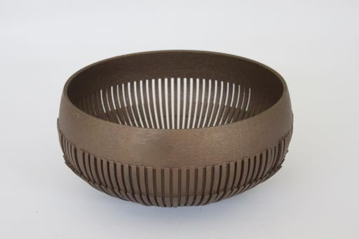
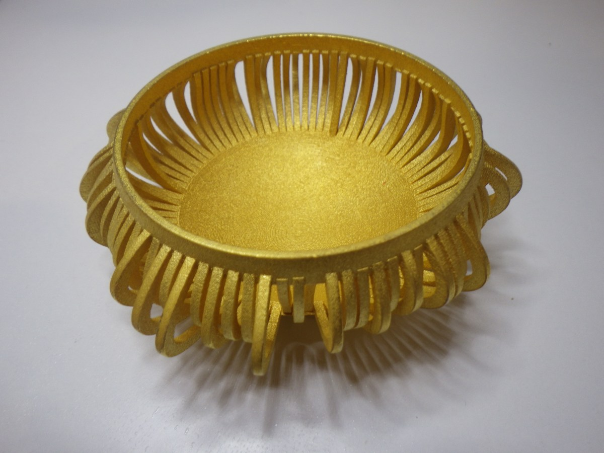
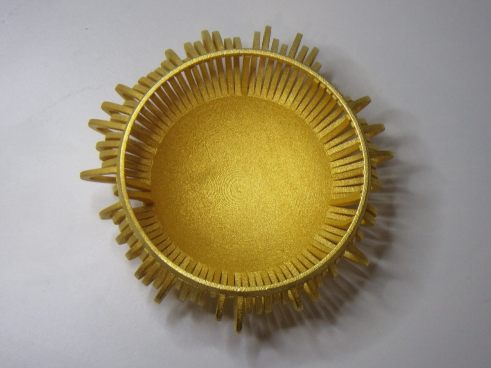
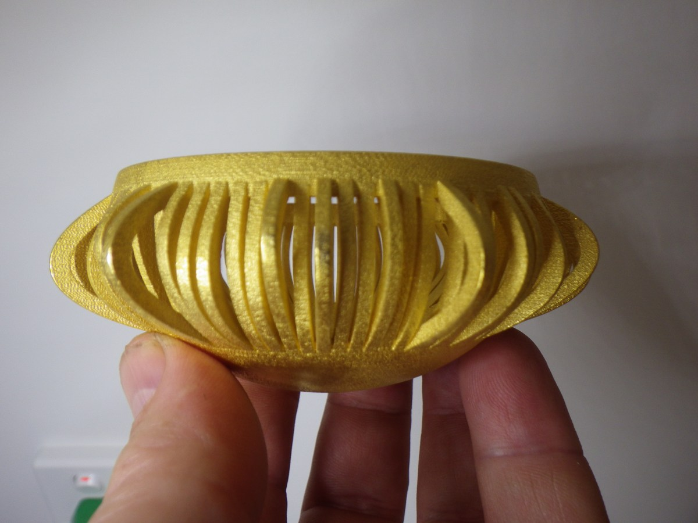
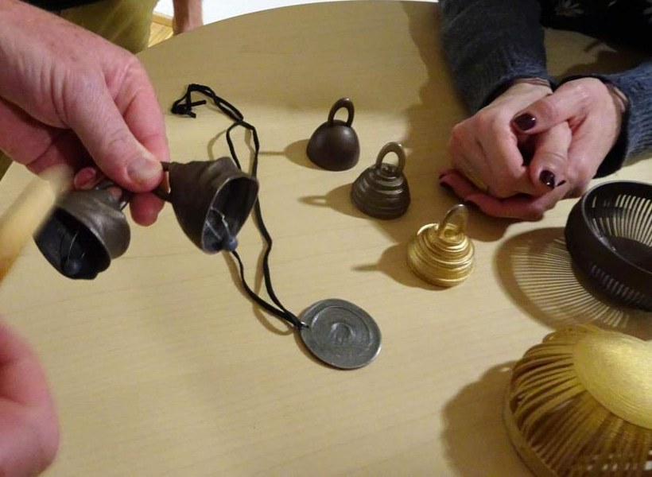

+++
author = "Yuichi Yazaki"
title = "Turning a Year of Chemotherapy Blood Pressure into a Bowl That Rings: Stephen Barrass's Chemo Singing Bowl"
slug = "chemo-singing-bowl"
date = "2026-11-05"
description = "Stephen Barrass's Chemo Singing Bowl maps a year of blood pressure readings from a person undergoing chemotherapy onto the shape of a bowl. The data is conveyed through the sound the bowl makes when it is struck."
categories = [
    "consume"
]
tags = [
    "data physicalization",
    "sonification"
]
image = "images/chemo-bowl-oblique.jpg"
series = ["data-physicalization", "data-sonification"]
series_weight = 34
seriesByline = "Stephen Barrass"
seriesTitle = "Blood Pressure Shaped as a Bowl, Told by Its Ring: Chemo Singing Bowl"
+++

Stephen Barrass's Chemo Singing Bowl maps a year of blood pressure readings from a person undergoing chemotherapy onto the shape of a bowl. The data is conveyed through the sound the bowl makes when it is struck. The bowl is 3D-printed in stainless steel, and you sound it by tapping it or rubbing its rim. The artist calls a sounding object whose form is determined by data Acoustic Sonification.

The work was published on the artist's blog on January 18, 2016, and in the same year was shown in an exhibition at the Museum of Applied Arts and Sciences (MAAS) in Sydney. What follows draws on the artist's blog, the installation paper at ICAD 2016, a 2014 paper about the predecessor, and a 2019 paper on which Barrass is a co-author. Where the sources differ in how they describe things, I show the difference as it is.

<!--more-->

## 2013: Turning his own blood pressure into a "singing bowl"

Chemo Singing Bowl has a predecessor: the Hypertension Singing Bowl, whose form was determined by the artist's own blood pressure. It was published on the blog in July 2013 and written up as a paper at the SoniHED conference in 2014.

It began with a diagnosis of high blood pressure. Barrass started measuring his systolic and diastolic pressure with a cuff and logging it in an app. In the paper, he writes this about the time-series graph the app drew:

> The plots of my blood pressure are generic and could have been share prices or CO2 emissions. Surely there was a way to make this personal dataset more personal, and more engaging.

In short: the graph of his blood pressure is generic, and could just as well show share prices or CO2 emissions; could this personal data be made more personal and more engaging?

For the sounding object he chose the Tibetan singing bowl, a bowl that "sings" with a sustained tone when its rim is rubbed. Singing bowls are associated with meditation and relaxation therapy, and these can lower blood pressure, which was his reason.

The first prototype (v0.0) varied wall thickness with the data, up to 5 mm. When struck it rang at 3628 Hz for 3 seconds, but it did not sing when rubbed. In the next version (v1.0) he made the wall a uniform 2 mm and placed the time axis around the circumference of the bowl. Each pair of readings was assigned one "spoke" joining the rim to the base, with the radius of the upper half varying with the systolic value and the radius of the lower half with the diastolic value.

Source: Stephen Barrass, "Research Through Design into Acoustic Sonification", ICAD 2016 (CC BY-NC 4.0)

v1.0 is 100 mm in diameter and weighs 162 g. Struck, it rings at 609 Hz for 10 seconds, and rubbed on the rim it sang like a traditional bowl. It also produced a 2 Hz tremolo and a hiss, which the artist says "may be caused by the data spokes." A 2014 video of the predecessor being played is on [YouTube](https://www.youtube.com/watch?v=DE3tolD5Krg). The ICAD 2016 paper sums up the predecessor this way:

> The bowl sings like a traditional singing bowl, but with a timbre that is changed by the dataset.

In short: the bowl sings like a traditional bowl, but its timbre is changed by the data.

## A year of chemotherapy, written into curved tines

The data in Chemo Singing Bowl is not the artist's own. It is the blood pressure that a person treated with chemotherapy for breast cancer recorded over the year of treatment. The artist's blog (2016) introduces it like this:

> This version of the acoustic sonification singing bowl introduces 3D splines as a way of mapping the data into the form. The irregularity of the dataset makes for inharmonic and dissonant acoustic effects.

In short: this version introduces 3D splines (smooth curves drawn through control points) as the way to map data into form, and the irregularity of the data produces inharmonic, dissonant sound. The ICAD 2016 paper states the intent behind the mapping:

> This mapping aims to amplify the effect of the dataset on the acoustics of the bowl by mapping the diastolic/systolic pressure to control points for the curvature of 2D splines amped to the tines.

In short: diastolic and systolic pressure become the control points that set the curvature of splines, and those splines are mapped onto the tines (the bands), in order to amplify the data's effect on the acoustics ("amped" appears to be a typo for "mapped"). So the predecessor mapped data to thickness, while Chemo maps it to how the tines curve.

Source: Stephen Barrass / SONIFICATION.COM, "Chemo Singing Bowl"

In the photo, the tines are not uniform in length or in how they curve.

Source: Stephen Barrass / SONIFICATION.COM, "Chemo Singing Bowl"

The correspondences that can be confirmed from the sources are as follows.

| Data | Property of the object | Source |
|---|---|---|
| Blood pressure recorded over a year of chemotherapy | The shape of the whole bowl (3D-printed stainless steel) | Artist's blog (2016) |
| Diastolic and systolic pressure values | Control points that set the curvature of splines; the splines are mapped onto the tines | ICAD 2016 |
| A year of blood pressure readings | Variation of the splines around the bowl | Wang et al. (2019) |
| Irregularity of the data | Inharmonic, dissonant sound | Artist's blog (2016) |
| How it is read | Sounded by striking or rubbing; the sound follows from the form | Wang et al. (2019) |

No source states explicitly that the time sequence was laid out around the circumference. Since the predecessor v1.0 did so, and since the source speaks of "variation of the splines around the bowl," Chemo can be read as also arranged around the circumference. The number of readings, the number of tines, the dimensions, and the frequencies were not found in any source.

Source: Stephen Barrass / SONIFICATION.COM, "Chemo Singing Bowl"

## Does the bowl sing? Where the sources disagree

The sources differ on two points: whether the bowl sings, and whether the splines are 2D or 3D.

| Point | Source | What it says |
|---|---|---|
| Does it sing? | ICAD 2016 | "This bowl does not sing very well" |
| Does it sing? | Wang et al. (2019) | "not sing harmonically" |
| Does it sing? | Artist's blog (2018) | "3D printed in stainless steep [steel] so it sings" |
| Dimension | Artist's blog (2016) | "3D splines" |
| Dimension | ICAD 2016 | "2D splines" |

The 2018 blog post is a list of demos the artist brought to a seminar at Schloss Dagstuhl in Germany, and it uses the same wording for the predecessor.

The explanations for why it does not sing also differ. ICAD 2016 says "possibly due to the curved shape of the tines." The blog and the 2019 paper point to the irregularity of the data. ICAD 2016 goes on to say that the next version would explore improving the singing effect using acoustic theory, but I found no source describing that version.

**I found no source that says whether the shape of the tines or the irregularity of the data is the main cause.** Because the data is mapped to curvature, the more irregular the data, the more irregular the tine shapes become, so the effect of the form and the effect of the data come out together in a single sound; this can be read that way. Set side by side, the predecessor mapped data to thickness and sang, while Chemo mapped it to curvature, for amplification, and sings less well; this suggests that both the character of the data and the choice of mapping show up in the sound.

## "How I felt at the time": the words of the person who supplied the data

According to the 2019 paper, the bowl was made as a gift for the data provider's mother, in thanks for caring for her during the chemotherapy. The data provider's reaction on hearing the sound is worded differently in three sources.

| Source | Reaction |
|---|---|
| ICAD 2016 | "it sounds as sick as I felt at the time" |
| Wang et al. (2019) | "that's exactly how I felt at the time" |
| Artist's blog (2016) | "... quite accurate – the sound is dry and heavy, without much resonance, just like I felt!" |

In short: it sounds as sick as I felt then; that's exactly how I felt then. The blog version continues: quite accurate, the sound is dry and heavy, without much resonance, just like I felt.

The predecessor was a bowl in which the artist listened to his own data. The SoniHED 2014 abstract says it invites a meditative reflection on the data and reminds one of a healthy life, and calls it a "poetic alternative" to the generic graphs of self-tracking.

Chemo was made from someone else's data, and the owner of the data listened to it. The predecessor's question of making personal data more personal came back, with another person's data, to that very person; this can be read that way. The words the owner used were "accurate" and "exactly." They can be read as pointing not to the correctness of reading a graph but to a match with a remembered bodily feeling.

## How did third parties see this work?

I found no independent critique or press coverage of Chemo Singing Bowl. It is treated in three ways.

The first is the 2019 paper in IEEE Computer Graphics and Applications, "An Emotional Response to the Value of Visualization." Co-authored by Yun Wang and others, with Barrass among them, it grew out of a working group at the 2018 Dagstuhl seminar.

> Informed by the role of emotion in psychology, art, design, marketing, and HCI, we argue for an expanded definition of value, applicable to all forms of data visualization.

In short: drawing on the role of emotion, the authors argue for broadening the definition of visualization's value. The paper writes that existing frameworks that measure efficiency (such as ICE-T) overlook the value of data physicalization, and it cites the Chemo bowl as an example. Because Barrass is a co-author, this is not a fully independent assessment.

The second is dataphys.org, a catalog of data physicalization works. It has no entry for Chemo alone, but has an entry for the predecessor group, "2011 – Stephen Barrass' Physical Data Sonifications," added by Pierre Dragicevic and recommended by Yvonne Jansen.

> Physical representations of data can target other senses than vision or touch.

In short: physical representations of data can address senses other than vision or touch. About the HRTF Bells (bells whose shapes are determined by the characteristics of the left and right ears), the entry says the differences in form are barely visible, but the pitch and timbre can be compared.

The third is selection by a museum. MAAS curator Matthew Connell chose this bowl for "Out of Hand: Materialising the Digital," which ran from September 3, 2016 to June 25, 2017. According to the artist's blog, it was an exhibition on the role of digital fabrication, and the bowl was shown alongside works by Zaha Hadid, Iris van Herpen, and others. It was also presented at the DESIGN Canberra Festival that year, and was placed as a hands-on demo you could pick up and sound at ICAD 2016 and at Dagstuhl in 2018.

Source: Stephen Barrass / SONIFICATION.COM, "Data Physicalisation @ Schloss Dagstuhl"

In book form, there is a chapter by Barrass, "Chemo Singing Bowl," in *Making with Data: Physical Design and Craft in a Data-Driven World*, edited by Samuel Huron, Till Nagel, Lora Oehlberg, and Wesley Willett (AK Peters / CRC Press, 2022). It is chapter 3.1 in Part 3, "Digital Production," pp. 185–198, DOI 10.1201/9781003264903-11. I have not been able to read the text of the chapter.

## Takeaways

What this bowl lets us take away is that changing the mapping changes how the object itself behaves. With a graph on a screen, switching from showing a value as thickness to showing it as curvature does not change how the screen behaves. With a sounding object, the mapping directly determines the sound.

In the paper on the predecessor, as a reflection on v0.0 not singing, Barrass writes that it would have been more efficient to print a baseline bowl with no data in it first and test that, before moving on to the mapping. For physicalization where the material is the medium, this procedure can be used as is.

Chemo also shows that a mapping which "amplifies" the effect can undermine the foundation of a metaphor. The metaphor of a singing bowl depends on the bowl singing. Even so, the owner of the data called the muddy sound "accurate." The collapse of the metaphor itself can be read as having conveyed the data.

The other point is separating causes. When you change the mapping, also make a version with no data in the same form and compare by ear. Then you can say how much of the audible difference is due to the data. That is what I think.

## References

**Primary sources**

- Stephen Barrass, "Chemo Singing Bowl" (SONIFICATION.COM, 2016-01-18) https://sonification.com/2016/01/18/chemo-singing-bowl/
- Stephen Barrass, "Research Through Design into Acoustic Sonification", ICAD 2016 installation paper (CC BY-NC 4.0) https://www.icad.org/icad2016/proceedings2/installations/ICAD2016_paper_52.pdf
- University of Canberra Research Portal, "Chemo Singing Bowl: Out of Hand - Materialising the Digital" https://researchprofiles.canberra.edu.au/en/publications/chemo-singing-bowl-out-of-hand-materialising-the-digital/
- Stephen Barrass, "3D Printed Acoustics @ Out Of Hand, Sydney" (2016-09-03) https://sonification.com/2016/09/03/out-of-hand-materialising-the-digital/
- Stephen Barrass, "Chemo Singing Bowl @ DESIGN Canberra" (2016-10-28) https://sonification.com/2016/10/28/design-canberra/
- Stephen Barrass, "Data Physicalisation @ Schloss Dagstuhl" (2018-10-30) https://sonification.com/2018/10/30/data-physicalisation-schloss-dagstuhl/
- Stephen Barrass, "Making With Data" (2022-12-13, reprint of the table of contents) https://sonification.com/2022/12/13/making-with-data/
- Stephen Barrass, "Chemo Singing Bowl", in S. Huron, T. Nagel, L. Oehlberg, W. Willett (eds.), *Making with Data: Physical Design and Craft in a Data-Driven World*, AK Peters / CRC Press, 2022, pp. 185–198 (text not read) https://doi.org/10.1201/9781003264903-11
- Stephen Barrass, "Acoustic Sonification of Blood Pressure in the Form of a Singing Bowl", SoniHED 2014, York https://www.york.ac.uk/media/c2d2/media/sonihedconference/Barrass_SoniHED_2014.pdf
- University of Canberra Research Portal, "Acoustic Sonification of Blood Pressure in the Form of a Singing Bowl" (abstract) https://researchprofiles.canberra.edu.au/en/publications/acoustic-sonification-of-blood-pressure-in-the-form-of-a-singing-/
- Stephen Barrass, "Hypertension Singing Bowl" (2013-07-10) https://sonification.com/2013/07/10/hypertension/
- Stephen Barrass, demo video of the Hypertension Singing Bowl (YouTube, 2014) https://www.youtube.com/watch?v=DE3tolD5Krg
- Stephen Barrass, "Sound in Data Physicalisation", *Dagstuhl Reports* 8(10), 2019, §5.4 https://drops.dagstuhl.de/storage/04dagstuhl-reports/volume08/issue10/18441/DagRep.8.10.127/DagRep.8.10.127.pdf

**Secondary sources**

- Yun Wang, Adrien Segal, Roberta Klatzky, Daniel F. Keefe, Petra Isenberg, Jörn Hurtienne, Eva Hornecker, Tim Dwyer, Stephen Barrass, Theresa-Marie Rhyne, "An Emotional Response to the Value of Visualization", *IEEE Computer Graphics and Applications* 39(5), 2019 (Barrass is a co-author) https://petra.isenberg.cc/publications/papers/Wang_2019_AER.pdf / doi:10.1109/MCG.2019.2923483
- dataphys.org, "2011 – Stephen Barrass' Physical Data Sonifications" (added by Pierre Dragicevic, recommended by Yvonne Jansen) https://dataphys.org/list/barrass-physical-data-sonifications/
- Jason Alexander, Petra Isenberg, Yvonne Jansen, Bernice E. Rogowitz, Andrew Vande Moere (eds.), Dagstuhl Seminar 18441 "Data Physicalization" report, *Dagstuhl Reports* 8(10), 2019 https://drops.dagstuhl.de/storage/04dagstuhl-reports/volume08/issue10/18441/DagRep.8.10.127/DagRep.8.10.127.pdf
- Out of Hand: Materialising the Digital (MAAS, curator Matthew Connell, 2016-09-03 to 2017-06-25). The selection is confirmed on the artist's blog https://sonification.com/2016/09/03/out-of-hand-materialising-the-digital/
- *Making with Data* book site https://makingwithdata.org/
