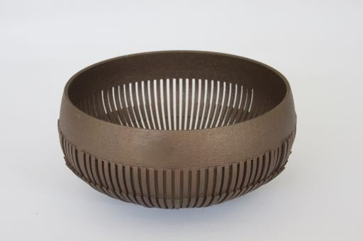
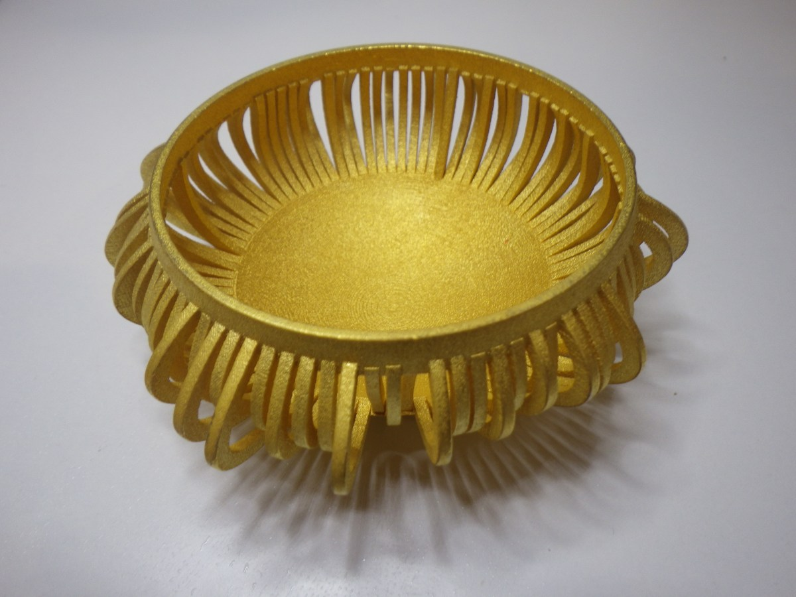
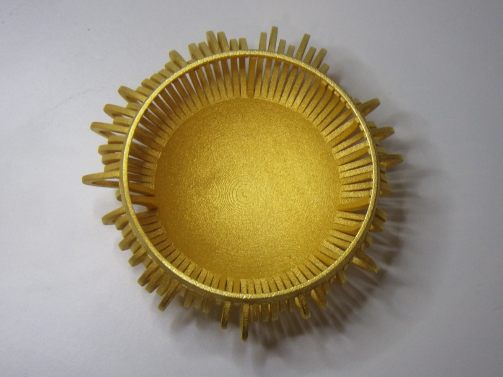
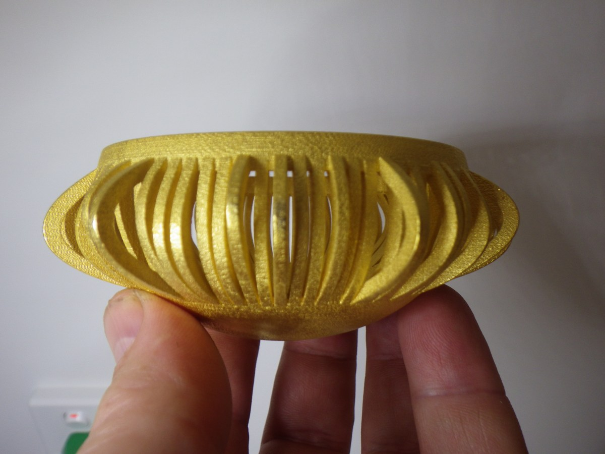
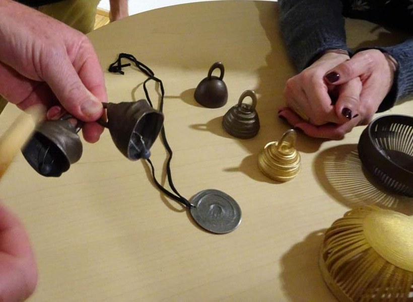

+++
author = "矢崎裕一"
title = "化学療法の1年分の血圧を、鳴らす鉢の形にする──Stephen Barrass の Chemo Singing Bowl"
slug = "chemo-singing-bowl"
date = "2026-11-05"
description = "Stephen Barrass の Chemo Singing Bowl は、化学療法を受けた人の1年分の血圧を、鉢の形に写した作品です。鉢を鳴らしたときの響きで、そのデータを伝えます。"
categories = [
    "consume"
]
tags = [
    "データ物質化",
    "ソニフィケーション"
]
image = "images/chemo-bowl-oblique.jpg"
series = ["data-physicalization", "data-sonification"]
series_weight = 31
seriesByline = "Stephen Barrass"
seriesTitle = "血圧を鉢の形にし、響きで伝える──Chemo Singing Bowl"
+++

Stephen Barrass（スティーブン・バラス）の Chemo Singing Bowl は、化学療法を受けた人の1年分の血圧を、鉢の形に写した作品です。鉢を鳴らしたときの響きで、そのデータを伝えます。鉢はステンレス鋼の3Dプリントで、叩くか、縁をこすって鳴らします。作者は、データで形を決めた鳴る物体を Acoustic Sonification（音響ソニフィケーション）と呼んでいます。

作品は2016年1月18日に作者のブログで公開され、同じ年、シドニーの応用美術科学博物館（MAAS）の展覧会に出品されました。以下は、作者のブログ、国際会議 ICAD 2016 の展示論文、前作を扱った2014年の論文、Barrass が共著者に入った2019年の論文に沿います。資料どうしで書き方が違う点は、違いとしてそのまま示します。

<!--more-->

## 2013年、自分の血圧を「歌う鉢」にする

Chemo Singing Bowl には前作があります。作者本人の血圧で形を決めた Hypertension Singing Bowl です。2013年7月にブログで公開し、2014年に会議 SoniHED で論文にしています。

きっかけは、高血圧と診断されたことでした。Barrass はカフで収縮期と拡張期の血圧を測り、アプリに記録し始めます。アプリが描く時系列のグラフについて、論文にこう書いています。

> The plots of my blood pressure are generic and could have been share prices or CO2 emissions. Surely there was a way to make this personal dataset more personal, and more engaging.

自分の血圧のグラフはありきたりで、株価や CO2 排出量のグラフでもおかしくない。この個人的なデータを、もっと個人的で、引き込まれるものにできないか、という要旨です。

鳴る物体には、チベットのシンギングボウル（singing bowl）を選びました。縁をこすると、持続音で「歌う」鉢です。瞑想やリラクゼーション療法と結びつき、それらが血圧を下げうることが理由でした。

最初の試作（v0.0）は、壁の厚さをデータで変え、最大5mmになりました。叩くと3628Hzが3秒鳴りますが、こすっても歌いません。次の版（v1.0）では壁を2mmにそろえ、時間軸を鉢の周に沿って置きます。読み取り1組ごとに、縁と底をつなぐ「スポーク」を1本割り当て、上半分の半径を収縮期、下半分の半径を拡張期の値で変えました。

Stephen Barrass／ICAD 2016「Research Through Design into Acoustic Sonification」より引用（CC BY-NC 4.0）

v1.0 は直径100mm、重さ162g です。叩くと609Hzが10秒鳴り、縁をこすると伝統的な鉢のように歌いました。2Hzのトレモロとヒス音も出て、作者は「データのスポークが原因かもしれない」と書いています。前作を鳴らす2014年の動画が [YouTube](https://www.youtube.com/watch?v=DE3tolD5Krg) にあります。ICAD 2016 の論文は、前作をこうまとめています。

> The bowl sings like a traditional singing bowl, but with a timbre that is changed by the dataset.

鉢は伝統的な鉢のように歌うが、音色はデータによって変わっている、という要旨です。

## 化学療法の1年を、曲がった帯に写す

Chemo Singing Bowl のデータは、作者本人のものではありません。乳がんの化学療法を受けた人が、治療の1年間に記録した血圧です。作者のブログ（2016）は、こう紹介しています。

> This version of the acoustic sonification singing bowl introduces 3D splines as a way of mapping the data into the form. The irregularity of the dataset makes for inharmonic and dissonant acoustic effects.

この版では、データを形に写す方法として 3D スプライン（制御点でなめらかな曲線を描く方法）を取り入れた。データの不規則さが、倍音の整わない、不協和な響きを生む、という要旨です。ICAD 2016 の論文は、写し方の意図を書いています。

> This mapping aims to amplify the effect of the dataset on the acoustics of the bowl by mapping the diastolic/systolic pressure to control points for the curvature of 2D splines amped to the tines.

拡張期・収縮期の血圧を、スプラインの曲率を決める制御点にし、そのスプラインを tines（帯）に写す。データが音響に与える効果を増幅するためだ、という要旨です（"amped" は "mapped" の誤記と見られます）。前作は太さの変化に写し、Chemo は帯の曲がり方に写したことになります。

Stephen Barrass／SONIFICATION.COM「Chemo Singing Bowl」より引用

写真では、帯の長さや曲がり方が一本ずつそろっていません。

Stephen Barrass／SONIFICATION.COM「Chemo Singing Bowl」より引用

資料から確かめられる対応は、次のとおりです。

| データ | 物の性質 | 出典 |
|---|---|---|
| 化学療法の1年間に記録した血圧 | 鉢全体の形（ステンレス鋼の3Dプリント） | 作者ブログ（2016） |
| 拡張期・収縮期の血圧の値 | スプラインの曲率を決める制御点。そのスプラインを帯に写す | ICAD 2016 |
| 1年間の血圧の読み取り | 鉢の周りのスプラインの変化 | Wang ほか（2019） |
| データの不規則さ | 倍音の整わない、不協和な響き | 作者ブログ（2016） |
| 読み方 | 叩く、またはこすって鳴らす。音は形から決まる | Wang ほか（2019） |

時間の並びを周に沿って置いたと明記した資料はありません。前作 v1.0 がそうしていたこと、「鉢の周りのスプラインの変化」とあることから、Chemo も周に沿って並べたと読めます。読み取りの件数、帯の本数、寸法、周波数は、どの資料にも見当たりませんでした。

Stephen Barrass／SONIFICATION.COM「Chemo Singing Bowl」より引用

## 鉢は歌うのか──資料ごとの食い違い

資料は二つの点で書き方が違います。鉢が歌うかどうかと、スプラインが2Dか3Dかです。

| 論点 | 資料 | 書かれていること |
|---|---|---|
| 歌うか | ICAD 2016 | "This bowl does not sing very well"（あまりうまく歌わない） |
| 歌うか | Wang ほか（2019） | "not sing harmonically"（調和して歌わない） |
| 歌うか | 作者ブログ（2018） | "3D printed in stainless steep [steel] so it sings"（歌うように3Dプリントした） |
| 次元 | 作者ブログ（2016） | "3D splines" |
| 次元 | ICAD 2016 | "2D splines" |

2018年のブログは、ドイツの Schloss Dagstuhl のセミナーに持参したデモの一覧で、前作にも同じ言い方をしています。

歌わない原因の説明も違います。ICAD 2016 は "possibly due to the curved shape of the tines"、帯が曲がった形のせいかもしれない、と書きます。ブログと2019年の論文は、データの不規則さを挙げます。ICAD 2016 は、次の版では音響の理論で歌う効果の改善を探る、と続けますが、その版について書いた資料は見つかりませんでした。

**帯の形とデータの不規則さのどちらが主な原因かを書いた資料は、見つかりませんでした。** 曲率に写せば、データが不規則なほど帯の形も不規則になるので、形の効果とデータの効果は一つの音にまとまって出てくる、と読めます。前作は太さに写して歌い、Chemo は増幅のため曲率に写してあまり歌わなくなった、と並べると、データの性質と写し方の選択がどちらも響きに出ていると読めます。

## 「あのときの自分の感じ方」──データを提供した人の言葉

2019年の論文によれば、この鉢は、化学療法のあいだの看病への感謝として、患者の母親に贈るために作られました。音を聞いたデータ提供者の感想は、三つの資料で言い回しが違います。

| 資料 | 感想 |
|---|---|
| ICAD 2016 | "it sounds as sick as I felt at the time" |
| Wang ほか（2019） | "that's exactly how I felt at the time" |
| 作者ブログ（2016） | "... quite accurate – the sound is dry and heavy, without much resonance, just like I felt!" |

あのときの自分と同じくらい具合の悪い音がする。まさにあのときの自分の感じ方だ。ブログの版は、かなり正確で、音は乾いて重く、あまり響かない、自分が感じていたように、と続きます。

前作は、作者が自分のデータを自分で聴く鉢でした。SoniHED 2014 の要旨は、データを瞑想的に見つめ直し、健康な暮らしを思い出させるもので、自己記録のありきたりなグラフに代わる "poetic alternative"（詩的な選択肢）だ、と書いています。

Chemo は、別の人のデータで作り、データの持ち主がその音を聴きました。前作の「個人的なデータを、もっと個人的に」という問いが、他人のデータで、その本人に返ったと読めます。持ち主が使った言葉は「正確だ」「まさに」でした。グラフを読む正しさではなく、記憶にある体の感じとの一致を指していると読めます。

## 第三者はこの作品をどう見たか

Chemo Singing Bowl を独立に論じた批評や報道は、見つかりませんでした。扱われ方は三つあります。

一つ目は、2019年の IEEE Computer Graphics and Applications の論文 "An Emotional Response to the Value of Visualization" です。Yun Wang らの共著で、Barrass も入っています。2018年の Dagstuhl のセミナーの作業部会から生まれました。

> Informed by the role of emotion in psychology, art, design, marketing, and HCI, we argue for an expanded definition of value, applicable to all forms of data visualization.

感情の役割を踏まえ、可視化の価値の定義を広げるべきだ、という要旨です。効率で測る既存の枠組み（ICE-T など）ではデータ物理化の価値を見落とす、と論文は書き、Chemo の鉢をその例に挙げます。Barrass が共著者なので、完全に独立した評価ではありません。

二つ目は、データ物理化の作品目録 dataphys.org です。Chemo 単独の項目はなく、前作群の項目「2011 – Stephen Barrass' Physical Data Sonifications」があります。Pierre Dragicevic（ピエール・ドラジチェヴィッチ）が追加し、Yvonne Jansen（イヴォンヌ・ヤンセン）が推薦した項目です。

> Physical representations of data can target other senses than vision or touch.

データの物理的な表現は、視覚や触覚以外の感覚にも向けられる、という要旨です。HRTF Bells（左右の耳の特性で形を決めた鐘）については、形の違いはほとんど見えないが、音の高さと音色は比べられる、と書いています。

三つ目は、美術館での選定です。MAAS のキュレーター Matthew Connell（マシュー・コネル）は、2016年9月3日〜2017年6月25日の「Out of Hand: Materialising the Digital」にこの鉢を選びました。作者のブログによれば、デジタル製造の役割を扱う展覧会で、Zaha Hadid や Iris van Herpen らの作品と並びました。同年の DESIGN Canberra Festival でも紹介され、ICAD 2016 と2018年の Dagstuhl では、手に取って鳴らせるデモとして置かれています。

Stephen Barrass／SONIFICATION.COM「Data Physicalisation @ Schloss Dagstuhl」より引用

書籍では、Samuel Huron、Till Nagel、Lora Oehlberg、Wesley Willett 編『Making with Data: Physical Design and Craft in a Data-Driven World』（AK Peters / CRC Press、2022）に、Barrass の章 "Chemo Singing Bowl" があります。第3部 "Digital Production" の 3.1 章、pp. 185–198、DOI は 10.1201/9781003264903-11 です。章の本文は、今回は読めていません。

## 使い道

この鉢から持ち帰れるのは、写し方を変えると、物そのものの振る舞いが変わるということです。画面のグラフなら、値を太さで表すか曲がり方で表すかを変えても、画面の振る舞いは変わりません。鳴る物では、写し方がそのまま響きを決めます。

Barrass は前作の論文で、v0.0 が歌わなかった反省として、写し方に進む前に、データを入れない基準の鉢を先に刷って試すほうが効率的だった、と書いています。素材が媒体になる物理化では、この手順がそのまま使えます。

Chemo は、効果を「増幅」する写し方が、比喩の土台を崩しうることも示しています。歌う鉢という比喩は、鉢が歌うことで成り立ちます。それでも、データの持ち主は濁った響きを「正確だ」と言いました。比喩が崩れたこと自体が、データを伝えたと読めます。

もう一つは、原因の切り分けです。写し方を変えたら、同じ形にデータを入れない版も作って聴き比べる。そうすれば、聴こえる違いのどこまでがデータによるものかを言えるようになる、と筆者は考えます。

## 参考・出典

**一次情報**

- Stephen Barrass, "Chemo Singing Bowl"（SONIFICATION.COM、2016-01-18） https://sonification.com/2016/01/18/chemo-singing-bowl/
- Stephen Barrass, "Research Through Design into Acoustic Sonification", ICAD 2016 installation paper（CC BY-NC 4.0） https://www.icad.org/icad2016/proceedings2/installations/ICAD2016_paper_52.pdf
- University of Canberra Research Portal, "Chemo Singing Bowl: Out of Hand - Materialising the Digital" https://researchprofiles.canberra.edu.au/en/publications/chemo-singing-bowl-out-of-hand-materialising-the-digital/
- Stephen Barrass, "3D Printed Acoustics @ Out Of Hand, Sydney"（2016-09-03） https://sonification.com/2016/09/03/out-of-hand-materialising-the-digital/
- Stephen Barrass, "Chemo Singing Bowl @ DESIGN Canberra"（2016-10-28） https://sonification.com/2016/10/28/design-canberra/
- Stephen Barrass, "Data Physicalisation @ Schloss Dagstuhl"（2018-10-30） https://sonification.com/2018/10/30/data-physicalisation-schloss-dagstuhl/
- Stephen Barrass, "Making With Data"（2022-12-13、目次の転載） https://sonification.com/2022/12/13/making-with-data/
- Stephen Barrass, "Chemo Singing Bowl", in S. Huron, T. Nagel, L. Oehlberg, W. Willett (eds.), *Making with Data: Physical Design and Craft in a Data-Driven World*, AK Peters / CRC Press, 2022, pp. 185–198（本文は未読） https://doi.org/10.1201/9781003264903-11
- Stephen Barrass, "Acoustic Sonification of Blood Pressure in the Form of a Singing Bowl", SoniHED 2014, York https://www.york.ac.uk/media/c2d2/media/sonihedconference/Barrass_SoniHED_2014.pdf
- University of Canberra Research Portal, "Acoustic Sonification of Blood Pressure in the Form of a Singing Bowl"（要旨） https://researchprofiles.canberra.edu.au/en/publications/acoustic-sonification-of-blood-pressure-in-the-form-of-a-singing-/
- Stephen Barrass, "Hypertension Singing Bowl"（2013-07-10） https://sonification.com/2013/07/10/hypertension/
- Stephen Barrass, Hypertension Singing Bowl のデモ動画（YouTube、2014） https://www.youtube.com/watch?v=DE3tolD5Krg
- Stephen Barrass, "Sound in Data Physicalisation", *Dagstuhl Reports* 8(10), 2019, §5.4 https://drops.dagstuhl.de/storage/04dagstuhl-reports/volume08/issue10/18441/DagRep.8.10.127/DagRep.8.10.127.pdf

**第三者評価**

- Yun Wang, Adrien Segal, Roberta Klatzky, Daniel F. Keefe, Petra Isenberg, Jörn Hurtienne, Eva Hornecker, Tim Dwyer, Stephen Barrass, Theresa-Marie Rhyne, "An Emotional Response to the Value of Visualization", *IEEE Computer Graphics and Applications* 39(5), 2019（Barrass 共著） https://petra.isenberg.cc/publications/papers/Wang_2019_AER.pdf / doi:10.1109/MCG.2019.2923483
- dataphys.org, "2011 – Stephen Barrass' Physical Data Sonifications"（Pierre Dragicevic 追加、Yvonne Jansen 推薦） https://dataphys.org/list/barrass-physical-data-sonifications/
- Jason Alexander, Petra Isenberg, Yvonne Jansen, Bernice E. Rogowitz, Andrew Vande Moere (eds.), Dagstuhl Seminar 18441 "Data Physicalization" 報告書, *Dagstuhl Reports* 8(10), 2019 https://drops.dagstuhl.de/storage/04dagstuhl-reports/volume08/issue10/18441/DagRep.8.10.127/DagRep.8.10.127.pdf
- Out of Hand: Materialising the Digital（MAAS、キュレーター Matthew Connell、2016-09-03〜2017-06-25）。選定の事実は作者ブログで確認 https://sonification.com/2016/09/03/out-of-hand-materialising-the-digital/
- *Making with Data* 書籍サイト https://makingwithdata.org/
