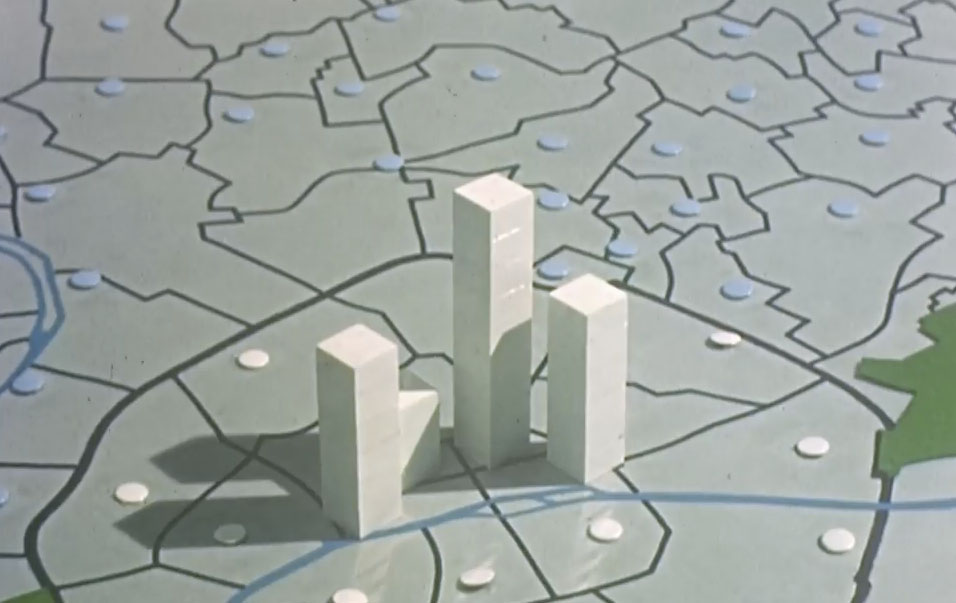
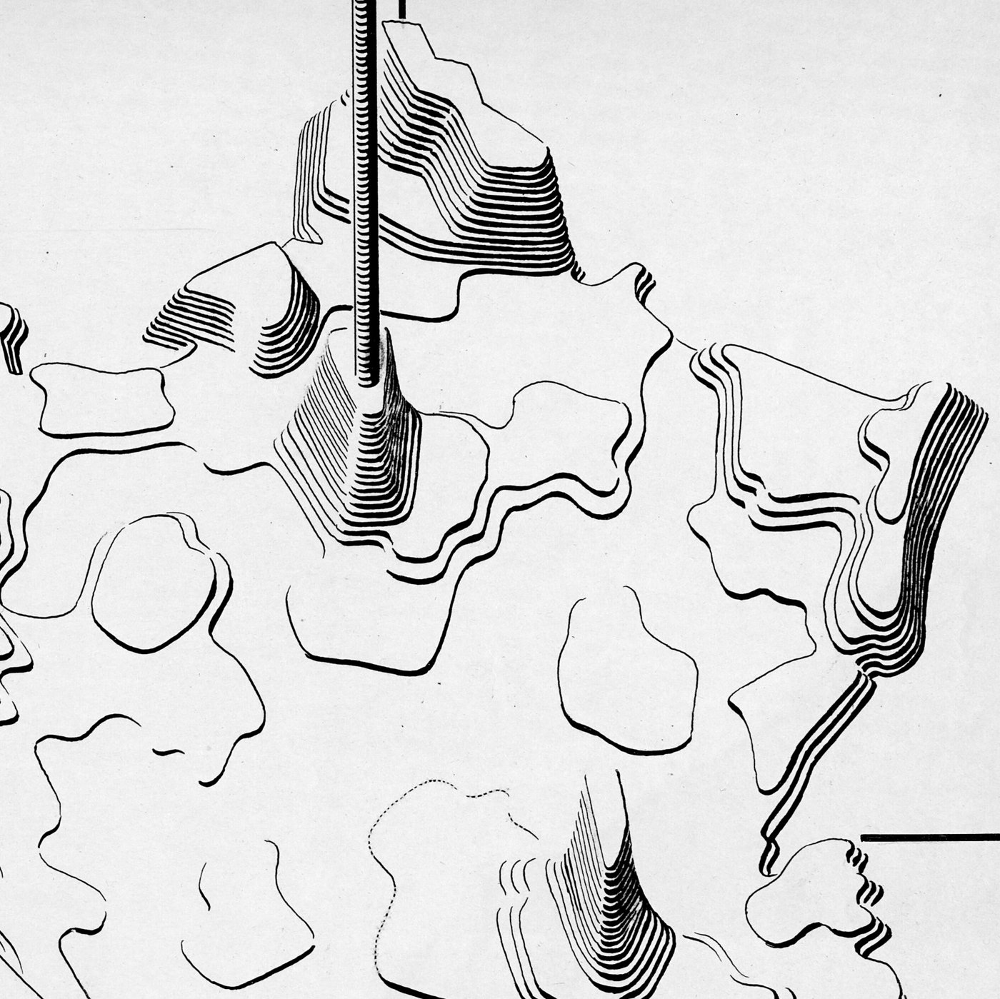
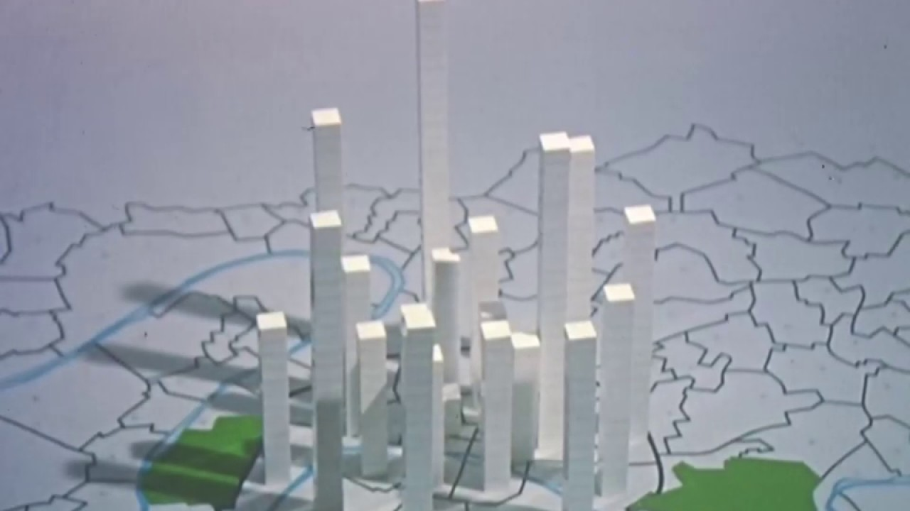

+++
author = "Yuichi Yazaki"
title = "160 Years of Paris Emptying Out at Its Center, Filmed in 10,000-Person Cubes: Chronique Démographique de la Région Parisienne"
slug = "chronique-demographique-paris"
date = "2026-11-01"
description = "A film that stacks cubes, one per 10,000 people, into a column for each commune, arranges the columns on a map, and shoots them frame by frame, year by year. From 1801 to 1961, it shows central Paris emptying while the suburbs swell."
categories = [
    "consume"
]
tags = [
    "data physicalization",
    "maps",
    "Jacques Bertin"
]
image = "images/film-frame-paris-columns.jpg"
series = ["data-physicalization"]
series_weight = 12
seriesByline = "ISHA and CMSS"
seriesTitle = "Filmed in Cubes of 10,000 People: 160 Years of Paris Population"
+++

*Chronique Démographique de la Région Parisienne 1801 - 1961* is a film in which columns of small cubes, one cube per 10,000 people, are stacked for each commune and arranged on a map, then shot in stop motion, year by year, as the narrator reads out the years. As the columns rise and shrink, you can see the movement of population between 1801 and 1961: the center of Paris empties while the suburbs swell.

The film is listed on dataphys.org, in the "List of Physical Visualizations" that collects examples of data physicalization, as an educational film from the 1960s. According to dataphys, it was made between 1962 and 1967 by ISHA and CMSS, in collaboration with Jacques Bertin's cartography laboratory. This article reads the film through the dataphys entry and a transcript of the film's narration.

<!--more-->

## 1960s: White Columns Standing on a Map

The dataphys.org entry is titled "1965 – Stop Motion Animation of Physical 3D Map." It was added on April 16, 2018, by Pierre Dragicevic, a researcher of data physicalization.

> This educational movie from the 1960s uses physical bars and stop motion animation to show the evolution of population in the Paris area between 1801 and 1961. It was made between 1962 and 1967 by the Institut des Sciences Humaines Appliquées (ISHA) and the Centre de Mathématique Sociale et de Statistique (CMSS), in collaboration with the Laboratoire de Cartographie directed by Jacques Bertin.

In short: an educational film that uses physical bars and stop motion to show how the population of the Paris area changed, made by ISHA (Institute of Applied Human Sciences) and CMSS (Center for Social Mathematics and Statistics) in collaboration with Jacques Bertin's cartography laboratory.

The "1965" in the entry title is a representative year chosen by dataphys; the body text does not pin the production down to a single year. The producers are ISHA and CMSS, and Bertin's laboratory took part as a collaborator.

Source: produced by ISHA and CMSS, held by the Archives nationales, digitized by dataphys.org / From dataphys.org "List of Physical Visualizations"

The film was provided by the French National Archives (Archives nationales), digitized by the dataphys curators, and uploaded to YouTube by Dragicevic.

I have found no reliable source for the names of the director or cameraperson, or for the running time. What follows is limited to what the narration tells us.

## One Cube = 10,000 People, One Column = One Commune

The film opens with "Paris et sa banlieue." (Paris and its suburbs), and the next two sentences serve as the legend.

> Chaque colonne de petits cubes représente la population d'une commune.
>
> Chaque petit cube représente 10 000 habitants.

Each column of small cubes represents the population of one commune. Each cube represents 10,000 inhabitants. dataphys writes "physical bars," but according to the narration, each column is not a single block of wood but **a stack of small cubes**. The height of a column is determined by the number of cubes stacked, that is, by the population.

The table below summarizes how the data maps to what you see.

| Data | Visual form / technique | Confirmed in |
|---|---|---|
| Population (quantity) | Number of stacked cubes. One cube = 10,000 people; this sets the column height | Narration |
| Place (commune) | One column = one commune, placed at that commune's position on the map | Narration; dataphys title and tags |
| Time (1801–1961) | Columns are rebuilt for each year the narrator reads out and shot one frame at a time (stop motion) | Narration; dataphys |
| Pace of time | The speed of frame-by-frame shooting (cadence) changes from scene to scene | Narration |
| Regional grouping | Scenes are divided: suburbs only, all of Paris, groups of arrondissements, three rings | Narration |
| Viewpoint | Can be seen from all sides (dataphys.org, 18:40); seen in cross-section (narration) | dataphys; narration |
| Material, color | Not confirmed (in the film frames the columns look white) | — |

The narration does not tell us how fractions smaller than 10,000 people were handled, or what the columns were made of.

This form, showing a quantity per area as the height of a solid, touches on Bertin's own theory. In 1966 Bertin wrote the paper "La cartographie statistique automatique" for issue 17 of the journal *Mathématiques et sciences humaines*, published by CMSS. The paper is bilingual, in French and English.

> only a histogram in three dimensions, a "relief" can properly transcribe quantities by zones.

That is: only a three-dimensional histogram, a "relief," can properly transcribe quantities by zone. Yet the same paper chooses, as the form to use on a paper map, a regular scatter of circles of increasing size (*semis régulier de cercles croissants*). The reasons were that the whole can be read at once, that it can be reduced a great deal, and that it is easy to automate.

Source: Jacques Bertin, BnF GE CC-5541 (19-46) / DESIGNSHS "Le laboratoire graphique de Jacques Bertin"

Bertin's laboratory also left original drawings of maps that depict quantities as solids (*stéréogramme*). The figure above is one of them, and it appeared in *Sémiologie graphique*. The film can be read as building, out of real cubes, the relief that was not chosen on paper, and adding time, which is hard to draw on paper, through stop motion. However, no source shows that Bertin himself decided the design of the film.

## One Frame per Year Read Aloud, Repeated at Changing Speeds

In the film's first scene, the narration simply reads out years. After "Paris et sa banlieue en 1801." it continues with 1817, 1821, 1826, 31, 36, 41, 46, and so on, ending with "Et 1961." The sequence of years can be read as following census years, but the narration does not say what kind of statistics they are.

The twentieth-century part proceeds through 1911, 1921, 26, 31, 36, 46, 51, 56. The years 1916 and 1941 are not read out. These can be read as years in which no census was held, in the midst of the two world wars. Note that the transcript was generated automatically and contains places that seem to be mishearings.

The order of scenes that can be read from the transcript is as follows.

1. Paris and its suburbs (1801→1961)
2. Suburbs only
3. All of Paris
4. The inner 11 arrondissements (Les 11 arrondissements intérieurs)
5. Arrondissements 1 to 4, then group by group
6. Arrondissements 5 to 7
7. The outer 9 arrondissements (Les 9 arrondissements périphériques)
8. Cross-section from Neuilly to Montreuil
9. Comparison at 40-year intervals (1801, 1846, 1886, 1926, 1956)
10. Averages of three rings (couronnes): central, middle, outer

After the scene of arrondissements 1 to 4, the narration announces a change in how the data is shown.

> Examinons le mouvement démographique à des cadences cinématographiques de plus en plus rapides.

It means: let us examine the population movement at ever faster cinematic cadences. In later scenes the years are thinned out, as in 1801, 1856, 1876, 1921, 1946, 1956. In the scene of arrondissements 5 to 7, "cadence de prise de vue accélérée" (accelerated shooting cadence) is followed by "Cadence lente" (slow cadence).

Played fast, only the direction of increase and decrease remains; played slowly, you can follow what happened in which year. The structure can be read as showing both views of the same data, one after the other.

## From Neuilly to Montreuil, the Center Empties

After the scene of the outer 9 arrondissements, "Démonstration rapide de l'évolution démographique." (a rapid demonstration of the demographic evolution) is inserted, and the cross-section scene follows.

> Vue en coupe de Neuilly à Montreuil. Alors que les côtés grandissent, le centre se vide.

A cross-section from Neuilly to Montreuil: while the sides grow, the center empties. This is the sentence in the film that states its answer most plainly. A cross-section removes the overlap in depth, and can be read as letting the heights of the columns on the section be compared from the side.

The narration then says "Reprenons plus lentement." (Let us resume more slowly) and reads through the years from 1801 to 1956 again. The structure of the previous section, in which a fast playback shows the direction and a slow playback confirms it, repeats here.

Source: produced by ISHA and CMSS, held by the Archives nationales / From YouTube "Chronique Démographique de la Région Parisienne 1801 - 1961"

With solid columns, depending on the viewing angle, columns in front hide those behind. According to dataphys, the scene from 18:40 lets you see the model from all sides.

The final scene goes through the contrast of "Paris en 1801." and "Paris en 1956.", then the 40-year comparison, and ends with the averages of the three rings.

> moyenne des trois couronnes centrales, médianes et extérieures en 1956, en 1801, et de nouveau en 1956.

That is: the average of the central, middle, and outer rings, shown for 1956, for 1801, and again for 1956. For viewers who have watched dozens of columns, this can be read as a way of closing by handing over the conclusion as three values.

## How Third Parties Saw the Film

I have found no criticism or paper that discusses this film itself. Here are three items from different standpoints.

The first is its place as a means of telling stories with data. Dragicevic cites this film as an example in dataphys's "Stop Motion Animation" entry.

> For an example of how stop motion animation can be used for telling stories about data, see our entry 1965 - Stop Motion Animation of Physical 3D Map.

This points readers to the entry as an example of using stop motion to tell a story about data. dataphys classifies the film as a "Passive physical visualization" and tags it "storytelling." It treats the film as a physicalization meant to be shown, not one the viewer touches and manipulates.

The second is its place as part of a laboratory's work. The historian of science Jessica Martin describes the structure of Bertin's laboratory in a 2023 paper. In 1961 the laboratory had a "laboratoire cinéma" (film laboratory) alongside the cartography, documentation and analysis, and photography sections, and Bertin called the whole a « centre graphique ». The paper does not mention the film. Even so, it can be read as work done in collaboration with a laboratory that had the setup to make films.

The third is the readability of physical 3D bar charts. "Data Physicalization" (2021) by Dragicevic, Yvonne Jansen, and Andrew Vande Moere introduces the CHI 2013 experiment by Jansen and colleagues.

> They found that participants performed best with the 2D visualizations, but when a 3D representation was used, the physical condition outperformed even the stereoscopic display. A second experiment suggested that the likely reason was that physicalizations allowed participants to quickly and efficiently "bookmark" data points (bars) of interest with their fingers.

The result: performance was best with 2D charts, but among 3D representations, physical bars beat even a stereoscopic screen, probably because people could "bookmark" bars of interest with their fingers.

Viewers of the film cannot put a finger on the columns. dataphys writes, "You can see the physical visualization from all sides by jumping at 18:40." The film also has a cross-section scene. These can be read as devices that reduce occlusion. Set beside the study's conclusion, the film can be read as drawing out the advantage of physicalization not through touch but through the way it is shot.

## Takeaways

What we can take from this film is how it handles the legend, time, and viewpoint.

With a unit of one cube = 10,000 people, you can count the cubes instead of reading the column height off a scale. Because the first two sentences state the unit outright, the viewer can afterward watch the columns while hearing only the years.

Time is marked not at equal intervals but by the years the narrator reads out (this can be read as following census years, though the kind of statistics is not stated). When showing change over time in an animation, matching the years you read out to the years of the data tells the audience which points are actual measurements.

Play fast to show the direction, play slowly to follow the years, and finally compress everything into the averages of three rings. It can be read as handing the audience three ways of seeing one dataset, the overall flow, the detail, and the summary, in a fixed order.

The occlusion problem can be read as answered with the cross-section. In the cross-section from Neuilly to Montreuil, the movement "the sides grow and the center empties" is visible without the front columns getting in the way. If you know what a solid figure is meant to say, you can look for the cut that shows that one sentence best.

## References

**Primary sources**

- dataphys.org "1965 – Stop Motion Animation of Physical 3D Map" (added by Pierre Dragicevic, 2018-04-16) — [https://dataphys.org/list/stop-motion-animation-of-physical-bar-charts/](https://dataphys.org/list/stop-motion-animation-of-physical-bar-charts/)
- The film itself, "Chronique Démographique de la Région Parisienne 1801 - 1961" (YouTube, uploaded by Pierre Dragicevic) — [https://www.youtube.com/watch?v=IYq9Nw9Izxk](https://www.youtube.com/watch?v=IYq9Nw9Izxk) (from 18:40: [https://www.youtube.com/watch?v=IYq9Nw9Izxk&t=18m40s](https://www.youtube.com/watch?v=IYq9Nw9Izxk&t=18m40s)). Title and uploader confirmed via oEmbed: [https://www.youtube.com/oembed?url=https://www.youtube.com/watch?v=IYq9Nw9Izxk&format=json](https://www.youtube.com/oembed?url=https://www.youtube.com/watch?v=IYq9Nw9Izxk&format=json). Quotations from the narration are based on a transcript of this video.
- CAMS (2015) Histoire du CAMS (a source cited by dataphys; not readable at the time of writing) — [http://cams.ehess.fr/histoire-du-cams/](http://cams.ehess.fr/histoire-du-cams/) (Wayback: [http://web.archive.org/web/20230529205235/http://cams.ehess.fr/histoire-du-cams/](http://web.archive.org/web/20230529205235/http://cams.ehess.fr/histoire-du-cams/))
- Jacques Bertin, "La cartographie statistique automatique", *Mathématiques et sciences humaines*, 17, 1966, pp.71-76 — [https://www.numdam.org/item/MSH_1966__17__71_0/](https://www.numdam.org/item/MSH_1966__17__71_0/) (PDF: [https://www.numdam.org/item/MSH_1966__17__71_0.pdf](https://www.numdam.org/item/MSH_1966__17__71_0.pdf))
- Jacques Bertin, Carte de France des densités exprimées par stéréogramme (BnF GE CC-5541 (19-46)), DESIGNSHS — [https://laboratoire-graphique.fr/plateforme/document/?id=9041__carte-de-france-des-densites-exprimees-par-stereogramme](https://laboratoire-graphique.fr/plateforme/document/?id=9041__carte-de-france-des-densites-exprimees-par-stereogramme)

**Secondary sources**

- Pierre Dragicevic, dataphys.org "1897 – Stop Motion Animation" — [https://dataphys.org/list/stop-motion-animation/](https://dataphys.org/list/stop-motion-animation/)
- Jessica Martin, "Le laboratoire de graphique, au-delà de Jacques Bertin ? Les femmes du laboratoire de graphique", *Design Arts Medias*, 2023 — [https://journal.dampress.org/issues/femmes-de-sciences/le-laboratoire-de-graphique-au-dela-de-jacques-bertin-les-femmes-du-laboratoire-de-graphique](https://journal.dampress.org/issues/femmes-de-sciences/le-laboratoire-de-graphique-au-dela-de-jacques-bertin-les-femmes-du-laboratoire-de-graphique)
- Pierre Dragicevic, Yvonne Jansen, Andrew Vande Moere, "Data Physicalization", *Springer Handbook of Human Computer Interaction*, 2021 (HAL) — [https://hal.science/hal-02113248v3/document](https://hal.science/hal-02113248v3/document)
- Yvonne Jansen, Pierre Dragicevic, Jean-Daniel Fekete, "Evaluating the Efficiency of Physical Visualizations", CHI '13 — [http://doi.acm.org/10.1145/2470654.2481359](http://doi.acm.org/10.1145/2470654.2481359)
