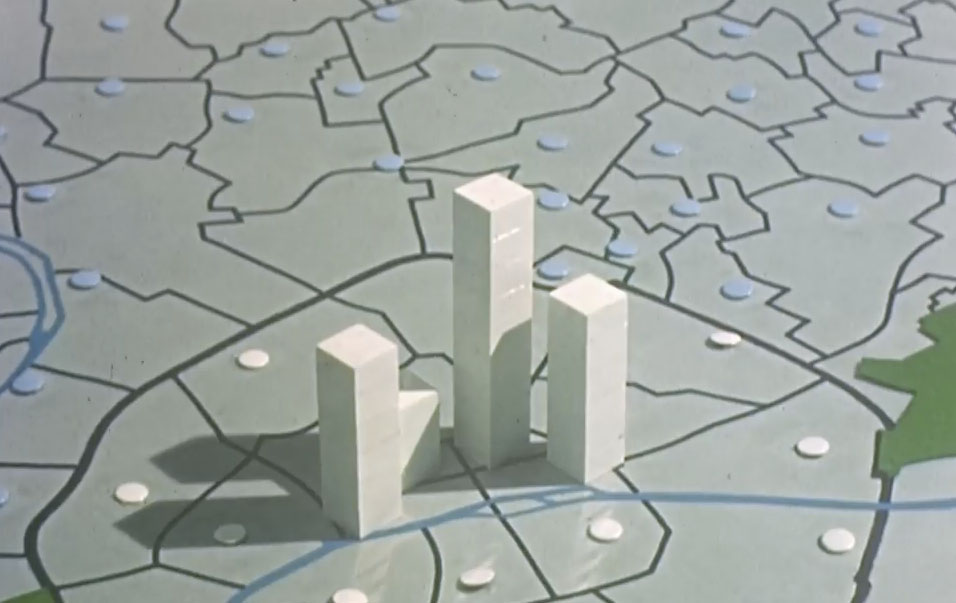
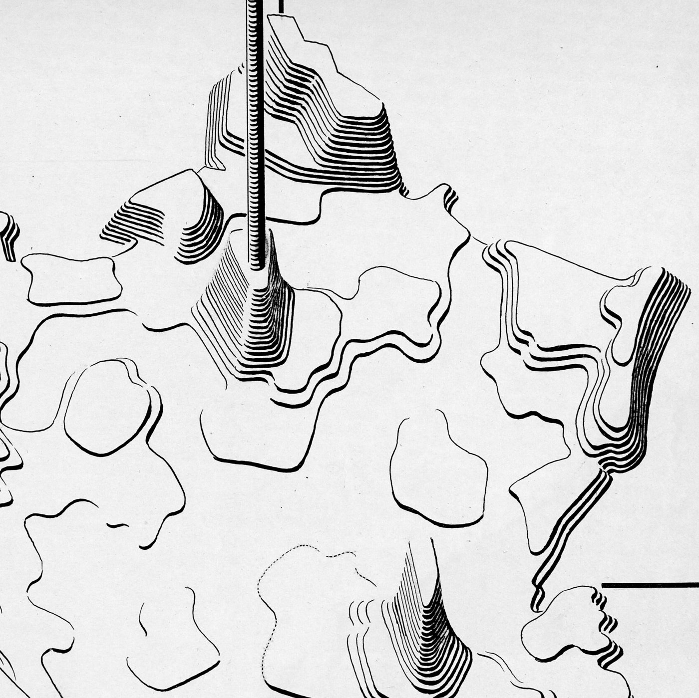
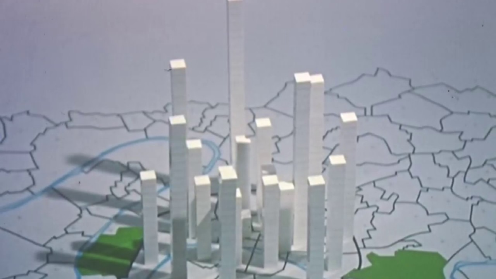

+++
author = "矢崎裕一"
title = "パリの中心が空になる160年を、1万人の立方体で撮る──Chronique Démographique de la Région Parisienne"
slug = "chronique-demographique-paris"
date = "2026-11-01"
description = "1個＝1万人の立方体をコミューンごとに積んだ柱を地図に並べ、年ごとにコマ撮りした映画です。1801〜1961年に、パリの中心が空き、郊外が膨らむ動きを見せます。"
categories = [
    "consume"
]
tags = [
    "データ物質化",
    "地図",
    "ジャック・ベルタン"
]
image = "images/film-frame-paris-columns.jpg"
series = ["data-physicalization"]
series_weight = 12
seriesByline = "ISHA・CMSS"
seriesTitle = "1万人の立方体で撮る──パリの人口160年"
+++

『Chronique Démographique de la Région Parisienne 1801 - 1961』は、1個＝1万人の小さな立方体をコミューンごとに積んだ柱を地図の上に並べ、ナレーションが読み上げる年ごとにコマ撮りした映画です。柱が伸びたり縮んだりする様子から、1801〜1961年のあいだに、パリの中心が空き、郊外が膨らんでいく人口の移動が見えてきます。

この映画は、データ物理化の事例を集めた dataphys.org の「List of Physical Visualizations」に、1960年代の教育映画として載っています。dataphys によれば、1962〜1967年に、ISHA と CMSS が、ジャック・ベルタンの地図学研究室と協力して作りました。本稿は、dataphys の項目と、映画のナレーションの文字起こしに沿って読みます。

<!--more-->

## 1960年代、地図の上に白い柱を立てる

dataphys.org の項目名は「1965 – Stop Motion Animation of Physical 3D Map」です。2018年4月16日に、データ物理化の研究者 Pierre Dragicevic（ピエール・ドラギチェヴィッチ）が追加しました。

> This educational movie from the 1960s uses physical bars and stop motion animation to show the evolution of population in the Paris area between 1801 and 1961. It was made between 1962 and 1967 by the Institut des Sciences Humaines Appliquées (ISHA) and the Centre de Mathématique Sociale et de Statistique (CMSS), in collaboration with the Laboratoire de Cartographie directed by Jacques Bertin.

物理的な棒とストップモーションでパリ地域の人口の推移を見せる教育映画で、ISHA（応用人文科学研究所）と CMSS（社会数学・統計センター）が、Jacques Bertin（ジャック・ベルタン）の地図学研究室と協力して作った、という内容です。

見出しの「1965」は dataphys が付けた代表年で、本文は制作年を一つに絞っていません。制作の主体は ISHA と CMSS で、ベルタンの研究室は協力の立場です。

ISHA・CMSS 制作、Archives nationales 所蔵、dataphys.org によるデジタル化／dataphys.org「List of Physical Visualizations」より引用

フィルムはフランス国立公文書館（Archives nationales）が提供し、dataphys のキュレーターがデジタル化して、Dragicevic が YouTube に載せました。

監督や撮影者の名前、上映時間は、確かめられる資料が見つかっていません。以下は、ナレーションから分かることに限って進めます。

## 1個＝1万人、1本＝1コミューン

映画は「Paris et sa banlieue.」（パリとその郊外）で始まり、続く二文が凡例です。

> Chaque colonne de petits cubes représente la population d'une commune.
>
> Chaque petit cube représente 10 000 habitants.

小さな立方体を積んだ柱1本が、一つのコミューンの人口を表す。立方体1個は、1万人を表す。dataphys は「physical bars（物理的な棒）」と書いていますが、ナレーションによれば、柱は一本の角材ではなく、**小さな立方体を積み上げたもの**です。柱の高さは、積んだ個数、つまり人口で決まります。

データと見た目の対応を表にまとめます。

| データ | 対応させた見た目・手法 | 確かめた出典 |
|---|---|---|
| 人口（量） | 積んだ立方体の個数。1個＝1万人で、柱の高さになる | ナレーション |
| 場所（コミューン） | 柱1本＝1コミューン。地図の上の、そのコミューンの位置に立てる | ナレーション、dataphys の題名とタグ |
| 時間（1801〜1961年） | ナレーションが読み上げる年ごとに柱を作り替え、1コマずつ撮るストップモーション | ナレーション、dataphys |
| 時間の進み方 | 撮影のコマ送りの速さ（cadence）を、場面ごとに変える | ナレーション |
| 地域のまとまり | 場面を分ける。郊外だけ、パリ全体、区のグループ、3つの環 | ナレーション |
| 視点 | 全方向から見られる（dataphys.org、18:40）。断面で見る（ナレーション） | dataphys、ナレーション |
| 素材・色 | 未確認（コマの写真では、柱は白く見える） | ― |

1万人に満たない端数の扱いや、柱の素材は、ナレーションからは分かりません。

この「地域ごとの量を、立体の高さで見せる」形には、ベルタン側の理論との接点があります。ベルタンは 1966年、CMSS が発行元の雑誌『Mathématiques et sciences humaines』17号に、論文「La cartographie statistique automatique」を書きました。フランス語と英語を併記した論文です。

> only a histogram in three dimensions, a "relief" can properly transcribe quantities by zones.

地域ごとの量を正しく写せるのは、三次元のヒストグラム、つまり「relief（起伏）」だけだ、という一文です。ところが同じ論文は、紙の地図で使う形として、大きさが段階的に増える円を規則正しく並べる方法（semis régulier de cercles croissants）を選んでいます。理由は、全体を読めること、大きく縮小できること、自動化しやすいことでした。

Jacques Bertin、BnF GE CC-5541 (19-46)／DESIGNSHS「Le laboratoire graphique de Jacques Bertin」より引用

ベルタンの研究室には、量を立体で描いた地図（stéréogramme）の原図も残っています。上の図はその一つで、『Sémiologie graphique』に載った図です。この映画は、紙の上では選ばれなかった relief を実物の立方体で組み、紙では描きにくい時間をコマ撮りで加えたもの、と読めます。ただし、映画の設計をベルタン本人が決めたことを示す資料はありません。

## 読み上げる年ごとに一コマ、速さを変えて繰り返す

映画の最初の場面で、ナレーションは年号だけを読み上げていきます。「Paris et sa banlieue en 1801.」に続いて、1817、1821、1826、31、36、41、46……と続き、最後が「Et 1961.」です。年号の並びは国勢調査の年に沿っていると読めますが、ナレーションは統計の種類を言っていません。

20世紀の部分は、1911、1921、26、31、36、46、51、56 と進みます。1916年と1941年は読み上げられません。二つの世界大戦のさなかで、国勢調査が行われなかった年に当たると読めます。なお、文字起こしは自動で作られたもので、聞き違いと思われる箇所があります。

文字起こしから読み取れる場面の順番は、次のとおりです。

1. パリと郊外（1801→1961）
2. 郊外のみ
3. パリ全体
4. 内側の11区（Les 11 arrondissements intérieurs）
5. 1〜4区、続いて区のグループごと
6. 5〜7区
7. 外側の9区（Les 9 arrondissements périphériques）
8. ヌイイからモントルイユへの断面図
9. 40年ごとの比較（1801、1846、1886、1926、1956）
10. 中心・中間・外側の3つの環（couronnes）の平均

1〜4区の場面の後で、ナレーションは見せ方を切り替えると宣言します。

> Examinons le mouvement démographique à des cadences cinématographiques de plus en plus rapides.

だんだん速いコマ送りで人口の動きを見ていこう、という意味です。後の場面では、年号が 1801、1856、1876、1921、1946、1956 のように間引かれます。5〜7区では「cadence de prise de vue accélérée」（速めた撮影速度）の後に「Cadence lente」（ゆっくり）が続きます。

速く流せば増減の向きだけが残り、遅く流せばどの年に何が起きたかを追えます。同じデータで、その両方を順に見せる構成だと読めます。

## ヌイイからモントルイユへ、中心が空になる

外側の9区の場面の後に「Démonstration rapide de l'évolution démographique.」（人口の動きの早送り）が入り、断面図の場面になります。

> Vue en coupe de Neuilly à Montreuil. Alors que les côtés grandissent, le centre se vide.

ヌイイからモントルイユへの断面。両側が伸びるあいだに、中心は空になっていく。この映画の中で、答えをもっともはっきり言う一文がここです。断面にすれば奥行きの重なりがなくなり、断面上の柱の高さを横から比べられる、と読めます。

ナレーションはこの後「Reprenons plus lentement.」（もう一度ゆっくり）と言い、1801年から1956年までを年ごとに読み直します。速い再生で向きを見せ、遅い再生で確かめる、という前の節の構成がここでも繰り返されます。

ISHA・CMSS 制作、Archives nationales 所蔵／YouTube「Chronique Démographique de la Région Parisienne 1801 - 1961」より引用

立体の柱は、見る向きによっては手前の柱が奥を隠します。dataphys によれば、18:40 からの場面では模型を全方向から見られます。

最後の場面は「Paris en 1801.」「Paris en 1956.」の対比、40年ごとの比較を経て、3つの環の平均で終わります。

> moyenne des trois couronnes centrales, médianes et extérieures en 1956, en 1801, et de nouveau en 1956.

中心・中間・外側の3つの環の平均を、1956年、1801年、もう一度1956年の順に見せる、という一文です。何十本もの柱を見てきた観客に、結論を3つの値で渡す締め方だと読めます。

## 第三者はこの映画をどう見たか

この映画そのものを論じた批評や論文は見つかっていません。立場の違う3件を並べます。

一つ目は、データで物語る手段としての位置づけです。Dragicevic は dataphys の「Stop Motion Animation」の項目で、この映画を例に挙げています。

> For an example of how stop motion animation can be used for telling stories about data, see our entry 1965 - Stop Motion Animation of Physical 3D Map.

ストップモーションでデータの物語を語る例として、この項目を見てほしい、という案内です。dataphys はこの映画を「Passive physical visualization」に分類し、「storytelling」のタグを付けています。見る人が触って操作するものではなく、見せるための物理化として扱っています。

二つ目は、研究室の仕事の一部としての位置づけです。科学史の Jessica Martin（ジェシカ・マルタン）は、2023年の論文でベルタンの研究室の体制を書いています。1961年の研究室には、地図学・資料と分析・写真の部門と並んで「laboratoire cinéma（映画の研究室）」があり、ベルタンは全体を « centre graphique » と呼んでいました。この論文は映画には触れていません。それでも、映画を作る体制を持った研究室が協力した仕事だった、と読めます。

三つ目は、物理的な3D棒グラフの読みやすさです。Dragicevic、Yvonne Jansen（イヴォンヌ・ヤンセン）、Andrew Vande Moere による「Data Physicalization」（2021）は、Jansen らの CHI 2013 の実験を紹介しています。

> They found that participants performed best with the 2D visualizations, but when a 3D representation was used, the physical condition outperformed even the stereoscopic display. A second experiment suggested that the likely reason was that physicalizations allowed participants to quickly and efficiently "bookmark" data points (bars) of interest with their fingers.

成績が最もよかったのは2Dの図だが、3Dなら物理的な棒が立体視の画面に勝った。指で気になる棒に「しおり」を挟めたからだろう、という結果です。

映画の観客は、柱に指を置けません。dataphys は "You can see the physical visualization from all sides by jumping at 18:40" と書いています。映画には断面図の場面もあります。これらは隠れを減らす工夫として働いていると読めます。研究の結論と並べると、この映画は物理化の利点を、触ることではなく撮り方で引き出していると読めます。

## 使い道

この映画から持ち帰れることは、凡例、時間、視点の扱い方です。

1個＝1万人という単位なら、柱の高さを目盛りで読む代わりに、立方体の個数として数えられます。最初の二文で単位を言い切っているので、観客はその後、年号だけを聞きながら柱を見ていられます。

時間は、等間隔ではなく、読み上げられる年で刻まれています（国勢調査の年に沿っていると読めますが、統計の種類は語られません）。アニメーションで推移を見せるとき、読み上げる年をデータの年に合わせれば、どこが実測かを観客に伝えられます。

速く流して向きを見せ、遅く流して年を追い、最後は3つの環の平均に縮める。一つのデータに対して、全体の流れ、細部、要約の三つの見方を、順番を決めて渡している、と読めます。

隠れの問題には、断面で答えていると読めます。ヌイイからモントルイユへの断面で見ると、「両側が伸び、中心が空く」という動きが、手前の柱に邪魔されずに見えます。立体の図で何を言いたいかが決まっているなら、その一言がいちばんよく見える切り口を探せばよい、と読めます。

## 参考・出典

**一次情報**

- dataphys.org「1965 – Stop Motion Animation of Physical 3D Map」（Pierre Dragicevic 追加、2018-04-16）— [https://dataphys.org/list/stop-motion-animation-of-physical-bar-charts/](https://dataphys.org/list/stop-motion-animation-of-physical-bar-charts/)
- 映画本編「Chronique Démographique de la Région Parisienne 1801 - 1961」（YouTube、Pierre Dragicevic によるアップロード）— [https://www.youtube.com/watch?v=IYq9Nw9Izxk](https://www.youtube.com/watch?v=IYq9Nw9Izxk)（18:40 から：[https://www.youtube.com/watch?v=IYq9Nw9Izxk&t=18m40s](https://www.youtube.com/watch?v=IYq9Nw9Izxk&t=18m40s)）。題名とアップロード者は oEmbed で確認：[https://www.youtube.com/oembed?url=https://www.youtube.com/watch?v=IYq9Nw9Izxk&format=json](https://www.youtube.com/oembed?url=https://www.youtube.com/watch?v=IYq9Nw9Izxk&format=json)。ナレーションの引用は、この映像の文字起こしによる。
- CAMS (2015) Histoire du CAMS（dataphys が挙げる出典。本稿の執筆時点では読めていない）— [http://cams.ehess.fr/histoire-du-cams/](http://cams.ehess.fr/histoire-du-cams/)（Wayback：[http://web.archive.org/web/20230529205235/http://cams.ehess.fr/histoire-du-cams/](http://web.archive.org/web/20230529205235/http://cams.ehess.fr/histoire-du-cams/)）
- Jacques Bertin, "La cartographie statistique automatique", *Mathématiques et sciences humaines*, 17, 1966, pp.71-76 — [https://www.numdam.org/item/MSH_1966__17__71_0/](https://www.numdam.org/item/MSH_1966__17__71_0/)（PDF：[https://www.numdam.org/item/MSH_1966__17__71_0.pdf](https://www.numdam.org/item/MSH_1966__17__71_0.pdf)）
- Jacques Bertin, Carte de France des densités exprimées par stéréogramme（BnF GE CC-5541 (19-46)）、DESIGNSHS — [https://laboratoire-graphique.fr/plateforme/document/?id=9041__carte-de-france-des-densites-exprimees-par-stereogramme](https://laboratoire-graphique.fr/plateforme/document/?id=9041__carte-de-france-des-densites-exprimees-par-stereogramme)

**第三者評価**

- Pierre Dragicevic, dataphys.org「1897 – Stop Motion Animation」— [https://dataphys.org/list/stop-motion-animation/](https://dataphys.org/list/stop-motion-animation/)
- Jessica Martin, "Le laboratoire de graphique, au-delà de Jacques Bertin ? Les femmes du laboratoire de graphique", *Design Arts Medias*, 2023 — [https://journal.dampress.org/issues/femmes-de-sciences/le-laboratoire-de-graphique-au-dela-de-jacques-bertin-les-femmes-du-laboratoire-de-graphique](https://journal.dampress.org/issues/femmes-de-sciences/le-laboratoire-de-graphique-au-dela-de-jacques-bertin-les-femmes-du-laboratoire-de-graphique)
- Pierre Dragicevic, Yvonne Jansen, Andrew Vande Moere, "Data Physicalization", *Springer Handbook of Human Computer Interaction*, 2021（HAL）— [https://hal.science/hal-02113248v3/document](https://hal.science/hal-02113248v3/document)
- Yvonne Jansen, Pierre Dragicevic, Jean-Daniel Fekete, "Evaluating the Efficiency of Physical Visualizations", CHI '13 — [http://doi.acm.org/10.1145/2470654.2481359](http://doi.acm.org/10.1145/2470654.2481359)
