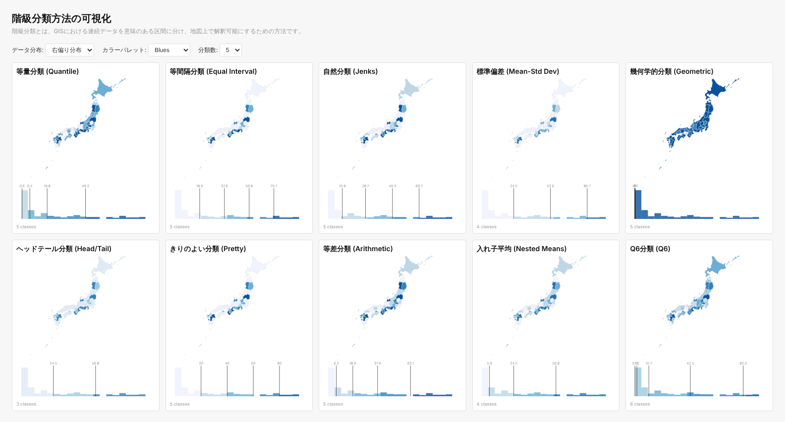

+++
author = "Yuichi Yazaki"
title = "Splitting the Same Data Ten Ways and Comparing the Maps: Visualizing Classification Methods"
slug = "classification-methods-explorable"
date = "2026-11-23"
description = "An interactive page that lines up ten classification methods, including quantile, equal interval, and natural breaks (Jenks), as maps and histograms of the same data. You can switch the data distribution, the colors, and the number of classes."
categories = [
    "principle"
]
tags = [
    "interactive",
    "classification",
    "choropleth map",
    "histogram"
]
image = "images/cover-ten-methods.png"
series = ["interactive-explainers"]
series_weight = 30
seriesTitle = "Splitting the Same Data Ten Ways: Visualizing Classification Methods"
+++

"Kaikyū bunrui hōhō no kashika" (Visualizing Classification Methods) is an interactive page that lines up ten classification methods as maps and histograms of the same data. Quantile, equal interval, natural breaks (Jenks), and others appear on one screen. When you switch the data distribution, the color palette, or the number of classes, all ten change at once.

**[Open "Visualizing Classification Methods"](https://classification.explorable-explanations.com/)** (the page itself is in Japanese)

This page introduces it. The page is at the link above and runs in the browser.

<!--more-->

## What classification is

The page opens with this explanation: classification is a way to divide continuous data in GIS into meaningful intervals so that it can be read on a map. Depending on where the breaks fall, a map of the same data is colored differently.

## Ten methods on one screen

The screen shows these ten methods.

- Quantile
- Equal Interval
- Natural breaks (Jenks)
- Mean-Std Dev (standard deviation)
- Geometric
- Head/Tail
- Pretty
- Arithmetic
- Nested Means
- Q6

Each panel holds a map of Japan with the prefectures shaded, and a histogram below it. The histogram marks the break positions with vertical lines and values, and the number of classes appears at the lower left of the panel.

## What you can switch

| Item | Choices |
|---|---|
| Data distribution | Uniform, normal, right-skewed, bimodal |
| Color palette | 18 palettes, including Blues, Greens, and YlOrRd |
| Number of classes | 3 to 9 |

Yuichi Yazaki / Screen of "Visualizing Classification Methods"

## What it shows

Switching the data distribution brings out the differences between methods. With the right-skewed distribution, for example, the number of dark prefectures differs greatly between the quantile map and the equal-interval map. You can check on one screen that the choice of method shapes the impression a map gives.

Even with the same setting for the number of classes, the class count shown at the lower left of each panel differs by method. On the screen with the normal distribution and the setting at 5, standard deviation and Q6 showed 6, Nested Means showed 4, and Head/Tail showed 2.

The idea of classification is also covered in [the article on classed maps and choropleth maps](/en/classification-and-coloplethmap/) and [the article on Jenks](/en/classification-jenks/).

## References

- Visualizing Classification Methods (in Japanese). [classification.explorable-explanations.com](https://classification.explorable-explanations.com/)
- Explorable Explanations, "Visualizing Classification Methods" (introduction page). [explorable-explanations.com/en/p/classification](https://explorable-explanations.com/en/p/classification/)
