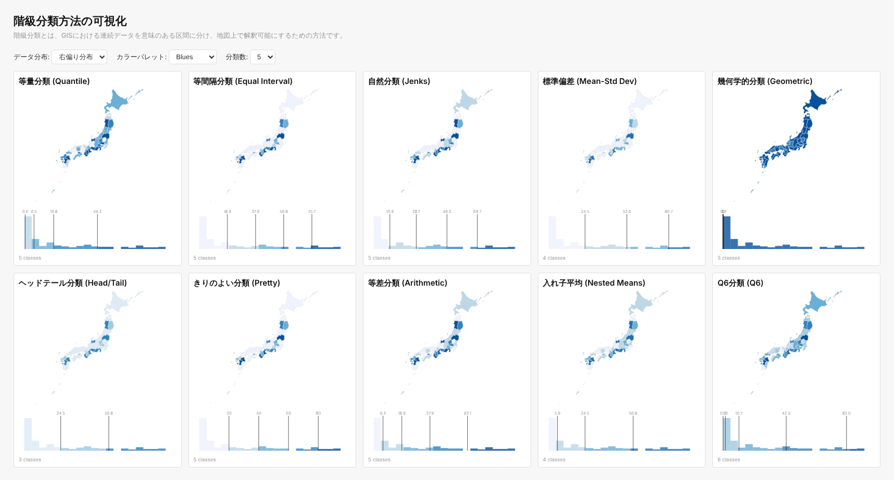

+++
author = "矢崎裕一"
title = "同じデータを10通りに区切って、地図を見比べる──階級分類方法の可視化"
slug = "classification-methods-explorable"
date = "2026-11-23"
description = "等量分類、等間隔分類、自然分類（Jenks）など10通りの階級分類を、同じデータの地図とヒストグラムで並べて比べられるインタラクティブなページです。データの分布、色、分類数を切り替えられます。"
categories = [
    "principle"
]
tags = [
    "インタラクティブ",
    "階級分類",
    "コロプレス・マップ",
    "ヒストグラム"
]
image = "images/cover-ten-methods.png"
series = ["interactive-explainers"]
series_weight = 30
seriesTitle = "同じデータを10通りに区切る──階級分類方法の可視化"
+++

「階級分類方法の可視化」は、10通りの階級分類を、同じデータの地図とヒストグラムで並べて比べられるインタラクティブなページです。等量分類、等間隔分類、自然分類（Jenks）などが一画面に並びます。データの分布、カラーパレット、分類数を切り替えると、10枚が同時に変わります。

**[「階級分類方法の可視化」を開く](https://classification.explorable-explanations.com/)**

このページは、その紹介です。本編は上のリンク先にあり、ブラウザでそのまま動きます。

<!--more-->

## 階級分類とは

ページの冒頭は、階級分類をこう説明しています。GIS で連続データを意味のある区間に分け、地図の上で読めるようにするための方法です。どこで区切るかによって、同じデータの地図でも色の付き方が変わります。

## 10通りを一画面に並べる

画面には、次の10通りの分類が並びます。

- 等量分類（Quantile）
- 等間隔分類（Equal Interval）
- 自然分類（Jenks）
- 標準偏差（Mean-Std Dev）
- 幾何学的分類（Geometric）
- ヘッドテール分類（Head/Tail）
- きりのよい分類（Pretty）
- 等差分類（Arithmetic）
- 入れ子平均（Nested Means）
- Q6分類（Q6）

それぞれの枠に、都道府県を塗り分けた日本地図と、その下のヒストグラムが入っています。ヒストグラムには区切りの位置が縦線と数値で示され、枠の左下に階級の数が出ます。

## 切り替えられるもの

| 項目 | 選択肢 |
|---|---|
| データ分布 | 一様分布、正規分布、右偏り分布、二峰性分布 |
| カラーパレット | Blues、Greens、YlOrRd など18種類 |
| 分類数 | 3〜9 |

矢崎裕一／「階級分類方法の可視化」の画面

## 何が分かるか

データ分布を切り替えると、分類ごとの違いがはっきり出ます。たとえば右偏り分布にすると、等量分類の地図と等間隔分類の地図で、濃い色の県の数が大きく変わります。どの分類を選ぶかが地図の印象を左右することを、同じ画面で確かめられます。

分類数を同じにしても、枠の左下に出る階級の数は、分類によって違います。分類数を5にした正規分布の画面では、標準偏差とQ6分類が6、入れ子平均が4、ヘッドテール分類が2でした。

階級分類の考え方は、[階級区分図とコロプレス・マップの記事](/classification-and-coloplethmap/)と[Jenks の記事](/classification-jenks/)でも扱っています。

## 参考・出典

- 階級分類方法の可視化. [classification.explorable-explanations.com](https://classification.explorable-explanations.com/)
- Explorable Explanations「階級分類方法の可視化」（紹介ページ）. [explorable-explanations.com/p/classification](https://explorable-explanations.com/p/classification/)
