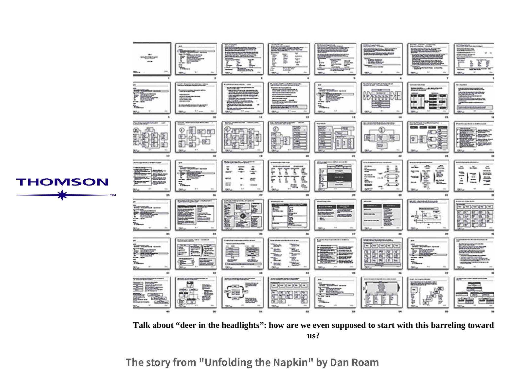
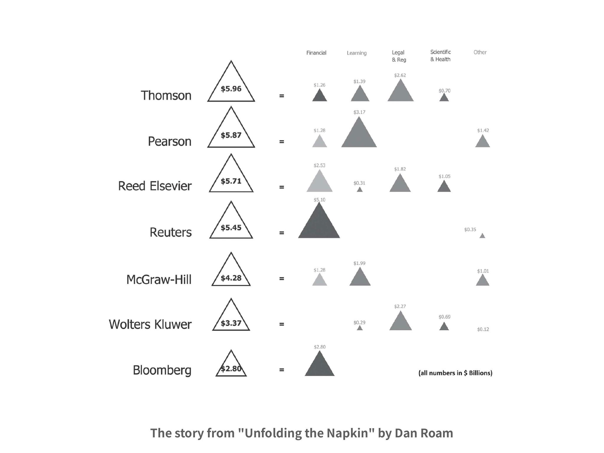
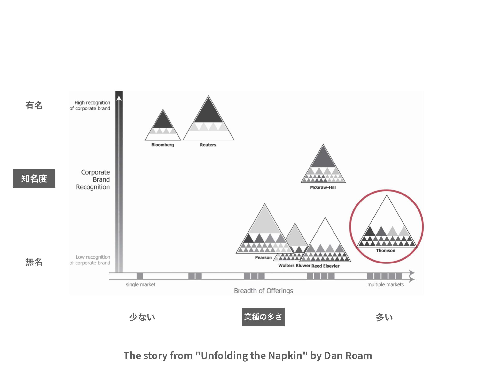
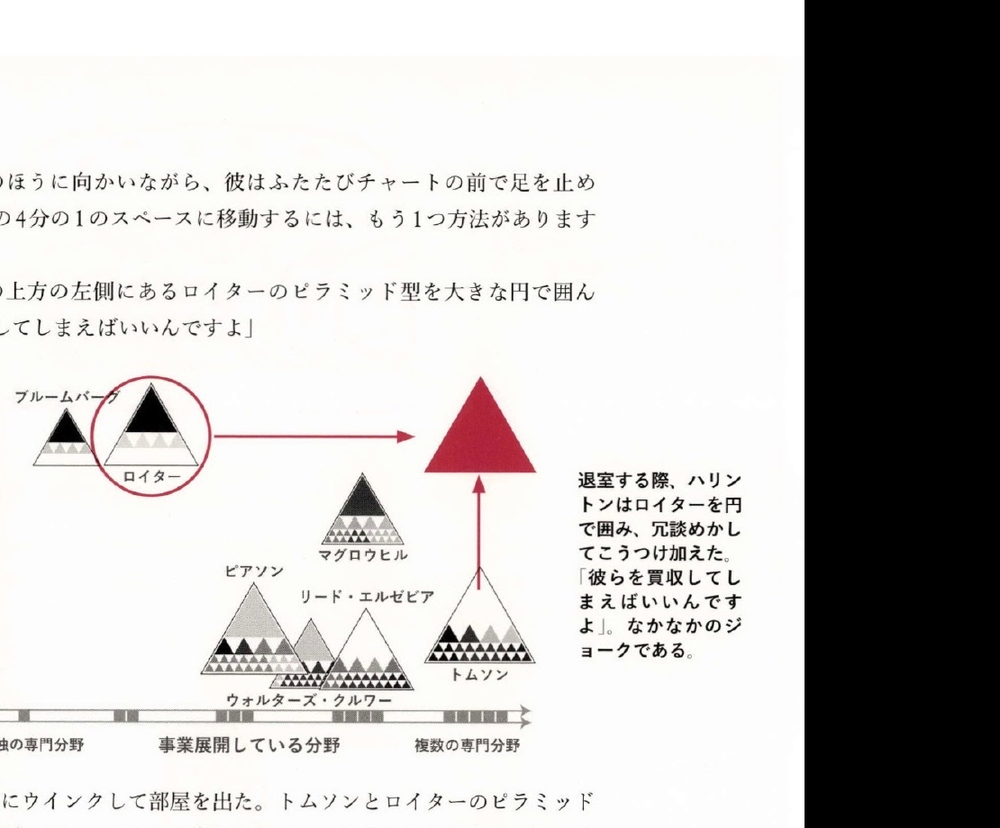
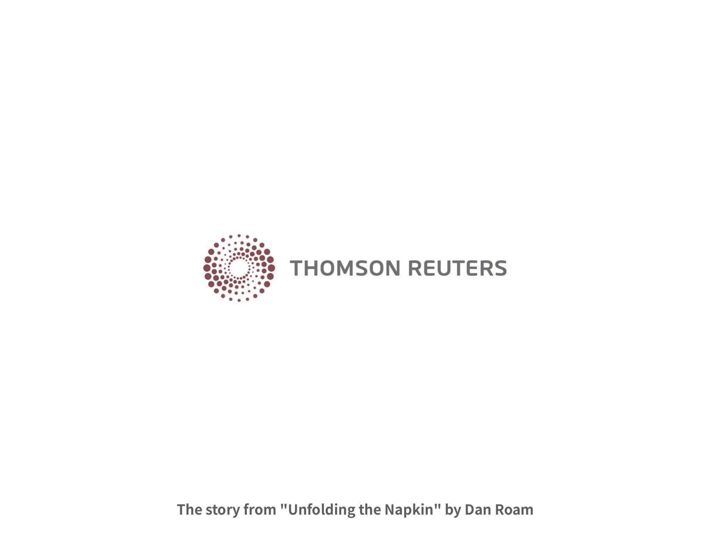

+++
draft = true
author = "Yuichi Yazaki"
title = "図の前で、依頼者自身が答えを言い出す──Dan Roam の Thomson 事例"
slug = "dan-roam-unfolding-napkin-thomson"
date = "2026-08-17"
description = "いわゆるデータ分析ではない。可視化すると社長や社員が議論に参加でき、コンサルタントは正解を渡すのではなく、依頼者から解決を引き出す。"
categories = [
    "technology",
    "principle"
]
tags = [
    "ビジュアルシンキング"
]
image = "images/cover.jpg"
+++

Thomson の話の面白さは、分析結果を渡したことではありません。図があると、依頼してきた社長も、あるいは社員も、議論に参加できる。コンサルタントが正解を導き出すのではなく、依頼者自身から解決を引き出す。Dan Roam（ダン・ローム）が Thomson Corporation で描いた一連の図は、そのためのものでした。

出典は『Unfolding the Napkin』（2009）です。『The Back of the Napkin』（2008）の実践編で、日本語版は講談社から『４日で使える 実践！ 超ビジュアルシンキング』（小川敏子訳、2011）として出ています。以下は、その本に載っているストーリーに沿います。

<!--more-->

## 2001年、トムソン社からの依頼

2001年末、カナダの情報サービス企業トムソン社が、Roam に戦略立案を依頼します。ニューヨーク証券取引所への上場を控え、自社ブランドを世界に浸透させたい。課題は二つでした。ビジネス界がトムソンをどれだけ知っているか。ほぼ無名の状態から、規模と実績を投資家へ、費用対効果よく伝えられるか。

データはすでにありました。半年かけて、世界中のビジネスリーダーに数百件のインタビューを行い、認知度、製品の評価、各社の規模を聞いています。結果は何百ものリスト、表、グラフになり、巨大なプレゼン資料にまとめられました。コミュニケーション部門は、これを使ってブランド戦略とマーケティング計画を作らねばならない。ところが資料は厚すぎて、誰も使いこなせない。本はこれを「ヘッドライトの光のなかにシカが出現した状況」と書いています。

Dan Roam／Unfolding the Napkinより引用

数字も図もあるのに、議論の場所がない。Roam はここから「視る」に入ります。材料を捨てるのではなく、6つの問い（誰／なに、どれだけの量、どこ、いつ、どのように、なぜ）でスライスする。

## 「誰／なに」と「どれだけの量」

最初に特定したのは、資料に繰り返し出てくる競合7社です。Bloomberg、Reed Elsevier、McGraw-Hill、Pearson、Thomson、Reuters、Wolters Kluwer。扱う領域は四つ。金融、学習、法律、科学およびヘルスケア。スタート地点は、きれいなチャートではなく、誰を・何を見るかの確定です。

次に、2001年の売上で量を置きます。トムソンが 59.6億ドルで首位、以下ピアソン、リード・エルゼビア、ロイターと続きます。上位なのに、聞いたことのない社名が並ぶ。合計だけでは説明がつかないので、同じ三角形を事業別に割ります。

Dan Roam／Unfolding the Napkinより引用

ロイターは売上のほとんどが金融、ピアソンは学習、ブルームバーグは金融のみ。トムソンはどの分野にもいるが、どこでも圧倒的シェアではない。売上首位と「顔がない」が、ここで同時に見えます。

三角形の面積は、棒グラフより量の差を読み取りにくい（Cleveland と McGill, 1984）。本が数値を書き込んでいるのはそのためです。ここでの役割は精度ではなく、全体と部分を同じ図形で見せ、次の議論に乗せることです。

## ブランド・ピラミッドと、依頼を軸にする

量の次は「どこ」です。本はブランド・ピラミッドを使います。頂点が企業、中段がマーケット・グループ、底辺が製品。B2B でも、ペプシコとドリトスと同じ型だ、と書いてあります。製品は知られている。親会社の名は知られていない。

視覚の約束は四つです。大きさは相対的な売上、位置は階層、色は専門分野、濃さはブランド認知度。そのうえで座標を決めます。横軸は専門分野の数（単独か、複数か）。縦軸は会社全体の認知度。縦軸は、依頼そのものです。

Dan Roam／Unfolding the Napkinより引用

ブルームバーグとロイターは左上。分野は狭いが、社名は知られている。トムソンは右下。分野はいちばん広く、売上も最大なのに、認知度は低い。2001年のこの業界には、複数分野かつ高認知の会社がいない。本はそれを「大きな穴」と呼びます。

データは資料にすでにあった、と Roam は書いています。絵にすると、表より先に見える。データは変わらない。結論を出せる形になる。

## 図の前で、社長が円を描く

地図は 2001年の「いま」です。上場は 2003年。2年で、空いている右上へトムソンのピラミッドを動かせるか。「どのように」の問いです。

この絵を、CEO のディック・ハリントンに見せます。本によれば、ハリントンは絵を見て、同じスペースにチャンスを見出した。円を自分で描く。こんな形で見たことがない、責任者として何をすべきか、と問う。コンサルタントが正解を読み上げる場面ではありません。社長が図の前に立ち、議論に参加する場面です。

Roam 側の提案は、有名な製品ブランドにトムソンの名を足し、右上の三角形を塗りつぶす、というブランドの足し算です。帰り際、ハリントンはロイターのピラミッドを丸で囲み、こう言います。右上へ行く方法はもう一つある。買ってしまえばいい。当時は冗談に聞こえた、と本は書いています。会社の規模が違いすぎたからです。

ダン・ローム／『４日で使える 実践！ 超ビジュアルシンキング』より引用

5年後の 2007年、トムソンはロイターを 172億ドルで買収します。2008年4月17日に完了し、Thomson Reuters になります。IR は新ブランドを、専門家向け intelligent information の提供者として打ち出しています。本は最後に、こう問います。わたしたちが作成したチャートの価値は 172億ドルか。

Dan Roam／Unfolding the Napkinより引用

図が買収を起こした、とまでは言えません。買収は規制当局の審査を経た経営判断です。本が示しているのは別のことです。正解を渡したのは Roam ではない。右上の穴を指したのも、ロイターを丸で囲んだのも、依頼者です。可視化の仕事は、その発言が可能な場所をつくったところで終わっています。

## 第三者はこの本をどう見たか

Roam 自身のサイトは、『The Back of the Napkin』を BusinessWeek の年間最優秀イノベーションブック、Fast Company の年間ベストビジネス書、The Times（ロンドン）の Creativity Book of the Year として紹介しています。講談社の邦訳紹介も、amazon.com の 2008年 Best Books（ビジネス・投資）5位と BusinessWeek の Best Innovation & Design Books of 2008 を挙げています。Pixar 共同創業者の Ed Catmull は「visual thinking は習得する価値がある」と述べ、Daniel Pink や IDEO の Tom Kelley も後続作に推薦を寄せています。

書評側は、枠組みの有用さと、過剰な体系化の両方を見ています。

- Publishers Weekly は「包括的な体系」としつつ、SQVID を clumsy な頭字語と呼び、本の3分の1を占める長いケーススタディが、単純さという中心メッセージと食い違うと書いています。
- プレゼンテーション評の Six Minutes（Andrew Dlugan）は、6つの問いと SQVID を「本の値段に見合う洞察」としつつ、描き方の実務と、絵をどう語るかの不足を指摘しています。評価は 3.5/5 です。
- デザイナーの Andy Polaine は、ビジネス創造本への懐疑を前提に「それでも説得された」と書いています。Visual Thinking Codex は、訓練なしで誰にでも通じる「自然な文法」というより、ビジネス問題向けの実用文法だと読むべき、という留保も同系統の評にあります。
- 日本語では、マインドマップ的読書感想文が「絵を描くことがゴールではなく、問題解決が目的」と要約しています。本が好き！ の書評は実践編について、「不完全な絵のほうが反応が返ってくる」という Roam の主張を拾っています。

Neuromarketing の書評は、付録に視覚の科学がある一方、本体はコンサル経験に基づくと指摘しています。データ可視化の研究文献（Bertin、Cleveland & McGill、Munzner）とは系統が違います。Roam は「どの絵が知覚的に正確か」より、「どの問いの絵か」を先に決めます。Thomson の図が強いのも、面積の精度ではなく、社長がペンを持って入れる余白を残したからです。

## 使い道

この一連の図が示している使い道は、分析の精度ではありません。図の前に人が立てることです。

材料を減らせば、社長も社員も同じ絵を指させます。軸が依頼（認知度）なら、議論はその目標から外れません。三角形が知覚的に正確でなくても、同じ形が繰り返されていれば、空いている右上を一緒に見られます。Roam が手描きを勧めるのも、磨き上げた完成品は受け入れるか拒否するだけになるからです。粗い図のほうが、依頼者が口を挟める。

ハリントンは円を描き、冗談を言い、五年後にその冗談どおり動きます。可視化の仕事は、そこで終わっています。正解を渡したのではなく、依頼者自身が次の手を言える場所をつくった。使い道は、そこです。

## 参考・出典

**一次情報**

- ダン・ローム（小川敏子訳）『４日で使える 実践！ 超ビジュアルシンキング』講談社、2011年、トムソン社の事例（「第2日目 視る」）。原著: Dan Roam, *Unfolding the Napkin*, Portfolio, 2009. [講談社](https://www.kodansha.co.jp/book/products/0000185731) / [Penguin Random House](https://www.penguinrandomhouse.com/books/305290/unfolding-the-napkin-by-dan-roam/)
- ダン・ローム（小川敏子訳）『描いて売り込め！ 超ビジュアルシンキング』講談社、2009年5月19日、ISBN 9784062146906. [講談社](https://www.kodansha.co.jp/book/products/0000184475)
- Dan Roam, *The Back of the Napkin: Solving Problems and Selling Ideas with Pictures*, Portfolio, 2008. 公式紹介: [danroam.com/my-books](https://www.danroam.com/my-books)
- Thomson Reuters, “Thomson Completes Acquisition of Reuters; Thomson Reuters Shares Begin Trading Today,” 2008-04-17. [IR](https://ir.thomsonreuters.com/news-releases/news-release-details/thomson-completes-acquisition-reuters-thomson-reuters-shares)
- Reuters, “Thomson agrees to buy Reuters for $17.2 billion,” 2007-05-15. [報道](https://www.reuters.com/article/business/media-telecom/update-2-thomson-agrees-to-buy-reuters-for-172-billion-idUSL15334467/)
- William S. Cleveland & Robert McGill, “Graphical Perception: Theory, Experimentation, and Application to the Development of Graphical Methods,” *Journal of the American Statistical Association*, 79(387), 1984. [doi:10.1080/01621459.1984.10478080](https://doi.org/10.1080/01621459.1984.10478080)

**第三者評価**

- *Publishers Weekly*, review of *The Back of the Napkin*, 2008. [書評](https://www.publishersweekly.com/9781591841999)
- Andrew Dlugan, “Book Review: The Back of the Napkin (Dan Roam),” *Six Minutes*, 2010-06-02. [書評](https://sixminutes.dlugan.com/book-review-back-napkin-dan-roam/)
- Andy Polaine, “The Back of The Napkin,” *Designer’s Review of Books*, 2009-01-21. [書評](https://www.designersreviewofbooks.com/2009/01/the-back-of-the-napkin/)
- Roger Dooley, “Visual Selling,” *Neuromarketing*. [書評](https://www.neurosciencemarketing.com/blog/articles/back-napkin.htm)
- smooth「【スゴ本再び】『4日で使える 実践！ 超ビジュアルシンキング』ダン・ローム」マインドマップ的読書感想文. [書評](https://smoothfoxxx.livedoor.biz/archives/51939750.html)
- hamachobi「『4日で使える 実践！ 超ビジュアルシンキング』」本が好き！. [書評](https://ww.honzuki.jp/book/180347/review/41724/)
