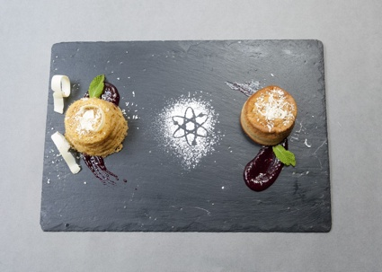
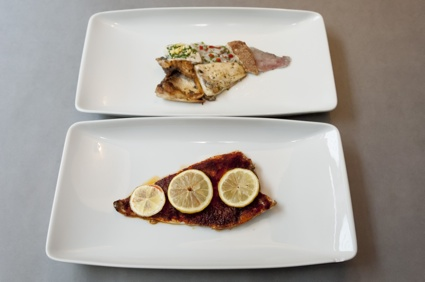
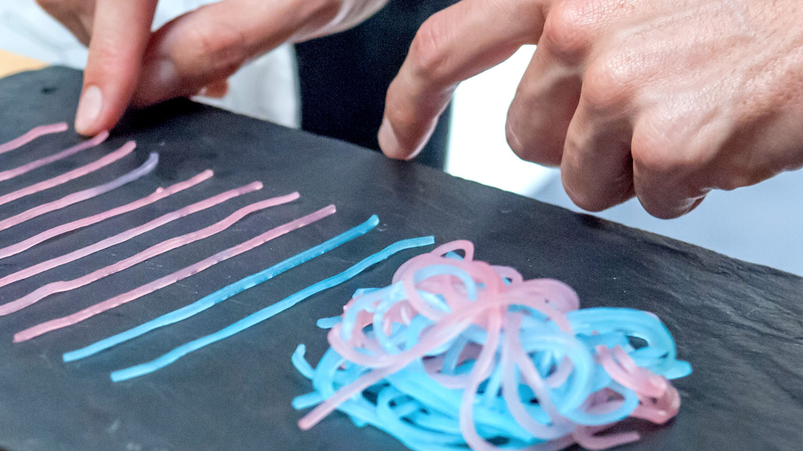

+++
author = "Yuichi Yazaki"
title = "Eating Local Data as Local Food: Data Cuisine by Moritz Stefaner and Susanne Jaschko"
slug = "data-cuisine"
date = "2026-11-06"
description = "Data Cuisine is a workshop that expresses a place's open data through that place's food. Held in many cities since Helsinki in 2012, it mapped data onto the amount of sugar, the size of a dish, and combinations of ingredients."
categories = [
    "consume"
]
tags = [
    "data physicalization",
    "taste"
]
image = "images/pink-blue-noodles.jpg"
series = ["data-physicalization"]
series_weight = 22
seriesByline = "Moritz Stefaner and Susanne Jaschko"
seriesTitle = "Local Data Served as Local Food: Data Cuisine"
+++

Data Cuisine is a workshop that expresses a place's open data through that place's food. The first one was held in Helsinki in September 2012, and after Barcelona in 2014 it was held in many other places. In the dishes, data was mapped onto the amount of sugar, the size of a dish, and combinations of ingredients. Spain's cut to its science budget became a cake with 34% less sugar. The destinations of Spain's young emigrants became a plate of fish dishes, each evoking its country, served in portions sized to match the ranking.

The project was planned by the visualization designer Moritz Stefaner and the Berlin-based curator Susanne Jaschko. What follows draws on the organizers' announcement pages, an interview with the two (We Make Money Not Art, 2014), and reports in WIRED, Core77, and Engadget. The official site, data-cuisine.net, would not open from my environment, so I could not read the official descriptions of individual dishes. I write about the contents of the dishes only to the extent I could confirm them in the interview and the press coverage.

<!--more-->

## 2012: an open-data cooking workshop in Helsinki

The first event was called "The Art of Data Cuisine: The Open Data Cooking Workshop." It was held on 15-16 September 2012, produced by Pixelache in Helsinki and organized by Jaschko's prozessagenten. It was timed to coincide with the Open Knowledge Festival, held the same month. Pixelache's announcement poses these questions.

> "Have you ever tried to imagine how a fish soup tastes whose recipe is based on publicly available local fishing data? Or what a pizza would be like if it was based on Helsinki's population mix?"

In other words: what would a fish soup made from local fishing data taste like, or a pizza made from Helsinki's population mix? The description of the work at the 2016 Information is Beautiful Awards states the rule: express "local open data in local food" through properties such as color, shape, texture, smell, taste, nutrition, and origin.

In Helsinki there was a public tasting on the evening of the second day, and the chef was Antti Nurkka. The second event was held in Barcelona in June 2014, co-produced by the CCCB (Centre de Cultura Contemporània de Barcelona) and Sónar+D. For the first two days participants researched topics and data, and in the second half they cooked the dishes with chefs in a professional kitchen.

The number of host cities differs depending on the source and the date.

| Source | Date | Host cities |
|---|---|---|
| WIRED, Core77, We Make Money Not Art | 2014 | Two events: Helsinki and Barcelona |
| Information is Beautiful Awards description | 2016 | "Helsinki, Barcelona, Leeuwarden, Basel, Berlin, Gembloux, Belgium and Boston" |

For the events in the 2016 list other than Helsinki and Barcelona, I could not confirm the years or the dishes. In the same year, Data Cuisine won Gold in the Dataviz Project category of the Information is Beautiful Awards. Stefaner also gave a talk on the project at eyeo 2016 ([video](https://vimeo.com/178369024)).

## Expressing numbers through sugar and the size of a dish

Requiem for Science in Barcelona is a dish by Antonija Kuzmanic. It expressed the cut to Spain's science budget with two cakes.

Source: Data Cuisine / [We Make Money Not Art](https://we-make-money-not-art.com/?p=7303)

The reports differ on what the two cakes were compared on.

| Source | What was compared |
|---|---|
| WIRED (2014-07-24) | A cake made from an ordinary recipe and a cake with 34% less sugar. The 34% is the size of this year's cut to Spain's science budget |
| Engadget (2014-07-24) | The cake for the 2013 budget has 34% less sugar than the cake for the 2005 budget |

Both map the proportion of the cut onto the amount of sugar.

Emigration Fish is a dish by Samuel Boucher and Jahn Schlosser. Its subject was the countries to which many young Spaniards had emigrated. According to WIRED, the fish was prepared differently for each country, and the size was set to match the ranking.

Source: Data Cuisine / [We Make Money Not Art](https://we-make-money-not-art.com/?p=7303)

France is fish with a wine sauce, Germany parsley and beer, the United Kingdom battered fish, Ecuador ceviche, and the United States fish fried in bacon fat. WIRED writes of the top six countries, but only five dishes are listed.

First Date Noodles takes as its subject whether people have sex on a first date. According to Core77, in an informal survey of Facebook acquaintances, 59% of women and 86% of men answered yes. Pink and blue noodles stand for gender; the tangled lump is the people who said yes, and the noodles sticking out are those who said no.

Source: Moritz Stefaner / [Truth & Beauty](https://truth-and-beauty.net/projects/data-cuisine)

Stefaner's page does not label this photo with a dish name, but it can be read as the same form that Core77 describes for First Date Noodles. The correspondences I could confirm are summarized below.

| Dish | Data | How it is expressed in food | Source |
|---|---|---|---|
| Requiem for Science | Rate of cut to the science budget | Difference in sugar between two cakes (34%) | WIRED, Engadget |
| Emigration Fish | Countries where young people emigrate | Cooking method of the fish, evoking the country | WIRED |
| Emigration Fish | Ranking of destinations | Size of the fish dish | WIRED |
| First Date Noodles | Gender | Color of the noodles (pink and blue) | Core77 |
| First Date Noodles | Share of "yes" and "no" | Tangled lump of noodles and noodles sticking out | Core77 |
| Sugarsm | Methods named in a survey, and their shares | One lump of sugar per method, in that quantity | WIRED caption |
| Kippis! | Alcohol consumption by region of Finland | Shape of the map of Finland | Core77 |
| Alcohol consumption map (Helsinki, dish name not given) | Alcohol consumption within the country | Wine in varying amounts, and regional dishes | Engadget |
| Name unconfirmed (Helsinki) | Types of crime | Different kinds of fish stacked up | Engadget |

Quantity is mapped to the amount of sugar or noodles, category to cooking method or color, and rank to size. This can be read as a search for the food-world equivalents of length, color, and area in a diagram on paper.

## Bad taste and culinary associations can also be codes

Some dishes deliberately use bad taste. Jaschko answers as follows in We Make Money Not Art.

> "Creating a dish that tastes terrible is sometimes the best way to communicate a negative development or a problematic situation."

In other words, a dish that tastes bad can sometimes be the best way to convey a negative change or a problem. Her examples are Suicide Cocktail, which dealt with alcohol consumption and suicide rates in Finland, and Unemployed Pan con Tomate!, which expresses the sharp rise in youth unemployment. The sources I could read did not say which ingredients were changed or how. Stefaner also gives as an example of a dish that need not taste good one that expressed noise with salt. According to Core77, it is Take it with a Pinch of Salt!, which dealt with a day of noise on Barcelona's streets.

Stefaner told WIRED what can be used in food: three-dimensional form, sweet, sour, salty, bitter, umami, and spiciness, texture, the cultural associations of ingredients and dishes, cooking conditions, serving temperature, and plating. The country-by-country cooking methods of Emigration Fish can be read as falling under "cultural connotations."

On how the dishes are made, Jaschko says:

> "In most cases, a 'data' dish is created by either remixing, altering or re-interpreting existing recipes."

That is, a data dish is usually made by remixing, altering, or reinterpreting existing recipes. Chefs encourage participants to try other techniques and ingredients, and also take part in the plating. **The data mapping is built not as a wholly new dish but as a deviation from a familiar recipe**, as I read it.

## "Twice as sweet" is hard to tell apart, says its creator

On how precisely taste can convey information, Stefaner answers in We Make Money Not Art:

> "It is simply much harder to determine what is "twice as sweet" as opposed to as twice as long line in a graphic. Then again, taste is a much more emotional and temporally complex experience that just looking at a dot on a screen. So, the mechanisms to encode information might be more fuzzy, but potentially much deeper."

That is, telling "twice as sweet" is much harder than telling a line twice as long. On the other hand, taste is a more emotional experience than a dot on a screen, and one that changes over time. The code may be vague, but it may reach deeper. In the same answer he also says that reading the data accurately is not the primary concern.

Jaschko says that making a visual diagram out of food is relatively easy, and that the aim is a dish that communicates through both appearance and taste. But she also says that there are so many possibilities that most participants settle on something simple.

Stefaner describes what he found interesting from the visualization side:

> "From a data visualization point of view, I found it really interesting to watch how deeply people meditate on very simple data points, when they think about turning them into food experiences. In a way, this is a very needed counterpoint to the current trend of consuming lots of data in a very quick and superficial way."

That is, when people try to turn data into a dish, they think hard about very simple data points, which is a needed counterpoint to the trend of consuming data quickly and superficially. The number Requiem for Science dealt with was a single figure, 34%. Its weight seems to have lain less in making people read accurately than in creating time to keep thinking about one number.

On differences between places, Jaschko says that in Helsinki many participants were immigrants or travelers, and there was less local cuisine. The rule of "using the local food" can be read as having been followed differently depending on the participants.

## How third parties saw the workshop

The assessments each point to a different aspect. The first is the view that quantity reaches people as taste. WIRED's Kyle Vanhemert wrote of the science-budget cake:

> "the dish turned an abstract budget cut into something much more palpable—the drop in funding literally left a bad taste in your mouth."

That is, an abstract budget cut became something tangible. The same article, however, mocks the choice of fish fried in bacon fat for the United States: "Ha, ha, Euros. We get it. Americans are fat." This can be read as pointing out that when cultural associations are used as codes, stereotypes land on the plate as they are.

The second is the lack of precision. Core77 wrote that, through the "geotagging" of regional taste, eaters can taste the differences between data points. It then calls Data Cuisine a "not entirely precise way to present information."

The third is its position as a code that uses the five senses. In 2014, Andy Kirk of Visualising Data introduced the Barcelona event as "a truly multi-sensory approach to encoding data." In 2016 a CHI extended abstract, "Data Edibilization: Representing Data with Food" by Yun Wang et al., also appeared, but I have not read its full text.

## Takeaways

There are four judgments that can be taken back into visualization work.

The first is to recognize situations where accuracy is not the goal. Stefaner admits that "twice as sweet" is hard to tell apart, and said that readability is not the primary concern. A chart that demands precise comparison and a chart that makes people think about a single number call for different designs, as I read it.

The second is to narrow down the numbers. Requiem for Science used 34%, and First Date Noodles used 59% and 86%. The fewer the numbers, the more time the audience seems to have to think.

The third is to separate which property is used for quantity and which for category. Quantity was the amount of sugar or noodles, category the cooking method or color, and rank the size. Even when the material changes to food, the same thinking as in a paper diagram can be used.

The fourth is the price of cultural association. If countries are expressed by cooking methods, stereotypes enter the code, as WIRED mocked. When you use associations, you need to decide on the view they carry as well.

A work by the same Stefaner that uses physical material is [Perpetual Plastic](/en/perpetual-plastic/). An example that leaves the rendering to sound is [Chemo Singing Bowl](/en/chemo-singing-bowl/).

## References

**Primary sources**

- Moritz Stefaner, "Data Cuisine," Truth & Beauty (project page). [Page](https://truth-and-beauty.net/projects/data-cuisine) / [Markdown version](https://truth-and-beauty.net/projects/data-cuisine.md)
- Pixelache, "The Art of Data Cuisine: The Open Data Cooking Workshop," 2012-09-15 to 16. [Announcement page](https://www.pixelache.ac/pages/open-data-cooking-workshop)
- CCCB, "Sonar+D: Data Cuisine Workshop with Moritz Stefaner and Susanne Jaschko," 2014-06-10 to 13. [Announcement page](https://www.cccb.org/en/w/activities/sonard-data-cuisine-workshop-with-moritz-stefaner-and-susanne-jaschko)
- Information is Beautiful Awards, "Data Cuisine" (description of the work, list of host cities). [Showcase page](https://www.informationisbeautifulawards.com/showcase/1681-data-cuisine)
- Truth & Beauty, Information is Beautiful Awards 2016. [Page](https://truth-and-beauty.net/appearances/awards/information-is-beautiful-awards-2016)
- Truth & Beauty, talk at eyeo 2016 (2016-06-10). [Page](https://truth-and-beauty.net/appearances/talks/eyeo-2016) / [Video (Vimeo)](https://vimeo.com/178369024)
- Truth & Beauty, 1 2 3 data (Fondation EDF, Paris, 2018). [Page](https://truth-and-beauty.net/appearances/exhibitions/123-data)
- Truth & Beauty, Data Cuisine exhibited in Zürich (Museum für Gestaltung Zürich, 2019). [Page](https://truth-and-beauty.net/appearances/exhibitions/data-cuisine-zurich)
- Régine Debatty, "Data Cuisine, food as data expression," *We Make Money Not Art*, 2014-07-02 (interview with Stefaner and Jaschko). [Article](https://we-make-money-not-art.com/?p=7303)
- Data Cuisine official site (would not open from my environment; text not checked). [data-cuisine.net](http://data-cuisine.net/)

**Secondary sources**

- Kyle Vanhemert, "These Weird Meals Are Actually Clever Data Visualizations," *WIRED*, 2014-07-24. [Article](https://www.wired.com/2014/07/data-cuisine/)
- "Data Cuisine Lets You Have Your Data and Eat It, Too," *Core77*, 2014-06-30. [Article](https://www.core77.com/posts/27214/Data-Cuisine-Lets-You-Have-Your-Data-and-Eat-It-Too)
- Sarah Silbert, "Data Cuisine creates meals based on cultural statistics," *Engadget*, 2014-07-24. [Article](https://www.engadget.com/2014-07-24-data-cuisine.html)
- Andy Kirk, "Tasty visualisations from the Barcelona Data Cuisine," *Visualising Data*, 2014-06-19. [Article](https://visualisingdata.com/?p=9077)
- Yun Wang, Xiaojuan Ma, Qiong Luo, Huamin Qu, "Data Edibilization: Representing Data with Food," *CHI EA 2016* (full text not checked). [doi:10.1145/2851581.2892570](https://doi.org/10.1145/2851581.2892570)
