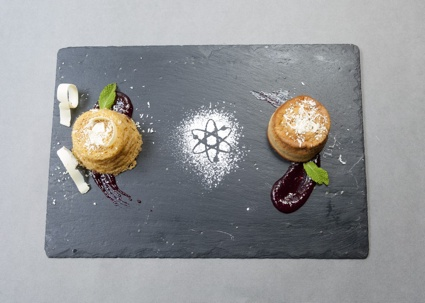
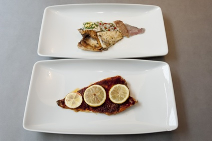
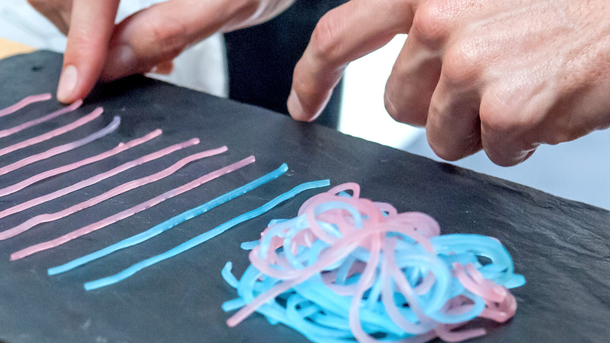

+++
author = "矢崎裕一"
title = "その土地のデータを、その土地の料理で食べる──Moritz Stefaner と Susanne Jaschko の Data Cuisine"
slug = "data-cuisine"
date = "2026-11-06"
description = "Data Cuisine は、その土地のオープンデータをその土地の料理で表すワークショップです。2012年のヘルシンキから各地で開かれ、データを砂糖の量、料理の大きさ、食材の組み合わせに写しました。"
categories = [
    "consume"
]
tags = [
    "データ物質化",
    "味覚"
]
image = "images/pink-blue-noodles.jpg"
series = ["data-physicalization"]
series_weight = 99
seriesByline = "Moritz Stefaner・Susanne Jaschko"
seriesTitle = "その土地のデータを、その土地の料理で──Data Cuisine"
+++

Data Cuisine（データ・キュイジーヌ）は、その土地のオープンデータを、その土地の料理で表すワークショップです。2012年9月のヘルシンキが最初で、2014年のバルセロナを経て、各地で開かれました。料理では、データを砂糖の量、料理の大きさ、食材の組み合わせに写しました。スペインの科学予算の削減は、砂糖を34%減らしたケーキになりました。若者の移住先は、その国を連想させる魚料理を、順位に合わせた大きさで盛った皿になりました。

企画したのは、可視化デザイナーの Moritz Stefaner（モーリッツ・ステファナー）と、ベルリンのキュレーター Susanne Jaschko（ズザンネ・ヤシュコ）です。以下は、主催者の告知ページ、二人へのインタビュー（We Make Money Not Art、2014年）、WIRED・Core77・Engadget の報道に沿います。公式サイト data-cuisine.net は筆者の環境から開けず、料理ごとの公式解説は読めていません。料理の中身は、インタビューと報道で確かめた範囲に限って書きます。

<!--more-->

## 2012年、ヘルシンキのオープンデータ料理

第1回の名前は「The Art of Data Cuisine: The Open Data Cooking Workshop」でした。2012年9月15〜16日、ヘルシンキの Pixelache が制作し、Jaschko の prozessagenten が主催しました。同じ月に開かれた Open Knowledge Festival に合わせた催しです。Pixelache の告知文は、こう問いかけます。

> "Have you ever tried to imagine how a fish soup tastes whose recipe is based on publicly available local fishing data? Or what a pizza would be like if it was based on Helsinki's population mix?"

その土地の漁獲データで作った魚のスープや、ヘルシンキの人口構成で作ったピザはどんな味か、という問いです。2016年の Information is Beautiful Awards の作品説明は、「local open data in local food」を、色・形・食感・匂い・味・栄養・産地などの性質で表す、と決まりを書いています。

ヘルシンキでは2日目の夕方に公開試食会があり、シェフは Antti Nurkka でした。第2回は2014年6月のバルセロナで、CCCB（バルセロナ現代文化センター）と Sónar+D の共同制作です。前半2日で題材とデータを調べ、後半はプロの厨房でシェフと料理を作りました。

開催地の数は、時点によって違います。

| 資料 | 時点 | 開催地 |
|---|---|---|
| WIRED、Core77、We Make Money Not Art | 2014年 | ヘルシンキとバルセロナの2回 |
| Information is Beautiful Awards の作品説明 | 2016年 | 「Helsinki, Barcelona, Leeuwarden, Basel, Berlin, Gembloux, Belgium and Boston」 |

2016年の一覧のうち、ヘルシンキとバルセロナ以外の回の年と料理は確かめられませんでした。Data Cuisine は同じ年、Information is Beautiful Awards の Dataviz Project 部門で Gold を受けています。Stefaner は eyeo 2016 でこの企画を講演しました（[動画](https://vimeo.com/178369024)）。

## 砂糖の量と、料理の大きさで数を表す

バルセロナの Requiem for Science は、Antonija Kuzmanic の料理です。スペインの科学予算の削減を、2つのケーキで表しました。

Data Cuisine／[We Make Money Not Art](https://we-make-money-not-art.com/?p=7303) より引用

2つのケーキの何を比べたかは、報道で書き方が違います。

| 資料 | 比べたもの |
|---|---|
| WIRED（2014-07-24） | 普通のレシピのケーキと、砂糖を34%減らしたケーキ。34%は、スペインの科学予算の今年の削減幅 |
| Engadget（2014-07-24） | 2013年の予算のケーキは、2005年の予算のケーキより砂糖が34%少ない |

どちらも、削減の割合を砂糖の量に写しています。

Emigration Fish は、Samuel Boucher と Jahn Schlosser の料理です。題材は、スペインの若者が多く移住した国でした。WIRED によると、国ごとに魚の料理法を変え、順位に合わせて大きさを決めました。

Data Cuisine／[We Make Money Not Art](https://we-make-money-not-art.com/?p=7303) より引用

フランスはワインソース、ドイツはパセリとビール、イギリスは衣揚げ、エクアドルはセビーチェ、アメリカはベーコンの脂で揚げた魚です。WIRED は上位6か国と書きますが、挙げた料理は5つです。

First Date Noodles は、初めてのデートでセックスをするかが題材です。Core77 によると、Facebook の知り合いへの非公式のアンケートで、女性59%、男性86%が「する」と答えました。ピンクと青の麺が性別を表し、絡まった塊が「する」人、外に出た麺が「しない」人です。

Moritz Stefaner／[Truth & Beauty](https://truth-and-beauty.net/projects/data-cuisine) より引用

Stefaner のページはこの写真に料理名を添えていませんが、Core77 が書く First Date Noodles と同じ形だと読めます。確かめられた対応をまとめます。

| 料理 | データ | 食べ物での表し方 | 出典 |
|---|---|---|---|
| Requiem for Science | 科学予算の削減率 | 2つのケーキの砂糖の量の差（34%） | WIRED、Engadget |
| Emigration Fish | 若者の移住先の国 | その国を連想させる魚の調理法 | WIRED |
| Emigration Fish | 移住先の順位 | 魚料理の大きさ | WIRED |
| First Date Noodles | 性別 | 麺の色（ピンクと青） | Core77 |
| First Date Noodles | 「する」と「しない」の割合 | 絡まった塊の麺と、外に出た麺 | Core77 |
| Sugarsm | アンケートで挙がった方法と、その割合 | 砂糖の塊ひとつずつと、その量 | WIRED のキャプション |
| Kippis! | フィンランドの地域ごとの飲酒量 | フィンランドの地図の形 | Core77 |
| 飲酒量の地図（ヘルシンキ、料理名の記載なし） | 国内の飲酒量 | 量を変えたワインと、地域の料理 | Engadget |
| 名前未確認（ヘルシンキ） | 犯罪の種類 | 積み重ねた別々の種類の魚 | Engadget |

量は砂糖や麺の量に、種類は調理法や色に、順位は大きさに写しています。紙の図の長さ・色・面積に当たるものを、食べ物の中で探したと読めます。

## まずさと、料理の連想も符号になる

味の悪さを、わざと使った料理もあります。Jaschko は We Make Money Not Art で、こう答えています。

> "Creating a dish that tastes terrible is sometimes the best way to communicate a negative development or a problematic situation."

まずい料理が、悪い変化や問題を伝えるいちばんの方法になることがある、という話です。例は、フィンランドの飲酒量と自殺率を扱った Suicide Cocktail と、若者の失業の急増を表す Unemployed Pan con Tomate! です。どの食材をどう変えたかは、読めた資料にはありませんでした。Stefaner も、塩で騒音を表した料理を、おいしくなくてよい例に挙げます。Core77 によると、バルセロナの通りの1日の騒音を扱った Take it with a Pinch of Salt! です。

Stefaner は WIRED に、食べ物で使えるものを並べています。立体の形、甘・酸・塩・苦・うま味と辛さ、食感、食材と料理の文化的な連想、調理の条件、出すときの温度、盛り付けです。Emigration Fish の国ごとの調理法は、このうち「cultural connotations」に当たると読めます。

料理の作り方について、Jaschko はこう話しています。

> "In most cases, a 'data' dish is created by either remixing, altering or re-interpreting existing recipes."

多くの場合、データの料理は既存のレシピを混ぜ、変え、解釈し直して作る、という説明です。シェフは別の手法や食材を試すよう促し、盛り付けにも加わります。**データの対応を、まったく新しい料理ではなく、知られたレシピからのずれとして作っている**と読めます。

## 「2倍の甘さ」は見分けにくい、と作者は言う

味でどこまで正確に伝えられるかについて、Stefaner は We Make Money Not Art で、こう答えています。

> "It is simply much harder to determine what is "twice as sweet" as opposed to as twice as long line in a graphic. Then again, taste is a much more emotional and temporally complex experience that just looking at a dot on a screen. So, the mechanisms to encode information might be more fuzzy, but potentially much deeper."

2倍の長さの線に比べて、「2倍の甘さ」を見分けるのはずっと難しい。一方で味は、画面の点より感情的で、時間の中で変わる経験だ。符号はあいまいでも、深く届くかもしれない、という話です。同じ答えで、データを正確に読めるかは第一の関心ではない、とも言っています。

Jaschko は、目で見る図を食べ物で作るだけなら比較的やさしく、目指すのは見た目と味の両方で伝わる料理だと言います。ただ、可能性が多すぎて、参加者の多くは単純なものに落ち着くとも話しています。

Stefaner は、可視化の側から見て面白かったことを、こう話しています。

> "From a data visualization point of view, I found it really interesting to watch how deeply people meditate on very simple data points, when they think about turning them into food experiences. In a way, this is a very needed counterpoint to the current trend of consuming lots of data in a very quick and superficial way."

料理にしようとすると、人はとても単純なデータの点をじっくり考える。データを速く浅く消費する流れへの、必要な対抗になる、という話です。Requiem for Science が扱った数字は、34%の一つでした。正確に読ませるより、一つの数字を考え続ける時間を作ることに重心があったと読めます。

土地による違いについて、Jaschko は、ヘルシンキでは移民や旅行中の参加者が多く、地元の料理は少なめだったと話しています。「その土地の料理で」という決まりは、参加者によって守られ方が変わったと読めます。

## 第三者はこのワークショップをどう見たか

評価は、それぞれ別の点に向いています。一つ目は、量が味として届くという見方です。WIRED の Kyle Vanhemert は、科学予算のケーキをこう書きました。

> "the dish turned an abstract budget cut into something much more palpable—the drop in funding literally left a bad taste in your mouth."

抽象的な予算の削減が、手触りのあるものになった、という評価です。ただし同じ記事は、アメリカをベーコンの脂で揚げた魚にした点を「Ha, ha, Euros. We get it. Americans are fat.」と皮肉っています。文化的な連想を符号にすると、固定観念もそのまま皿に載る、という指摘と読めます。

二つ目は、精密さの欠如です。Core77 は、地域の味の「geotagging」で、食べる人がデータの点の違いを味わえると書きました。そのうえで、Data Cuisine は「not entirely precise way to present information」だとしています。

三つ目は、五感を使う符号としての位置づけです。Visualising Data の Andy Kirk は2014年、バルセロナの回を「a truly multi-sensory approach to encoding data」と紹介しました。2016年には CHI の拡張抄録に、Yun Wang らの「Data Edibilization: Representing Data with Food」も出ていますが、本文は読めていません。

## 使い道

可視化の仕事に持ち帰れる判断は、四つあります。

一つ目は、正確さを求めない場面を見分けることです。Stefaner は「2倍の甘さ」を見分けるのは難しいと認め、読みやすさは第一の関心ではないと言いました。比べる精度を求める図と、一つの数字を考えさせる図は、別の設計になると読めます。

二つ目は、数字を絞ることです。Requiem for Science は34%、First Date Noodles は59%と86%でした。扱う数字が少ないほど、受け手が考える時間が生まれると読めます。

三つ目は、量と種類で使う性質を分けることです。量は砂糖や麺の量、種類は調理法や色、順位は大きさでした。素材が食べ物に変わっても、紙の図と同じ考え方が使えると読めます。

四つ目は、文化的な連想の代償です。国を料理法で表せば、WIRED が皮肉ったように固定観念も符号に入ります。連想を使うときは、それが運ぶ見方まで決める必要があると読めます。

同じ Stefaner の物を使った作品に [Perpetual Plastic](/perpetual-plastic/) があります。音に任せた例は [Chemo Singing Bowl](/chemo-singing-bowl/) です。

## 参考・出典

**一次情報**

- Moritz Stefaner, “Data Cuisine,” Truth & Beauty（プロジェクトページ）. [ページ](https://truth-and-beauty.net/projects/data-cuisine) / [Markdown 版](https://truth-and-beauty.net/projects/data-cuisine.md)
- Pixelache, “The Art of Data Cuisine: The Open Data Cooking Workshop,” 2012-09-15〜16. [告知ページ](https://www.pixelache.ac/pages/open-data-cooking-workshop)
- CCCB, “Sonar+D: Data Cuisine Workshop with Moritz Stefaner and Susanne Jaschko,” 2014-06-10〜13. [告知ページ](https://www.cccb.org/en/w/activities/sonard-data-cuisine-workshop-with-moritz-stefaner-and-susanne-jaschko)
- Information is Beautiful Awards, “Data Cuisine”（作品説明、開催地の一覧）. [作品ページ](https://www.informationisbeautifulawards.com/showcase/1681-data-cuisine)
- Truth & Beauty, Information is Beautiful Awards 2016. [ページ](https://truth-and-beauty.net/appearances/awards/information-is-beautiful-awards-2016)
- Truth & Beauty, eyeo 2016 での講演（2016-06-10）. [ページ](https://truth-and-beauty.net/appearances/talks/eyeo-2016) / [動画（Vimeo）](https://vimeo.com/178369024)
- Truth & Beauty, 1 2 3 data（Fondation EDF、パリ、2018）. [ページ](https://truth-and-beauty.net/appearances/exhibitions/123-data)
- Truth & Beauty, Data Cuisine exhibited in Zürich（Museum für Gestaltung Zürich、2019）. [ページ](https://truth-and-beauty.net/appearances/exhibitions/data-cuisine-zurich)
- Régine Debatty, “Data Cuisine, food as data expression,” *We Make Money Not Art*, 2014-07-02（Stefaner と Jaschko へのインタビュー）. [記事](https://we-make-money-not-art.com/?p=7303)
- Data Cuisine 公式サイト（筆者の環境から開けず、本文未確認）. [data-cuisine.net](http://data-cuisine.net/)

**第三者評価**

- Kyle Vanhemert, “These Weird Meals Are Actually Clever Data Visualizations,” *WIRED*, 2014-07-24. [記事](https://www.wired.com/2014/07/data-cuisine/)
- “Data Cuisine Lets You Have Your Data and Eat It, Too,” *Core77*, 2014-06-30. [記事](https://www.core77.com/posts/27214/Data-Cuisine-Lets-You-Have-Your-Data-and-Eat-It-Too)
- Sarah Silbert, “Data Cuisine creates meals based on cultural statistics,” *Engadget*, 2014-07-24. [記事](https://www.engadget.com/2014-07-24-data-cuisine.html)
- Andy Kirk, “Tasty visualisations from the Barcelona Data Cuisine,” *Visualising Data*, 2014-06-19. [記事](https://visualisingdata.com/?p=9077)
- Yun Wang, Xiaojuan Ma, Qiong Luo, Huamin Qu, “Data Edibilization: Representing Data with Food,” *CHI EA 2016*（本文未確認）. [doi:10.1145/2851581.2892570](https://doi.org/10.1145/2851581.2892570)
