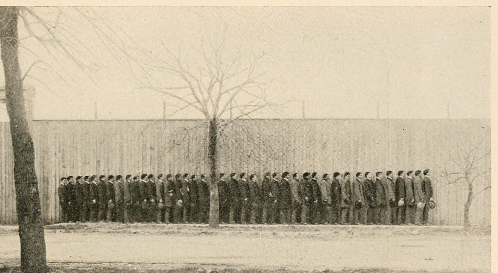
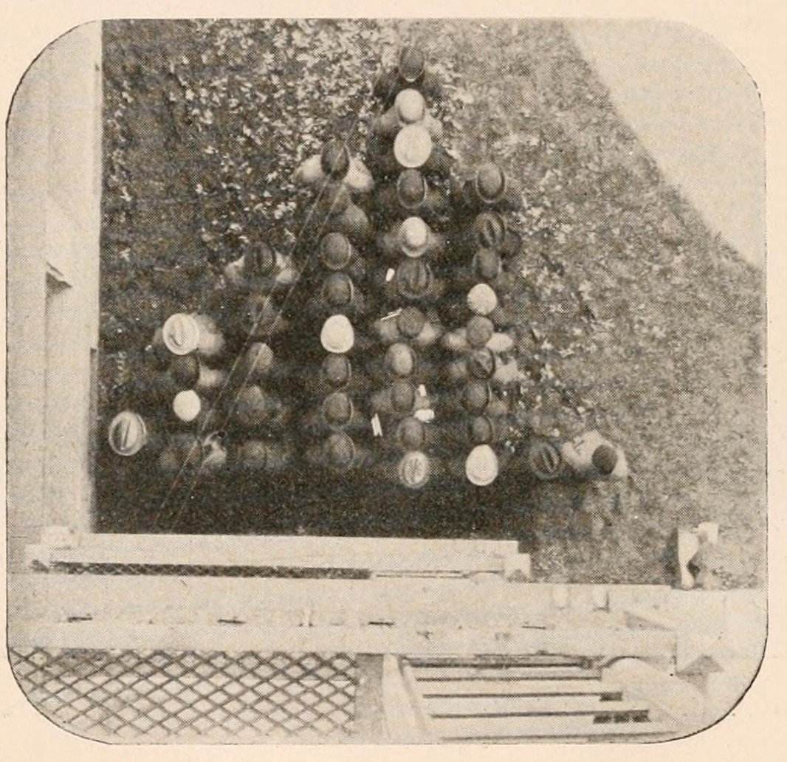
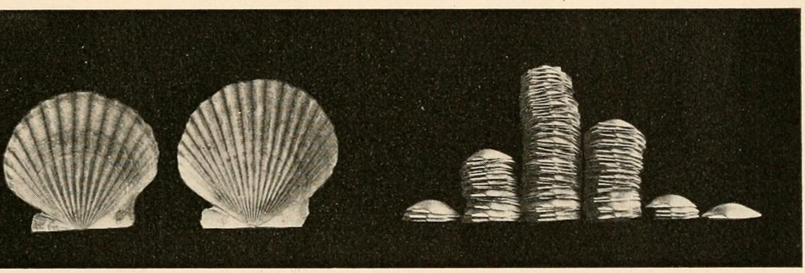

+++
author = "Yuichi Yazaki"
title = "Rearranging the Same 40 People into a Different Graph: Davenport's \"Frequency Polygon Without Paper\""
slug = "davenport-physical-distributions"
date = "2026-11-01"
description = "Line the same students up by height and the tops of their heads trace rank against value; line them up in columns of two-inch classes and each column's length becomes a frequency. The arrangement decides which graph you get."
categories = [
    "consume"
]
tags = [
    "data physicalization",
    "frequency distribution",
    "Charles Davenport"
]
image = "images/students-file-by-height.jpg"
+++

Line the same students up by height, and the tops of their heads trace a sequence of rank and value. Line them up in columns of two-inch classes, and the length of each column becomes a frequency. In 1901 the biologist Charles Benedict Davenport published a paper with photographs of 40 University of Chicago students arranged in these two ways. The data and the people are the same; only the arrangement changes the graph.

The source is Davenport's paper "The Statistical Study of Evolution" (pp.447–460), published in the general-interest science magazine *Popular Science Monthly*, Vol.59 (September 1901). It is also listed as "Davenport's Physical Distributions" on dataphys.org, a catalog of data physicalization examples. What follows is based on the Wikisource transcription and the page scans at the Internet Archive.

<!--more-->

## 1901: An Introduction to Counting Evolution

The paper is signed "Professor C. B. DAVENPORT, UNIVERSITY OF CHICAGO." Its subject is an introduction to the statistical study of evolution. It explains the mean, median, mode, frequency polygon, standard deviation, coefficient of variation, and correlation to general readers, one after another.

It opens with a declaration that science is becoming quantitative.

> As science advances its methods become more and more quantitative.

In short: the more science advances, the more quantitative its methods become. Davenport also writes that individual differences among people cannot be captured in adjectives, so they are measured and expressed in numbers.

The photographs of people and shells appear in the first half of the paper. They are examples explaining how to make a "frequency polygon." There are two photographs of students and two of shells. The photographer, date, and place are not stated in the magazine.

The ending of the paper also deserves a mention. In the last paragraph, Davenport writes that rapid and thorough improvement of the human race can be achieved only through understanding and applying these methods. He also laments, using the word "appalling," that people are ignorant of the comparison between race mixture and pure breeding. Davenport was a eugenicist who went on to found the Eugenics Record Office in 1910. The photographs of students lined up by height appear in a paper that closes with such claims. This article reads only the "arrangement" part of the photographs.

## One Line by Height: The Curve Traced by the Tops of Heads

The caption of Fig. 1 reads "File of Forty University of Chicago Students arranged (approximately) in order of Height." Forty students stand in a single line, roughly in order of height.

Source: C. B. Davenport (photographer unknown), Popular Science Monthly 59 (1901), p.449, from the Internet Archive (public domain)

In the text, Davenport describes how to read this line.

> Imagine a file of 40 men arranged in order of stature—the tallest at the head of the column. The crown of their heads will form a flowing curve, nearly level in the middle of its course and becoming more oblique at the ends. The reason for this is that the middle statures are much more common than the extreme ones.

If 40 people are arranged by height, the line of their crowns forms a smooth curve, nearly level in the middle and steeper at both ends. The reason is that middling heights are far more common than extreme ones. He continues: "Half the people have a stature within two inches of the average." That is, half of the people fall within two inches of the mean.

In this arrangement, one person is one unit. The height is the person's actual physical height. The horizontal position is the rank in height. The line connecting the tops of the heads becomes a curve of rank against value. In today's terms, this can be read as close to a quantile plot, or a bar chart sorted by value.

In this arrangement the distribution is not directly visible; what we see is the slope. It can be read that the gentler the slope in a stretch, the more people of similar height there are. Each person's value is preserved, but "how many people there are" can only be inferred from the slope.

## One Column per Class: Photographed from Directly Above

In the next paragraph, Davenport explains how to make a frequency polygon on paper.

> The frequency polygon is got first by sorting out the data into a number of equally extensive 'classes'; then by laying off these classes as a series of points at equal intervals of space along a horizontal base-line; by erecting perpendiculars proportional to the frequency of each class, and by joining with a line the tops of all these perpendiculars.

The steps are: divide the data into classes of equal width; place the classes at equal intervals along a horizontal baseline; erect perpendiculars proportional to the frequency of each class; and join the tops of the perpendiculars with a line. Right after that comes the sentence at the heart of this article.

> Such frequency polygons may also be obtained, without drawing on paper, by putting the individuals belonging to the same class in the same vertical column and arranging the columns in order along a common base-line.

The claim is that a frequency polygon can be made **without drawing on paper**: put individuals of the same class in the same column, and arrange the columns in order along a common baseline.

The students' classes are eight: 56–57.9, 58–59.9, 60–61.9, 62–63.9, 64–65.9, 66–67.9, 68–69.9, and 70–71.9 inches. This divides roughly 142 to 183 cm in steps of about 5 cm. Students of the same class form one line, and the lines are arranged in order from the baseline. Fig. 2 is that arrangement taken as a "bird's-eye view," that is, photographed from directly above.

Source: C. B. Davenport (photographer unknown), Popular Science Monthly 59 (1901), p.450, from the Internet Archive (public domain)

Even with the same 40 people as in Fig. 1, the way height is expressed has changed. Height is shown not by how tall the person is, but by which column the person stands in. The length of a column is the number of people. Because the photograph is taken from above, each person's physical height does not appear. In exchange for giving up individual values, frequencies become visible as lengths, as can be read.

The number of students in each class is not given in the body text of the magazine. In the reading by Brinton, who reprinted the photographs in 1914, the lowest class has one person, and each of the two highest classes also has one. The class with the most people is the 64–65.9 inch column.

This format can be read as a good match for the mode, which Davenport valued. He wrote that the mean is "over-rated and over-used," and described the mode as follows.

> it is not the result of calculation and is not an ideal value merely, but is the prevailing or typical actual condition.

The claim is that the mode is neither the result of a calculation nor an ideal value, but the actual condition that prevails most. In the columns by class, that condition can be read as appearing, without any calculation, as the longest column.

## Piles of Shells and Three Arrangements

Davenport shows the same construction with shells. In Atlantic coast scallops (Pecten), the number of ribs on the shell differs from individual to individual. According to the text, among 100 individuals from one locality, the number of ribs varies from 15 to 21.

> If we put in one pile the shells having the same number of ribs and arrange the piles in order, from 15 to 20, upon a level base we shall get a figure which is the frequency polygon for the ribs of Pecten shells from the given locality (Fig. 4).

Put shells with the same number of ribs in one pile, and arrange the piles in order from 15 to 20 on a level base. The result is the frequency polygon of the ribs of scallops from that locality.

Source: C. B. Davenport (photographer unknown), Popular Science Monthly 59 (1901), p.451, from the Internet Archive (public domain)

The two shells on the left are Fig. 3, with 15 and 20 ribs. They correspond to the two ends (15 and 20 ribs) of the piles arranged in Fig. 4. The right side is Fig. 4, which Davenport named "Self-formed Frequency Polygon of Pecten Ribs." According to Brinton, the leftmost pile (15 ribs) has three shells, the rightmost pile (20 ribs) has one, and the pile of 17 ribs is the tallest.

The table below sets out how data corresponds to appearance in the three arrangements.

| Arrangement | One unit | Horizontal position | Length / height | What is visible |
|---|---|---|---|---|
| Fig. 1: one line by height | One student | Rank in height | The height itself (the person's actual stature) | Each individual's value, and a curve of rank against value |
| Fig. 2: columns by class (bird's-eye view) | One student | Height class (2-inch width, 8 classes) | Column length = number of people in the class | Frequency polygon. The mode is the longest column |
| Fig. 4: piles of shells | One shell | Number of ribs (15–20, 6 divisions) | Pile height = number of shells with that rib count | Frequency polygon. The mode is the tallest pile |

Fig. 1 and Fig. 2 use the same 40 students as material. What differs is what is assigned to the horizontal position, and what is not photographed. Fig. 2 and Fig. 4 have different materials but form the same type of figure.

Davenport's own term is "frequency polygon," and the word "histogram" does not appear in the magazine. Calling it a "unit chart" can also be read as a later reclassification.

## How Third Parties Viewed These Photographs

Assessments divide by point of interest across visualization research, practical guides to charts, and statistics education.

Pierre Dragicevic, who registered this entry on dataphys.org, summarizes its purpose as "to explain the notion of statistical distribution to a lay audience." He then writes the following.

> His examples also show that spatial arrangement is a key feature of data visualizations, and that a good spatial arrangement can augment cognition even without the use of abstract mappings and encodings.

The assessment is that a good spatial arrangement can aid cognition even without abstract mappings or encodings. On eugenics, he mentions only briefly that it "may be controversial," and says the educational value of the explanation is clear.

Willard C. Brinton reprinted the piles of shells and the line of students in Chapter 10 of his 1914 chart textbook *Graphic Methods for Presenting Facts*. At the start of the chapter, Brinton writes that engineers had hardly used the frequency curves that biologists use. Davenport's photographs were what he chose as the introduction. At the same time, he points out the following.

> Though it is unfortunate that no horizontal scale or vertical scale is shown in the picture, the reader will nevertheless be able to see from this illustration the general scheme on which frequency curves are based.

The assessment is that it is a pity there is no scale on either axis, but the idea behind frequency curves still comes across. For the students' photograph, he even reads off an asymmetry: there are more people below the mode than above it.

The paper "Is Human Height Bimodal?" (2002) by Schilling, Watkins, and Watkins says that a "living histogram" of height has become a standard classroom demonstration. The oldest example they found was a 1914 photograph of 175 male students at Connecticut Agricultural College lined up. The paper does not mention Davenport, but the 1901 photographs can be read as an example 13 years earlier. The same paper warns that even when a histogram appears to have two peaks, one cannot say the underlying distribution is bimodal unless the sample is very large. It can be read that the unevenness in a line of 40 should likewise not be over-interpreted.

## Takeaways

What these photographs leave for visualization work is this: deciding the arrangement is deciding the type of graph. From the same 40 people, Fig. 1 and Fig. 2 made a chart of rank and value and a chart of frequency.

The same holds for on-screen charts. A bar chart sorted by value keeps each individual value and shows the distribution only through its slope. A histogram that counts by class discards individual values and shows frequency as length. Which to show depends on whether you want to answer the reader's question "who has how much" or "how many are at what level."

A format in which one individual is one unit shows the mode without counting. It is a form suited to the first picture in an explanation.

Brinton's point also applies. Even with physical objects lined up, without a scale you cannot read the number of people or the classes. In both physical arrangements and on-screen charts, the axes and the definitions of classes need to be shown separately.

When you line up participants in a class or workshop, making both a single line and columns by class lets them experience the same people becoming different graphs. However, in a small group, unevenness in the lines can arise by chance alone.

## References

**Primary sources**

- Davenport, C. B. "The Statistical Study of Evolution." *Popular Science Monthly*, Vol.59, Sept. 1901, pp.447–460.
  - Wikisource (transcription): https://en.wikisource.org/wiki/Popular_Science_Monthly/Volume_59/September_1901/The_Statistical_Study_of_Evolution
  - Pages with figures (Fig. 1–4): https://en.wikisource.org/wiki/Page:Popular_Science_Monthly_Volume_59.djvu/459 , /460 , /461
  - Page scans (Internet Archive): https://archive.org/details/popularsciencemo59newy
- Davenport, C. B. *Statistical Methods, with Special Reference to Biological Variation*, 2nd ed., 1904: https://archive.org/details/statisticalmetho00daverich
- Wikimedia Commons file pages (figure metadata and licenses)
  - Fig. 1: https://commons.wikimedia.org/wiki/File:PSM_V59_D459_U_of_chicago_students_in_order_of_height.png
  - Fig. 2: https://commons.wikimedia.org/wiki/File:PSM_V59_D460_U_of_chicago_students_grouped_by_stature.png
  - Fig. 3 and 4: https://commons.wikimedia.org/wiki/File:PSM_V59_D461_Evolutionary_shapes_of_scallop_ribs_and_pecten_shapes.png
- dataphys.org "Davenport's Physical Distributions": https://dataphys.org/list/davenports-physical-distributions/

**Secondary sources**

- Pierre Dragicevic, "Davenport's Physical Distributions," dataphys.org: https://dataphys.org/list/davenports-physical-distributions/
- Willard C. Brinton, *Graphic Methods for Presenting Facts*, Engineering Magazine Co., 1914, pp.164–165 (Fig. 140, 141): https://archive.org/details/graphicmethodsfo00brinrich
- Schilling, M. F., Watkins, A. E., & Watkins, W., "Is Human Height Bimodal?" *The American Statistician* 56(3), 2002, pp.223–229: https://www.jstor.org/stable/3087302 (PDF: https://staff.washington.edu/tamre/IsHumanHeightBimodal.pdf )
- Wikipedia "Charles Davenport" (biography and eugenics activities): https://en.wikipedia.org/wiki/Charles_Davenport
