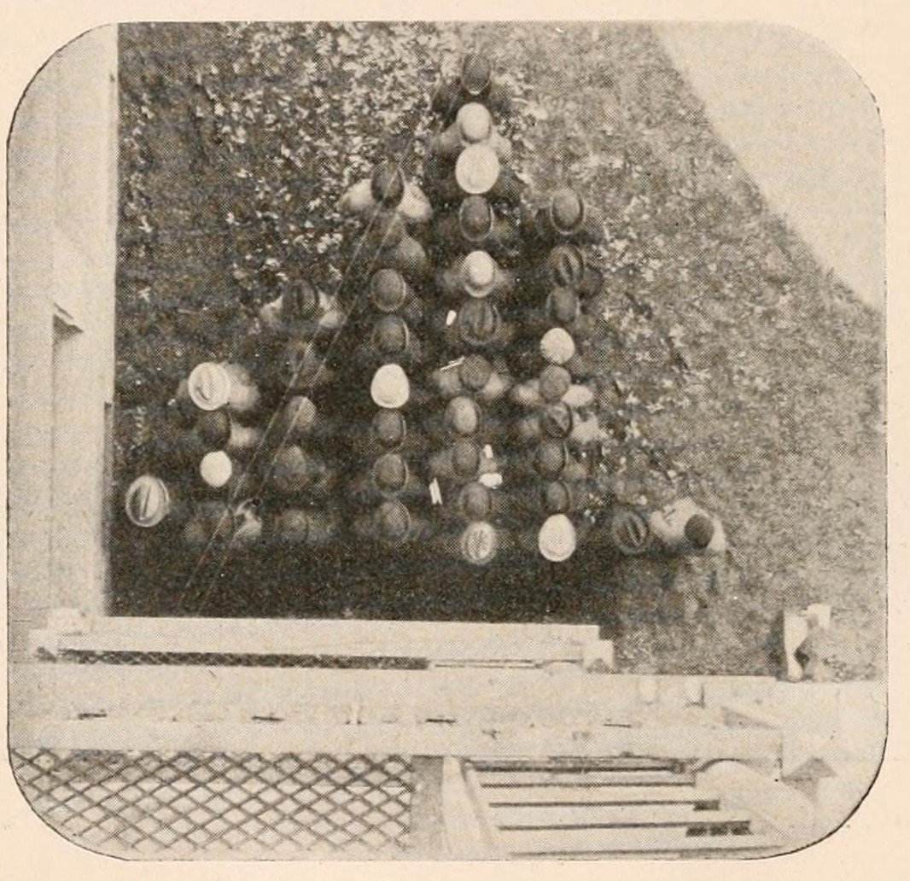
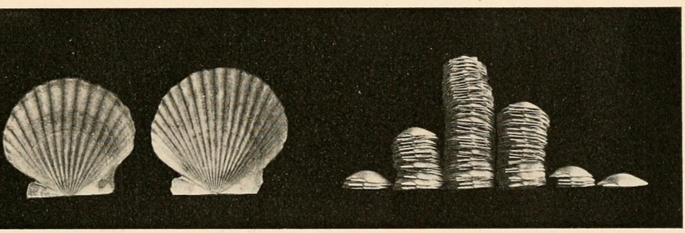

+++
author = "矢崎裕一"
title = "同じ40人を、並べ替えて別のグラフにする──Davenport の「紙を使わない度数多角形」"
slug = "davenport-physical-distributions"
date = "2026-11-01"
description = "同じ学生でも、身長順の一列に並べれば順位と値の並びに、2インチごとの階級の列に並べれば列の長さが度数になります。並べ方で別のグラフになります。"
categories = [
    "consume"
]
tags = [
    "データ物質化",
    "度数分布",
    "Charles Davenport"
]
image = "images/students-file-by-height.jpg"
series = ["data-physicalization"]
series_weight = 3
seriesByline = "Charles B. Davenport"
seriesTitle = "並べ替えて別のグラフにする──紙を使わない度数多角形"
+++

同じ学生でも、身長順の一列に並べれば、頭の高さの線が順位と値の並びになります。2インチごとの階級の列に並べれば、列の長さが度数になります。1901年、生物学者の Charles Benedict Davenport（チャールズ・B・ダヴェンポート）は論文に、シカゴ大学の学生40人をこの2通りに並べた写真を載せました。データも人も同じで、並べ方だけで別のグラフになります。

出典は、Davenport が一般向けの科学雑誌『Popular Science Monthly』第59巻（1901年9月号）に書いた論文 "The Statistical Study of Evolution"（pp.447–460）です。データ物理化の事例集 dataphys.org にも「Davenport's Physical Distributions」として載っています。以下は、Wikisource の翻刻と Internet Archive の誌面スキャンに沿います。

<!--more-->

## 1901年、進化を数えるための入門記事

論文の署名は「Professor C. B. DAVENPORT, UNIVERSITY OF CHICAGO」です。主題は、進化を統計で研究する方法の紹介でした。平均、中央値、最頻値、度数多角形、標準偏差、変異係数、相関を、順に一般の読者へ説明しています。

書き出しは、科学は量的になるという宣言です。

> As science advances its methods become more and more quantitative.

科学が進むほど、方法は量的になる、という主張です。人の個体差は形容詞では言い表せないので、測って数で表す、とも書いています。

人と貝殻を並べた写真は、論文の前半に出てきます。「度数多角形（frequency polygon）」のつくり方を説明する例です。写真は学生が2点、貝殻が2点です。撮影者、撮影日、撮影場所は誌面に書かれていません。

論文の結びにも触れておきます。最後の段落で Davenport は、人類の急速で徹底した改良は、これらの方法を理解し適用することでしか成し遂げられないだろう、と書きます。人種の混交と純粋な交配の比較を知らないことを「appalling」と嘆いてもいます。Davenport はのちの1910年に Eugenics Record Office を設立する優生学者です。学生の身長を並べた写真は、そうした主張で締めくくられる論文の中に載っています。この記事では、写真のうち「並べ方」の部分だけを読みます。

## 身長順の一列──頭頂が描く曲線

Fig.1 のキャプションは「File of Forty University of Chicago Students arranged (approximately) in order of Height」です。40人の学生が、おおよそ身長の順に一列に並んでいます。

C. B. Davenport（撮影者不明）, Popular Science Monthly 59 (1901), p.449／Internet Archive より引用（パブリックドメイン）

Davenport は本文で、この列の読み方を書いています。

> Imagine a file of 40 men arranged in order of stature—the tallest at the head of the column. The crown of their heads will form a flowing curve, nearly level in the middle of its course and becoming more oblique at the ends. The reason for this is that the middle statures are much more common than the extreme ones.

40人を背の順に並べると、頭頂の線はなめらかな曲線になる。真ん中はほぼ水平で、両端で傾きが急になる。中くらいの身長が、極端な身長よりずっと多いからだ、という説明です。続けて「Half the people have a stature within two inches of the average」とも書きます。半数の人は、平均から2インチ以内に収まります。

この配置では、1人が1単位です。身長は、その人の実際の背の高さそのものです。横の位置は、身長の順位です。頭頂を結んだ線は、順位と値の曲線になります。今の言葉でいえば、分位点プロットや、値で並べ替えた棒グラフに近いと読めます。

この配置では、分布は直接には見えず、見えているのは傾きだと読めます。傾きが緩い区間ほど似た身長の人が多い、という読み方です。一人ひとりの値は残る一方、「何人いるか」は傾きから推し量るしかない配置と読めます。

## 階級ごとの列──真上から撮る

次の段落で、Davenport は紙の上での度数多角形のつくり方を説明します。

> The frequency polygon is got first by sorting out the data into a number of equally extensive 'classes'; then by laying off these classes as a series of points at equal intervals of space along a horizontal base-line; by erecting perpendiculars proportional to the frequency of each class, and by joining with a line the tops of all these perpendiculars.

データを等しい幅の階級に分ける。階級を横の基線に等間隔で置く。各階級の度数に比例した垂線を立てる。垂線の先端を線で結ぶ。これが手順です。そのすぐ後に、この記事の中心になる一文が来ます。

> Such frequency polygons may also be obtained, without drawing on paper, by putting the individuals belonging to the same class in the same vertical column and arranging the columns in order along a common base-line.

度数多角形は**紙に描かずにもつくれる**。同じ階級の個体を同じ列に入れ、列を共通の基線に沿って順に並べればよい、という主張です。

学生の階級は、56–57.9、58–59.9、60–61.9、62–63.9、64–65.9、66–67.9、68–69.9、70–71.9 インチの8つです。約142〜183cm を、約5cm 刻みに分けています。同じ階級の学生を一列にし、列を基線から順に並べる。それを「bird's-eye view」、つまり真上から撮ったのが Fig.2 です。

C. B. Davenport（撮影者不明）, Popular Science Monthly 59 (1901), p.450／Internet Archive より引用（パブリックドメイン）

Fig.1 と同じ40人でも、ここでは身長の表し方が変わっています。身長は、その人の背の高さではなく、どの列に立っているかで表されます。列の長さは人数です。真上から撮るので、一人ひとりの背の高さは写りません。個人の値を捨てるかわりに、度数が長さとして見えるようになった、と読めます。

階級ごとの人数は、誌面の本文には書かれていません。1914年に写真を転載した Brinton の読み取りでは、最も低い階級は1人、最も高い2階級もそれぞれ1人です。最も人数が多いのは 64–65.9 インチの列でした。

この形式は、Davenport が重んじた最頻値（mode）と相性がよいと読めます。彼は平均を「over-rated and over-used」と書き、最頻値をこう評しています。

> it is not the result of calculation and is not an ideal value merely, but is the prevailing or typical actual condition.

最頻値は計算の結果でも理想の値でもなく、実際にいちばん多い状態だ、という主張です。階級ごとの列では、その状態がいちばん長い列として、計算なしに目に入ると読めます。

## 貝殻の山と、3つの並べ方

Davenport は、同じつくり方を貝殻でも示します。大西洋岸のホタテ（Pecten）は、殻の放射肋（ribs）の数が個体ごとに違います。本文によれば、一つの産地の100個体で、肋の数は15本から21本まで変わります。

> If we put in one pile the shells having the same number of ribs and arrange the piles in order, from 15 to 20, upon a level base we shall get a figure which is the frequency polygon for the ribs of Pecten shells from the given locality (Fig. 4).

同じ肋の数の殻を一つの山にし、15本から20本まで水平な台の上に順に並べる。そうすれば、その産地のホタテの肋の度数多角形になる、という説明です。

C. B. Davenport（撮影者不明）, Popular Science Monthly 59 (1901), p.451／Internet Archive より引用（パブリックドメイン）

左の2枚が Fig.3 で、15本と20本の殻です。Fig.4 で並べた山の両端（15本と20本）にあたります。右が Fig.4 で、Davenport はこれを「Self-formed Frequency Polygon of Pecten Ribs」と名づけました。Brinton によれば、左端の15本の山は3枚、右端の20本の山は1枚で、17本の山が最も高くなっています。

3つの配置の、データと見た目の対応を表にします。

| 配置 | 1単位 | 横の位置 | 長さ・高さ | 見えるもの |
|---|---|---|---|---|
| Fig.1 身長順の一列 | 学生1人 | 身長の順位 | 身長そのもの（実物の背の高さ） | 一人ひとりの値と、順位と値の曲線 |
| Fig.2 階級ごとの列（俯瞰） | 学生1人 | 身長の階級（2インチ幅、8階級） | 列の長さ＝その階級の人数 | 度数多角形。最頻値は最も長い列 |
| Fig.4 貝殻の山 | 殻1枚 | 肋の数（15〜20本、6区分） | 山の高さ＝その本数の枚数 | 度数多角形。最頻値は最も高い山 |

Fig.1 と Fig.2 は、素材が同じ学生40人です。違うのは、横の位置に何を割り当てたかと、何を写さなかったかです。Fig.2 と Fig.4 は素材が違っても、同じ型の図になっています。

Davenport 自身の呼び名は「frequency polygon」で、誌面に「ヒストグラム」の語はありません。「ユニットチャート」という呼び方も、後世の分類による言い換えと読めます。

## 第三者はこの写真をどう見たか

評価は、可視化研究、図表の実務書、統計教育で、論点が分かれます。

dataphys.org にこの項目を登録した Pierre Dragicevic（ピエール・ドラジチェヴィッチ）は、目的を「to explain the notion of statistical distribution to a lay audience」とまとめています。そのうえで、次のように書きます。

> His examples also show that spatial arrangement is a key feature of data visualizations, and that a good spatial arrangement can augment cognition even without the use of abstract mappings and encodings.

よい空間配置は、抽象的なマッピングやエンコーディングを使わなくても、認知を助ける、という評価です。優生学については「may be controversial」と短く触れ、説明の教育的な価値は明らかだとしています。

Willard C. Brinton（ウィラード・C・ブリントン）は、1914年の図表の教本『Graphic Methods for Presenting Facts』の第10章で、貝殻の山と学生の列を転載しました。章の冒頭で Brinton は、技術者は生物学者が使う度数曲線をほとんど使ってこなかった、と書いています。その入門に選んだのが Davenport の写真でした。一方で、こう指摘します。

> Though it is unfortunate that no horizontal scale or vertical scale is shown in the picture, the reader will nevertheless be able to see from this illustration the general scheme on which frequency curves are based.

横軸にも縦軸にも目盛りがないのは残念だが、度数曲線の考え方は伝わる、という評価です。学生の写真については、最頻値より低い人のほうが高い人より多い、と非対称まで読み取っています。

Schilling、Watkins、Watkins の論文「Is Human Height Bimodal?」（2002）は、身長の「living histogram」が授業の定番の実演になっていると述べます。彼らが見つけた最古の例は、1914年にコネチカット農科大学の男子学生175人を並べた写真でした。論文は Davenport に触れていませんが、1901年の写真はそれより13年早い例と読めます。同じ論文は、ヒストグラムの山が二つに見えても、標本がとても大きくなければ、元の分布が二峰だとは言えないと警告しています。40人の列の凸凹も、読みすぎないほうがよいと読めます。

## 使い道

この写真が可視化の仕事に残すのは、並べ方を決めることが、グラフの種類を決めることだ、という点です。Fig.1 と Fig.2 は、同じ40人から、順位と値の図と度数の図をつくりました。

画面上の図でも同じです。値で並べ替えた棒グラフは、一件ずつの値を残し、分布は傾きでしか見せません。階級で数えたヒストグラムは、個々の値を捨て、度数を長さで見せます。どちらを出すかは、読者に「誰がどれだけか」と「どれくらいが何人か」のどちらを答えたいかで決まります。

1個体を1単位にする形式では、数えなくても最頻値が見えます。説明の最初の一枚に向いた形式です。

Brinton の指摘も当てはまります。実物を並べても、目盛りがなければ人数も階級も読めません。物理的な配置でも画面上の図でも、軸と階級の定義は別に示す必要があります。

授業やワークショップで参加者を並べるときは、一列と階級ごとの列の両方をつくると、同じ人が別のグラフになることを体験できます。ただし小さな集団では、列の凸凹は偶然でも生じます。

## 参考・出典

**一次情報**

- Davenport, C. B. "The Statistical Study of Evolution." *Popular Science Monthly*, Vol.59, Sept. 1901, pp.447–460.
  - Wikisource（翻刻）：https://en.wikisource.org/wiki/Popular_Science_Monthly/Volume_59/September_1901/The_Statistical_Study_of_Evolution
  - 図のページ（Fig.1〜4）：https://en.wikisource.org/wiki/Page:Popular_Science_Monthly_Volume_59.djvu/459 、/460 、/461
  - 誌面スキャン（Internet Archive）：https://archive.org/details/popularsciencemo59newy
- Davenport, C. B. *Statistical Methods, with Special Reference to Biological Variation*, 2nd ed., 1904：https://archive.org/details/statisticalmetho00daverich
- Wikimedia Commons ファイルページ（図のメタデータとライセンス）
  - Fig.1：https://commons.wikimedia.org/wiki/File:PSM_V59_D459_U_of_chicago_students_in_order_of_height.png
  - Fig.2：https://commons.wikimedia.org/wiki/File:PSM_V59_D460_U_of_chicago_students_grouped_by_stature.png
  - Fig.3・4：https://commons.wikimedia.org/wiki/File:PSM_V59_D461_Evolutionary_shapes_of_scallop_ribs_and_pecten_shapes.png
- dataphys.org「Davenport's Physical Distributions」：https://dataphys.org/list/davenports-physical-distributions/

**第三者評価**

- Pierre Dragicevic, "Davenport's Physical Distributions," dataphys.org：https://dataphys.org/list/davenports-physical-distributions/
- Willard C. Brinton, *Graphic Methods for Presenting Facts*, Engineering Magazine Co., 1914, pp.164–165（Fig.140, 141）：https://archive.org/details/graphicmethodsfo00brinrich
- Schilling, M. F., Watkins, A. E., & Watkins, W., "Is Human Height Bimodal?" *The American Statistician* 56(3), 2002, pp.223–229：https://www.jstor.org/stable/3087302 （PDF：https://staff.washington.edu/tamre/IsHumanHeightBimodal.pdf ）
- Wikipedia「Charles Davenport」（経歴と優生学の活動）：https://en.wikipedia.org/wiki/Charles_Davenport
