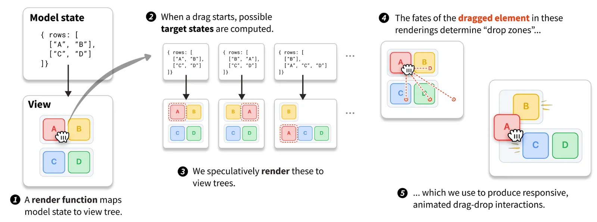
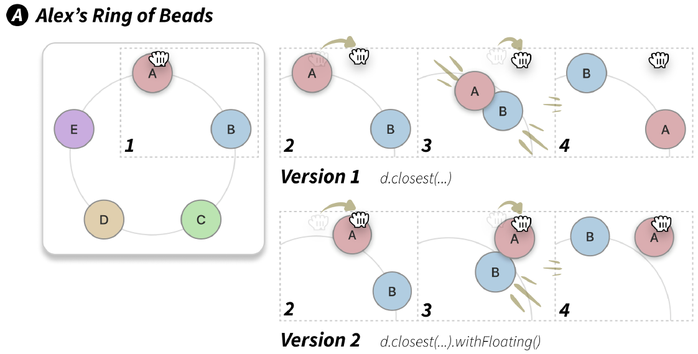
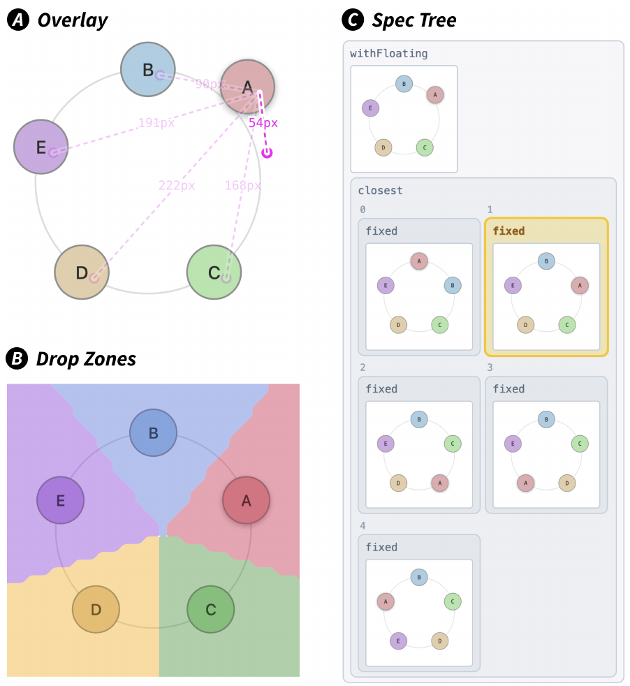
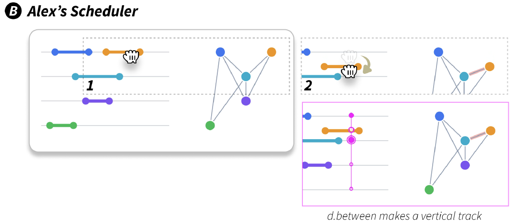
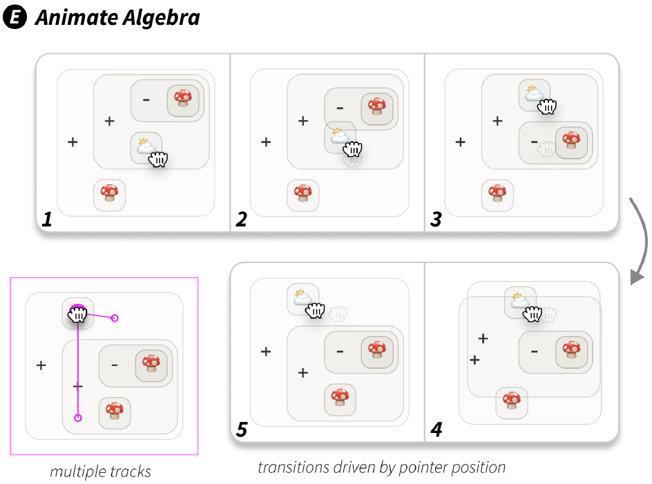
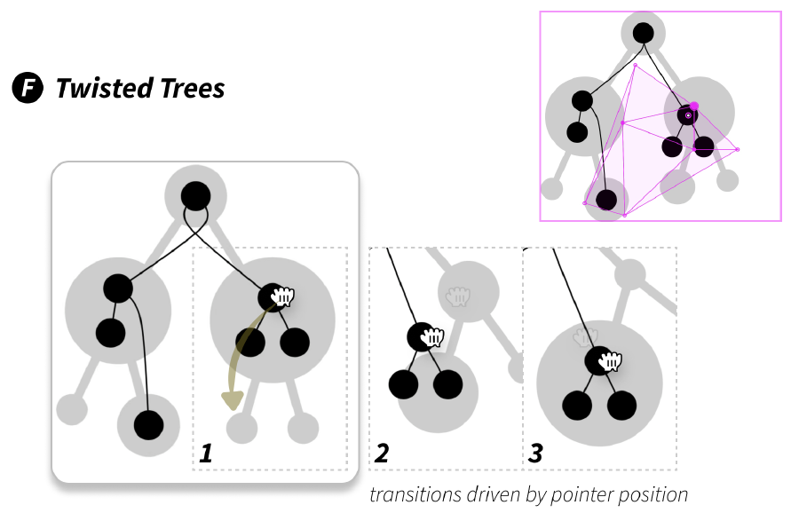
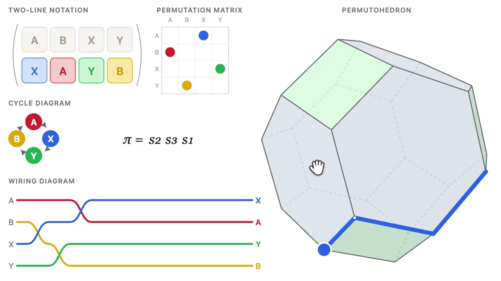
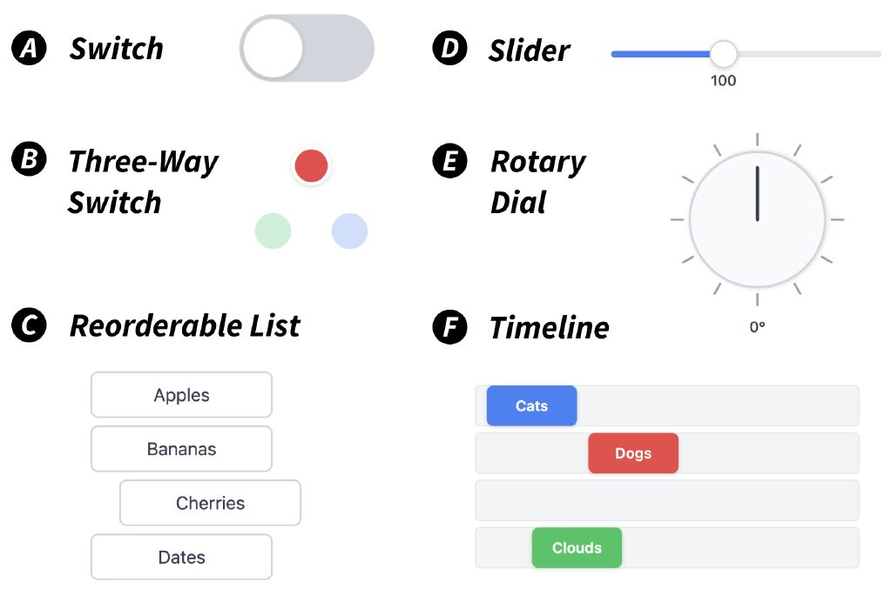

+++
author = "Yuichi Yazaki"
title = "Don't Write the Drag, List Its Outcomes: Declarative Dragging"
slug = "declarative-dragging"
date = "2026-11-04"
description = "Declarative Dragging replaces hand-written drag logic with a list of the states the display can take as the result of a drag. The system draws them in advance and assembles the motion from them."
categories = [
    "consume"
]
tags = [
    "interaction",
    "drag and drop",
    "Declarative Dragging",
    "Dragology",
    "Joshua Horowitz",
    "Andrew Blinn",
    "Jeffrey Heer",
    "UIST"
]
image = "images/how-it-works.png"
+++

Declarative Dragging is a way to write a drag not as coordinate calculations but as a list of the states the display can take as the result of the drag. The system draws each listed state in advance, and from the positions where the dragged element ends up, it assembles the drop targets and the motion in between.

It was proposed by Joshua Horowitz, Andrew Blinn, and Jeffrey Heer. The paper "Declarative Dragging" was presented at UIST 2026 (November 2–5, 2026, Detroit) and was chosen as one of six Best Paper Awards. The implementation is Dragology, a TypeScript library released under the MIT license. What follows is based on the paper PDF on the authors' site and the project page.

<!--more-->

## Instead of Writing the Motion, List the States

The paper opens by saying that high-quality drag and drop is hard to build. It needs drop-target calculations, transition animations, and previews during the drag.

> In many cases, the complexity of drag-and-drop causes interface developers to forsake it entirely in favor of simpler forms and widgets.

In short: the complexity leads developers to give up on dragging and settle for forms and widgets.

The core of the mechanism is the Scrabble rack example in §3.1. When the state is `[A, B, C]`, the states that can result from dragging B are three: `[B, A, C]`, `[A, B, C]` (unchanged), and `[A, C, B]`. Traditionally, you would build a drop target by hand for each one. Here, **the three states go through the render function to draw three racks, and the position where B is drawn is taken from each**. At the moment of release, the closest position is chosen and the state switches to it.



Source: Horowitz, Blinn, Heer / Declarative Dragging project page, "How it works"

What the author writes is only a render function that turns a state into a display, and, for each draggable element, a set of candidate states. The paper calls this model-driven dragging, and drawing in advance speculative rendering. The idea is to use a render function such as React's not only for sequential updates but also for branching future states (§2.2).

| Input | Maps to | Handled by |
|---|---|---|
| State | SVG display | Render function |
| Candidate states | Element positions in the pre-drawn displays | Engine |
| Distance from pointer to each position | State on release | `closest` |
| Pointer inside a convex hull | Interpolation weights of up to three displays | `between` |
| A number inside the state | Value at which the element gets closest to the pointer | `vary` |
| DOM `id` | Correspondence of elements across displays | `lerpViews` |

## Ring of Beads and Scheduler: Choosing the Motion with Operators

Once the drop target is decided, the motion in between is still undecided. The paper lets you choose it by combining operators (§3.2). Each operator builds a function that takes the pointer position and returns the preview for that moment and the state if the pointer were released now.

The Ring of Beads in §4 imagines a math teacher, Alex, showing how beads arranged in a ring can be reordered. The state is `{beads: ["A", "B", "C", "D", "E"]}`. To the bead's rendering, you add the following attribute.

```js
dragologyOnDrag={() => {
  const newStates = state.beads.map((_, targetIdx) => {
    const newState = structuredClone(state);
    newState.beads.splice(idx, 1);
    newState.beads.splice(targetIdx, 0, bead);
    return newState; });
  return d.closest(newStates); }}
```

The first part builds the states in which the grabbed bead is reinserted at each position, and the last line gathers them with `closest`. This is all the code you add.



Source: Horowitz, Blinn, Heer / paper "Declarative Dragging," Figure 2 A (CC BY 4.0 per Crossref)

With `closest` alone, A jumps to the nearest position and does not move at first. If you change the last line to `d.closest(newStates).withFloating()`, A follows the pointer, and the other beads move aside to show where they will land.

You can check why it moves this way with three visualization tools.



Source: Horowitz, Blinn, Heer / paper "Declarative Dragging," Figure 3 (CC BY 4.0 per Crossref)

Scheduler is the problem of assigning meetings to rooms. For a drag that changes the room, you line up states with only the room number changed and pass them to `between`, so the meeting bar slides along a vertical line. Start times cannot be listed as continuous values, so you use `vary`.

```js
dragologyOnDrag={() => {
  return d.vary(state, param("meetings", i, "start"), {
    constraint: (s) => [
      lessThan(0, s.meetings[i].start),
      lessThan(s.meetings[i].start, s.meetings[i].end - MIN_LENGTH),
    ]});}}
```

This specification moves only `meetings[i].start` within the constraint and keeps searching for the value at which the endpoint gets closest to the pointer. Even if you later change how the endpoint is drawn, the specification stays the same.

> It is expressed semantically, in terms of control over parameters, not fragile coordinate logic.

In short: it is written in terms of what the parameters mean, not fragile coordinate calculations.



Source: Horowitz, Blinn, Heer / paper "Declarative Dragging," Figure 2 B (CC BY 4.0 per Crossref)

Figure 4 sorts the operators into three kinds.

| Kind | Operators |
|---|---|
| Primitives (basic behaviors) | `state`, `d.vary`, `d.dropTarget` |
| Combinators (combining) | `d.closest`, `d.between`, `spec.whenFar`, `d.switchToStateAndFollow` |
| Modifiers (layering features) | `withFloating`, `withSnapRadius`, `onDrop` |

## Trees of Expressions and Maps Between Trees: Grabbing an Abstraction and Moving It

The demos in §6 widen the combinations. Animate Algebra rewrites an expression shaped like a tree by dragging, following the commutative and associative laws. For each rewrite it builds a track `d.between([state, newState_i])`, and gathers them with `d.closest`.



Source: Horowitz, Blinn, Heer / paper "Declarative Dragging," Figure 2 E (CC BY 4.0 per Crossref)

Twisted Trees is an order-preserving map from one tree to another. It puts all the candidate states into a single `between`, so you can move freely inside the convex hull. While you move, gray circles stretch and shrink little by little, showing in advance what would enter or leave if you kept going. The paper calls this feedforward.



Source: Horowitz, Blinn, Heer / paper "Declarative Dragging," Figure 2 F (CC BY 4.0 per Crossref)

After the paper, the project page added Permutation lab, which shows a permutation in several representations at once. The page says Horowitz is working on new math explorables.

> interacting with any one representation fluidly updates the others, even halfway through a drag

In short: the other representations update even in the middle of a drag. You can see this in the video on the [project page](https://declarative-dragging.github.io/), and the paper's examples in the [five-minute introduction video](https://www.youtube.com/watch?v=l7v-UwpsEbk).



Source: Horowitz, Blinn, Heer / Declarative Dragging project page, poster image of the video in "Since the paper"

## Where 13 Developers Were Surprised and Where They Stumbled

The core of the evaluation is interviews with 13 people who had experience building drag and drop (§7–8). Game developers, data visualization researchers, educators, and others worked through six examples in order, in sessions of 90 to 120 minutes each, and in four of them the participants tried to implement the drag themselves.



Source: Horowitz, Blinn, Heer / paper "Declarative Dragging," Figure 7 (CC BY 4.0 per Crossref)

Participants were surprised by how short the code was and by the automatic interpolation of colors and positions.

> Once the states (the what) is defined, playing around with how the drag interaction could be in between was much less of a stressful concern…

This is P10's remark: once the states are decided, there is no worry that tinkering with the in-between motion will break the result.

The stumbling concentrated on the reorderable-list task. The paper writes "a sharp cliff" and titles a subsection of §8.3 "Enumerating states isn't very declarative." P09 said they were used to thinking about a single transition, but not used to thinking about all N states a drag could produce at once.

There is also a preliminary comparison with LLM coding agents (Appendix C). The same specification was implemented five times each by seven means; Dragology fully satisfied it in 4 of 5 runs, and the others in 0 to 2. Only the Dragology condition was given an AGENTS.md prepared by the authors, and they acknowledge the risk of "overfit." They also state that this does not replace evaluation by people.

The limitations are in §9. The focus is on drags where the element stays where it is dropped (repositional); gestures that draw a shape, for example, are hard or impossible to write. Multi-touch is not supported either. The effort of listing states is called "perhaps the biggest conceptual hurdle to adoption." The computational cost grows with the number of states, and at 512 states the initialization at drag start exceeded 1500 ms. The paper also lists bias in the participants as a limitation.

## How Did Third Parties See This Work?

As of November 4, 2026, almost no independent third-party evaluation can be found. The 13 participants' remarks were collected and selected by the authors, so they are not included here.

| Kind | Content |
|---|---|
| Award selection | UIST 2026 Best Paper (6 papers). The criteria are "originality, research rigor, supporting evidence, clarity, and potential impact." Individual reviews are not public |
| PR in a third-party repository (title only checked) | Spencer Chang's playhtml has a PR titled "website: declarative dragging prototype and examples" (#678). The body is unchecked |
| Discussion | The Hacker News post (2026-11-04) had 0 comments at the time of research |

No independent blog posts, talks, or social media commentary were found.

## Uses

For visualization work, what can be taken home is the idea that **if you have a render function, the interaction can be built by calling that function many times**, as I read it. If you already draw SVG from data with D3 or React, what you add may be just a list of states.

Compared with Vega-Lite, the difference in what is declared becomes visible, as I read it. A Vega-Lite selection mainly connects the result of an interaction to filtering data or to encodings. Declarative Dragging lets you grab a mark directly and switch the very state the chart represents. In the Vega and Vega-Lite references the paper cites, Heer is an author of both.

A screen like Permutation lab can be read as close to linked views.

On the other hand, the effort of listing states remains. For operations where combinations multiply, such as reordering, you need to estimate the number of states and the computational cost first, I think. The paper's §8.5 sums up that separating the what from the how reduces the risk of trial and error. Fix the render function and the state design first, then compare the in-between motion by swapping operators. That order is, as I read it, how to use it.

## References

**Primary sources**

- Joshua Horowitz, Andrew Blinn, Jeffrey Heer, "Declarative Dragging," *Proceedings of the 39th Annual ACM Symposium on User Interface Software and Technology (UIST '26)*, 2026, pp. 1–16. [doi:10.1145/3830398.3830556](https://doi.org/10.1145/3830398.3830556)
- Paper PDF (authors' version). [andrewblinn.com/papers/D2.pdf](https://andrewblinn.com/papers/D2.pdf)
- Crossref metadata (including license information). [api.crossref.org](https://api.crossref.org/works/10.1145/3830398.3830556)
- Declarative Dragging project page. [declarative-dragging.github.io](https://declarative-dragging.github.io/)
- Interactive supplementary material. [declarative-dragging.github.io/uist26](https://declarative-dragging.github.io/uist26/)
- "Declarative Dragging - UIST 2026 Submission Video". [YouTube](https://www.youtube.com/watch?v=l7v-UwpsEbk)
- Dragology (GitHub). [github.com/declarative-dragging/dragology](https://github.com/declarative-dragging/dragology) / [LICENSE](https://raw.githubusercontent.com/declarative-dragging/dragology/main/LICENSE) / [README](https://raw.githubusercontent.com/declarative-dragging/dragology/main/README.md)
- Dragology (npm). [npmjs.com/package/dragology](https://www.npmjs.com/package/dragology)
- Dragology demo gallery. [joshuahhh.com/dragology/#/demos](https://joshuahhh.com/dragology/#/demos)
- UIST 2026 (dates and venue). [uist.acm.org/2026](https://uist.acm.org/2026/)

**Secondary sources**

- UIST 2026 Awards. [uist.acm.org/2026/awards](https://uist.acm.org/2026/awards/)
- spencerc99/playhtml, PR #678 "website: declarative dragging prototype and examples" (body unchecked). [GitHub](https://github.com/spencerc99/playhtml/pull/678)
- Hacker News post (0 comments at the time of research). [news.ycombinator.com](https://news.ycombinator.com/item?id=50361586)
