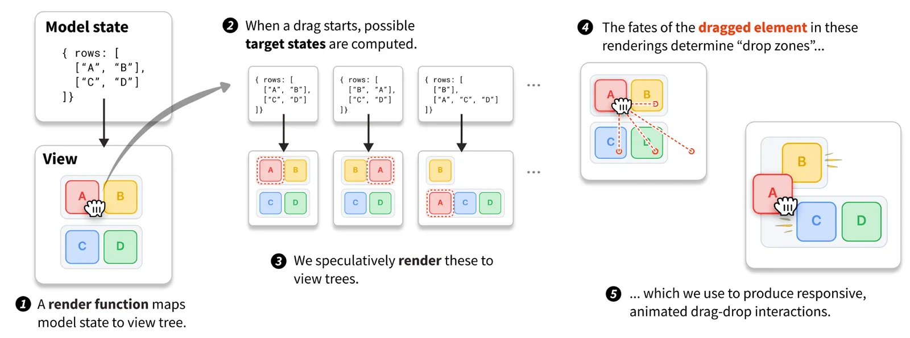
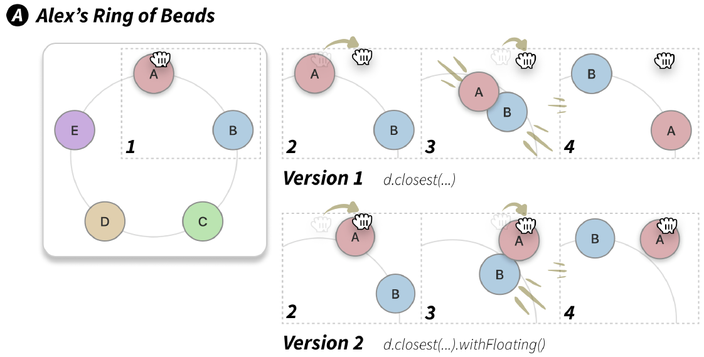
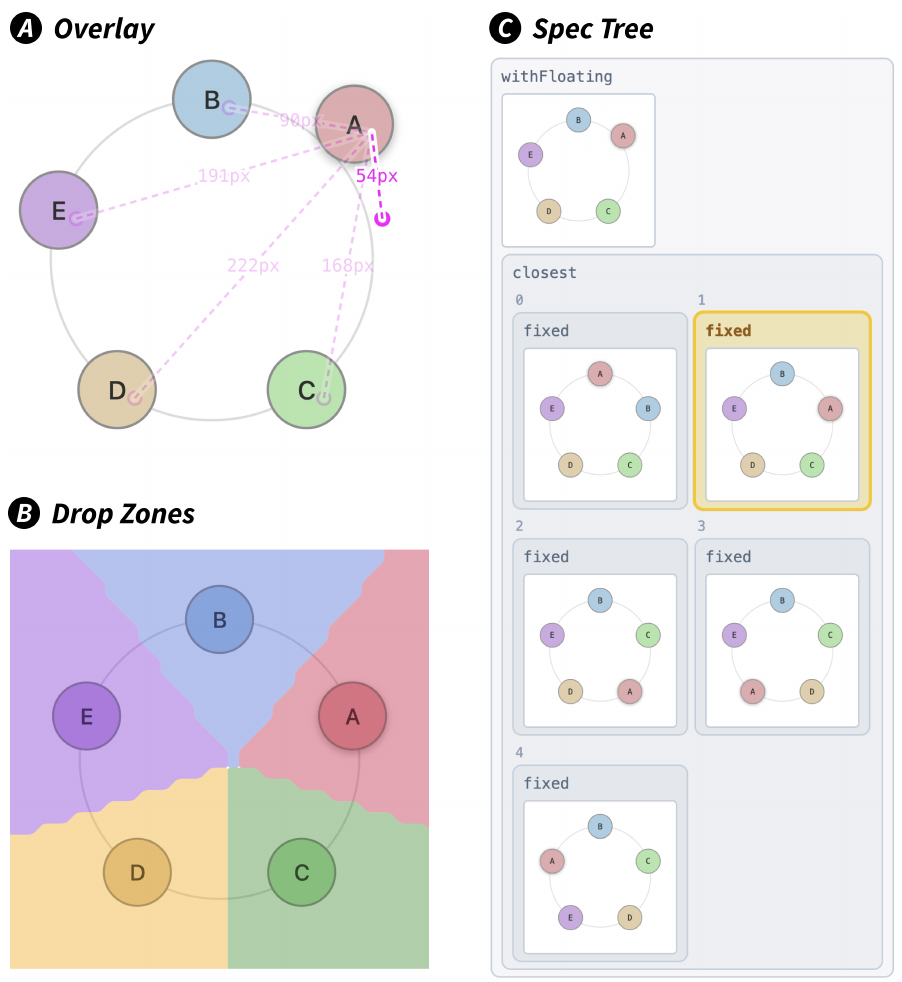
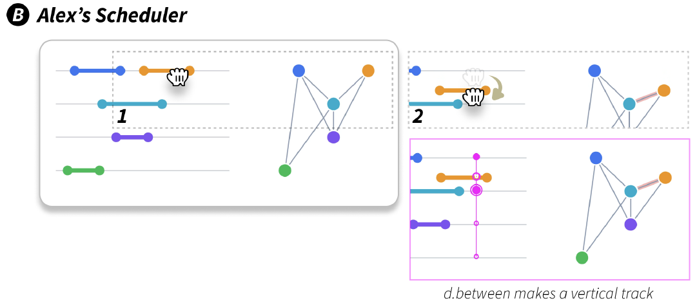
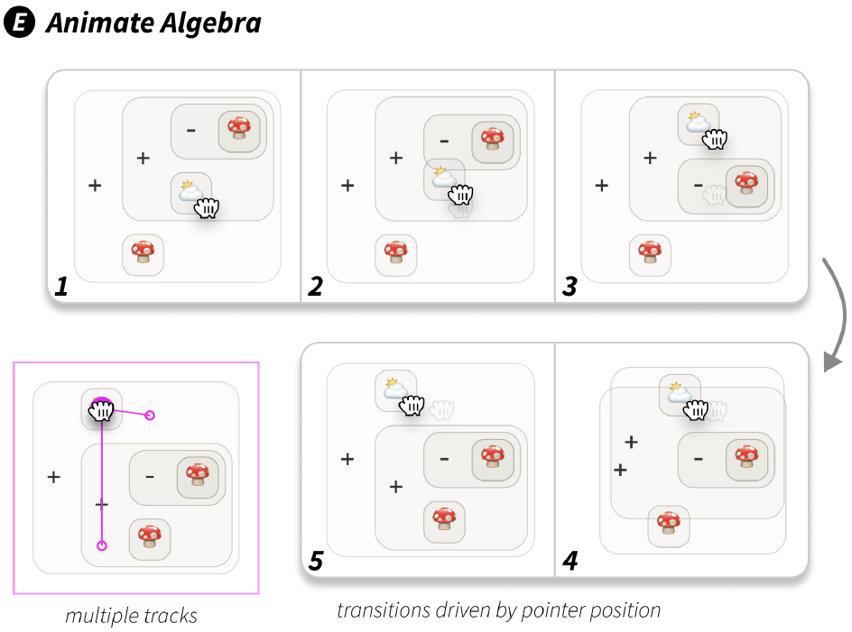
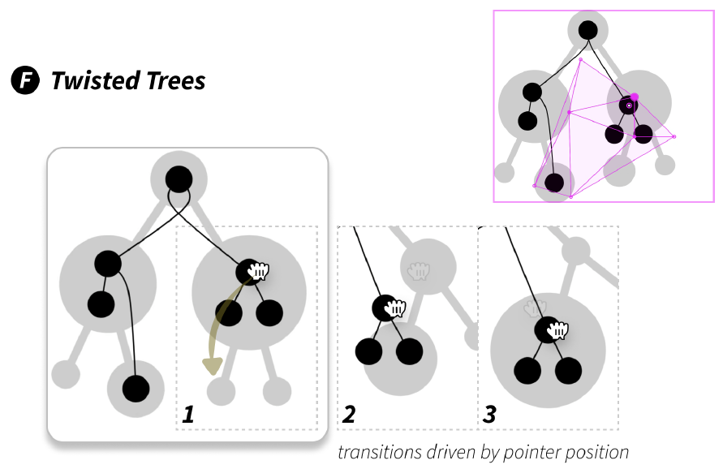
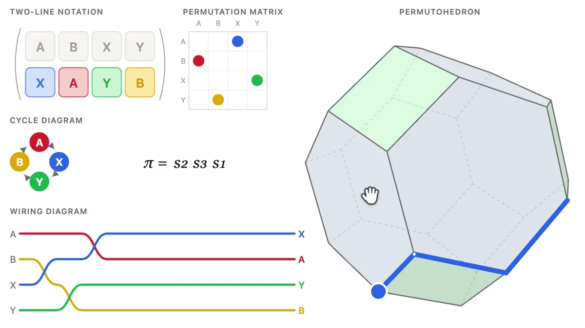
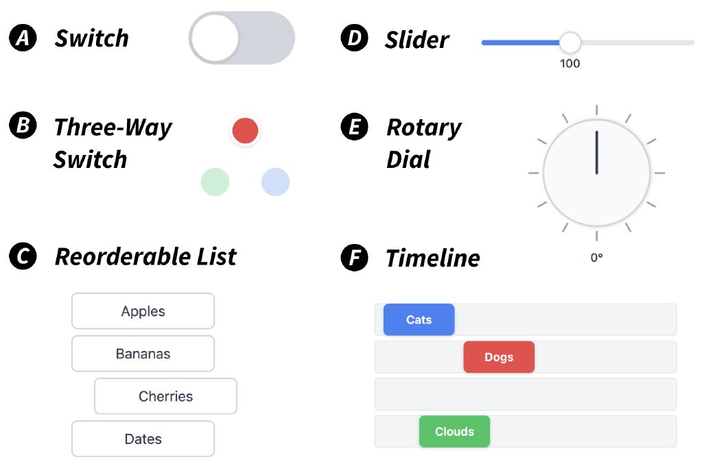

+++
author = "矢崎裕一"
title = "ドラッグの動きを書かず、ドラッグの結果を並べる──Declarative Dragging"
slug = "declarative-dragging"
date = "2026-11-04"
description = "Declarative Dragging は、ドラッグの動きを書く代わりに、ドラッグの結果として画面が取りうる状態を並べる方法です。システムがそれらを先に描き、動きを組み立てます。"
categories = [
    "consume"
]
tags = [
    "インタラクション",
    "ドラッグ＆ドロップ",
    "Declarative Dragging",
    "Dragology",
    "Joshua Horowitz",
    "Andrew Blinn",
    "Jeffrey Heer",
    "UIST"
]
image = "images/how-it-works.png"
+++

Declarative Dragging は、ドラッグの動きを座標の計算で書く代わりに、ドラッグの結果として画面が取りうる状態を並べて書く方法です。システムは、並べた状態をそれぞれ前もって描いてみて、要素が行き着く位置から、ドロップ先と途中の動きを組み立てます。

提案したのは Joshua Horowitz（ジョシュア・ホロウィッツ）、Andrew Blinn（アンドリュー・ブリン）、Jeffrey Heer（ジェフリー・ヒア）の3人です。論文「Declarative Dragging」は UIST 2026（2026年11月2〜5日、デトロイト）で発表され、6本の Best Paper Award の1本に選ばれました。実装は Dragology という TypeScript のライブラリで、MIT ライセンスで公開されています。以下は、著者サイトにある論文 PDF とプロジェクトページに沿います。

<!--more-->

## 動きを書く代わりに、状態を並べる

論文は冒頭で、質の高いドラッグ＆ドロップは作るのが難しいと書きます。ドロップ先の計算、遷移のアニメーション、ドラッグ中のプレビューが要るからです。

> In many cases, the complexity of drag-and-drop causes interface developers to forsake it entirely in favor of simpler forms and widgets.

複雑さのせいで、開発者がドラッグをあきらめ、フォームや部品で済ませてしまう、という要旨です。

仕組みの核は、§3.1 の Scrabble のラックの例です。状態が `[A, B, C]` のとき、B をドラッグした結果としてありうる状態は `[B, A, C]`、`[A, B, C]`（元のまま）、`[A, C, B]` の三つです。従来は、それぞれにドロップ先を手で作っていました。ここでは、**三つの状態を描画関数に通して三つのラックを描き、それぞれで B が描かれた位置を取り出します**。離した瞬間に一番近い位置を選び、その状態に切り替えます。



Horowitz, Blinn, Heer／Declarative Dragging プロジェクトページ「How it works」より引用

作り手が書くのは、状態を画面に変える描画関数と、ドラッグできる要素ごとの候補の状態の集合だけです。論文はこれを model-driven dragging、前もって描くことを speculative rendering と呼びます。React などの描画関数を、順番の更新だけでなく、枝分かれする未来の状態にも使う、という位置づけです（§2.2）。

| 入力 | 対応させる先 | 担う部分 |
|---|---|---|
| 状態 | SVG の画面 | 描画関数 |
| 候補の状態 | 先に描いた画面での要素の位置 | エンジン |
| ポインタと各位置の距離 | 離したときの状態 | `closest` |
| 凸包の中のポインタ | 最大三つの画面の補間の重み | `between` |
| 状態の中の数値 | 要素がポインタに最も近づく値 | `vary` |
| DOM の `id` | 画面どうしの要素の対応 | `lerpViews` |

## Ring of Beads と Scheduler──演算子で途中の動きを選ぶ

ドロップ先が決まっても、途中の動きは決まりません。論文はこれを演算子の組み合わせで選ばせます（§3.2）。各演算子は、ポインタの位置から、その瞬間のプレビューと、いま離したときの状態を返す関数を作ります。

§4 の Ring of Beads は、数学の教員 Alex が輪に並んだビーズの並べ替えを見せる、という想定です。状態は `{beads: ["A", "B", "C", "D", "E"]}`。ビーズの描画に、次の属性を足します。

```js
dragologyOnDrag={() => {
  const newStates = state.beads.map((_, targetIdx) => {
    const newState = structuredClone(state);
    newState.beads.splice(idx, 1);
    newState.beads.splice(targetIdx, 0, bead);
    return newState; });
  return d.closest(newStates); }}
```

前半で、つかんだビーズを各位置に入れ直した状態を作り、最後の行で `closest` にまとめます。足すコードはこれだけです。



Horowitz, Blinn, Heer／論文「Declarative Dragging」Figure 2 A より引用（Crossref の記載では CC BY 4.0）

`closest` だけでは、A は一番近い位置に飛び移り、最初のうちは動きません。最後の行を `d.closest(newStates).withFloating()` にすると、A はポインタに付いて動き、ほかのビーズがよけて落ちる先を予告します。

動きの理由は、三つの可視化ツールで確かめられます。



Horowitz, Blinn, Heer／論文「Declarative Dragging」Figure 3 より引用（Crossref の記載では CC BY 4.0）

Scheduler は、会議を部屋に割り当てる問題です。部屋を変えるドラッグでは、部屋番号だけを変えた状態を並べて `between` に渡し、会議の棒を縦の線の上で滑らせます。開始時刻は連続値で並べられないので、`vary` を使います。

```js
dragologyOnDrag={() => {
  return d.vary(state, param("meetings", i, "start"), {
    constraint: (s) => [
      lessThan(0, s.meetings[i].start),
      lessThan(s.meetings[i].start, s.meetings[i].end - MIN_LENGTH),
    ]});}}
```

`meetings[i].start` だけを制約の範囲で動かし、端点がポインタに一番近づく値を探し続ける指定です。端点の描き方を後で変えても、この指定は変わりません。

> It is expressed semantically, in terms of control over parameters, not fragile coordinate logic.

壊れやすい座標の計算ではなく、パラメータの意味で書かれている、という要旨です。



Horowitz, Blinn, Heer／論文「Declarative Dragging」Figure 2 B より引用（Crossref の記載では CC BY 4.0）

Figure 4 は、演算子を三種類に分けています。

| 種類 | 演算子 |
|---|---|
| Primitives（基本の挙動） | `state`、`d.vary`、`d.dropTarget` |
| Combinators（組み合わせ） | `d.closest`、`d.between`、`spec.whenFar`、`d.switchToStateAndFollow` |
| Modifiers（機能を重ねる） | `withFloating`、`withSnapRadius`、`onDrop` |

## 式の木と木の写像──抽象をつかんで動かす

§6 のデモは、組み合わせを広げます。Animate Algebra は、木の形の式を、交換法則や結合法則に沿ってドラッグで書き換えます。書き換えごとに `d.between([state, newState_i])` という線路を作り、それらを `d.closest` でまとめます。



Horowitz, Blinn, Heer／論文「Declarative Dragging」Figure 2 E より引用（Crossref の記載では CC BY 4.0）

Twisted Trees は、木から木への順序を保つ写像です。候補の状態をすべて一つの `between` に入れ、凸包の中を自由に動かせます。動かす間、灰色の円が少しずつ伸び縮みし、このまま進めば何が出入りするかを先に見せます。論文はこれを feedforward と呼びます。



Horowitz, Blinn, Heer／論文「Declarative Dragging」Figure 2 F より引用（Crossref の記載では CC BY 4.0）

論文の後、プロジェクトページには、置換を複数の表現で同時に見せる Permutation lab が加わっています。Horowitz は新しい数学の explorable に取り組んでいる、とページにあります。

> interacting with any one representation fluidly updates the others, even halfway through a drag

ドラッグの途中でも、ほかの表現が更新される、という要旨です。この動きは[プロジェクトページ](https://declarative-dragging.github.io/)の動画で、論文の例は[5分の紹介動画](https://www.youtube.com/watch?v=l7v-UwpsEbk)で見られます。



Horowitz, Blinn, Heer／Declarative Dragging プロジェクトページ「Since the paper」の動画のポスター画像より引用

## 13人の開発者は、どこで驚き、どこでつまずいたか

評価の中心は、ドラッグ＆ドロップを作った経験のある13人へのインタビューです（§7–8）。ゲーム開発者、データ可視化の研究者、教育者などが、1回90〜120分で6つの例を順に進め、うち4つでは参加者が自分でドラッグを実装しようとしました。



Horowitz, Blinn, Heer／論文「Declarative Dragging」Figure 7 より引用（Crossref の記載では CC BY 4.0）

参加者は、コードの短さと、色や位置の補間が自動で付くことに驚きました。

> Once the states (the what) is defined, playing around with how the drag interaction could be in between was much less of a stressful concern…

状態を決めてしまえば、間の動きをいじっても結果が壊れる心配がない、という P10 の言葉です。

つまずきは、並べ替えリストの課題に集中しました。論文は "a sharp cliff" と書き、§8.3 の小見出しを "Enumerating states isn't very declarative." としています。P09 は、一つの遷移を考えるのには慣れているが、ドラッグで生じうる N 個の状態をまとめて考えるのは不慣れだった、と述べています。

LLM のコーディングエージェントによる予備比較もあります（付録 C）。同じ仕様を7通りの手段で各5回実装させ、完全に満たしたのは Dragology で5回中4回、ほかは0〜2回でした。Dragology の条件だけに作者が用意した AGENTS.md を渡しており、作者は "overfit" の恐れも認めています。人による評価の代わりにはならない、とも断っています。

限界は §9 にあります。対象は置いた所に要素が残るドラッグ（repositional）が中心で、描くジェスチャーなどは書きにくいか、書けません。マルチタッチにも対応していません。状態を並べる手間は "perhaps the biggest conceptual hurdle to adoption" とされます。計算コストは状態の数とともに増え、512状態ではドラッグ開始の初期化が1500msを超えました。参加者の偏りも、論文は限界に挙げています。

## 第三者はこの研究をどう見たか

2026年11月4日の時点で、独立した第三者の評価はほとんど見つかりません。13人の発言は著者が集めて選んだものなので、ここには含めません。

| 種類 | 内容 |
|---|---|
| 賞の選考 | UIST 2026 の Best Paper（6本）。基準は "originality, research rigor, supporting evidence, clarity, and potential impact"。個々の講評は非公開 |
| 第三者のリポジトリの PR（題名のみ確認） | Spencer Chang の playhtml に "website: declarative dragging prototype and examples" という PR（#678）がある。本文は未確認 |
| 議論 | Hacker News への投稿（2026-11-04）は、調査時点でコメント0 |

独立したブログ、講演、SNS 上の論評は見つかりませんでした。

## 使い道

可視化の仕事に持ち帰れるのは、**描画関数があれば、操作はその関数を何度も呼んで組み立てられる**という考え方だと読めます。D3 や React でデータから SVG を描いていれば、足すのは状態のリストで済むと考えられます。

Vega-Lite と比べると、宣言する対象の違いが見えると読めます。Vega-Lite の選択（selection）は、操作の結果を主にデータの絞り込みやエンコーディングにつなぎます。Declarative Dragging は、マークを直接つかんで、図が表す状態そのものを切り替えます。論文が引く Vega と Vega-Lite の文献には、どちらも Heer が著者に入っています。

Permutation lab のような画面は、連動したビュー（linked views）に近いと読めます。

一方で、状態を並べる手間は残ります。並べ替えのように組み合わせが増える操作では、状態の数と計算コストを先に見積もる必要があると考えられます。論文 §8.5 は、what と how を分けることが試行の危険を減らす、とまとめています。描画関数と状態の設計を先に固め、途中の動きは演算子を差し替えて比べる。その順番が使い道だと読めます。

## 参考・出典

**一次情報**

- Joshua Horowitz, Andrew Blinn, Jeffrey Heer, "Declarative Dragging," *Proceedings of the 39th Annual ACM Symposium on User Interface Software and Technology (UIST '26)*, 2026, pp. 1–16. [doi:10.1145/3830398.3830556](https://doi.org/10.1145/3830398.3830556)
- 論文 PDF（著者の版）. [andrewblinn.com/papers/D2.pdf](https://andrewblinn.com/papers/D2.pdf)
- Crossref のメタデータ（ライセンスの記載を含む）. [api.crossref.org](https://api.crossref.org/works/10.1145/3830398.3830556)
- Declarative Dragging プロジェクトページ. [declarative-dragging.github.io](https://declarative-dragging.github.io/)
- 対話型の補足資料. [declarative-dragging.github.io/uist26](https://declarative-dragging.github.io/uist26/)
- "Declarative Dragging - UIST 2026 Submission Video". [YouTube](https://www.youtube.com/watch?v=l7v-UwpsEbk)
- Dragology（GitHub）. [github.com/declarative-dragging/dragology](https://github.com/declarative-dragging/dragology) / [LICENSE](https://raw.githubusercontent.com/declarative-dragging/dragology/main/LICENSE) / [README](https://raw.githubusercontent.com/declarative-dragging/dragology/main/README.md)
- Dragology（npm）. [npmjs.com/package/dragology](https://www.npmjs.com/package/dragology)
- Dragology デモギャラリー. [joshuahhh.com/dragology/#/demos](https://joshuahhh.com/dragology/#/demos)
- UIST 2026（会期・会場）. [uist.acm.org/2026](https://uist.acm.org/2026/)

**第三者評価**

- UIST 2026 Awards. [uist.acm.org/2026/awards](https://uist.acm.org/2026/awards/)
- spencerc99/playhtml, PR #678 "website: declarative dragging prototype and examples"（本文は未確認）. [GitHub](https://github.com/spencerc99/playhtml/pull/678)
- Hacker News への投稿（調査時点でコメント0）. [news.ycombinator.com](https://news.ycombinator.com/item?id=50361586)
