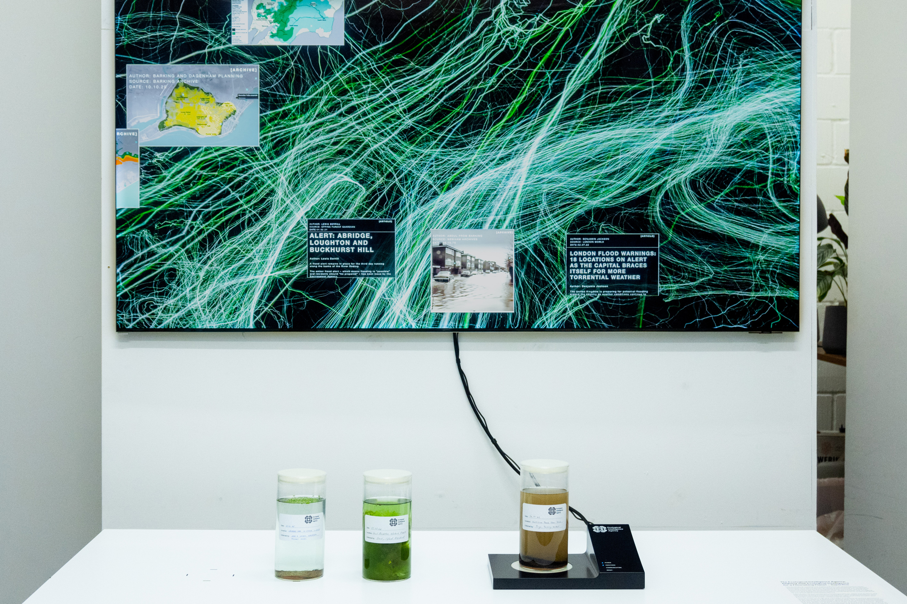
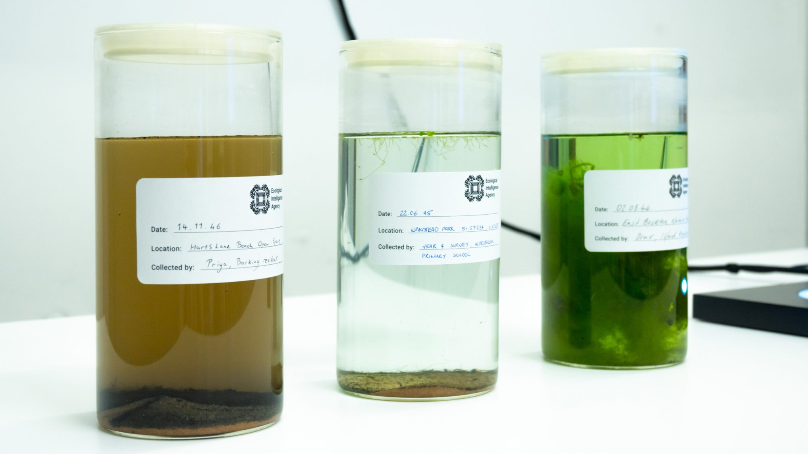
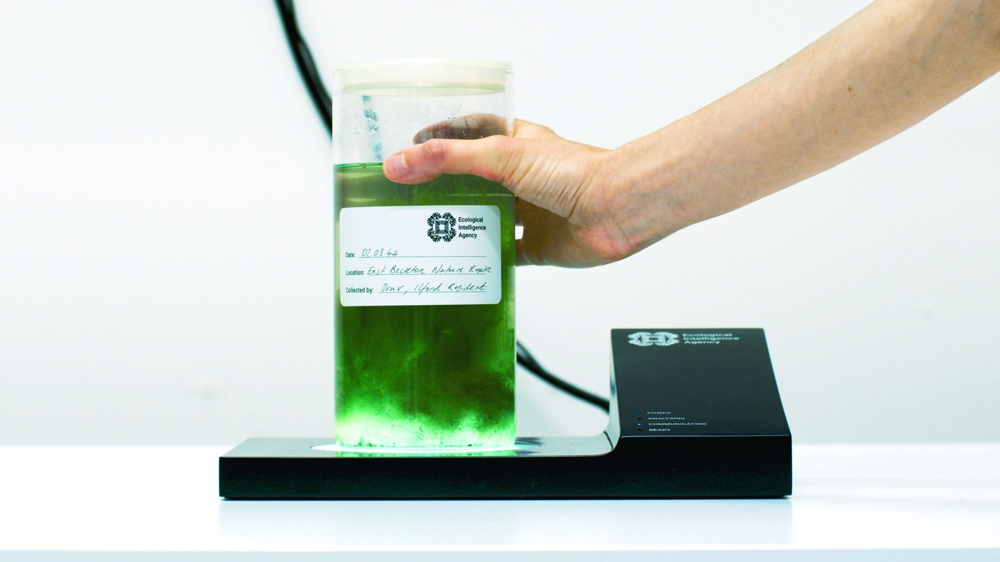
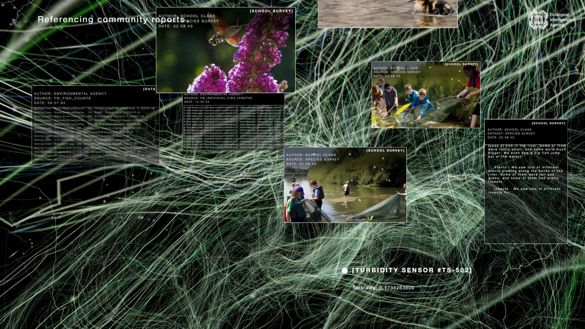
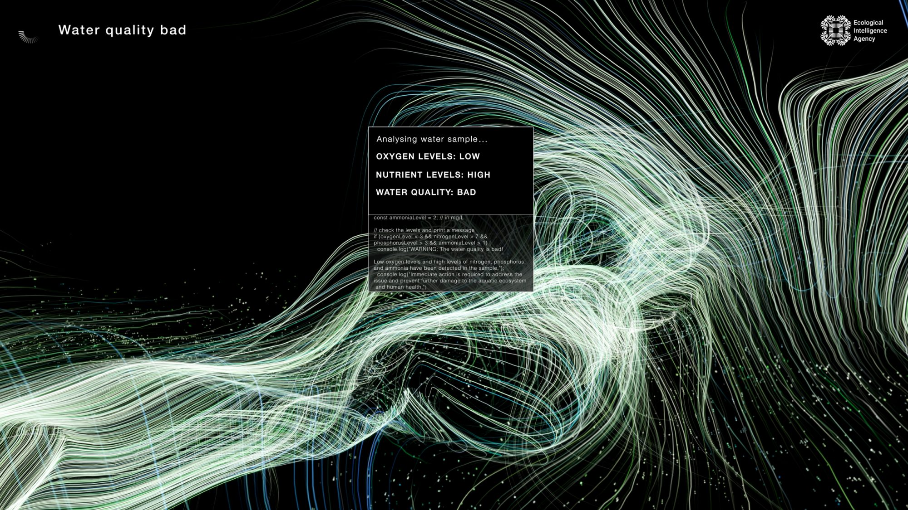

+++
author = "Yuichi Yazaki"
title = "A Government Agency That Speaks in the River's Poetry: Superflux's The Ecological Intelligence Agency"
slug = "ecological-intelligence-agency"
date = "2026-08-16"
description = "A fictional agency translates London river data into poems spoken by the river and a device that reads jars of water. Read here as Superflux's answer to a problem: raw data alone does not move people."
categories = [
    "consume"
]
tags = [
    "original visual transformation",
]
image = "images/cover.jpg"
+++

"There is plenty of raw data showing how bad pollution is. But it doesn't lead to change." So said Jon Ardern, co-founder of Superflux, which made the work, in later reflection. *The Ecological Intelligence Agency* is a fictional agency that translates data from London's River Roding into poems spoken by the river and a device that reads jars of water. It can be read as a work that redesigns how the health of a river is received through the senses, rather than adding more numbers.

Superflux made this work in 2023, commissioned by the UK government's Policy Lab and Defra Futures. Below, I read it in the order a visitor encounters it, following Superflux's project page, three short films published on Vimeo, and the record Policy Lab published in 2024. The project page ends with a disclaimer that the work does not represent government policy or intent.

<!--more-->

## June 2023: Gathering at Somerset House

In June 2023, a forum and exhibition called *Changing Course* was held at Somerset House in London. It was organized by Policy Lab and Defra Futures, with the Catchment Based Approach (CaBA) as co-host. Superflux quotes the following question on its project page.

> How can we transform what the freshwater system looks like, 20 years from now and beyond?

The question asks how the freshwater system could be transformed 20 years from now and beyond. Superflux was invited by Neha Sharma of Policy Lab and Phil Tovey of Defra Futures.

According to Policy Lab's record, the aim was not to predict the future. It was to start conversations and unsettle thinking. Three methods were prepared.

| Method | What it involved |
|---|---|
| Collective intelligence | Gathering opinions using Pol.is |
| More-than-human moral imagination | The UK government's first Interspecies Council, by Moral Imaginations |
| Speculative design | An installation commissioned from Superflux (this work) |

About 80 people attended over two days. In other words, the first audience for this work was not general web viewers. It was **practitioners involved in freshwater decision-making: policymakers, researchers, NGOs, and regulators**.

Ardern's words quoted at the start, "There is plenty of raw data showing how bad pollution is. But it doesn't lead to change", can be read as a reflection on a work aimed at this kind of professional setting.

## Placing a jar on the sensor stand

The installation in the official photographs consists of a large wall screen and a white table in front of it. Glass sample jars are lined up on the table, and the jar at the right end sits on a black sensor stand. A cable runs from the stand to the screen, staging the gesture of "reading" a sample.

Photo: Superflux

The jar labels carry the EIA logo, with the date, location, and collector handwritten on them. The dates are in the mid-2040s. The locations include Hart's Lane, Wanstead Park, and East Beckton Nature Reserve. The collectors are a Barking resident, a Year 4 primary school survey, and an Ilford resident.

Photo: Superflux

Inside are murky brown water, clear water with duckweed floating on it, and green water choked with algae. Jars of the same standard make the differences in water quality something you can hold in your hand.

The side of the sensor stand has four lamps: POWER, ANALYSING, COMMUNICATING, and READY. The act of placing a jar on the stand is itself the input. The order is **handle the water with your hands first, before looking at the screen**.

Photo: Superflux

## On screen, official records sit beside children's observations

The screen's background is a dark field. Thin green and white lines run across it, and the charts have no axes. Over this, the agency's windows layer up.

One screen is **Referencing community reports**. Beside tables of the Environment Agency's fish counts (1993) and individual lengths (2023) sit a 2043 school survey: a photo of children using nets at the riverside, a close-up of an insect, and the pupils' written observations. At the lower right, the live reading of a turbidity sensor is shown.

Photo: Superflux

The government's quantitative records and children's voices appear on the same screen. To me, the two seem to be given equal weight. On another screen, a Barking and Dagenham plan drawing sits next to a photo of a flooded street. Local Facebook and Instagram posts are also treated as a sensor called [SOCIAL MEDIA].

The warning window shows more of what is inside. Under "Analysing water sample..." come OXYGEN LEVELS: LOW, NUTRIENT LEVELS: HIGH, and WATER QUALITY: BAD. Below that is displayed code that writes the thresholds for oxygen, nitrogen, phosphorus, and ammonia as `if` statements.

Photo: Superflux

A one-word verdict, WATER QUALITY: BAD, does appear. But the verdict is not a black box that outputs only a conclusion. It can be read as a design that shows, as conditional branches, which value exceeded which threshold.

The agency's setup can also be read as echoing this way of showing. The EIA is premised not as one giant model but as a collection of local AI models. Superflux writes that what it aims for is not a whole picture but a parenthesized *(partial) picture*, a partial picture of entanglement with the world. When it meets a gap in knowledge, it does not fill it with an answer but points to whom else should be asked.

## The river speaks in poetry

In this work, the River Roding itself speaks. A generative model is used to make an LLM speak as the river. The prompts drew on British Romantic ballads, free-verse lyricism, and London spoken word. The input mixes in not only ecological data but also local social media posts. The sound mix was by David Vélez.

Drawing on surveys of the Roding's environmental and amenity risks, the scenarios split into three. Each is published on Vimeo as a short film.

| Short film | Length | Focus as written by Superflux |
|---|---|---|
| Pollution | 5:34 | The effects of forever chemicals on ecosystems, including through the food chain |
| Sewage | 5:40 | Large-scale infrastructure and sewage, and the knock-on effects on the river such as algal blooms |
| Flooding | 5:44 | Rising flood risk, and imagining living with the natural flow of water |

The PFAS warning on screen can be read as corresponding to Pollution, the algae jar and the oxygen-shortage verdict to Sewage, and the flooded-street photo to Flooding. According to Superflux, the range of the prompts runs from a lament for forever chemicals quietly sinking away to imagining a harmonious future.

In this article, I read the poem as something that translates data into a lure for feeling. The clue is the mathematician Whitehead, whom Superflux cites. On this view, a proposition is in itself neither true nor false but a *lure for feeling* that changes how the world is felt, and its efficacy lies in what it makes possible to feel and think.

In his interview with parCitypatory, Ardern says that much of current law is "damage limitation to keep exploitation going in a controlled form." In my reading, even if you add more numbers, as long as the frame that sees the river as a service remains, policy only manages the ceiling of harm. The river's poem can be read as a translation so that **people in the policy arena feel the river as a party at the meeting table**.

On the other hand, on the project page Tovey writes about a raindrop, borrowing from Tim Morton (and his Kant example). The data of a raindrop, that is, bouncing, wetting, unpleasant, pleasant, this size, this speed, is none of it the raindrop itself. He then asks where the threshold lies for a faithful representation of the nonhuman.

Superflux itself, as we saw above, writes that what it aims for is a *(partial) picture*. I read the river's voice as likewise not a faithful copy of the river, and *(partial)* as a notation that acknowledges that limit.

## How third parties saw the work

There were not many specialist reviews right after it opened. Here I set out three views with different points of emphasis.

- Policy Lab, the commissioning side, in its February 2024 record, positioned the work as an installation that lets people experience the role of AI in future policymaking. Tovey commented that it made the future a "tangible present," reaching places analytical foresight alone cannot. To me, this reads as valuing not the accuracy of prediction but that it gave the space of possibilities a form an organization can hold. Superflux, for its part, describes the forum's discussion as "rich and knotty."
- The trend publication LSN Global (2023-09-29) called it *ground-breaking*, yet summarized the three short films as stories of "AI solving pollution, sewage, and flooding." It reads them as a sign of companies finding alternatives to water scarcity and sewage. Superflux's vocabulary is not "solve" but looking at impacts and imagining ways of living together. The studio's earlier skepticism toward extractive AI fades in this reading.
- Laura Puttkamer of parCitypatory (2025-08-01) interviewed Ardern, starting from the press preview of the *More than Human* exhibition at the Design Museum in London (2025-07-11 to 10-05). Her focus is whether adding emotion to data can turn residents into guardians of the river. Ardern admits that quantifying the impact is hard. He then points to people who get in touch years later to say "my way of thinking changed," and to a case where a policymaker used the river's voice in a workshop, and answers that this is slow work.

The same work was read by the commissioning side as making the future a "tangible present," and by the trend publication as a sign of AI solutions. The translation into poems and jars changes meaning depending on the recipient's frame of reference.

## Takeaways

**What this work shows visualization practice is design for when the data exists but people do not move, not for when data is lacking.** I narrow what can be taken away to three points.

- First, check who is looking and what they have at hand. The first audience of this work was practitioners involved in freshwater decision-making. I read Superflux as having changed how the data is received instead of increasing the numbers.
- Put an entrance you can touch in front of the screen. In this work, placing a jar on the sensor stand was the input. Even for meeting materials, you can start by building from what goes into participants' hands.
- Show the basis for a verdict and the parts that are missing. This work does output a one-word verdict, BAD, but it lays out the threshold `if` statements, writes *(partial)*, and points to whom to ask for opinions. Before folding things into a single score, you can show what was discarded.

One more thing: Tovey's caution about the raindrop is, as it stands, a caution for visualization. However carefully you translate, a representation is not the thing itself. Whether it is a poem or a chart, noting that it is a partial picture invites the audience into the discussion.

## References

**Primary sources**

- Superflux, [The Ecological Intelligence Agency](https://superflux.in/index.php/work/the-ecological-intelligence-agency/) (project page, 2023. Includes comments by Phil Tovey)
- Superflux, [The Ecological Intelligence Agency — Pollution / Sewage / Flooding](https://vimeo.com/superflux/videos) (Vimeo)
- Policy Lab, [Using experimental methods to reimagine decision-making for the freshwater system, post 2043](https://openpolicy.blog.gov.uk/2024/02/07/using-experimental-methods-to-reimagine-decision-making-for-the-freshwater-system-post-2043/) (2024-02-07)

**Secondary sources**

- LSN Global, [Superflux unveils the Ecological Intelligence Agency](https://www.lsnglobal.com/daily-signals/article/29965/superflux-unveils-the-ecological-intelligence-agency) (2023-09-29)
- Laura Puttkamer, [If A River Could Speak…](https://parcitypatory.org/2025/08/01/if-a-river-could-speak/) (parCitypatory, 2025-08-01)
- Design Museum, [More than Human](https://designmuseum.org/exhibitions/more-than-human) (2025-07-11 to 10-05)
