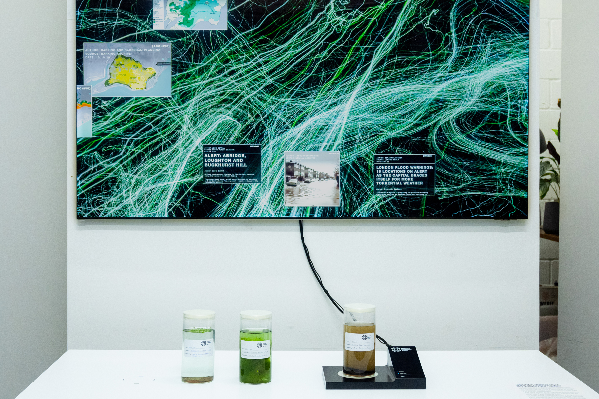
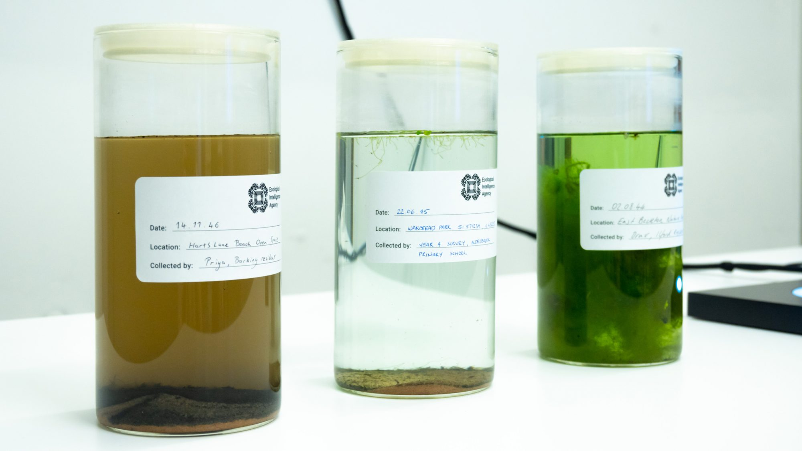
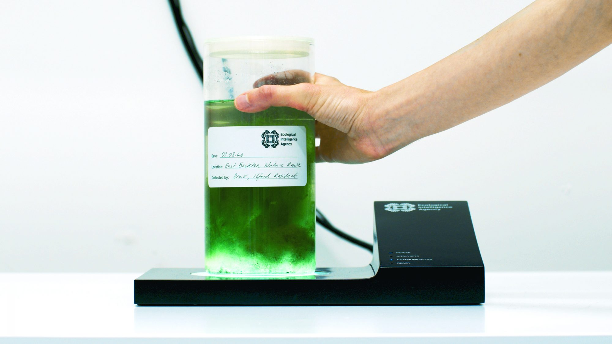
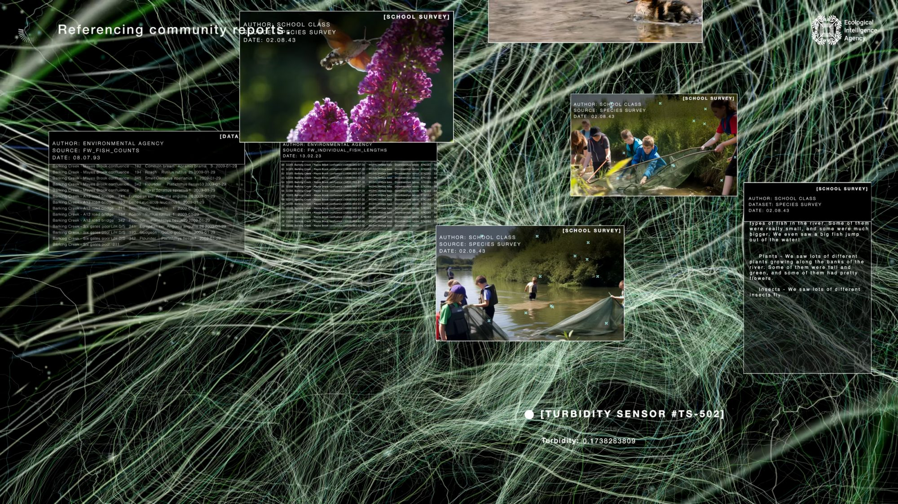
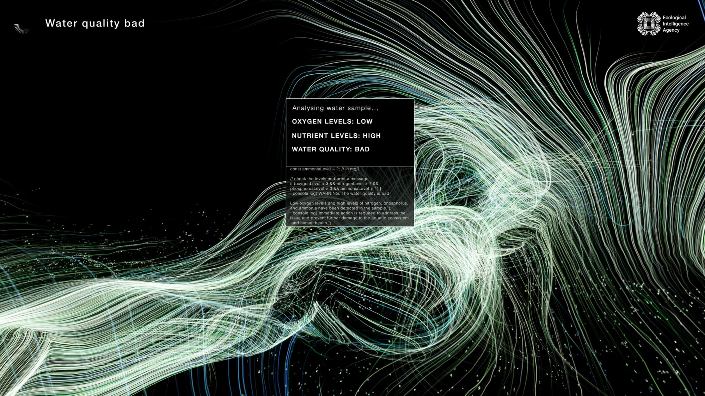

+++
author = "矢崎裕一"
title = "川が詩で語りかける行政機関──Superflux『The Ecological Intelligence Agency』"
slug = "ecological-intelligence-agency"
date = "2026-08-16"
lastmod = "2026-11-01"
description = "汚染の生データはたくさんあるのに、変化にはつながらなかった。『The Ecological Intelligence Agency』は、ローディング川のデータを川が語る詩と水の瓶を読む装置に翻訳し、行政官が川の健康を感覚で受け取れるように設計し直した架空の行政機関です。"
categories = [
    "consume"
]
tags = [
    "オリジナルのビジュアル変換",
]
image = "images/cover.jpg"
series = ["speculative-design"]
series_weight = 4
seriesByline = "Superflux"
seriesTitle = "川が詩で語りかける行政機関"
+++

汚染の生データはたくさんあるのに、変化にはつながらなかった。『The Ecological Intelligence Agency』は、ロンドンのローディング川のデータを、川が語る詩と、水の瓶を読む装置に翻訳した架空の行政機関です。数字を足すのではなく、行政官が川の健康を感覚で受け取れるように設計し直しています。

作ったのはデザインスタジオ Superflux（スーパーフラックス）で、2023年に英国政府の Policy Lab と Defra Futures の委託を受けました。以下は、Superflux の作品ページ、Vimeo で公開された三本の短編、Policy Lab が 2024年に公開した記録に沿って、鑑賞者が作品に出会う順に読みます。作品ページの末尾には、これが政府の政策や意図を代表しない、という但し書きがあります。

<!--more-->

## 2023年6月、Somerset House に集まった人たち

2023年6月、ロンドンの Somerset House で、フォーラム兼展示 *Changing Course* が開かれました。主催は Policy Lab と Defra Futures で、Catchment Based Approach（CaBA）が共催です。Superflux が作品ページに引くのは、次の問いです。

> How can we transform what the freshwater system looks like, 20 years from now and beyond?

20年後とその先に向けて、淡水系の姿をどう変えられるか、という問いです。Superflux を招いたのは、Policy Lab の Neha Sharma と、Defra Futures の Phil Tovey（フィル・トーヴィー）でした。

Policy Lab の記録によれば、目的は未来の予測ではありません。会話を起こし、考えを揺さぶることです。方法は三つ用意されました。

| 方法 | 中身 |
|---|---|
| 集合知 | Pol.is を使った意見の集約 |
| more-than-human の道徳的想像 | Moral Imaginations による、英国政府初の Interspecies Council |
| スペキュラティブ・デザイン | Superflux に委嘱した設置作品（本作） |

来場は二日間で約80名でした。政策担当者、研究者、NGO、規制当局の人たちです。つまり本作の最初の観客は、ウェブの一般閲覧者ではありません。**淡水の意思決定に関わる行政官や実務者**です。

その人たちの手元には、すでに数字がありました。共同創業者の Jon Ardern（ジョン・アーダーン）は、のちの取材でこう語っています。汚染がどれほど悪いかを示す生データはたくさんある。だが、それは変化につながらない。本作は、この自己診断から始まっています。

## 机の上の瓶を、センサ台に置く

会場に入ると、壁面の大画面と、その前の白いテーブルが目に入ります。テーブルには採水のガラス瓶が並び、右端の瓶は黒いセンサ台に載っています。台から画面へケーブルが伸びています。

写真：Superflux

瓶のラベルには EIA のロゴが入り、日付・地点・採集者が手書きされています。日付は 2040年代半ばです。地点は Hart's Lane、Wanstead Park、East Beckton Nature Reserve など。採集者は Barking の住民、小学校4年生の調査、Ilford の住民です。

写真：Superflux

中身は、濁った茶、浮草の浮いた澄んだ水、藻で埋まった緑です。同じ規格の瓶が、水質の差を手に取れる物として並べます。数値の表なら一行ずつ読む差が、ここでは一目で比べられます。

センサ台の側面には、POWER／ANALYSING／COMMUNICATING／READY の四つのランプがあります。鑑賞者が瓶を台に置くことが、そのまま機関への入力になります。**画面を見る前に、まず手で水を扱う**順番です。

写真：Superflux

## 画面に、行政の記録と子どもの観察が並ぶ

瓶を置くと、画面が動きます。暗い地に緑と白の細い線が走り、チャートの軸はありません。その上に、機関のウィンドウが重なっていきます。

ある画面は **Referencing community reports** です。Environment Agency の魚類カウント（1993）と個体長（2023）の表の横に、2043年の学校調査が並びます。川辺で網を使う子どもの写真、昆虫の接写、児童の観察文です。右下には、濁度センサのライブ値が出ています。

写真：Superflux

行政の定量的な記録と、子どもの声が、同じ画面に同じ重さで載ります。別の画面では、Barking and Dagenham の計画図と、冠水した街路の写真が並びます。地域の Facebook や Instagram の投稿も、[SOCIAL MEDIA] というセンサとして扱われます。

警告のウィンドウは、さらに中身を見せます。「Analysing water sample...」の下に、OXYGEN LEVELS: LOW、NUTRIENT LEVELS: HIGH、WATER QUALITY: BAD。その下に、酸素・窒素・リン・アンモニアの閾値を `if` で書いたコードが表示されます。

写真：Superflux

判定は、結論だけを出す黒箱になっていません。どの値がどの閾値を越えたかを、条件分岐として見せます。行政官は、データが足りないから動けないのではありませんでした。だから画面は、データを一つの指標に圧縮しません。

この設計の背景には、機関の設定があります。EIA は、一つの巨大なモデルではなく、局所的な AI モデルの集まりという設定です。目指すのは全体像ではなく、Superflux が *(partial) picture* と書く部分的な絵です。知識の隙間に出会ったら、答えで埋めずに、誰にさらに意見を聞くべきかを指します。

## 川が、詩で語りかける

画面の最後に、ローディング川そのものが語り出します。生成モデルを使い、LLM に川として話させています。プロンプトが参照したのは、英国ロマン派のバラッド、自由詩の抒情、ロンドンのスポークンワードです。入力には生態データだけでなく、地域のソーシャルメディア投稿も混ぜています。音のミックスは David Vélez が担当しました。

川の調査から、語りは三つのシナリオに分かれ、それぞれ短編として Vimeo で公開されています。

| 短編 | 長さ | Superflux が書く焦点 |
|---|---|---|
| Pollution | 5:34 | 永遠化学物質が、食物連鎖などを通じて生態系に与える影響 |
| Sewage | 5:40 | 大規模インフラと下水、藻類の大発生など川への波及 |
| Flooding | 5:44 | 洪水リスクの増加と、自然な水の流れと共に暮らす想像 |

画面の PFAS 警告は Pollution に、藻の瓶と酸素不足の判定は Sewage に、冠水の写真は Flooding に対応します。永遠化学物質が静かに沈んでいく嘆きから、川と調和した未来の想像まで、川の声は幅を持って語ります。

なぜ数字ではなく詩なのか。Superflux は数学者 Alfred North Whitehead（ホワイトヘッド）を引いています。命題はそれ自体で真でも偽でもなく、世界の感じ方を変える *lure for feeling* だ、という考え方です。命題の効力は、何を感じ、考えられるようにするかで決まります。

Ardern は取材で、現行法の多くは「搾取を制御された形で続けるための損傷制限」だと述べています。数字を足しても、川をサービスとして見る枠が残れば、政策は被害の上限を管理するだけになります。川の詩は、**行政官が川を会議の相手として感じる**ための翻訳です。

一方で、Tovey は作品ページにこう書き残しています。雨粒のデータ、つまり跳ねる、濡れる、この大きさ、この速さのどれも、雨粒そのものではない。川の声も、川の忠実な写しではありません。Superflux が *(partial)* と書くのは、この限界を認めた表記です。

## 第三者はこの作品をどう見たか

公開直後の専門的なレビューは多くありません。ここでは、論点の違う三つの見方を並べます。

- 委託した側の Policy Lab は、2024年2月の記録で本作を、未来の政策決定における AI の役割を体験させる設置と位置づけました。Tovey は、分析的なフォーサイトだけでは届かない場所へ、未来を「触れる現在」にしたと評しています。評価の軸は予測の精度ではなく、議論が起きたかどうかです。
- トレンド誌の LSN Global（2023-09-29）は *ground-breaking* と呼びつつ、三本の短編を「AI が汚染・下水・洪水を解決する」話として要約しました。企業が水の問題の代替策を見つける兆しとして読んでいます。Superflux の語彙は「解決する」ではなく、影響を見て、共に暮らす仕方を想像する、です。スタジオが置いた AI への疑いは、この読みでは薄くなります。
- parCitypatory の Laura Puttkamer（2025-08-01）は、Design Museum での再展示を機に Ardern に取材しました。焦点は、データに感情を足すことで、住民を川の守り手に変えられるかです。Ardern は、影響の定量は難しいと認めています。そのうえで、何年たっても「考え方が変わった」と連絡が来ること、政策担当者がワークショップで川の声を使った例があることを挙げ、遅い仕事だと答えています。

同じ作品が、委託側には議論を起こす装置として、トレンド誌には AI による解決の兆しとして読まれました。詩と瓶への翻訳は、受け取る側の枠組みによって意味が変わります。

## 使い道

**本作が可視化の仕事に示すのは、データが足りないときではなく、データがあるのに人が動かないときの設計です。**持ち帰れることを三つに絞ります。

- 最初に、見る人と、その人の手元にあるものを確かめる。 本作の観客は、すでに数字を持つ行政官でした。だから Superflux は、数字を増やす代わりに、受け取り方を変えています。
- 画面の前に、手で触れる入口を置く。 本作では、瓶をセンサ台に置く動作が入力でした。会議の資料でも、まず参加者の手に渡るものから組み立てられます。
- 判定の根拠と、欠けている部分を見せる。 閾値の `if` 文を出すこと、*(partial)* と書くこと、意見を聞くべき相手を指すことは、どれも圧縮しない設計です。一つのスコアにまとめる前に、何を捨てたかを示せます。

もう一つ、Tovey の雨粒の注意は、そのまま可視化の注意です。どれほど丁寧に翻訳しても、表現は対象そのものではありません。詩でもチャートでも、それが部分的な絵だと書き添えることが、受け手を議論に招き入れます。

## 参考・出典

**一次情報**

- Superflux, [The Ecological Intelligence Agency](https://superflux.in/index.php/work/the-ecological-intelligence-agency/)（作品ページ、2023。Phil Tovey のコメントを含む）
- Superflux, [The Ecological Intelligence Agency — Pollution / Sewage / Flooding](https://vimeo.com/superflux/videos)（Vimeo）
- Policy Lab, [Using experimental methods to reimagine decision-making for the freshwater system, post 2043](https://openpolicy.blog.gov.uk/2024/02/07/using-experimental-methods-to-reimagine-decision-making-for-the-freshwater-system-post-2043/)（2024-02-07）

**第三者評価**

- LSN Global, [Superflux unveils the Ecological Intelligence Agency](https://www.lsnglobal.com/daily-signals/article/29965/superflux-unveils-the-ecological-intelligence-agency)（2023-09-29）
- Laura Puttkamer, [If A River Could Speak…](https://parcitypatory.org/2025/08/01/if-a-river-could-speak/)（parCitypatory、2025-08-01）
