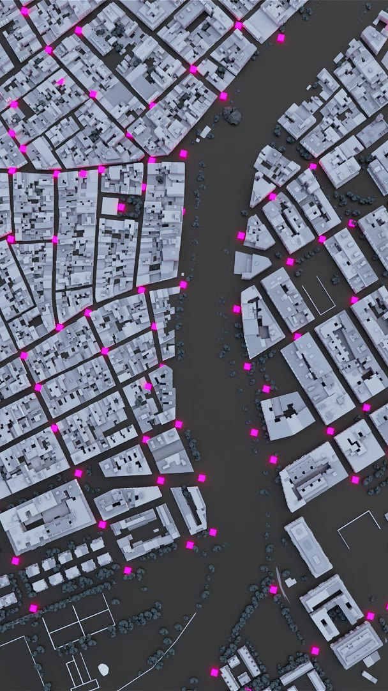
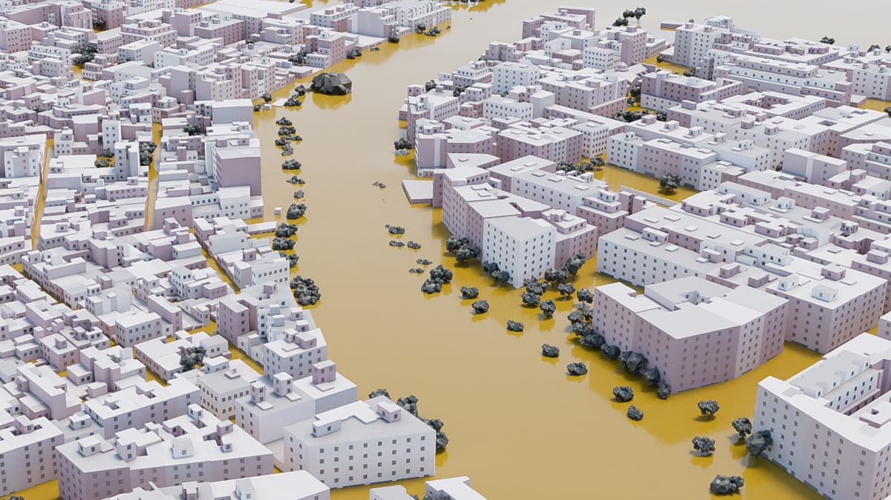
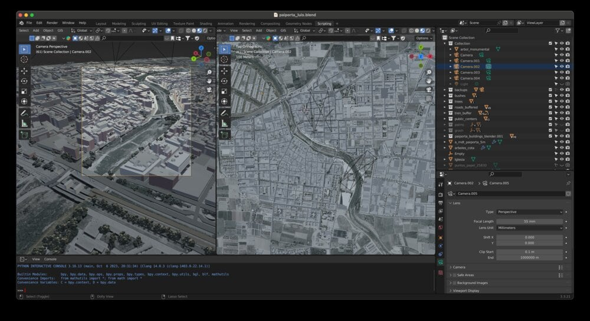
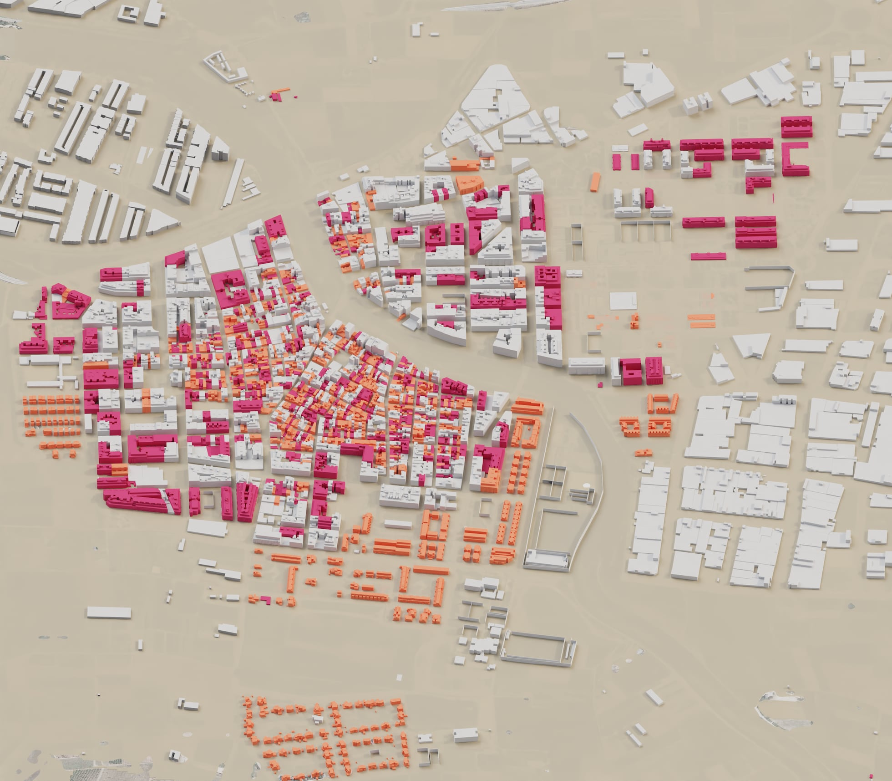
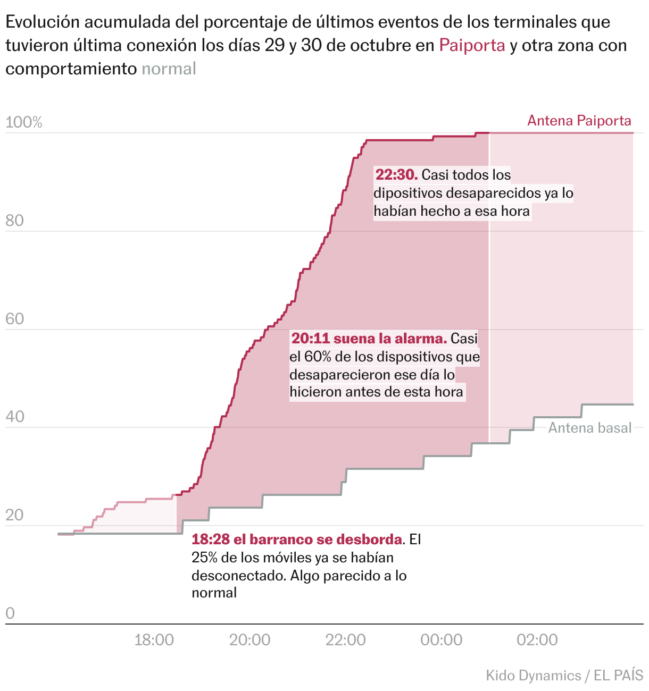

+++
author = "Yuichi Yazaki"
title = "Turning 140 Water Marks into a Town's Water Surface — EL PAÍS's \"Paiporta bajo el agua\" (Paiporta under water)"
slug = "elpais-paiporta-flood"
date = "2026-11-04"
description = "EL PAÍS built a water surface from 140 flood marks measured in Paiporta after the 2024 torrential rains, and overlaid it on a 3D model of the town's buildings reconstructed from cadastral data."
categories = [
    "consume"
]
tags = [
    "data journalism",
    "Sigma Awards",
    "3D",
    "flood",
    "spatial interpolation"
]
image = "images/cover.jpg"
series = ["dataviz-journalism"]
series_weight = 8
seriesByline = "Borja Andrino, Luis Sevillano, and Jacob Vicente"
seriesTitle = "140 Water Marks Become the Town's Water Surface: Paiporta bajo el agua"
+++

From 140 water marks measured in Paiporta, EL PAÍS built the surface of the flood. It then overlaid that surface on a 3D model of the town's buildings reconstructed from cadastral data. The setting is a town in the province of Valencia, Spain, where a river overflowed in the torrential rains of October 29, 2024. The 3D town is a video drawn in Blender, and it plays as the reader scrolls.

The piece appeared on December 29, 2024, in EL PAÍS Semanal, the Sunday magazine of EL PAÍS. It is signed by three authors: Borja Andrino, Luis Sevillano Pires, and Jacob Vicente. At the Sigma Awards 2025 it was selected for the shortlist. This article reads it alongside the piece's main text and methodology section, the page's scripts, Sevillano's portfolio, and the Sigma entry form.

<!--more-->

## Turning 140 points measured three weeks later into a surface of water

Paiporta is a town of about 30,000 people, cut through by the Barranco del Poyo, a ravine that is normally dry. On October 29, heavy rain upstream made it overflow at around 6:30 in the evening. According to the piece's text, 46 people died in Paiporta that day, 19 of them found in their own homes.

What EL PAÍS measured were the water marks left on walls, entrances, and garages. The methodology section begins like this.

> Durante los días 18, 19 y 20 de noviembre se tomaron in *si tu* 140 mediciones de marcas de agua en todo el municipio de Paiporta. Es importante señalar que estas marcas corresponden al estado del agua estancada, es posible que en algunos momentos de la riada fuesen incluso superadas.

In short: on November 18 to 20, 140 water marks were measured on site across the town. The note adds that the marks show the state of the standing water, and that at some moment of the flood the level may have exceeded them. The water surface the piece draws is the height at which the marks remained, not the peak. According to the text cards, 73 of the 140 marks are above 2 m, and none is below 1.1 m.

The methodology section also describes the steps that turn points into a surface, in three stages.

1. Remove the riverbed from the digital terrain model (MDT) and smooth it to make a base surface.
2. Interpolate a grid by inverse distance weighting (IDW), using the depths of the 140 points and points on the outer edge of the flooded area (depth 0).
3. Add the interpolated depths to the base MDT to get the height of the water surface across the whole town.

The edge points were collected by researchers at the University of Valencia. Because of these 0 values at the edge, the water surface can be read as constructed so that it ends at the town's boundary. What is interpolated is not the elevation of the water surface but the depth, which is then added to the terrain.

Source: Borja Andrino, Luis Sevillano Pires, Jacob Vicente / EL PAÍS, "Paiporta bajo el agua"

This is the poster image (for smartphones) of the video in card 7. The text of card 6 puts a magenta (#ff35ea) band behind the phrase "140 marcas de la inundación". The magenta dots in the bird's-eye view can be read as those 140 points. Card 7 continues with "El resultado es un municipio completamente anegado" (the result is a town completely under water).

## Rebuilding the town from the cadastre and turning it into video in Blender

The town overlaid on the water surface is also built from data. The shapes of the buildings come from the Catastro (the Spanish cadastre). Heights were estimated from the difference between a surface model and a terrain model, giving an average height per floor. Extreme values were replaced.

The methodology states the estimated and hand-made parts one by one. Windows and entrances were placed at random, based on each building's perimeter and number of floors. Tree positions were collected by hand, and three bridges and one footbridge were built by hand. The church and the buildings on two streets were built from Google street-level photos. Roads and streetlights come from Catastro vector data, which "pueden no estar completos" (may not be complete).

Source: Borja Andrino, Luis Sevillano Pires, Jacob Vicente / EL PAÍS, "Paiporta bajo el agua"

This 3D does not run inside the browser. The methodology says that the opening frames and the maps in the piece were all made in Blender. Sevillano also recalls it this way.

> The reconstruction was rendered as video and embedded in a scroll-driven narrative format to guide readers through the progression of impact.

In other words, the reconstruction was rendered as video and embedded in a scroll-driven narrative. Reading the script, there are 12 text cards. Each card has a video for desktop and one for smartphones, and the video plays from the beginning when the card appears.

Source: Luis Sevillano / luissevillano.net, "Paiporta under water: reconstructing a deadly flood"

Organized from the piece's methodology and the page's code, the correspondence between data and visuals looks like this.

| Data | Processing / source | Appearance / material | Value |
|---|---|---|---|
| Water marks (points) | Measured on site, November 18–20 | Numbers on text cards; magenta dots in the bird's-eye view | 140 points, 73 of them above 2 m |
| Flood depth (surface) | Points and edge zeros interpolated by IDW, added to the terrain | Ochre layer of water filling the spaces between buildings | Measured minimum 1.1 m |
| Terrain | Digital terrain model (MDT) | 3D ground; line of the cross-section | Cross-section length 150 m |
| Buildings | Shapes from the Catastro; height from the difference of two models | Extruded boxes; windows and entrances random | — |
| Trees, bridges, church | Handwork, regional inventory, street-level photos | 3D assets | Eucalyptus over 20 m |
| Ground-floor homes | No procedure given in the piece | Color-coded buildings in a still image | Over 2,000 homes, about 1,000 of them |
| Underground parking | No procedure given in the piece | Dark pink buildings in a still image | Over 400 buildings, about 5,000 spaces |
| Mobile phone disconnections | Analysis by Kido Dynamics | Two cumulative lines | 57.7% at 20:11 |

On the text cards, the phrase "dos metros de altura" (two meters high) gets an ochre (#efa83d) highlight. It is in the same family of colors as the layer of water in the images, so the highlight in the text can be read as serving as the legend.

## Ground-floor homes and underground parking

The main text uses the 3D town to approach the question of where the people who died were. More than 2,000 homes have rooms on the ground floor, and about half of them, around 1,000, have all their rooms on the ground floor. A home with every room on the ground floor has no upper floor to escape to.

Source: Borja Andrino, Luis Sevillano Pires, Jacob Vicente / EL PAÍS, "Paiporta bajo el agua"

This still image is placed after the paragraph on ground-floor homes, with neither a caption nor a legend. The text puts a dark pink band behind two phrases: "homes with rooms on the ground floor" and "homes with all rooms at street level". The two colors in the image can be read as corresponding to these two categories. However, it is not stated which color is which.

The next paragraph turns to the basements. More than 400 buildings have at least one underground parking space, and the spaces total about 5,000. Here too a still image appears, with buildings painted dark pink. The methodology does not say which data these numbers come from.

The entry form gives the meaning of this part as follows.

> Estos espacios fueron determinantes en la catástrofe: la mitad de las víctimas fallecieron en ellos, atrapadas por la riada.

The claim is that these spaces were decisive in the catastrophe: half of the victims died in them, trapped by the flood. By overlaying the height of the water surface and the structure of the buildings in the same image, the piece can be read as showing in a single picture which homes' ground floors went under.

## The 20:11 alert and the numbers that disagree

The timing of the flooding is shown by different data in a different chart. It is an analysis of mobile phones by Kido Dynamics, counting the devices that dropped off the network from the evening to the night of the 29th and did not reconnect even days later.

Source: Kido Dynamics, EL PAÍS / EL PAÍS, "Paiporta bajo el agua" (Datawrapper)

The y-axis shows, among the devices whose last connection fell on the 29th or 30th, the share that had ended its last communication by that time. The two lines are the Paiporta antenna and a baseline antenna (Antena basal). In the data, Paiporta is at 26.3% at 18:28, 57.7% at 20:11, and 98.5% at 22:30. The baseline antenna was at 23.7% even at 20:11.

> 20:11 suena la alarma. Casi el 60% de los dispositivos que desaparecieron ese día lo hicieron antes de esta hora

The note says: at 20:11 the alarm sounds, and nearly 60% of the devices that disappeared that day did so before that time. The main text also gives the water depth at that moment.

> Cuando la alarma de emergencias sonó en los móviles de los vecinos, a las 20.11, en muchas calles el agua corría con más de metro y medio de altura.

That is, when the alarm sounded at 20:11, the water was running more than 1.5 m high in many streets.

Here the numbers in the piece and in the entry form disagree. For the same time, the entry form writes "en varias calles el agua superaba los dos metros" (in several streets the water exceeded two meters), citing "numerosos testimonios" (numerous testimonies) as the basis. The number of measurements and the period also differ by source.

| Item | The piece | Entry form | Sevillano's portfolio |
|---|---|---|---|
| Water depth at 20:11 | Over 1.5 m (many streets) | Over 2 m (several streets, from testimonies) | — |
| Number of measurements | 140 | más de 140 (more than 140) | hundreds (across several affected towns) |
| When measured | November 18–20 (three weeks later) | — | Days after the flood |
| Techniques | No mention of machine learning or scraping | Lists AI/Machine learning and Scraping | blender, r, qgis, aftereffects |

**For the water depth at 20:11, the number a reader saw in the piece is over 1.5 m.** The entry form's "over 2 m" cannot be confirmed within the piece as the depth at the time 20:11. Whether the hundreds of measurements include towns other than Paiporta is also not clear from the sources.

## How third parties saw the piece

At the Sigma Awards 2025, 19 judges chose a shortlist of 50 from 498 entries, and this piece was one of them. It is not among the 10 winners. The listing site for Sigma works also carries the piece's page as part of the 2025 shortlist. Per-entry comments have not been published, and I found no critique that discusses this piece. Here I set out two sources with different points of focus.

The first is a flood depth map made by the CGAT group at the Universitat Politècnica de València (UPV). For the same disaster, researchers and students measured wall marks in the surrounding area, reaching 5,097 points as of January 21, 2025. Like EL PAÍS, it interpolates points into a surface, but it also produces a separate surface with the buildings masked out.

> the height of the masked sheet of water that presents the flooding only in the areas without buildings (streets, squares, open field, ….), where it has really occurred

This describes a surface that shows only the places without buildings, that is, where the flooding actually occurred. EL PAÍS does the opposite: it stands buildings up as 3D boxes and intersects them with the water surface. Where the surface cuts through a building, UPV removes it, while EL PAÍS shows it as the height of the water on a home's ground floor, it can be read. According to press reports, Professor Josep Pardo Pascual, who led the survey, testified in court that the water exceeded 3 m. This agrees, independently, with the entry form's statement of "over 3 m at some points".

The second is a 2025 study by Montse Morcate and Rebeca Pardo, which analyzes front-page newspaper photographs in the weeks after the torrential rains.

> visual metaphors for the dead were used frequently, especially symbolic images of piled‐up cars

The finding is that visual metaphors for the dead were used frequently, especially images of piled-up cars. This piece also shows piled-up cars in card 5. At the same time, it translates the reason for the deaths into building structure, ground-floor homes and underground parking, and shows it with numbers and 3D forms. Against the metaphors of photojournalism, the visualization can be read as trying to show the mechanism.

## Takeaways

The first is to leave the procedure for making a surface from points in plain words: base surface, zeros at the edge, IDW, adding to the terrain. Because the steps are written down, readers can trace how much of the water surface is measured value and where interpolation begins.

The second is to write "measured values" and "made values" separately. Once things become a 3D image, the measured water surface and randomly placed windows melt into the same look. The piece states in the text that the marks are the height of standing water, that building heights are estimates, and that windows are random.

The third is to leave height and time to separate charts. The 3D town shows "how far it sank", and the cumulative line shows "when they disappeared". The two are connected by a single time, 20:11.

Finally, check the numbers in entry forms and retrospectives against the numbers in the piece. In this piece, both the water depth at 20:11 and the number of measurements differed from source to source. When introducing the piece, it is safer to put first the numbers the reader saw in the piece.

## References

**Primary sources**

- Borja Andrino, Luis Sevillano Pires, Jacob Vicente, "Paiporta bajo el agua," *EL PAÍS Semanal*, 2024-12-29 (main text and methodology, "Metodología y recursos"): https://elpais.com/eps/2024-12-29/paiporta-bajo-el-agua.html
- Script of the scroll section of the same piece (card text and video file names): https://ep00.epimg.net/infografias/2024/12/paiporta-zona-cero/assets/index.js?v=1
- CSS of the scroll section of the same piece (highlight colors): https://ep00.epimg.net/infografias/2024/12/paiporta-zona-cero/main.css?v=1
- Cross-section of the same piece (ai2html): https://ep00.epimg.net/infografias/2024/12/paiporta3D/perfil.js?v6666
- Chart of mobile phone disconnections (Datawrapper, Kido Dynamics / EL PAÍS): https://datawrapper.dwcdn.net/vMAvT/1/ , data: https://datawrapper.dwcdn.net/vMAvT/1/dataset.csv
- Luis Sevillano, "Paiporta under water: reconstructing a deadly flood" (portfolio): https://luissevillano.net/work/paiporta-under-water/
- Sigma Awards 2025 entry form (listing site; Spanish original and machine translation): https://sigma-awards.data-visualization.jp/entries/2025-s-0032/

**Secondary sources**

- GIJN, "Announcing the Sigma Awards 2025 Shortlist": https://www.sigmaawards.org/announcing-the-sigma-awards-2025-shortlist/
- GIJN, announcement of the 2025 Sigma Awards winners: https://www.sigmaawards.org/from-flammable-buildings-to-slaverys-hidden-legacy-to-tainted-groundwater-projects-from-10-countries-win-gijns-2025-sigma-awards/
- UPV ETSIGCT, "The CGAT group of the DICGF, together with the ETSIGCT, creates a map of the flooding in l'Horta Sud after the episode of October 29, 2024," 2025-01-28: https://www.upv.es/entidades/etsigct/en/2025/01/28/the-cgat-group-of-the-dicgf-together-with-the-etsigct-creates-a-map-of-the-flooding-in-lhorta-sud-after-the-episode-of-october-29-2024/
- NacióDigital, report on the testimony of Professor Josep Pardo Pascual: https://naciodigital.cat/societat/un-expert-en-cartografia-declara-que-laigua-va-superar-els-tres-metres-dalcada-durant-la-dana.html
- Montse Morcate & Rebeca Pardo (2025). Cut-Off Low (DANA) in Valencia: Visual Representation of Death and Grief in Photojournalism. *Media and Communication* 13 (CC BY 4.0). doi:10.17645/mac.10775 / https://www.cogitatiopress.com/mediaandcommunication/article/view/10775
