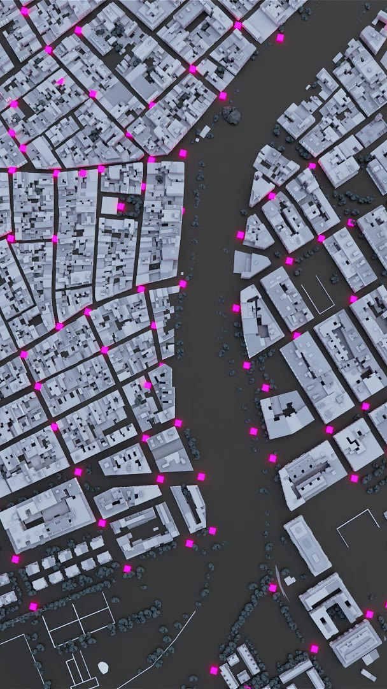
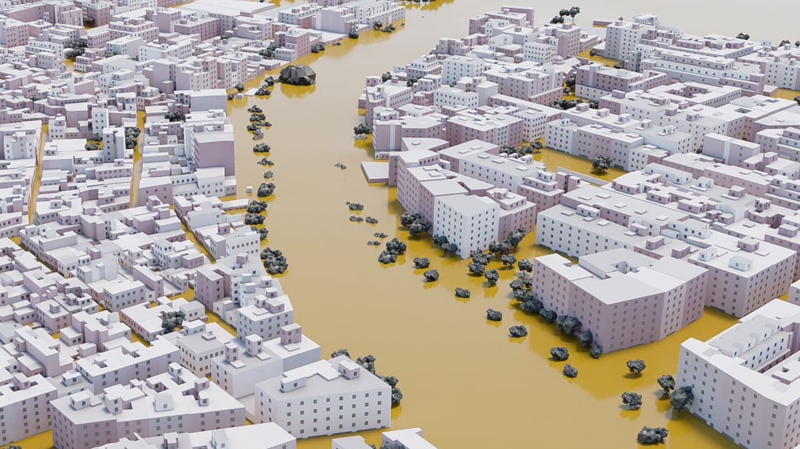
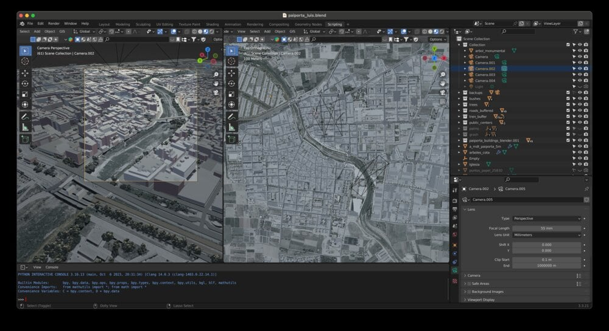
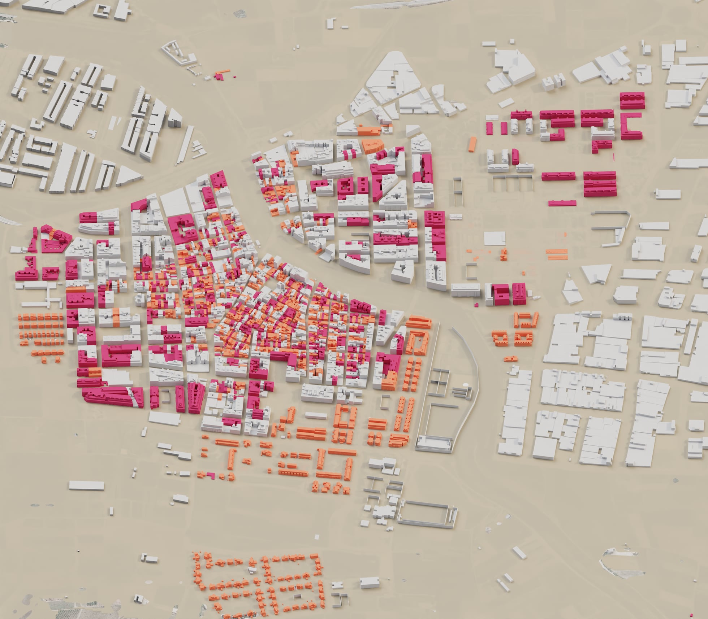
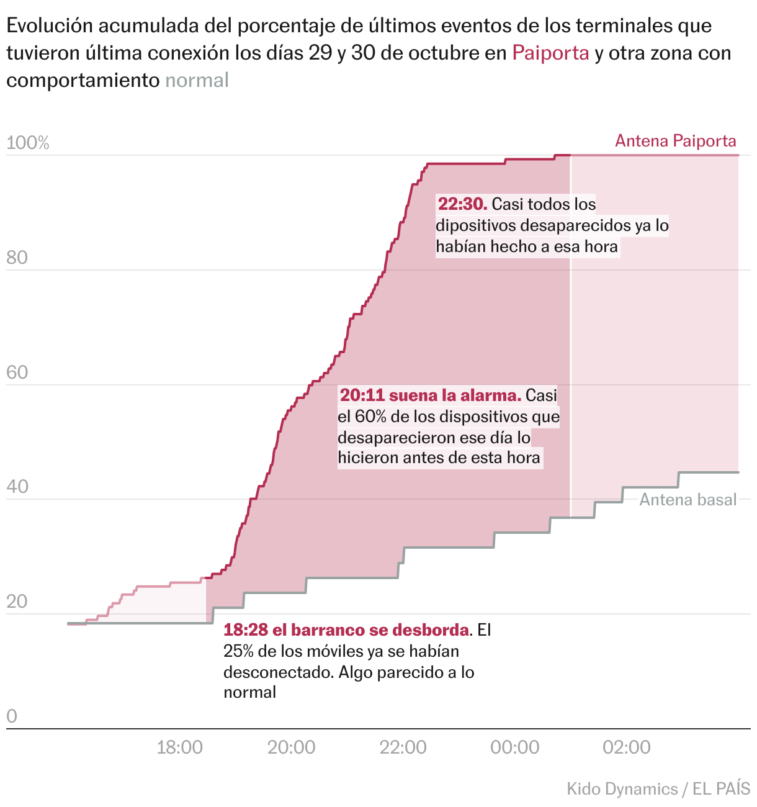

+++
author = "矢崎裕一"
title = "140点の水の跡から、町の水面を作る──EL PAÍS『Paiporta bajo el agua』"
slug = "elpais-paiporta-flood"
date = "2026-11-04"
description = "EL PAÍS は、2024年の豪雨で浸水したパイポルタで測った140点の水の跡から水面を作り、地籍データから起こした建物の3D模型と重ねました。"
categories = [
    "consume"
]
tags = [
    "データジャーナリズム",
    "Sigma Awards",
    "3D",
    "洪水",
    "空間補間"
]
image = "images/cover.jpg"
series = ["dataviz-journalism"]
series_weight = 8
seriesByline = "Borja Andrino・Luis Sevillano・Jacob Vicente"
seriesTitle = "水の跡140点を町の水面に──Paiporta bajo el agua"
+++

EL PAÍS は、パイポルタで測った140点の水の跡から、浸水した水面を作りました。それを、地籍データから起こした建物の3D模型と重ねています。舞台は、2024年10月29日の豪雨で川があふれたスペイン・バレンシア県の町です。3D の町は Blender で描いた動画で、読者のスクロールに合わせて再生されます。

作品は2024年12月29日、EL PAÍS の日曜版雑誌面 EL PAÍS Semanal に載りました。署名は Borja Andrino（ボルハ・アンドリノ）、Luis Sevillano Pires（ルイス・セビジャーノ）、Jacob Vicente（ハコブ・ビセンテ）の3人です。Sigma Awards 2025 ではショートリストに選ばれました。以下は、作品の本文と方法論の節、ページのスクリプト、Sevillano のポートフォリオ、Sigma への応募書類に沿って読みます。

<!--more-->

## 3週間後に測った140点を、水の面にする

Paiporta（パイポルタ）は人口約3万の町で、ふだん水のない涸れ川 Barranco del Poyo が町を貫いています。10月29日、上流の豪雨で、この川が夕方6時半ごろにあふれました。作品の本文によれば、この日パイポルタでは46人が亡くなり、うち19人は自宅で見つかっています。

EL PAÍS が測ったのは、壁や玄関、ガレージに残った水の跡です。方法論の節の冒頭は、こう始まります。

> Durante los días 18, 19 y 20 de noviembre se tomaron in *si tu* 140 mediciones de marcas de agua en todo el municipio de Paiporta. Es importante señalar que estas marcas corresponden al estado del agua estancada, es posible que en algunos momentos de la riada fuesen incluso superadas.

11月18〜20日に、町全体で140の水の跡を現地で測った。跡は止まった水の状態を示すもので、氾濫のある時点では水位がこれを上回った可能性がある、という注記です。作品が描く水面は、ピークではなく跡が残った高さです。文字カードによれば、140点のうち73点が2mを超え、1.1mを下回る跡は一つもありません。

点を面に変える手順も、方法論の節に3段階で書かれています。

1. 標高モデル（MDT）から川床を取り除き、平滑化して基準面を作る。
2. 140点の深さと、浸水域の外縁の点（深さ0）から、逆距離加重（IDW）で格子を補間する。
3. 基準の MDT に補間した深さを足し、町全体の水面の高さにする。

外縁の点は、バレンシア大学の研究者が集めたものです。端の0があるので、水面は町の外で途切れるように作られている、と読めます。補間したのは水面の標高ではなく深さで、それを地形に足しています。

Borja Andrino・Luis Sevillano Pires・Jacob Vicente／EL PAÍS「Paiporta bajo el agua」より引用

これはカード7の動画のポスター画像（スマホ用）です。カード6の文章は「140 marcas de la inundación」の語句に、マゼンタ（#ff35ea）の帯をかけています。俯瞰図のマゼンタの点は、その140点に当たると読めます。カード7は続けて「El resultado es un municipio completamente anegado」（結果は、完全に水没した町だ）と書きます。

## 地籍から町を起こし、Blender で動画にする

水面と重ねる町も、データから起こしています。建物の形は Catastro（スペインの地籍）の図形です。高さは、地表面のモデルと地形のモデルの差から推定し、1階あたりの平均の高さを出しました。極端な値は置き換えています。

推定や手作業の部分も、方法論は一つずつ書いています。窓と玄関は、建物の外周と階数をもとに乱数で置いた。木の位置は手で集め、橋3本と歩道橋1本も手で作った。教会と2本の通りの建物は、Google の路上写真から作った。道路と街灯は Catastro のベクタデータで、「pueden no estar completos」（完全ではないかもしれない）とあります。

Borja Andrino・Luis Sevillano Pires・Jacob Vicente／EL PAÍS「Paiporta bajo el agua」より引用

この3D は、ブラウザの中で動かすものではありません。方法論は、冒頭の全コマと作品中の地図を Blender で作ったと書いています。Sevillano も、こう振り返ります。

> The reconstruction was rendered as video and embedded in a scroll-driven narrative format to guide readers through the progression of impact.

再現は動画としてレンダリングし、スクロールで進む物語に埋め込んだ、という説明です。スクリプトを読むと、文字カードは12枚あります。各カードに PC 用とスマホ用の動画があり、カードが現れると頭から再生されます。

Luis Sevillano／luissevillano.net「Paiporta under water: reconstructing a deadly flood」より引用

データと見た目の対応を、作品の方法論とページのコードから整理すると、次のようになります。

| データ | 加工・出どころ | 見た目・素材 | 値 |
|---|---|---|---|
| 水の跡（点） | 11月18〜20日に現地で測る | 文字カードの数字、俯瞰図のマゼンタの点 | 140点、うち73点が2m超 |
| 浸水の深さ（面） | 点と外縁の0を IDW で補間し、地形に足す | 建物のあいだを埋める黄土色の水の層 | 実測の最小は1.1m |
| 地形 | 標高モデル（MDT） | 3D の地面、断面図の線 | 断面の長さは150m |
| 建物 | Catastro の形、高さは2つのモデルの差 | 押し出した箱。窓と玄関は乱数 | — |
| 木・橋・教会 | 手作業、州の目録、路上写真 | 3D の素材 | ユーカリは20m超 |
| 1階の住宅 | 作品に手順の記載なし | 静止画の色分けした建物 | 2,000戸超、うち約1,000戸 |
| 地下駐車場 | 作品に手順の記載なし | 静止画の濃いピンクの建物 | 400棟超、約5,000台分 |
| 携帯電話の切断 | Kido Dynamics の分析 | 累積の折れ線2本 | 20:11 に57.7% |

文字カードでは「dos metros de altura」（2mの高さ）の語句に、黄土色（#efa83d）の強調がかかります。画の水の層と同じ系統の色で、文章の強調が凡例の役目をしていると読めます。

## 1階の家と、地下の駐車場

本文は、3D の町を使って、亡くなった人がどこにいたかに迫ります。1階に部屋がある住宅は2,000戸を超え、その半分の約1,000戸は全部の部屋が1階です。全室が1階の家には、逃げ上がる上の階がありません。

Borja Andrino・Luis Sevillano Pires・Jacob Vicente／EL PAÍS「Paiporta bajo el agua」より引用

この静止画は、1階の住宅の段落の後に置かれ、キャプションも凡例もありません。本文は「1階に部屋のある住宅」と「全部の部屋が道路の高さにある家」の2つの語句に、濃いピンクの帯をかけています。画の2色は、この2つの分類に当たると読めます。ただし、どちらの色がどちらかは書かれていません。

続く段落は地下です。地下に駐車スペースを一つでも持つ建物は400棟を超え、スペースは合わせて約5,000あります。ここにも、建物を濃いピンクで塗った静止画が入ります。これらの数をどのデータから出したかは、方法論に書かれていません。

応募書類は、この部分の意味をこう書いています。

> Estos espacios fueron determinantes en la catástrofe: la mitad de las víctimas fallecieron en ellos, atrapadas por la riada.

これらの空間が惨事を決めた。犠牲者の半分は、そこで水に閉じ込められて亡くなった、という主張です。水面の高さと建物の構造を同じ画に重ねたことで、どの家の1階が沈んだかを一枚で示している、と読めます。

## 20:11の警報と、食い違う数字

浸水の時間は、別のデータと別の図で示されます。Kido Dynamics による携帯電話の分析で、29日の夕方から夜に網から消え、数日たっても再接続しなかった端末を数えています。

Kido Dynamics・EL PAÍS／EL PAÍS「Paiporta bajo el agua」（Datawrapper）より引用

y軸は、29・30日に最後の接続があった端末のうち、その時刻までに最後の通信を終えた割合です。線はパイポルタの基地局と、平常の基地局（Antena basal）の2本です。データでは、パイポルタは18:28 に26.3%、20:11 に57.7%、22:30 に98.5%。平常の基地局は、20:11 でも23.7%でした。

> 20:11 suena la alarma. Casi el 60% de los dispositivos que desaparecieron ese día lo hicieron antes de esta hora

20:11、警報が鳴る。その日に消えた端末の6割近くが、この時刻より前に消えていた、という注記です。本文も、その時刻の水深を書いています。

> Cuando la alarma de emergencias sonó en los móviles de los vecinos, a las 20.11, en muchas calles el agua corría con más de metro y medio de altura.

警報が鳴った20:11、多くの通りで水は1.5mを超える高さで流れていた、という一文です。

ここで、作品と応募書類の数字が食い違います。応募書類は同じ時刻について「en varias calles el agua superaba los dos metros」（いくつかの通りで水は2mを超えていた）と書き、根拠を「numerosos testimonios」（多くの証言）としています。測った数や時期も、資料によって違います。

| 項目 | 作品 | 応募書類 | Sevillano のポートフォリオ |
|---|---|---|---|
| 20:11 の水深 | 1.5m超（多くの通り） | 2m超（いくつかの通り、証言による） | — |
| 測った数 | 140 | más de 140（140超） | hundreds（数百、被災した複数の町で） |
| 測った時期 | 11月18〜20日（3週間後） | — | Days after the flood |
| 技術 | 機械学習やスクレイピングの説明はない | AI/Machine learning、Scraping を挙げる | blender, r, qgis, aftereffects |

**20:11 の水深について、読者が作品で見た数字は1.5m超です。** 応募書類の2m超は、20:11 という時刻の水深としては、作品の中では確かめられません。数百の測定がパイポルタ以外の町を含むのかどうかも、資料からは分かりません。

## 第三者はこの作品をどう見たか

Sigma Awards 2025 では、応募498件から19人の審査員が50件のショートリストを選び、この作品はその1件でした。受賞の10件には入っていません。Sigma の一覧サイトの作品ページも、2025年のショートリストとして載せています。作品ごとの講評は公開されておらず、この作品を論じた批評も見つかりませんでした。ここでは、論点の違う資料を2つ並べます。

一つ目は、バレンシア工科大学（UPV）の CGAT が作った浸水深マップです。同じ災害で、研究者と学生が周辺地域の壁の跡を測りました。2025年1月21日時点で5,097点です。点を補間して面にする点は EL PAÍS と同じですが、建物を抜いた面を別に出しています。

> the height of the masked sheet of water that presents the flooding only in the areas without buildings (streets, squares, open field, ….), where it has really occurred

建物のない場所、つまり実際に浸水が起きた場所だけを示す面、という説明です。EL PAÍS は逆に、建物を3D の箱として立て、水の面と交差させています。面が建物を貫く部分を、UPV は抜き、EL PAÍS は家の1階の高さとして見せた、と読めます。報道によれば、この調査を率いた Josep Pardo Pascual 教授は、裁判所で水が3mを超えたと証言しています。応募書類の「一部の地点で3m超」と、独立に一致します。

二つ目は、Montse Morcate と Rebeca Pardo の2025年の研究です。豪雨後数週間の新聞1面の写真を分析しています。

> visual metaphors for the dead were used frequently, especially symbolic images of piled‐up cars

死者を表す比喩が多用され、とくに積み重なった車の写真が使われた、という指摘です。この作品もカード5で積み重なった車を見せます。一方で、犠牲の理由を1階の住宅と地下駐車場という建物の構造に置き換え、数と3D の形で見せています。写真報道の比喩に対して、可視化は仕組みを示そうとした、と読めます。

## 使い道

一つ目は、点から面を作る手順を、そのまま言葉で残すことです。基準面、外縁の0、IDW、地形への足し込み。手順が書いてあるので、読者は水面のどこまでが測った値で、どこからが補間かをたどれます。

二つ目は、「測った値」と「作った値」を分けて書くことです。3D の画になると、実測の水面と、乱数で置いた窓は、同じ見た目に溶けます。作品は、跡が止まった水の高さであること、建物の高さが推定であること、窓が乱数であることを、文章で断っています。

三つ目は、高さと時間を別の図に任せることです。3D の町は「どこまで沈んだか」を、累積の折れ線は「いつ消えたか」を見せます。二つを、20:11 という一つの時刻でつないでいます。

最後に、応募書類や振り返りの数字は、作品の数字と照らし合わせることです。この作品では、20:11 の水深も測った数も、資料ごとに違いました。紹介するときは、読者が見た作品の数字を先に置くのが安全です。

## 参考・出典

**一次情報**

- Borja Andrino, Luis Sevillano Pires, Jacob Vicente, "Paiporta bajo el agua," *EL PAÍS Semanal*, 2024-12-29（本文・方法論「Metodología y recursos」）：https://elpais.com/eps/2024-12-29/paiporta-bajo-el-agua.html
- 同作品のスクロール部分のスクリプト（カードの文章・動画ファイル名）：https://ep00.epimg.net/infografias/2024/12/paiporta-zona-cero/assets/index.js?v=1
- 同作品のスクロール部分の CSS（強調色）：https://ep00.epimg.net/infografias/2024/12/paiporta-zona-cero/main.css?v=1
- 同作品の断面図（ai2html）：https://ep00.epimg.net/infografias/2024/12/paiporta3D/perfil.js?v6666
- 携帯電話の切断のグラフ（Datawrapper、Kido Dynamics / EL PAÍS）：https://datawrapper.dwcdn.net/vMAvT/1/ 、データ：https://datawrapper.dwcdn.net/vMAvT/1/dataset.csv
- Luis Sevillano, "Paiporta under water: reconstructing a deadly flood"（ポートフォリオ）：https://luissevillano.net/work/paiporta-under-water/
- Sigma Awards 2025 応募書類（一覧サイト、スペイン語原文と機械翻訳）：https://sigma-awards.data-visualization.jp/entries/2025-s-0032/

**第三者評価**

- GIJN, "Announcing the Sigma Awards 2025 Shortlist"：https://www.sigmaawards.org/announcing-the-sigma-awards-2025-shortlist/
- GIJN, 2025 Sigma Awards 受賞発表：https://www.sigmaawards.org/from-flammable-buildings-to-slaverys-hidden-legacy-to-tainted-groundwater-projects-from-10-countries-win-gijns-2025-sigma-awards/
- UPV ETSIGCT, "The CGAT group of the DICGF, together with the ETSIGCT, creates a map of the flooding in l'Horta Sud after the episode of October 29, 2024," 2025-01-28：https://www.upv.es/entidades/etsigct/en/2025/01/28/the-cgat-group-of-the-dicgf-together-with-the-etsigct-creates-a-map-of-the-flooding-in-lhorta-sud-after-the-episode-of-october-29-2024/
- NacióDigital, Josep Pardo Pascual 教授の証言の報道：https://naciodigital.cat/societat/un-expert-en-cartografia-declara-que-laigua-va-superar-els-tres-metres-dalcada-durant-la-dana.html
- Montse Morcate & Rebeca Pardo (2025). Cut-Off Low (DANA) in Valencia: Visual Representation of Death and Grief in Photojournalism. *Media and Communication* 13（CC BY 4.0）. doi:10.17645/mac.10775 ／ https://www.cogitatiopress.com/mediaandcommunication/article/view/10775
