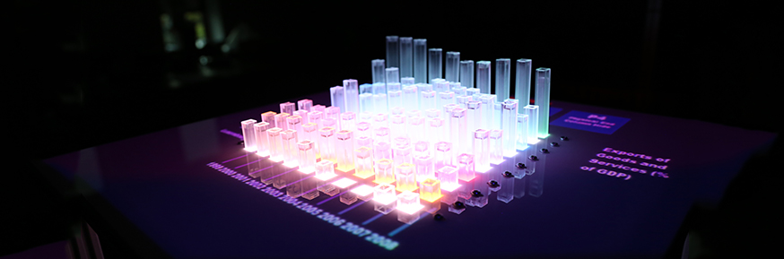
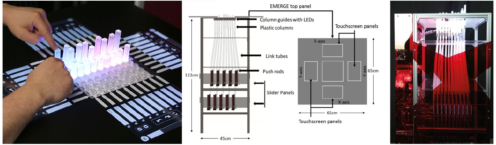
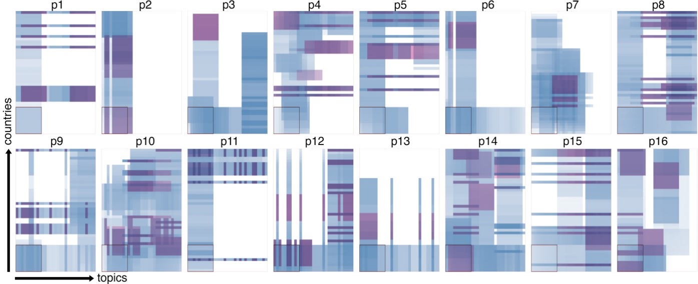
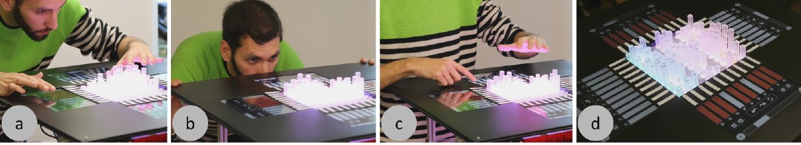

+++
author = "Yuichi Yazaki"
title = "Which Data Goes on 100 Bars? EMERGE, a Dynamic Physical Bar Chart"
slug = "emerge-dynamic-bar-chart"
date = "2026-11-05"
description = "EMERGE is a physical bar chart whose 10×10 bars move up and down. Since it can show only 100 bars at a time, hiding, reordering, and scrolling became a large part of its design."
categories = [
    "consume"
]
tags = [
    "data physicalization",
    "bar chart",
    "Yvonne Jansen"
]
image = "images/cover.jpg"
series = ["data-physicalization"]
series_weight = 30
seriesByline = "Faisal Taher, Jason Alexander et al. (Lancaster University)"
seriesTitle = "Which Data Goes on 100 Bars? EMERGE"
+++

EMERGE is a physical bar chart whose 10×10 bars move up and down. It was built by a research group at Lancaster University in the UK. Because it can show only 100 bars at a time, operations that decide which data goes onto the bars, such as hiding, reordering, and scrolling, became a large part of the design.

The first paper is "Exploring Interactions with Physically Dynamic Bar Charts" (CHI 2015) by seven authors including Faisal Taher and Jason Alexander. A follow-up observational study appeared in IEEE TVCG (2017; presented at VIS 2016), and a study of multi-person use appeared at CHI 2023. What follows is based on these three papers and the university's press release.

<!--more-->

## A Platform of 100 Rising and Falling Bars

EMERGE's design follows inFORM, the shape display from MIT. According to the 2015 paper (CHI15 below), the differences are the addition of LEDs, the control mechanism, and the software model.

Plastic bars are arranged in a 10×10 grid, each connected to a motorized slide potentiometer. The travel is 100 mm. The slider below and the bar above are joined by a push rod running through a hollow tube. The sliders are stacked in two tiers, which keeps the footprint to 0.55 × 0.44 × 1.20 m. An RGB LED under each bar lights it up.

Source: Lancaster University, "Shape changing display could spell the end for the 2D graph" (press release, April 13, 2015)

When a person pushes or pulls a bar, the potentiometer value changes. CHI15 used this to detect interaction. Axis labels and control buttons were projected from above onto the surface around the bars, and a Microsoft Kinect picked up touches. In the 2017 paper (TVCG17 below), touchscreens were placed along the four sides of the top surface. Opposite sides show the same information, so the display can be operated from any side.

Source: Miriam Sturdee, Hayat Kara, Jason Alexander, "Exploring Co-located Interactions with a Shape-Changing Bar Chart" (CHI 2023, CC BY). The central diagram is reprinted in that paper from CHI15 (© 2015 ACM).

The mapping between data and appearance is as follows.

| Data / state | Physical property | Details |
|---|---|---|
| Value | Bar height | 0–100 mm |
| Row category (country, region) | Bar color (RGB LED) | A different color for each row |
| Column category (year, topic) | Depth position and axis label | Labels projected; later on touchscreens |
| Vertical axis scale | None | Deliberately omitted in CHI15 |
| A selected point | Light | Dims the others and gives the intersection a different color |
| Emphasis | Pulling a bar up | Dims all bars other than the pulled one |
| Hide | Pushing a bar down | Hides the pressed point or row |
| Visible range | A 10×10 window | Moved by scrolling (CHI15, TVCG17) |
| Locked row | Position within the window | Stays when scrolling (TVCG17) |
| Saved view | The whole arrangement of bars | Saved and recalled later (TVCG17) |

This suggests that color is used only to show which row a bar belongs to, and quantity is shown by height alone. As for the vertical axis, CHI15 itself writes that having one could change interaction and behavior.

This research also has a chapter in the book *Making with Data* (edited by Samuel Huron, Till Nagel, Lora Oehlberg, and Wesley Willett; A K Peters/CRC Press, 2022). It is section 4.4, "EMERGE," in Part 4, "Actuation," which Crossref lists as pp. 287–298, doi:10.1201/9781003264903-19. The chapter's four authors are Alexander, Taher, John Hardy, and John Vidler. This is a different lineup from the seven CHI15 authors, and Vidler appears in CHI15 only in the acknowledgments.

## Trying 14 Interactions: The 2015 CHI Paper

CHI15 opens like this:

> Visualizations such as bar charts help users reason about data, but are mostly screen-based, rarely physical, and almost never physical and dynamic.

In short: most bar charts live on screens, and physical, moving ones are almost nonexistent. The question is how such bar charts should be operated to make exploration work well. Because the field is young, the authors avoided a comparative experiment and looked at participants' behavior and impressions rather than accuracy. There were 17 participants.

The tasks were four types based on the taxonomy of Heer and Shneiderman, with 14 interactions in total.

| Task | Interactions tried | Most preferred interaction (mean on a 5-point scale) |
|---|---|---|
| Mark | Point, Pull, Press | Press (4.29) |
| Filter | Swipe away, Manual press, Assisted press, Press to compare, Press shortcut | Press shortcut (4). Pressing the first bar of a row hides the whole row |
| Sort | Drag and drop, Press to swap (each in two movement styles) | Dragging a label (3.88) |
| Navigate | Scroll bar, directional arrows, Directional press, paging | Scroll bar (4) |

Of the four tasks, filtering, sorting, and navigating can be read as interactions that change which bars show what. A reason is also given for "hiding." On paper bar charts, neighboring bars distort height judgments the most (Zacks et al., 1998), so removing unneeded bars should make comparison easier.

When asked beforehand how they would do each task, all participants answered with touchscreen-style interactions such as swiping or tapping a label. For filtering, however, once they tried interactions that touch the bars directly, their ratings shifted toward the physical side. Even so, the paper concludes that each has its place.

> smaller interactions such as annotation afforded physical interaction, whereas larger motions such as row organization afforded touch-screen style swipe interactions.

In short: small interactions like marking suit physical interaction, while large motions like reordering rows suit touchscreen style.

The animation in which rows slowly move during sorting was not liked. When scrolling, the values for the years in between continued to appear on the bars, and every participant who viewed UK regional rainfall (1920–2012) noticed that the north gets more rain. Three of the 17 participants moved around the unit while operating it.

As a limitation, the paper notes that 10×10 shows little data. The country data came from the materials page of Jansen et al.'s CHI 2013 paper (aviz.fr/phys). Yvonne Jansen is also a co-author of CHI15.

## Viewing 31×46 Data Through a 10×10 Window

TVCG17 is an observational study by the same group. The 16 participants had never used a dynamic physical display or an interactive on-screen visualization tool. They explored European values survey data for about 16 minutes on average, then presented for about 5 minutes on average.

Six interactions were implemented.

- Highlighting: pull a bar up to emphasize it
- Swapping: drag labels to exchange rows
- Scrolling: move through data larger than 10×10
- Locking: fix a row so it stays in the window while scrolling
- Hiding: push a bar down to hide it. Pressing two points at the edge at the same time keeps only those two rows so they can be compared
- Snapshot: save the current view and recall it later

The data was 31 topics × 46 countries, and EMERGE can show only 10×10 at once. As a result, nobody looked at the data as a whole.

Source: Faisal Taher et al., "Investigating the Use of a Dynamic Physical Bar Chart for Data Exploration and Presentation" (IEEE TVCG, 2017, author's final version), Fig. 4

Seven of the 16 felt there was "too much data." On the other hand, 15 said a 10×10 window was enough. The authors acknowledge this discrepancy and list, as future work, bringing the focus+context techniques used in on-screen visualization to physicalization.

In the presentations, 9 of the 16 showed their saved snapshots in sequence. Nine also hid unneeded data to emphasize what remained, or used hidden bars as dividers between groups. This suggests that a state in which they had chosen and arranged what appeared in the window became the material for the presentation itself.

How people used their bodies was recorded too. Everyone moved between at least two sides, and four went around three sides. Movements such as peering in, tilting the head, and crouching appeared often right after scrolling. The authors write that because a 3D object looks different from different angles, multiple viewpoints help in checking relationships.

Source: Faisal Taher et al., "Investigating the Use of a Dynamic Physical Bar Chart for Data Exploration and Presentation" (IEEE TVCG, 2017, author's final version), Fig. 1

Bars in the center were hard to reach when surrounded by tall bars, so interaction concentrated on the edge bars. Fifteen participants said the data was easy to read, while one said it was hard to present without exact numbers.

It is not known what the body movements are for. The authors write:

> It remains an open question as to whether body movements are correlated with better insights from the data, if they allow participants to read data more accurately, or if they compensate for occlusion.

In short: whether they lead to better insights, serve accurate reading, or make up for hidden parts is unknown. The authors add that the unit should be placed where people can walk around it, not against a wall.

The 2023 paper (Miriam Sturdee, Hayat Kara, Alexander) repeated the same procedure with 24 participants in pairs and groups of four. Their exploration covered a narrower range than with one person, and they stayed in one window longer. The paper says that a single person could compensate for hidden parts by moving around, but groups and pairs could not.

## "The End of the 2D Graph" and the Paper's Self-Assessment

On April 13, 2015, Lancaster University issued a press release about EMERGE. Its headline was "Shape changing display could spell the end for the 2D graph," which says it could be the end of the 2D graph. The body text is stronger, saying it is "sounding the death knell for the two dimensional bar chart," that is, announcing the end of the 2D bar chart.

The papers are written differently. TVCG17 describes its own study this way:

> Our study was not a comparative experiment, and we therefore cannot draw any conclusions about how visualizations and physicalizations compare.

In short: because it was not a comparative experiment, no conclusion can be drawn about which is better, on-screen visualization or physicalization. This suggests the paper does not claim to be better than 2D.

The comparative experiment was done by Jansen et al. at CHI 2013. A static 3D bar chart was read faster as a physical object than on screen, but did not match a 2D on-screen display ([Jansen et al.'s evaluation experiment](/en/evaluating-physical-visualizations/)). EMERGE can be read as the next step, asking "if it can move, how should it be operated?" [Physical Charts](/en/tenison-road-charts/) in the same series is also a moving bar chart, but it sits inside a lab's glass window and is shown to people on the street. EMERGE is a lab prototype that viewers operate by pushing and pulling the bars.

## How Others Viewed EMERGE

The points of evaluation differ by source.

- **Bae et al. (CHI 2022)** place EMERGE alongside Zooids, under the argument that the breadth of interaction determines the depth of analysis. It is an example that builds filtering, reconfiguring, abstraction and elaboration, and selection into a 2.5D display.
- **Djavaherpour et al. (Computer Graphics Forum 2021)** put EMERGE in the "statistical data" category of their physicalization taxonomy, describing it as a responsive bar chart with bars and RGB LEDs. Jansen is a co-author.
- **Sauvé, Potts, Alexander, and Houben (CHI 2020)** cite EMERGE as motivation for an experiment on orientation and perception: it is unclear whether walking around compensates for occlusion or serves accurate reading. Alexander is a co-author.

The latter two include people from the creators' side, so they are not entirely third-party evaluations. In press coverage, ScienceDaily reposted the press release.

## Takeaways

EMERGE suggests that in physical visualization, the upper limit on how much can be shown is set first. This prototype has 100 bars. So the design turned toward operations for deciding what to assign to the limited bars.

The same applies on screens when a lot of data is placed in a small area. I read three takeaways. First, pair a means of looking outside the window with a means of keeping things fixed inside it. Second, choose the means by the size of the interaction: to select one point, touch that point; to move a row, move its label. Third, place a 3D display where viewers can walk around it.

## References

**Primary sources**

- Faisal Taher, John Hardy, Abhijit Karnik, Christian Weichel, Yvonne Jansen, Kasper Hornbæk, Jason Alexander, "Exploring Interactions with Physically Dynamic Bar Charts," CHI 2015, pp. 3237–3246. [PDF](https://www.kasperhornbaek.dk/papers/CHI2015_Emerge.pdf) / [Lancaster eprints](https://eprints.lancs.ac.uk/id/eprint/72692) / [doi:10.1145/2702123.2702604](https://doi.org/10.1145/2702123.2702604)
- Faisal Taher, Yvonne Jansen, Jonathan Woodruff, John Hardy, Kasper Hornbæk, Jason Alexander, "Investigating the Use of a Dynamic Physical Bar Chart for Data Exploration and Presentation," *IEEE TVCG* 23(1), 2017, pp. 451–460. [Author's final version](https://purehost.bath.ac.uk/ws/files/211082383/VIS16_PhysicalBarChart.pdf) / [Lancaster eprints](https://eprints.lancs.ac.uk/id/eprint/82634) / [doi:10.1109/TVCG.2016.2598498](https://doi.org/10.1109/TVCG.2016.2598498)
- Miriam Sturdee, Hayat Kara, Jason Alexander, "Exploring Co-located Interactions with a Shape-Changing Bar Chart," CHI 2023. [PDF](https://purehost.bath.ac.uk/ws/files/285358459/CHI23_EMERGECollaboration.pdf) / [University of Bath](https://researchportal.bath.ac.uk/en/publications/exploring-co-located-interactions-with-a-shape-changing-bar-chart/) / [doi:10.1145/3544548.3581214](https://doi.org/10.1145/3544548.3581214)
- Lancaster University, "Shape changing display could spell the end for the 2D graph," 2015-04-13. [Press release](https://www.lancaster.ac.uk/news/articles/2015/shape-changing-display-could-spell-the-end-for-the-2d-graph/)
- J. Heer, B. Shneiderman, "Interactive Dynamics for Visual Analysis," *Communications of the ACM* 55(4), 2012, pp. 45–54 (cited by CHI15; the source of the task taxonomy)
- J. Zacks, E. Levy, B. Tversky, D. J. Schiano, "Reading bar graphs: Effects of extraneous depth cues and graphical context," *Journal of Experimental Psychology: Applied* 4, 1998, pp. 119–138 (cited by CHI15; the rationale for "hiding")
- Yvonne Jansen, Pierre Dragicevic, Jean-Daniel Fekete, "Evaluating the Efficiency of Physical Visualizations," materials page for CHI 2013 (cited by CHI15 as the source of the country data). [aviz.fr/phys](http://www.aviz.fr/phys)
- Jason Alexander, "EMERGE Capabilities Demonstration" (YouTube). [Video](https://youtu.be/xA4jOwCHO8I)
- Jason Alexander, Faisal Taher, John Hardy, John Vidler, "EMERGE," Samuel Huron, Till Nagel, Lora Oehlberg, Wesley Willett (eds.), *Making with Data: Physical Design and Craft in a Data-Driven World*, A K Peters/CRC Press, 2022, 4.4. [Taylor & Francis](https://www.taylorfrancis.com/chapters/edit/10.1201/9781003264903-19/emerge-jason-alexander-faisal-taher-john-hardy-john-vidler) / [Crossref](https://api.crossref.org/works/10.1201/9781003264903-19) / [Routledge (table of contents)](https://www.routledge.com/Making-with-Data-Physical-Design-and-Craft-in-a-Data-Driven-World/Huron-Nagel-Oehlberg-Willett/p/book/9781032182223)

**Secondary sources**

- S. Sandra Bae, Clement Zheng, Mary Etta West, Ellen Yi-Luen Do, Samuel Huron, Danielle Albers Szafir, "Making Data Tangible: A Cross-disciplinary Design Space for Data Physicalization," CHI 2022. [arXiv](https://arxiv.org/abs/2202.10520)
- H. Djavaherpour et al. (Y. Jansen is a co-author), "Data to Physicalization: A Survey of the Physical Rendering Process," *Computer Graphics Forum* 40(3), 2021. [arXiv](https://arxiv.org/abs/2102.11175)
- Kim Sauvé, Dominic Potts, Jason Alexander, Steven Houben, "A Change of Perspective: How User Orientation Influences the Perception of Physicalizations," CHI 2020 (Alexander is a co-author). [PDF](https://eprints.lancs.ac.uk/id/eprint/140417/1/A_Change_of_Perspective_camera_ready.pdf)
- ScienceDaily, "Shape changing display could spell the end for the 2-D graph," 2015-04-13 (reprint of the press release). [Article](https://www.sciencedaily.com/releases/2015/04/150413130530.htm)
