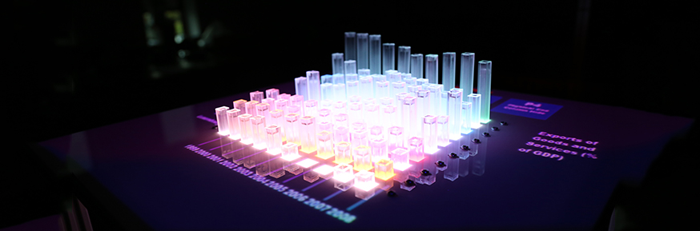
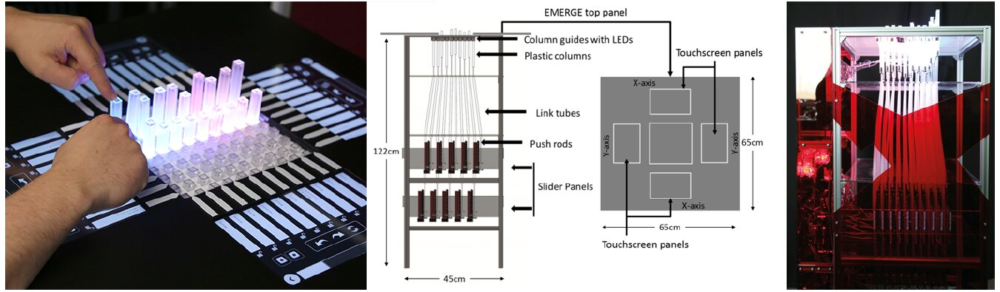
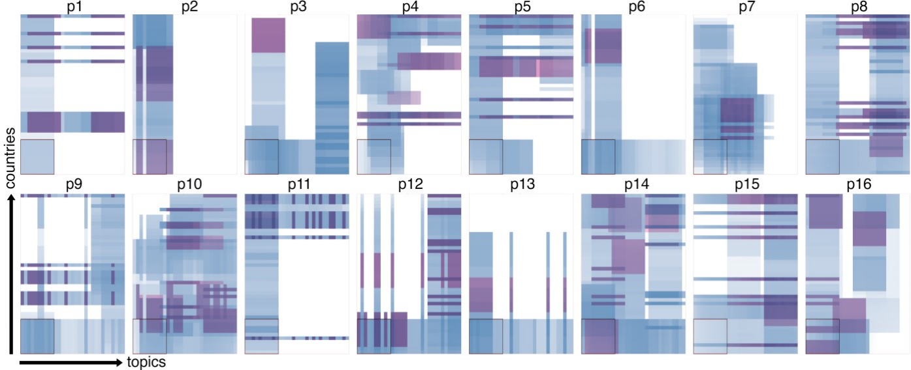
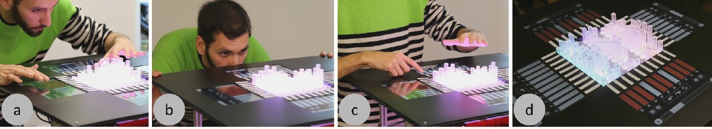

+++
author = "矢崎裕一"
title = "100本の棒に、どのデータを載せるか──動く物理棒グラフ EMERGE"
slug = "emerge-dynamic-bar-chart"
date = "2026-11-05"
description = "EMERGE は、10×10本の棒が上下する物理的な棒グラフです。一度に見せられる棒は100本だけなので、隠す・並べ替える・スクロールする操作が設計の中心になりました。"
categories = [
    "consume"
]
tags = [
    "データ物質化",
    "棒グラフ",
    "Yvonne Jansen"
]
image = "images/cover.jpg"
series = ["data-physicalization"]
series_weight = 99
seriesByline = "Faisal Taher・Jason Alexander ほか（Lancaster University）"
seriesTitle = "100本の棒にどのデータを載せるか──EMERGE"
+++

EMERGE（イマージ）は、10×10本の棒が上下する物理的な棒グラフです。英国の Lancaster University（ランカスター大学）の研究グループが作りました。一度に見せられる棒は100本だけなので、隠す・並べ替える・スクロールするといった、どのデータを棒に載せるかを決める操作が設計の中心になりました。

最初の論文は、Faisal Taher（ファイサル・タハー）、Jason Alexander（ジェイソン・アレクサンダー）ら7人による "Exploring Interactions with Physically Dynamic Bar Charts"（CHI 2015）です。続く観察研究が IEEE TVCG（2017年。VIS 2016 で発表）に、複数人での利用を調べた研究が CHI 2023 に出ています。以下は、この3本の論文と大学の広報に沿います。

<!--more-->

## 100本の棒が上下する台

EMERGE の設計は、MIT の形状ディスプレイ inFORM に従っています。2015年の論文（以下 CHI15）によれば、違いは LED を入れたこと、制御の仕組み、ソフトウェアのモデルです。

プラスチックの棒が10×10に並び、1本ずつ電動のスライド式ポテンショメーターにつながっています。動く幅は100mmです。下のスライダーと上の棒は、中空の管に通した押し棒でつながります。スライダーを2段に重ねて、床面積を 0.55×0.44×1.20m に抑えました。各棒の下には RGB LED があり、棒を光らせます。

Lancaster University／"Shape changing display could spell the end for the 2D graph"（2015年4月13日の広報）より引用

人が棒を押したり引いたりすると、ポテンショメーターの値が変わります。CHI15 はそれで操作を検出しました。軸のラベルと操作ボタンは、上に置いたプロジェクターで棒の周りの面に映し、Microsoft Kinect でタッチを拾いました。2017年の論文（以下 TVCG17）では、上面の4辺にタッチスクリーンを置きました。向かい合う辺には同じ情報が出るので、どの側からでも操作できます。

Miriam Sturdee・Hayat Kara・Jason Alexander／"Exploring Co-located Interactions with a Shape-Changing Bar Chart"（CHI 2023、CC BY）より引用。中央の構造図は、同論文が CHI15 から再掲したもの

データと見た目の対応は、次のとおりです。

| データ・状態 | 物理的な性質 | 具体 |
|---|---|---|
| 数値 | 棒の高さ | 0〜100mm |
| 行のカテゴリ（国、地域） | 棒の色（RGB LED） | 行ごとに別の色 |
| 列のカテゴリ（年、トピック） | 奥行きの位置と軸ラベル | ラベルは投影、のちにタッチスクリーン |
| 縦軸の目盛り | なし | CHI15 は意図して省いた |
| 選んだ1点 | 光 | ほかを暗くし、交点を別の色にする |
| 強調 | 棒を引き上げる | 引いた棒以外を暗くする |
| 隠す | 棒を下げる | 押した点や行を隠す |
| 見えている範囲 | 10×10 の窓 | スクロールで動かす（CHI15、TVCG17） |
| 固定した行 | 窓の中の位置 | スクロールしても残る（TVCG17） |
| 保存した見え方 | 棒の配置全体 | 保存し、あとで呼び出す（TVCG17） |

色は「どの行か」を示すためだけに使われ、量は高さだけで示している、と読めます。縦軸については、あれば操作や行動が変わりうると CHI15 自身が書いています。

この研究は、書籍『Making with Data』（Samuel Huron・Till Nagel・Lora Oehlberg・Wesley Willett 編、A K Peters/CRC Press、2022）にも章があります。第4部「Actuation」の 4.4「EMERGE」で、Crossref の記載では pp. 287–298、doi:10.1201/9781003264903-19 です。章の著者は Alexander、Taher、John Hardy、John Vidler の4人です。CHI15 の著者7人とは顔ぶれが違い、Vidler は CHI15 では謝辞に名前があるだけです。

## 14の操作を試す──2015年の CHI 論文

CHI15 は、こう書き出します。

> Visualizations such as bar charts help users reason about data, but are mostly screen-based, rarely physical, and almost never physical and dynamic.

棒グラフの多くは画面の上にあり、物理的で動くものはほぼない、という要旨です。問いは、そうした棒グラフをどう操作すれば探索がうまくいくか、です。分野が若いので比較実験は避け、正確さより参加者の行動と感想を見た、と書いています。参加者は17人でした。

作業は、Heer と Shneiderman の分類にもとづく4種で、操作は14通りです。

| 作業 | 試した操作 | 最も好まれた操作（5段階評価の平均） |
|---|---|---|
| 印をつける | Point、Pull、Press | Press（4.29） |
| 絞り込む | Swipe away、Manual press、Assisted press、Press to compare、Press shortcut | Press shortcut（4）。行の先頭の棒を押すと行全体が隠れる |
| 並べ替える | Drag and drop、Press to swap（それぞれ2通りの動き方） | ラベルのドラッグ（3.88） |
| 移動する | スクロールバー、方向の矢印、Directional press、ページ送り | スクロールバー（4） |

4つのうち3つは、どの棒に何を出すかを変える操作にあたります。「隠す」には理由も添えられています。紙の棒グラフでは隣の棒が高さの読みを最もゆがめる（Zacks ら、1998）ので、要らない棒を消すと読み比べやすくなる、という説明です。

作業の前に「どうやるか」を聞くと、全員がスワイプやラベルのタップといったタッチスクリーン式の操作を答えました。ところが絞り込みでは、棒に直接触れる操作を試すと、評価が物理の側に移りました。それでも論文の結論は使い分けです。

> smaller interactions such as annotation afforded physical interaction, whereas larger motions such as row organization afforded touch-screen style swipe interactions.

印をつけるような小さな操作は物理の操作に向き、行の並べ替えのような大きな動きはタッチスクリーン式に向く、という要旨です。

並べ替えで行がゆっくり移るアニメーションは、好まれませんでした。スクロールでは途中の年の値も棒に出し続け、英国の地域別降水量（1920〜2012年）を見た参加者は全員、北部のほうが雨が多いと気づきました。17人中3人は、本体の周りを回って操作しました。

論文は限界として、10×10では見せられるデータが少ないことを挙げています。国別のデータは、Jansen らの CHI 2013 の材料ページ（aviz.fr/phys）から取りました。Yvonne Jansen（イヴォンヌ・ジャンセン）は CHI15 の共著者でもあります。

## 31×46のデータを、10×10の窓で見る

TVCG17 は、同じグループの観察研究です。参加者は16人で、動く物理化も、画面上の対話型の可視化ツールも使ったことのない人たちでした。欧州の価値観調査のデータを平均約16分探索し、平均約5分で発表しました。

実装した操作は6つです。

- Highlighting：棒を引いて強調する
- Swapping：ラベルをドラッグして行を入れ替える
- Scrolling：10×10より大きいデータの中を動く
- Locking：行を固定し、スクロールしても窓に残す
- Hiding：棒を押して隠す。縁の2点を同時に押すと、その2行だけを残して比べられる
- Snapshot：今の見え方を保存し、あとで呼び出す

データは31トピック×46か国で、EMERGE が一度に出せるのは10×10です。結果は、誰もデータ全体を見ていませんでした。

Faisal Taher ほか／"Investigating the Use of a Dynamic Physical Bar Chart for Data Exploration and Presentation"（IEEE TVCG、2017、著者最終稿）Fig. 4 より引用

16人中7人は「データが多すぎる」と感じました。一方で15人は、10×10の窓で足りると答えています。著者はこの食い違いを認め、画面の可視化で使われる focus+context の手法を、物理化に持ち込むことを今後の課題に挙げました。

発表では、16人中9人が、保存したスナップショットを順に見せました。9人は、要らないデータを隠して強調したり、まとまりの間に隠した棒で仕切りを作ったりしました。窓の中身を選んで並べた状態が、そのまま発表の材料になったと読めます。

体の使い方も記録されています。全員が少なくとも2辺を行き来し、4人は3辺を回りました。覗き込む、首を傾ける、しゃがむといった動きは、スクロールの直後に多く出ました。著者は、立体は角度で見え方が違うので、複数の視点が関係の確認に役立つと書いています。

Faisal Taher ほか／"Investigating the Use of a Dynamic Physical Bar Chart for Data Exploration and Presentation"（IEEE TVCG、2017、著者最終稿）Fig. 1 より引用

中央の棒は、高い棒に囲まれると手が届きにくく、操作は縁の棒に集まりました。15人がデータを読みやすいと答えた一方、1人は正確な数値がないと発表しにくいと答えています。

体の動きが何のためかは、分かっていません。著者はこう書きます。

> It remains an open question as to whether body movements are correlated with better insights from the data, if they allow participants to read data more accurately, or if they compensate for occlusion.

よい気づきにつながるのか、正確に読むためか、隠れた部分を補うためかは分からない、という要旨です。そのうえで、壁際ではなく周りを歩ける場所に置くべきだと書いています。

2023年の論文（Miriam Sturdee、Hayat Kara、Alexander）は、2人組と4人組の計24人で同じ手順をくり返しました。探索の範囲は1人のときより狭く、一つの窓に長くとどまりました。隠れた部分は、1人なら周りを動いて補えたが、グループやペアではそうはいかなかった、と書いています。

## 「2Dグラフの終わり」と、論文の自己評価

2015年4月13日、Lancaster University は EMERGE の広報を出しました。見出しは "Shape changing display could spell the end for the 2D graph"、本文には "sounding the death knell for the two dimensional bar chart" とあります。どちらも、2Dの棒グラフが終わるという言い方です。

論文の書き方は違います。TVCG17 は、自らの研究をこう位置づけています。

> Our study was not a comparative experiment, and we therefore cannot draw any conclusions about how visualizations and physicalizations compare.

画面の可視化と物理化の優劣は、比較実験ではないので結論できない、という要旨です。論文は、2Dより良いとは主張していません。

比較実験を行ったのは、Jansen らの CHI 2013 です。静的な3D棒グラフは画面より実物のほうが速く読めましたが、2Dの画面表示には及びませんでした（[Jansen らの評価実験](/evaluating-physical-visualizations/)）。EMERGE はその次に、「動かせるならどう操作するか」へ進んだ研究として読めます。同じ特集の [Physical Charts](/tenison-road-charts/) も動く棒グラフですが、ラボのガラス窓の内側に置き、通りから見せる作品です。EMERGE は実験室の試作機で、見る人が棒を押し引きして操作します。

## 第三者はEMERGEをどう見たか

評価の論点は、文献ごとに違います。

- **Bae、Zheng、Do、Huron（CHI 2022）** は、対話の幅が分析の深さを決めるという論点で、EMERGE を Zooids と並べます。絞り込み、組み替え、抽象化と詳細化、選択を、2.5Dのディスプレイに組み込んだ例です。
- **Djavaherpour ほか（Computer Graphics Forum 2021）** は物理化の分類で、EMERGE を「統計データ」の例に入れ、棒と RGB LED の反応する棒グラフと説明します。Jansen が共著者です。
- **Sauvé、Potts、Alexander、Houben（CHI 2020）** は、向きと知覚を調べる実験の動機に EMERGE を挙げます。回り込みが遮蔽を補うためか、正確に読むためか分からない点です。Alexander が共著者です。

後の二つは作者側の人が加わっているので、完全な第三者の評価ではありません。報道では、ScienceDaily が広報を転載しました。

## 使い道

物理の可視化では、表示できる量の上限が先に決まる、と EMERGE からは読めます。棒は100本で、増やせません。だから設計は、限られた棒に何を割り当てるかの操作に向かいました。

画面でも、小さな面積に多くのデータを載せるときは同じです。持ち帰れることは三つあると読めます。一つ目は、窓の外を見に行く手段と、窓の中を固定して残す手段を対にすることです。二つ目は、操作の大きさで手段を分けることです。1点を選ぶならその点に触れ、行を動かすならラベルを動かす。三つ目は、立体の表示を、見る人が歩いて回れる場所に置くことです。

## 参考・出典

**一次情報**

- Faisal Taher, John Hardy, Abhijit Karnik, Christian Weichel, Yvonne Jansen, Kasper Hornbæk, Jason Alexander, "Exploring Interactions with Physically Dynamic Bar Charts," CHI 2015, pp. 3237–3246. [PDF](https://www.kasperhornbaek.dk/papers/CHI2015_Emerge.pdf) / [Lancaster eprints](https://eprints.lancs.ac.uk/id/eprint/72692) / [doi:10.1145/2702123.2702604](https://doi.org/10.1145/2702123.2702604)
- Faisal Taher, Yvonne Jansen, Jonathan Woodruff, John Hardy, Kasper Hornbæk, Jason Alexander, "Investigating the Use of a Dynamic Physical Bar Chart for Data Exploration and Presentation," *IEEE TVCG* 23(1), 2017, pp. 451–460. [著者最終稿](https://purehost.bath.ac.uk/ws/files/211082383/VIS16_PhysicalBarChart.pdf) / [Lancaster eprints](https://eprints.lancs.ac.uk/id/eprint/82634) / [doi:10.1109/TVCG.2016.2598498](https://doi.org/10.1109/TVCG.2016.2598498)
- Miriam Sturdee, Hayat Kara, Jason Alexander, "Exploring Co-located Interactions with a Shape-Changing Bar Chart," CHI 2023. [PDF](https://purehost.bath.ac.uk/ws/files/285358459/CHI23_EMERGECollaboration.pdf) / [University of Bath](https://researchportal.bath.ac.uk/en/publications/exploring-co-located-interactions-with-a-shape-changing-bar-chart/) / [doi:10.1145/3544548.3581214](https://doi.org/10.1145/3544548.3581214)
- Lancaster University, "Shape changing display could spell the end for the 2D graph," 2015-04-13. [広報](https://www.lancaster.ac.uk/news/articles/2015/shape-changing-display-could-spell-the-end-for-the-2d-graph/)
- Jason Alexander, "EMERGE Capabilities Demonstration"（YouTube）. [動画](https://youtu.be/xA4jOwCHO8I)
- Jason Alexander, Faisal Taher, John Hardy, John Vidler, "EMERGE," Samuel Huron, Till Nagel, Lora Oehlberg, Wesley Willett (eds.), *Making with Data: Physical Design and Craft in a Data-Driven World*, A K Peters/CRC Press, 2022, 4.4. [Taylor & Francis](https://www.taylorfrancis.com/chapters/edit/10.1201/9781003264903-19/emerge-jason-alexander-faisal-taher-john-hardy-john-vidler) / [Crossref](https://api.crossref.org/works/10.1201/9781003264903-19) / [Routledge（目次）](https://www.routledge.com/Making-with-Data-Physical-Design-and-Craft-in-a-Data-Driven-World/Huron-Nagel-Oehlberg-Willett/p/book/9781032182223)

**第三者評価**

- S. Sandra Bae, Clement Zheng, Ellen Yi-Luen Do, Samuel Huron, "Making Data Tangible: A Cross-disciplinary Design Space for Data Physicalization," CHI 2022. [arXiv](https://arxiv.org/abs/2202.10520)
- H. Djavaherpour ほか（Y. Jansen が共著者）, "Data to Physicalization: A Survey of the Physical Rendering Process," *Computer Graphics Forum* 40(3), 2021. [arXiv](https://arxiv.org/abs/2102.11175)
- Kim Sauvé, Dominic Potts, Jason Alexander, Steven Houben, "A Change of Perspective: How User Orientation Influences the Perception of Physicalizations," CHI 2020（Alexander が共著者）. [PDF](https://eprints.lancs.ac.uk/id/eprint/140417/1/A_Change_of_Perspective_camera_ready.pdf)
- ScienceDaily, "Shape changing display could spell the end for the 2-D graph," 2015-04-13（広報の転載）. [記事](https://www.sciencedaily.com/releases/2015/04/150413130530.htm)
