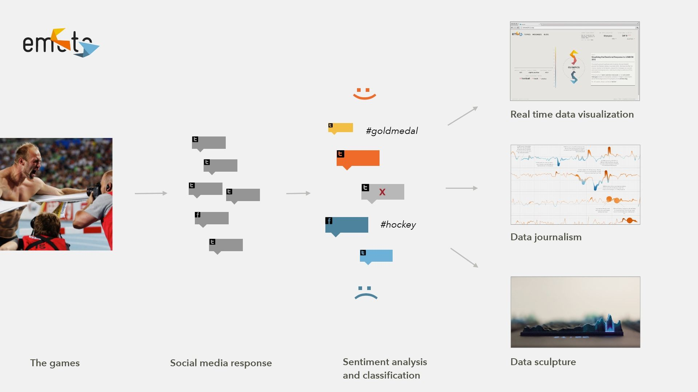
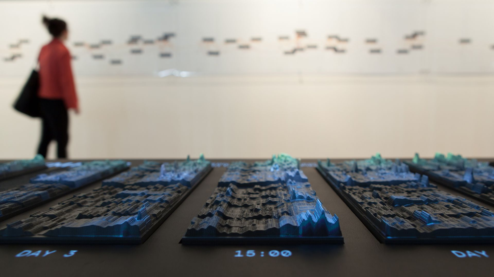
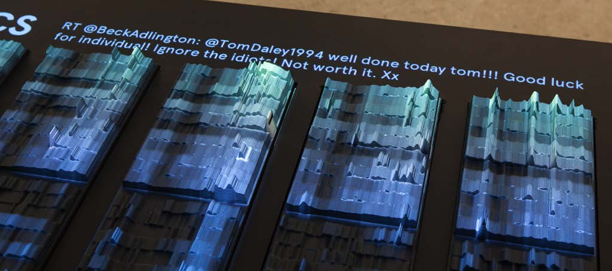
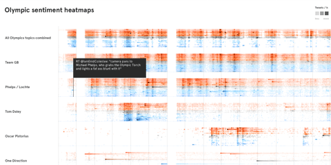

+++
author = "Yuichi Yazaki"
title = "Carving Tweet Counts into Height, Projecting Topic Heatmaps: emoto"
slug = "emoto"
date = "2026-11-01"
description = "A sculpture carved from English tweets about the London 2012 Olympics, with height showing the tweet count for each hour and sentiment level. Topic-specific heatmaps are projected on top, and visitors switch between them."
categories = [
    "consume"
]
tags = [
    "data physicalization",
    "heatmap"
]
image = "images/cover.jpg"
+++

The emoto data sculpture takes English-language tweets about the London 2012 Olympics, counts them by hour and sentiment level, and carves those counts into height. Each day of the Games is one plate, and 17 plates stand side by side. Topic-specific heatmaps are projected on top. With a knob in hand, visitors switch topics and move through time.

It was made by three parties: Moritz Stefaner, Drew Hemment, and Studio NAND. What follows draws on the official site emoto2012.org, the paper Hemment wrote for ISEA2013, Stefaner's page at Truth & Beauty, and The Creators Project's interview with the makers.

<!--more-->

## 12.5 Million Tweets, Shown in Three Forms

emoto was commissioned as a FutureEverything project for the Cultural Olympiad and the London 2012 Festival. Hemment conceived it and was project director, and Stefaner was lead designer. Studio NAND (Stephan Thiel, Steffen Fiedler, Jonas Loh) led the design of the physical sculpture.

The data are English-language tweets collected through Twitter's public API from the opening ceremony on July 27, 2012, to the closing ceremony on August 12. The count is "12.5 million" in Hemment's paper and "12 million English tweets" on the official site. Lexalytics' Salience Engine gave each tweet a sentiment score, which was sorted into equal-width bins from −6 (very negative) to +6 (very positive). Topics (events, athletes, countries, and so on) were separated using a predefined list.

Hemment describes three ways of presenting the work.

> Presentation was in three forms: a real-time sentiment visualisation web application, data journalistic analysis of the Games, and a physical interactive data sculpture.

That is, a real-time web application, data-journalism analysis, and a physical, interactive data sculpture.

Source: Moritz Stefaner / Truth & Beauty, "emoto"

The web version showed the Games as they happened. The sculpture was made after the Games ended and was first exhibited at WePlay in Preston (part of the London 2012 Festival), September 7-9, 2012. In 2013 it also appeared in the Information in Style exhibition at the CAFA Art Museum in Beijing.

Source: Moritz Stefaner, Drew Hemment, Studio NAND / Truth & Beauty, "emoto" (the same photo appears as Fig. 2, "emoto data sculpture and sentigraph," in the ISEA2013 paper, CC BY-NC-SA 3.0)

Acquiring the data nearly fell apart just before launch. According to the paper, the team had expected to use an extended version of the Firehose, which streams all tweets, through a data reseller. When Twitter tightened its terms, the reseller told them shortly before launch that neither the data nor any derived insight could be displayed publicly in any form. The team rebuilt its infrastructure in two weeks and switched to the public API, which covers about 1% of the roughly 400 million tweets sent per day.

Hemment also writes about the limits of this data. It covers only English-language tweets, and more than 65% of the web version's users came from four countries: the US, UK, Canada, and Australia.

> Such a limited perspective does not represent 'what the world thinks.'

In other words, a limited perspective does not represent what the world thinks. He adds that evaluating the accuracy of the sentiment analysis was outside the project's scope, and that mix-ups occurred, such as the BBC receiving a negative score when it reported bad news.

## Carving a Gray Heatmap into Height

Stefaner describes concretely in an interview how the sculpture was made.

> The basis for its creation process are 2D-graphics, basically gray-tone 'heat-maps,' which show the aggregated number of tweets per hour for each sentiment-level in a small rectangle. The lighter the rectangle, the higher the number of tweets for this hour and sentiment-level and the higher the elevation of the sculpture at this point. This results in the rollercoster-like bands you see in the sculpture.

The starting point is a flat gray [heatmap](/en/heatmap/). The tweet count for each hour and each sentiment level is summarized in a small rectangle. The lighter the rectangle, the higher the count, and the higher the sculpture at that point. The result is the roller-coaster-like bands.

**What the flat heatmap carried in the lightness of its color, the sculpture carries in height.** In the words of Studio NAND's Stephan Thiel, the height is "a third dimension in addition to time and sentiment-score." Time and sentiment level remain as positions on the plate. Stefaner also says the sculpture contains "all tweets we have collected for emoto."

The paper and other sources say the height shows "emotional highs and lows." This can be read as a metaphor. By the description of how it was made, height is the count, and sentiment is the position of the band.

The material is Chemiwood, a polyurethane foam, cut by CNC. According to Thiel, they preferred the traces left by the cutting head to the clean surface of a 3D print. The surface is finished with a two-component paint in a matte gray suited to projection.

Combining the makers' descriptions with my own reading, the correspondence between data, appearance, and material is as follows.

| Data / variable | Physical property | Specifics / notes |
|---|---|---|
| One day of the Games | One plate | 17 plates side by side |
| Time of day | Horizontal position on the plate (my reading) | Hourly. 17 plates form the time axis of the whole Games |
| Sentiment level | Vertical position on the plate (the bands, my reading) | Bins from −6 to +6 |
| Tweet count for that hour and level | Height of the carved surface | The lighter in the original heatmap, the higher |
| Tweets on all topics | The shape of the sculpture itself | All collected tweets |
| Stories by topic | Projection onto the sculpture (heatmap) | Switched with the knob |
| Most retweeted tweet of that hour | Text shown beside the sculpture | Chosen from the hour under the cursor |
| Material and finish | Chemiwood cut by CNC, matte gray paint | Cutting marks left visible |

How many sentiment steps there were (and whether 0 was included) could not be confirmed from the primary sources.

## Projecting Topics on Top, Switching with a Knob

The shape of the sculpture is determined by all the tweets. Differences between topics are carried by the light projected on top. According to the official site, heatmaps for themes found during the Games were projected, and visitors moved between themes with a controller and could "explore our archive."

Source: Moritz Stefaner, Drew Hemment, Studio NAND / Drew Hemment, "emoto – Visualising the online response to London 2012" (ISEA2013), Fig. 6 (CC BY-NC-SA 3.0)

According to Stefaner, many topics were grouped into "high-level stories." The Team GB story, for example, includes topics about individual athletes. To choose them, he ran a "data-driven 'hunt'" with the sentigraph, keeping both topics that showed up in the data as they did in real life and amusing data artifacts such as One Direction.

The interaction is a single rotating knob, a Griffin PowerMate. In Thiel's description, pressing it switches the theme and turning it moves the cursor along the timeline. The most retweeted tweet of the hour under the cursor appears beside the sculpture.

The tweets and topics shown in the exhibition can also be explored in the interactive heatmap on Stefaner's site. Horizontal bands are lined up by topic, and hovering over a row shows the most retweeted tweet at that time.

Source: Moritz Stefaner / well-formed-data.net, "emoto data sculpture"

This can be read as a division of labor: form fixes the whole, and light shows the parts. Switching the projection does not change the relief beneath. On the same platform, you can compare where one topic's surge falls within the volume of the whole Games. Whether the color of the projection stood for positive or negative could not be confirmed from the primary sources.

## What Changed by Making It a Solid

Stefaner describes the sculpture's place in the project this way.

> In many ways the crowning piece of the project, and a conceptual counterpoint to the ephemeral web activities, our data sculpture preserved the more than 12 million tweets in physical form.

That is, it was the crowning piece of the project, a conceptual counterpoint to ephemeral web activity, preserving more than 12 million tweets in physical form.

Thiel lists several advantages of the three-dimensional form.

> Creating a three-dimensional sculpture helped people understand the displayed dimensions in the data more quickly and naturally. ... This is often more immediate than encoding multiple variables in two-dimensional space.

Visitors grasped the dimensions of the data faster and more naturally, and this is often more immediate than packing several variables into a plane. He also names the ability to emphasize quantity through physical size and the way people can look and talk together, and says "if all the lights are off, it's still an object which represents information."

Thiel also writes about the difficulty. On a screen the view can be rearranged freely, but a large sculpture constrains how you can work with it.

> If you have a massive sculpture, this sets a limitation on how you can work with it, also in terms of interactivity

The projection and the knob can be read as answers to this constraint. The carved form is made once and cannot change. What needed to change was left to light and text.

According to a note in the paper, the team argued to Twitter that the carved piece was "far removed from the data stream" and could not be used to reconstruct the original information (the negotiation did not succeed).

Andy Kirk's article before the opening said it would be carved into "19 plates." The finished work has 17, and I found no source explaining the change.

## How Third Parties Saw the Work

On July 19, 2012, before the Games opened, Andy Kirk introduced emoto on Visualising Data as "One of the most ambitious, unique, multi-faceted and fundamentally exciting projects." This was written before the work was finished.

In an article dated September 20, 2012, Julia Kaganskiy of The Creators Project summarized the sculpture as follows.

> Peaks and valleys are etched into the plates to indicate the volume of tweets per hour, and a heat map of color gradations is projected on top to show the public's feelings towards a particular topic

The relief of the plates shows the volume per hour, and the gradations of projected color show feelings toward a topic. The same article calls the sculpture "9.5 meter long," but on the official site and in the paper, 9.5 m (9 m in the paper) is the length of the wall sentigraph. The sculpture's dimensions could not be confirmed from the primary sources.

At the Information is Beautiful Awards 2013, the installation was among the entries judged, and its showcase page carries the labels Bronze and Data visualization. The description calls the sculpture "its core component."

## Takeaways

First, how to translate a flat heatmap into a solid. Keep the two axes as positions and move only the count, which the lightness of color used to carry, into height. Because it maps one-to-one onto the original figure, it is harder to mistake what became height.

Second, separate what stays fixed from what changes. emoto carved a form determined by all tweets and layered topic differences on top with light. Leaving the whole to the material and the parts to projection and text allows many ways of viewing on a single platform.

Third, give each medium its own role. The web version streamed the Games as they happened, the sentigraph told the analysis, and the sculpture preserved the Games after they ended.

Finally, write down the bias in the data outside the work. From the relief alone you cannot tell that it is a 1% English-language sample. A record like Hemment's paper becomes the premise for reading the work.

## References

**Primary sources**

- emoto official site: https://emoto2012.org/
- Drew Hemment, "emoto – Visualising the online response to London 2012," ISEA2013 Proceedings (PDF): https://emoto2012.org/downloads/emoto_published.pdf (submitted version: https://www.isea-symposium-archives.org/wp-content/uploads/2021/07/ISEA2013_108_DrewHemment-Emotovisualising.pdf , bibliographic record: https://www.research.ed.ac.uk/en/publications/emoto-visualising-the-online-response-to-london-2012/ )
- Moritz Stefaner, Truth & Beauty, "emoto": https://truth-and-beauty.net/projects/emoto (Markdown version: https://truth-and-beauty.net/projects/emoto.md )
- Truth & Beauty, interactive heatmap: https://truth-and-beauty.net/assets/extras/emoto/heatmap/
- Moritz Stefaner, well-formed-data.net, "emoto" (2012-07-31) and "emoto data sculpture" (2012-09-20): https://well-formed-data.net/archives/tag/emoto/
- Moritz Stefaner, Drew Hemment, Gerrit Kaiser, talk slides (Strata London, October 2012): https://speakerdeck.com/moritzstefaner/emoto-visualising-the-online-response-to-london-2012
- Studio NAND, "emoto — The interface explained" (Vimeo, 2012-07-30): https://vimeo.com/46615102
- Lancaster EPrints bibliographic record: https://eprints.lancs.ac.uk/id/eprint/61698
- Interview with the makers (remarks by Stefaner and Thiel), The Creators Project / VICE: https://www.vice.com/en/article/data-visualization-sculpture-shows-twitter-reactions-to-london-2012-olympic-games/
- dataphys.org, "Emoto: Projection Augmented Heatmaps of Twitter Data": https://dataphys.org/list/emoto-projection-augmented-heatmaps-of-twitter-data/

**Secondary sources**

- Andy Kirk, "'emoto': Visualising the emotional response to London 2012," *Visualising Data*, 2012-07-19: https://visualisingdata.com/2012/07/emoto-visualising-the-emotional-response-to-london-2012/
- Julia Kaganskiy, "Data Visualization Sculpture Shows Twitter Reactions To London 2012 Olympic Games," *The Creators Project* / VICE, 2012-09-20: https://www.vice.com/en/article/data-visualization-sculpture-shows-twitter-reactions-to-london-2012-olympic-games/
- Information is Beautiful Awards 2013, "emoto installation": https://www.informationisbeautifulawards.com/showcase/68-emoto-installation
