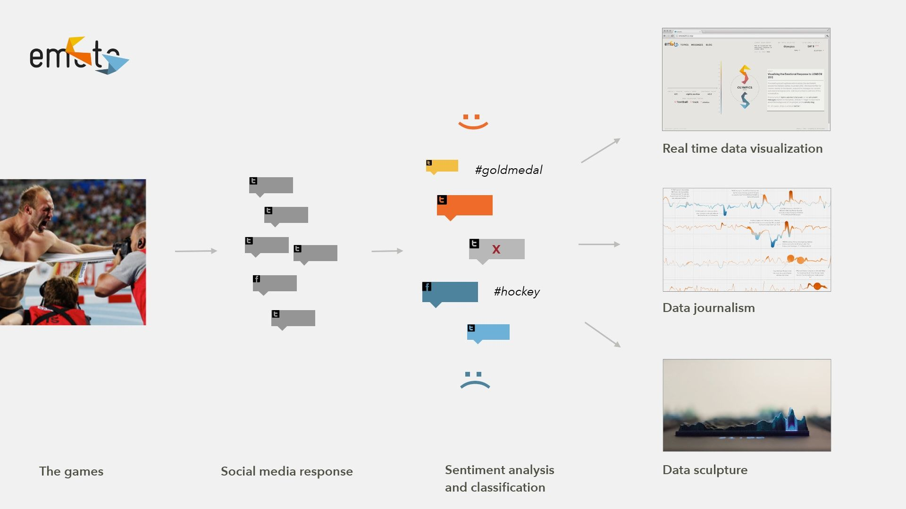
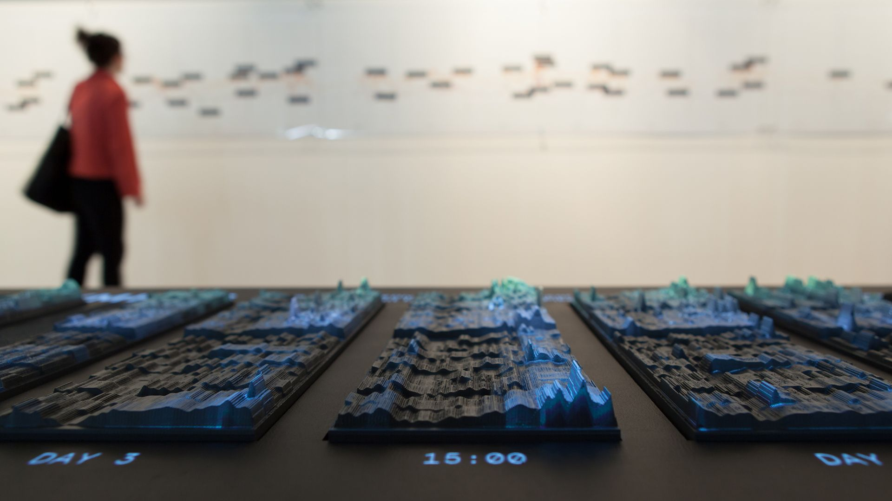
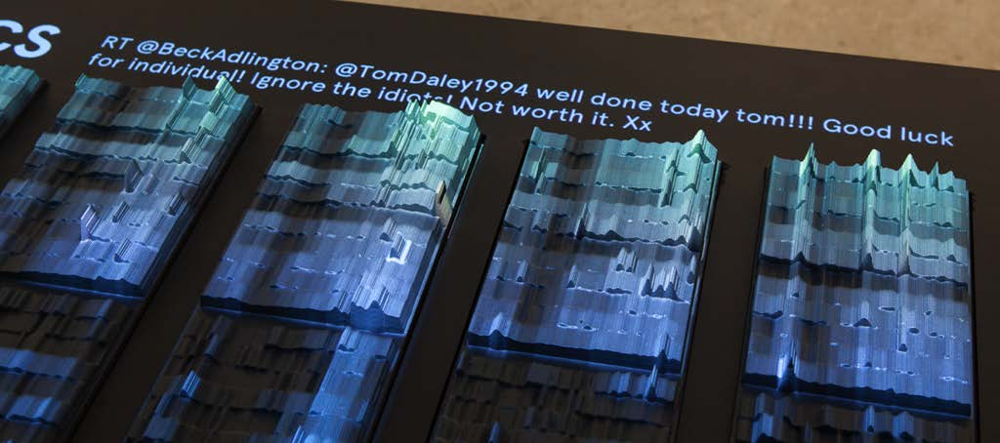
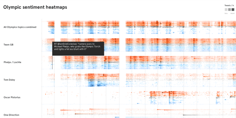

+++
author = "矢崎裕一"
title = "ツイートの件数を高さに削り、話題別のヒートマップを映す──emoto"
slug = "emoto"
date = "2026-11-01"
description = "ロンドン五輪のツイートを、時刻と感情の段階ごとの件数を高さにして削り出した彫刻です。上に話題別のヒートマップを投影し、来場者が切り替えて見られるようにしました。"
categories = [
    "consume"
]
tags = [
    "データ物質化",
    "ヒートマップ"
]
image = "images/cover.jpg"
series = ["data-physicalization"]
series_weight = 24
seriesByline = "Moritz Stefaner・Drew Hemment・Studio NAND"
seriesTitle = "ツイートの件数を高さに削る──emoto"
+++

emoto（エモト）のデータ彫刻は、ロンドン2012五輪をめぐる英語のツイートを、時刻と感情の段階ごとに数え、その件数を高さにして削り出したものです。大会の1日を1枚の板にして、17枚を横に並べています。その上に、話題別のヒートマップを投影しました。来場者は手元のノブで話題を切り替え、時間を動かして見られます。

制作は Moritz Stefaner（モーリッツ・ステファナー）、Drew Hemment（ドリュー・ヘメント）、Studio NAND の三者です。以下は、公式サイト emoto2012.org、Hemment が ISEA2013 に書いた論文、Stefaner の Truth & Beauty のページ、The Creators Project による作者インタビューに沿って読みます。

<!--more-->

## 1,250万件のツイートを、3つの形で見せる

emoto は、FutureEverything のプロジェクトとして、Cultural Olympiad と London 2012 Festival のために委嘱されました。発案者でプロジェクトディレクターは Hemment、リードデザイナーは Stefaner です。物理彫刻のデザインは、Studio NAND（Stephan Thiel、Steffen Fiedler、Jonas Loh）が主導しました。

データは、2012年7月27日の開会式から8月12日の閉会式まで、Twitter の公開APIで集めた英語のツイートです。件数は、Hemment の論文で「12.5 million」、公式サイトで「12 million English tweets」です。各ツイートには Lexalytics の Salience Engine が感情のスコアを付け、−6（very negative）から +6（very positive）までの等幅のビンに振り分けました。話題（競技、選手、国など）は、あらかじめ決めたリストで分けています。

Hemment は、見せ方を三つと書いています。

> Presentation was in three forms: a real-time sentiment visualisation web application, data journalistic analysis of the Games, and a physical interactive data sculpture.

リアルタイムのWebアプリ、データジャーナリズムの分析、物理的でインタラクティブなデータ彫刻の三つ、という説明です。

Moritz Stefaner／Truth & Beauty「emoto」より引用

Web版は、大会中の「いま」を見せました。彫刻は大会が終わってから作られ、2012年9月7〜9日、プレストンで開かれた WePlay（London 2012 Festival の一部）で初めて展示されました。2013年には北京の CAFA Art Museum の Information in Style 展にも出ています。

Moritz Stefaner・Drew Hemment・Studio NAND／Truth & Beauty「emoto」より引用（同じ写真は ISEA2013 論文の Fig. 2「emoto data sculpture and sentigraph」、CC BY-NC-SA 3.0）

データの取得は、公開の直前に崩れかけました。論文によると、当初は全ツイートを流す Firehose の拡張版を、データ再販業者を通じて使えるはずでした。Twitter が規約を締めると、公開直前にその業者から、データも派生した知見もどんな形でも公開表示できないと伝えられます。チームは2週間でインフラを作り直し、1日4億件の約1%にあたる公開APIに切り替えました。

Hemment は、このデータの限界も書いています。英語のツイートだけで、Web版の利用者は65%を超えて英米加豪の4か国からでした。

> Such a limited perspective does not represent 'what the world thinks.'

限られた視点は「世界がどう考えているか」を表さない、という一文です。感情分析の精度の評価はプロジェクトの範囲外で、BBC が悪いニュースを報じると BBC に負のスコアが付く、といった取り違えも起きたと書いています。

## グレーのヒートマップを、高さに削る

彫刻の作り方は、Stefaner がインタビューで具体的に話しています。

> The basis for its creation process are 2D-graphics, basically gray-tone 'heat-maps,' which show the aggregated number of tweets per hour for each sentiment-level in a small rectangle. The lighter the rectangle, the higher the number of tweets for this hour and sentiment-level and the higher the elevation of the sculpture at this point. This results in the rollercoster-like bands you see in the sculpture.

もとは平面のグレーの[ヒートマップ](/heatmap/)です。1時間ごと、感情の段階ごとに、ツイート数を小さな長方形にまとめる。明るい長方形ほど件数が多く、彫刻のその点も高くなる。それが、ジェットコースターのような帯になった、という説明です。

**平面のヒートマップでは色の明るさが担っていた件数を、彫刻では高さが担っています。** Studio NAND の Stephan Thiel（シュテファン・ティール）の言葉では、高さは「a third dimension in addition to time and sentiment-score」です。時間と感情の段階は、板の上の位置に残りました。Stefaner は、彫刻には「all tweets we have collected for emoto」が入っているとも述べています。

論文などは、高さが「emotional highs and lows」を示すと書いています。これは比喩と読めます。作り方の説明に従えば、高さは件数で、感情は帯の位置です。

素材は Chemiwood というポリウレタンフォームで、CNC で切削しました。Thiel によれば、3Dプリントのきれいな面より、切削ヘッドの跡が残るほうを好んだそうです。表面は、投影に向くマットなグレーの二液性塗料で仕上げています。

作者の説明と筆者の読みをまとめると、データと見た目・素材の対応は次のようになります。

| データ／変数 | 物理的な性質 | 具体値・補足 |
|---|---|---|
| 大会の1日 | 1枚の板 | 17枚を横に並べる |
| 時刻 | 板の上の横方向の位置（筆者の読み） | 1時間ごと。17枚で大会全体の時間軸になる |
| 感情の段階 | 板の上の縦方向の位置（帯、筆者の読み） | −6〜+6 のビン |
| その時刻・その段階のツイート数 | 削り出した面の高さ | 元のヒートマップで明るいほど高い |
| すべての話題のツイート | 彫刻の形そのもの | 収集した全ツイート |
| 話題別のストーリー | 彫刻に重ねる投影（ヒートマップ） | ノブで切り替える |
| その時刻に最もリツイートされたツイート | 彫刻の横に文字で表示 | カーソルのある1時間から選ぶ |
| 素材と仕上げ | Chemiwood を CNC で切削、グレーのマット塗装 | 切削の跡を残す |

感情の段が何段だったか（0 を含むかどうか）は、一次資料では確かめられませんでした。

## 話題を投影で重ね、ノブで切り替える

彫刻の形は、すべてのツイートで決まっています。話題ごとの違いは、上に投影する光が受け持ちました。公式サイトによれば、大会中に見つけたテーマごとのヒートマップを投影し、来場者はコントローラーでテーマを移り、「explore our archive」できました。

Moritz Stefaner・Drew Hemment・Studio NAND／Drew Hemment「emoto – Visualising the online response to London 2012」（ISEA2013）Fig. 6 より引用（CC BY-NC-SA 3.0）

Stefaner によれば、いくつもの話題を「high-level stories」にまとめました。Team GB のストーリーには、個々の選手の話題などが入ります。選ぶときは sentigraph を使って「data-driven 'hunt'」を行い、現実と同じくデータにも表れた話題と、One Direction のようなデータ上の面白い人工物の両方を残したそうです。

操作は、Griffin PowerMate という回すノブ一つです。Thiel の説明では、押すとテーマが切り替わり、回すと時間軸上のカーソルが動きます。カーソルのある1時間で最もリツイートされたツイートが、彫刻の横に表示されました。

展示に出したツイートと話題は、Stefaner のサイトのインタラクティブ・ヒートマップでも見られます。話題ごとに横長の帯が並び、行にマウスを重ねると、その時刻に最もリツイートされたツイートが出ます。

Moritz Stefaner／well-formed-data.net「emoto data sculpture」より引用

形で全体を固定し、光で部分を見せる分担と読めます。投影を切り替えても、下の起伏は変わりません。ある話題の盛り上がりが大会全体の量のどこに重なるかを、同じ台の上で見比べられます。なお、投影の色が正と負のどちらを表したかは、一次資料で確かめられませんでした。

## 立体にして、何が変わったか

Stefaner は、彫刻の位置づけをこう書いています。

> In many ways the crowning piece of the project, and a conceptual counterpoint to the ephemeral web activities, our data sculpture preserved the more than 12 million tweets in physical form.

プロジェクトの頂点であり、移ろうWebの活動への概念上の対位として、1,200万件を超えるツイートを物理的な形で保存した、という説明です。

Thiel は、立体にした利点をいくつか挙げています。

> Creating a three-dimensional sculpture helped people understand the displayed dimensions in the data more quickly and naturally. ... This is often more immediate than encoding multiple variables in two-dimensional space.

来場者はデータの次元をより早く自然に理解した。平面に複数の変数を詰めるより直接的なことが多い、という言葉です。空間の大きさで量を強調できたこと、人が一緒に見て話し合えることも挙げ、「if all the lights are off, it's still an object which represents information」と述べました。

難しさも、Thiel は書いています。画面ならビューを自由に組み替えられるが、大きな彫刻は扱い方を縛る、という点です。

> If you have a massive sculpture, this sets a limitation on how you can work with it, also in terms of interactivity

投影とノブは、この制約への答えと読めます。削った形は一度きりで変えられない。変えたい部分は光と文字に任せた、という分け方です。

論文の注によれば、チームは Twitter に、削った作品は「far removed from the data stream」で元の情報を組み立て直せない、と主張しました（交渉は実らず）。

開幕前の Andy Kirk の記事は「19 plates」に削ると伝えています。完成品は17枚で、変更の理由を書いた資料は見つかりませんでした。

## 第三者はこの作品をどう見たか

開幕前の2012年7月19日、Andy Kirk は Visualising Data で、emoto を「One of the most ambitious, unique, multi-faceted and fundamentally exciting projects」と紹介しました。完成前の記事です。

The Creators Project の Julia Kaganskiy は、2012年9月20日の記事で、彫刻を次のようにまとめています。

> Peaks and valleys are etched into the plates to indicate the volume of tweets per hour, and a heat map of color gradations is projected on top to show the public's feelings towards a particular topic

板の起伏が1時間あたりの量を示し、投影した色の濃淡が話題への感情を示す、という要約です。同じ記事は彫刻を「9.5 meter long」と書いていますが、公式サイトと論文では、9.5m（論文では9m）は壁の sentigraph の長さです。彫刻の寸法は、一次資料では確かめられませんでした。

Information is Beautiful Awards 2013 では、インスタレーションが審査の対象になり、ショーケースのページには Bronze と Data visualization の表示が付いています。説明文は、彫刻を「its core component」と呼んでいます。

## 使い道

まず、平面のヒートマップを立体にするときの置き換え方です。2つの軸は位置に残し、色の明るさで表していた件数だけを高さに移す。元の図と一対一で対応するので、何が高さになったかを取り違えにくくなります。

次に、変わらない部分と変わる部分を分けることです。emoto は、全ツイートで決まる形を削り、話題ごとの違いを光で重ねました。全体を素材に、部分を投影や文字に任せると、一つの台で何通りもの見方ができます。

三つ目は、媒体ごとに役割を変えることです。Web版は大会中の「いま」を流し、sentigraph は分析を語り、彫刻は終わった大会を保存しました。

最後に、データの偏りを作品の外に書き残すことです。起伏が1%の英語のサンプルだということは、形からは分かりません。Hemment の論文のような記録が、作品を読むための前提になります。

## 参考・出典

**一次情報**

- emoto 公式サイト：https://emoto2012.org/
- Drew Hemment, "emoto – Visualising the online response to London 2012," ISEA2013 Proceedings（PDF）：https://emoto2012.org/downloads/emoto_published.pdf （投稿版：https://www.isea-symposium-archives.org/wp-content/uploads/2021/07/ISEA2013_108_DrewHemment-Emotovisualising.pdf 、書誌：https://www.research.ed.ac.uk/en/publications/emoto-visualising-the-online-response-to-london-2012/ ）
- Moritz Stefaner, Truth & Beauty「emoto」：https://truth-and-beauty.net/projects/emoto （Markdown 版：https://truth-and-beauty.net/projects/emoto.md ）
- Truth & Beauty, インタラクティブ・ヒートマップ：https://truth-and-beauty.net/assets/extras/emoto/heatmap/
- Moritz Stefaner, well-formed-data.net「emoto」（2012-07-31）、「emoto data sculpture」（2012-09-20）：https://well-formed-data.net/archives/tag/emoto/
- Moritz Stefaner, Drew Hemment, Gerrit Kaiser, 講演スライド（Strata London, 2012年10月）：https://speakerdeck.com/moritzstefaner/emoto-visualising-the-online-response-to-london-2012
- Studio NAND, "emoto — The interface explained"（Vimeo, 2012-07-30）：https://vimeo.com/46615102
- Lancaster EPrints の書誌：https://eprints.lancs.ac.uk/id/eprint/61698
- 作者インタビュー（Stefaner と Thiel の発言）、The Creators Project / VICE：https://www.vice.com/en/article/data-visualization-sculpture-shows-twitter-reactions-to-london-2012-olympic-games/
- dataphys.org, "Emoto: Projection Augmented Heatmaps of Twitter Data"：https://dataphys.org/list/emoto-projection-augmented-heatmaps-of-twitter-data/

**第三者評価**

- Andy Kirk, "'emoto': Visualising the emotional response to London 2012," *Visualising Data*, 2012-07-19：https://visualisingdata.com/2012/07/emoto-visualising-the-emotional-response-to-london-2012/
- Julia Kaganskiy, "Data Visualization Sculpture Shows Twitter Reactions To London 2012 Olympic Games," *The Creators Project* / VICE, 2012-09-20：https://www.vice.com/en/article/data-visualization-sculpture-shows-twitter-reactions-to-london-2012-olympic-games/
- Information is Beautiful Awards 2013, "emoto installation"：https://www.informationisbeautifulawards.com/showcase/68-emoto-installation
