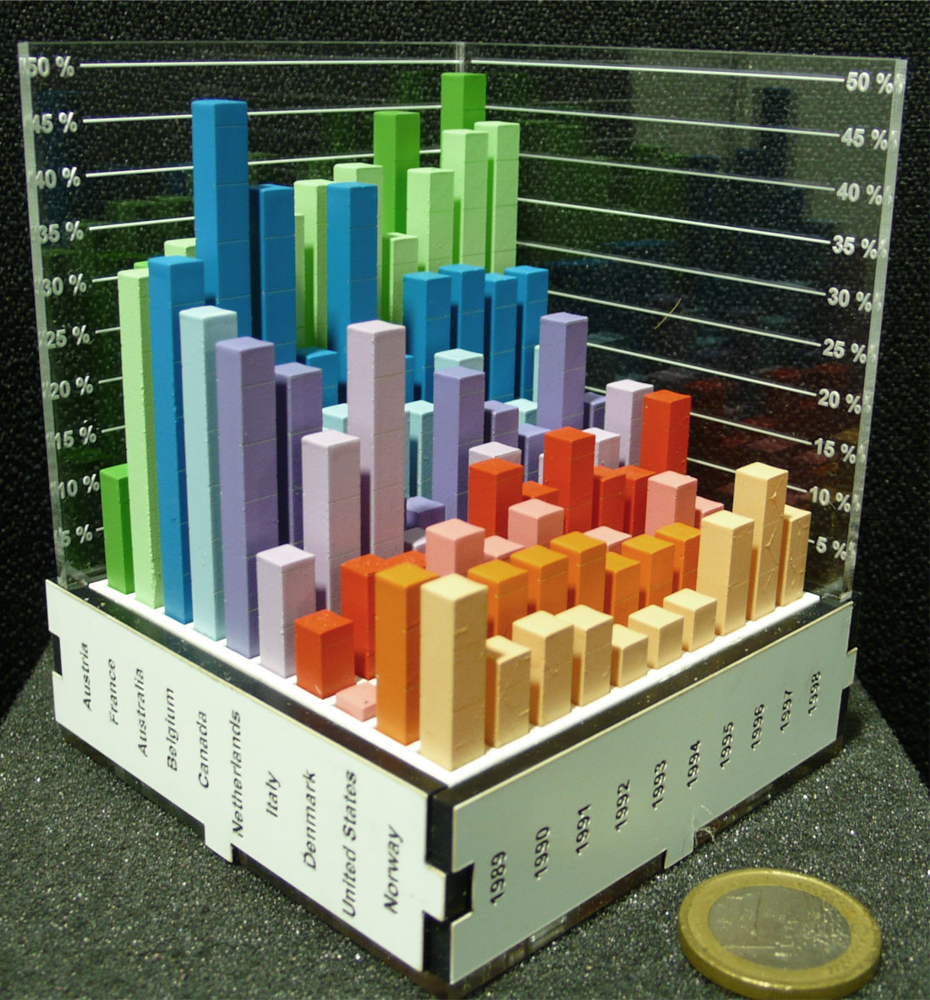
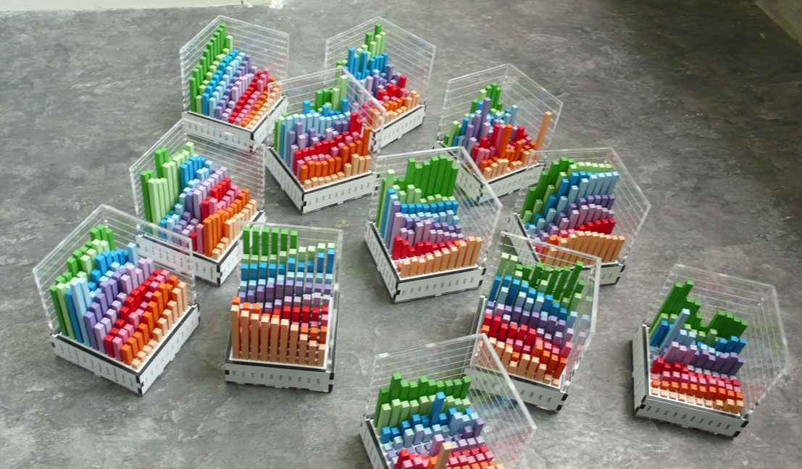

+++
author = "Yuichi Yazaki"
title = "Faster Than the 3D Bar Chart on Screen, Short of 2D: Jansen et al.'s Evaluation of Physical Visualizations"
slug = "evaluating-physical-visualizations"
date = "2026-11-01"
description = "The same 3D bar chart was read faster as a physical object than on a screen. It still fell short of an on-screen display that combined a 2D matrix view with a 2D bar chart."
categories = [
    "principle"
]
tags = [
    "data physicalization",
    "3D bar chart",
    "evaluation study",
    "Yvonne Jansen",
    "Pierre Dragicevic"
]
image = "images/physical-bar-chart.jpg"
+++

When the same 3D bar chart was moved from a screen to a physical object, reading data became about 20% faster. It still did not match an on-screen display that combined a flat matrix view with 2D bar charts. This is the result of an experiment published in 2013 by Yvonne Jansen and her colleagues. The "about 20%" is my rough estimate read from the paper's figures, and what was compared was speed, not accuracy.

The source is the paper "Evaluating the Efficiency of Physical Visualizations" (CHI 2013) by Jansen, Pierre Dragicevic, and Jean-Daniel Fekete. In dataphys.org, the catalog of data physicalization examples, it appears as a 2012 entry titled "Putting Physical Visualizations to the Test." What follows tracks the body of the paper. Values I read from figures are marked "approximate" each time.

<!--more-->

## The Debate over 3D Bar Charts Was Only About Screens

In information visualization, the common view is that 3D displays are not recommended. The paper acknowledges this at the start of its background section.

> Overall 3D visualizations are not recommended since they are subject to serious occlusion, distortion, and navigation issues.

In short, 3D is discouraged because of occlusion, distortion, and the difficulty of controlling the viewpoint. The authors continue right after:

> However, the controversy of 2D versus 3D only concerns the on-screen modality.

That is, the 2D-versus-3D debate has only ever been held about screens. 3D is common in physical visualizations, yet problematic on screen; the abstract gives this as the reason for choosing 3D. In the background are digital fabrication machines and research on shape-changing interfaces. The authors expect that, as either advances, building physical visualizations will become practical. The way of comparing is also distinctive.

> The vast majority of infovis studies involve comparisons across visual mappings only. We focus on comparisons across modalities only

Most studies have compared visual mappings; this one declares that it compares only the medium. Height, color, and layout are held constant, and only whether the chart is physical or on screen changes. The authors describe it as the first study to compare physical and on-screen visualizations on information visualization tasks. The paper itself cites earlier work that compared physical and screen media, such as research on spatial memory.

## Thirteen Bar Charts Built from Acrylic

The data are 16 sets built from Gapminder country indicators. One set consists of 100 values, 10 countries by 10 years, and the indicators include electricity consumption, birth rate, and car-accident death rate. They were chosen because the indicators are easy to understand, the values vary enough, and the years are evenly spaced.

Source: a work by Yvonne Jansen, Pierre Dragicevic, and Jean-Daniel Fekete (no photographer credited) / from dataphys.org, "2012 – Putting Physical Visualizations to the Test"

The physical charts are made of laser-cut acrylic. For each country, one cross-section of a 2D bar chart is cut out, painted, and assembled. The templates were generated automatically from the data. Each chart measures 8 × 8 cm outside and weighs 270 to 350 g, so it can be held and turned in the hand. Thirteen were built. The mapping is as follows.

| Data / variable | Appearance / material | Details |
|---|---|---|
| Indicator value | Bar height | Proportional to the value. Each bar is 5 × 5 mm, with 2 mm gaps |
| Country | Row position and bar color | ColorBrewer qualitative palette. Order sorted by similarity |
| Year | Column position | 10 evenly spaced years |
| Aid for reading values | Tick lines engraved on the sides of the bars | Engraved on 2 sides in the physical version |
| Axis scale | Engraved on transparent acrylic plates | 2 plates per chart. Tick intervals computed automatically |
| Country and year labels | Engraved vertically on the 4 sides of the base | Requires turning the chart slightly to read, but allows a compact size |

As countermeasures against occlusion, transparent bars, thin bars, and top-face-only display were also tried. The result, in the paper's words, was "They all turned out to have poor legibility." All were hard to read, and the authors went back to ordinary bars.

Source: a work by Yvonne Jansen, Pierre Dragicevic, and Jean-Daniel Fekete (no photographer credited) / from dataphys.org, "2012 – Putting Physical Visualizations to the Test"

## Physical Was Faster, and 2D Was Faster Still

In the first experiment, the same data were shown under four conditions.

| Condition | Visual mapping | Medium | Interaction |
|---|---|---|---|
| physical | 3D bar chart | Physical object | Hold, turn, and touch by hand |
| stereo | 3D bar chart | Screen (stereoscopic) | 23-inch polarized 3D monitor and glasses |
| mono | 3D bar chart | Screen | Rotate with the mouse; click to highlight a bar |
| 2D | Matrix view + 2D bar chart | Screen | Selecting a row or column label shows a bar chart of that cross-section |

The 2D condition shows values by the size of a square in each matrix cell, and selecting a row or column displays a bar chart of that cross-section. The authors settled on this form after also trying overlaid line charts and small multiples.

> the matrix view is analogous to a top view of the 3D model and the 2D bar chart view is analogous to a side cut.

The matrix corresponds to a top view of the 3D model, and the 2D bar chart to a cross-section. The paper also states the role of the 2D condition.

> Although our goal is not to compare 2D with 3D visualizations, we included an on-screen interactive 2D condition as a comparison baseline.

In short, comparing 2D with 3D was not the goal; the 2D condition was included as a baseline for comparison.

There were three kinds of tasks: Range, which asks for the range of values for one country; Order, which asks participants to sort the 10 countries for one year by value; and Compare, which asks them to pick the smallest value among three country-year combinations. Sixteen participants answered 576 questions in total.

Errors were few overall and did not differ by condition. The analysis was run on completion time, and the effect of condition was clear (F(3,24) = 165.18, p < 0.001). The authors summarize:

> Overall, we can safely conclude that the physical 3D visualization is more efficient than its 3D on-screen counterpart, mono or stereo alike.

The physical 3D bar chart is more efficient than the on-screen 3D bar chart, whether monocular or stereoscopic. By my rough estimate from the paper's figure, the physical condition's completion time was about 0.82 times that of the on-screen monocular condition, and the 2D condition's about 0.63 times that of the physical condition. The "about 20%" in the opening is this value.

Stereoscopy did not help. "Contrary to H3, there is no evidence of stereo outperforming mono." The hypothesis that stereo is faster than mono was not supported.

2D was fastest on all three tasks. However, the size of the gap varies by task.

> So although 2D beats all 3D conditions, the effect is weaker if a task cannot be solved by one 2D cut.

2D beat every 3D condition, but the advantage is smaller when a task cannot be solved with a single cross-section. Reading mean times per task from the figure gives the following.

| Condition | Range | Order | Compare |
|---|---|---|---|
| physical | about 24 s | about 47 s | about 39 s |
| stereo | about 27 s | about 62 s | about 52 s |
| mono | about 27 s | about 62 s | about 48 s |
| 2D | about 15 s | about 24 s | about 31 s |

(All values in the table are my rough estimates read from Figure 5 of the paper.)

Preference rankings matched the speed rankings. Some participants said of on-screen 3D, "I would loose my 'mark' easily during rotation," meaning they lost their place as they rotated the chart. The recordings capture this behavior:

> Most subjects used their fingers to temporarily “mark” rows and columns of interest. Eventually, almost everyone switched to putting their fingers directly on the bars relevant to the task.

Most people used their fingers to mark rows and columns, and in the end almost everyone put their fingers directly on the bars relevant to the task.

## Part of the Speed Came from Fingers Placed on the Bars

Why is the physical chart faster? The second experiment separated the reasons and measured them. There were four conditions.

| Condition | Description |
|---|---|
| mouse | On-screen 3D bar chart rotated with the mouse. No highlighting |
| prop | On-screen 3D bar chart rotated with a physical prop containing a rotation sensor |
| no touch | Physical 3D bar chart. Marking with fingers prohibited |
| touch | Physical 3D bar chart. Touching encouraged |

From mouse onward, each condition adds one element: "rotating directly by hand," "the look of the physical object," and "touching." Only the Compare task was used, with newly made problems in which no viewpoint shows all three bars at once. There were again 16 participants. The paper reports the results numerically in the text.

- touch is 15% shorter than no touch (confidence interval 7 to 22%)
- no touch is 13% shorter than prop (same, 5 to 20%)
- prop is 3% shorter than mouse (same, −4 to 10%)

So the effect of rotating directly, if any, is small. **In numbers, touching cut time by 15%, the look of the physical object by 13%, and rotating directly by hand made a difference of 3%.**

The authors limit the meaning of touch as follows.

> We do not refer to the use of tactile sensory information but to the action of placing fingers to use them as visual or memory aids.

It refers not to tactile information but to the act of placing fingers as a visual and memory aid. For the 13% gap between no touch and prop, the authors write only with a hedge, "Visual realism might also play a role." This suggests that even with the same way of rotating, how the chart looks may have affected speed.

Dragicevic and Jansen later reanalyzed the second experiment with 56 different analysis methods and concluded that the results do not depend on the choice of analysis. For the first experiment, the authors themselves caution that, once corrected for multiple comparisons, some effects may become less certain.

## How Third Parties Viewed This Study

The assessments fall into three groups: replication, positioning, and reactions at the time of publication.

- Replication: In 2020, K. Danyluk and colleagues compared a physical Lego chart with a VR version, using the same format, data, and tasks (18 participants). On the Compare task, physical took 33.6 seconds, VR at palm size 56.6 seconds, and VR at table size 65.7 seconds. They report that every participant traced the bars with their fingers in the physical version, and summarize this as consistent with Jansen et al.'s results.
- Positioning: In 2016, S. Stusak and colleagues introduced this study as the first to compare physical and on-screen displays on reading tasks. They also note that Jansen et al. themselves said their tasks and media were limited. Stusak and colleagues then moved their own focus to memory.
- Reaction at the time: In a May 2013 blog post, Patrick Durusau asked how closely a VR simulation of touch could approach the real object.

Danyluk and colleagues also list "physical manipulation" as an advantage, but the original paper says rotating directly is not important, so this can be read as slightly off. Durusau's question can be read as having been tested seven years later in VR by Danyluk and colleagues. Danyluk and colleagues also point out a limitation:

> Ultimately, static 3D barcharts like those we used are unlikely to outperform either 2D or 3D visualizations that include interactive features like dynamic filtering or tooltips.

Static 3D bar charts are unlikely to beat displays with interactive features such as filtering or tooltips.

## Takeaways

There are three takeaways about choosing a medium and one about evaluation methods.

First, if you use 3D, making it physical is an option. As a design implication, the authors write:

> i) if an analyst wishes to use a 3D visualization, making it physical is an option worth considering; ii) physical visualizations should be built to support direct touch and not enclose data.

Making a 3D chart physical is worth considering, and physical visualizations should be built to allow direct touch and not enclose the data. Putting the model in a case would take away the "fingers on the bars" way of reading that mattered in this study.

Second, for data with two categories and one quantity, first consider the pair of a top view and a cross-section. This pair was fastest in the study. However, the study was not designed to settle which of 2D and 3D is better. For comparisons that a single cross-section cannot solve, 2D's advantage also shrank. These two points need to accompany any citation of this work as grounds for avoiding 3D.

Third, provide a "place to put a finger" on screens too. What affected speed appears to have been less the rotation than the ability to leave a mark. The authors also write that 2D displays would benefit from paper or touch screens. A feature that keeps the selected row or column highlighted can be read as helping reading regardless of medium.

Finally, on evaluation methods: hold the visual mapping constant and change only the medium. Because of this design, "physical is faster" and "2D is faster" could both be stated, without contradiction, within the same experiment.

## References

**Primary sources**

- Yvonne Jansen, Pierre Dragicevic, Jean-Daniel Fekete, "Evaluating the Efficiency of Physical Visualizations," *Proceedings of CHI 2013*, pp. 2593–2602. [doi:10.1145/2470654.2481359](https://doi.org/10.1145/2470654.2481359) / [HAL](https://inria.hal.science/hal-00781831) / [PDF](https://inria.hal.science/hal-00781831v1/file/Evaluating_the_Efficiency_of_Physical_Visualizations.pdf)
- dataphys.org, "2012 – Putting Physical Visualizations to the Test" (Added by Pierre Dragicevic). [Entry page](https://dataphys.org/list/testing-physical-visualizations/)
- The authors' project page (the paper says it hosts the datasets, experiment data, and videos; I have not verified this). [aviz.fr/phys](http://www.aviz.fr/phys/)
- Pierre Dragicevic, Yvonne Jansen, "Re-Evaluating the Efficiency of Physical Visualizations: A Simple Multiverse Analysis". [Explorable Multiverse Analyses](https://explorablemultiverse.github.io/examples/frequentist) / [Reproduction materials for the R multiverse package](https://cran.r-universe.dev/multiverse/doc/example-frequentist.html)
- Yvonne Jansen, *Physical and Tangible Information Visualization*, doctoral dissertation, 2014. [HAL](https://tel.archives-ouvertes.fr/tel-00983501/document)

**Secondary sources**

- K. Danyluk, T. Ulusoy, W. Wei, W. Willett, "Touch and Beyond: Comparing Physical and Virtual Reality Visualizations," *IEEE TVCG*, 2020. [doi:10.1109/TVCG.2020.3023336](https://doi.org/10.1109/TVCG.2020.3023336) / [Author version](https://prism.ucalgary.ca/items/92c1179a-baa8-49eb-8538-2b881d83b283) / [Abstract](https://content.ieeevis.org/year/2021/paper_v-tvcg-9193986.html)
- S. Stusak, M. Hobe, A. Butz, "If Your Mind Can Grasp It, Your Hands Will Help," *TEI 2016*. [PDF](https://www.medien.informatik.uni-muenchen.de/pubdb/publications/pub/stusak2016tei/stusak2016tei.pdf)
- Patrick Durusau, "Evaluating the Efficiency of Physical Visualizations," *Another Word For It*, 2013-05-12. [Blog](https://tm.durusau.net/?p=41538)
