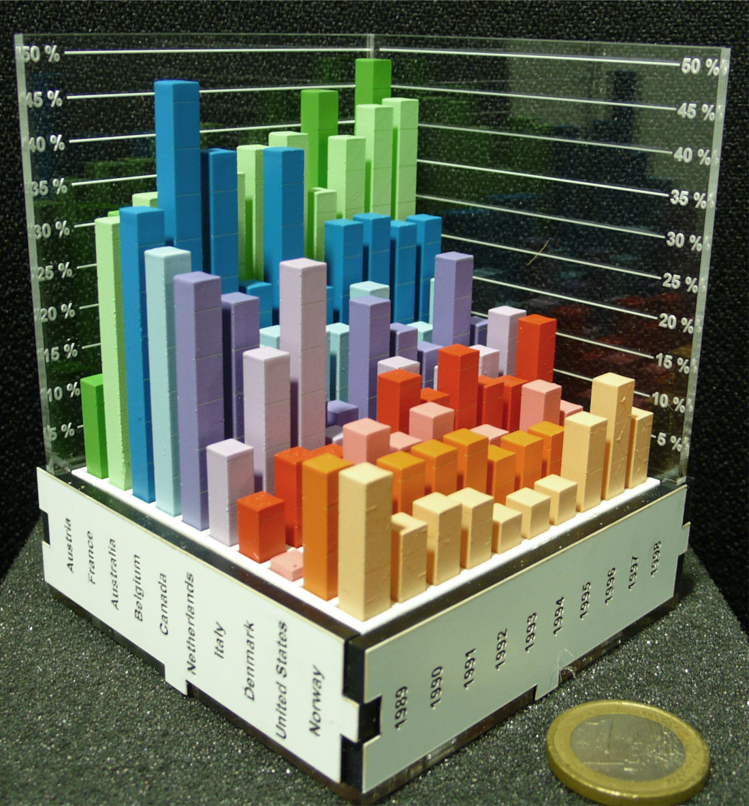
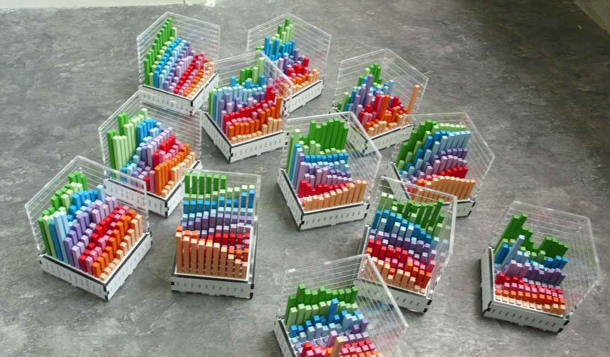

+++
author = "矢崎裕一"
title = "画面の3D棒グラフより速く、2Dには届かない──Jansen らの物理可視化の評価実験"
slug = "evaluating-physical-visualizations"
date = "2026-11-01"
description = "同じ3D棒グラフでも、画面より実物のほうが速く読み取れました。ただし、2Dの行列表示と棒グラフを組み合わせた表示には及びませんでした。"
categories = [
    "principle"
]
tags = [
    "データ物質化",
    "3D棒グラフ",
    "評価実験",
    "Yvonne Jansen",
    "Pierre Dragicevic"
]
image = "images/physical-bar-chart.jpg"
series = ["data-physicalization"]
series_weight = 23
seriesByline = "Jansen・Dragicevic・Fekete"
seriesTitle = "実物の3D棒グラフは速いか──評価実験"
+++

同じ3D棒グラフを画面から実物に移すと、データの読み取りは約2割速くなりました。ただし、平面の行列表示と2D棒グラフを組み合わせた画面上の表示には及びませんでした。2013年に Yvonne Jansen（イヴォンヌ・ジャンセン）らが発表した実験の結果です。「約2割」は論文の図から筆者が読んだ概算で、比べたのは正確さではなく速さです。

出典は、Jansen、Pierre Dragicevic（ピエール・ドラギチェヴィッチ）、Jean-Daniel Fekete（ジャン＝ダニエル・フェケテ）の論文 "Evaluating the Efficiency of Physical Visualizations"（CHI 2013）です。データ物理化の事例集 dataphys.org には、「Putting Physical Visualizations to the Test」という項目名で、2012年の事例として載っています。以下は論文本文に沿います。図から読んだ値には、そのつど「概算」と添えます。

<!--more-->

## 3D棒グラフの是非は、画面の上だけの話だった

情報可視化では、3Dの表示は勧められないのが通説です。論文も、背景の節でまずそれを認めています。

> Overall 3D visualizations are not recommended since they are subject to serious occlusion, distortion, and navigation issues.

隠れ（遮蔽）、ゆがみ、視点操作の難しさがあるので、3Dは勧められない、という要旨です。著者はすぐ後に、こう続けます。

> However, the controversy of 2D versus 3D only concerns the on-screen modality.

2Dか3Dかの論争は、画面の上でしか行われてこなかった、という指摘です。3Dは物理的な可視化ではよく使われるのに、画面では問題が多い。だから3Dを選んだ、と要旨にあります。背景には、デジタル工作機械と、形を自ら変えるインタフェースの研究があります。どちらも進めば、物理的な可視化を作ることが現実的になる、と著者は見ています。比べ方も特徴的です。

> The vast majority of infovis studies involve comparisons across visual mappings only. We focus on comparisons across modalities only

多くの研究は見た目の対応づけを比べてきたが、この研究は媒体だけを比べる、という宣言です。高さ・色・配置はそろえ、実物か画面かだけを変えます。著者はこれを、情報可視化の課題で物理と画面を比べた最初の研究としています。空間記憶の研究など、物理と画面を比べた先例は論文自身が挙げています。

## アクリルで作った13台の棒グラフ

データは、Gapminder の国別指標から作った16組です。1組は10か国×10年の100個の値で、指標は電力消費、出生率、自動車事故の死亡率などです。指標が分かりやすいこと、値のばらつきが十分あること、年が等間隔であることを条件に選ばれました。

Yvonne Jansen, Pierre Dragicevic, Jean-Daniel Fekete の研究（撮影者の記載なし）／dataphys.org「2012 – Putting Physical Visualizations to the Test」より引用

実物はレーザーカットしたアクリル製です。国ごとに2D棒グラフの断面を1枚ずつ切り出し、塗装して組み立てます。型紙はデータから自動生成しました。外寸8×8cm、重さ270〜350gで、手で持って回せます。これを13台作っています。対応づけは次のとおりです。

| データ・変数 | 見た目・素材 | 詳細 |
|---|---|---|
| 指標の値 | 棒の高さ | 値に比例。棒は1本5×5mm、間隔2mm |
| 国 | 行の位置と棒の色 | ColorBrewer の質的配色。並び順は類似度で並べ替え |
| 年 | 列の位置 | 等間隔の10年 |
| 値の読み取り補助 | 棒の側面に刻んだ目盛り線 | 実物では2面に彫刻 |
| 軸の目盛り | 透明アクリル板に彫刻 | 1台につき2枚。刻みは自動計算 |
| 国名・年のラベル | 台座の4面に縦向きで彫刻 | 少し回して読む必要があるが、小型にできる |

遮蔽の対策として、透明な棒、細い棒、上面だけの表示も試されました。結果は "They all turned out to have poor legibility."、どれも読みにくく、通常の棒に戻したとあります。

Yvonne Jansen, Pierre Dragicevic, Jean-Daniel Fekete の研究（撮影者の記載なし）／dataphys.org「2012 – Putting Physical Visualizations to the Test」より引用

## 実物は速く、2Dはさらに速かった

最初の実験では、同じデータを4つの条件で見せました。

| 条件 | 見た目の対応づけ | 媒体 | 操作 |
|---|---|---|---|
| physical | 3D棒グラフ | 実物 | 手で持って回す、触る |
| stereo | 3D棒グラフ | 画面（立体視） | 23インチの偏光式3Dモニターと眼鏡 |
| mono | 3D棒グラフ | 画面 | マウスで回転、クリックで棒をハイライト |
| 2D | 行列表示＋2D棒グラフ | 画面 | 行・列のラベルを選ぶと、その断面の棒グラフが出る |

2D条件は、行列のセル内の正方形の大きさで値を示し、行か列を選ぶとその断面の棒グラフを出します。重ねた折れ線やスモールマルチプルも試したうえで、この形にしました。

> the matrix view is analogous to a top view of the 3D model and the 2D bar chart view is analogous to a side cut.

行列は3D模型の上面図に、2D棒グラフは断面に当たる、という説明です。2D条件の位置づけも書かれています。

> Although our goal is not to compare 2D with 3D visualizations, we included an on-screen interactive 2D condition as a comparison baseline.

2Dと3Dを比べることは目的ではなく、比較の基準として入れた、という要旨です。

課題は3種類です。ある国の値の範囲を答える Range、ある年の10か国を値の順に並べる Order、3つの国・年から最小値を選ぶ Compare。参加者は16人で、計576問に答えました。

誤答は全体に少なく、条件による差もありませんでした。分析は作業時間で行われ、条件の効果がはっきり出ています（F(3,24) = 165.18, p < 0.001）。著者のまとめはこうです。

> Overall, we can safely conclude that the physical 3D visualization is more efficient than its 3D on-screen counterpart, mono or stereo alike.

実物の3D棒グラフは、単眼でも立体視でも、画面の3D棒グラフより効率がよい、という結論です。論文の図から筆者が読んだ概算では、実物の作業時間は単眼の画面の約0.82倍、2Dは実物の約0.63倍でした。冒頭の「約2割」は、この値です。

立体視は助けになりませんでした。"Contrary to H3, there is no evidence of stereo outperforming mono."、立体視が単眼より速いという仮説は支持されなかった、とあります。

2Dは3つの課題すべてで最速でした。ただし差の大きさは課題で変わります。

> So although 2D beats all 3D conditions, the effect is weaker if a task cannot be solved by one 2D cut.

2Dはすべての3D条件に勝ったが、1枚の断面で解けない課題では差が小さい、という要旨です。課題別の平均時間を図から読むと、次のとおりです。

| 条件 | Range | Order | Compare |
|---|---|---|---|
| physical | 約24秒 | 約47秒 | 約39秒 |
| stereo | 約27秒 | 約62秒 | 約52秒 |
| mono | 約27秒 | 約62秒 | 約48秒 |
| 2D | 約15秒 | 約24秒 | 約31秒 |

（表の値はすべて、論文の図5を筆者が読んだ概算です）

好みの順位は速さの順位と一致しました。画面の3Dには "I would loose my 'mark' easily during rotation"、回すうちに目印を見失う、という声がありました。録画には、こんな様子が残っています。

> Most subjects used their fingers to temporarily “mark” rows and columns of interest. Eventually, almost everyone switched to putting their fingers directly on the bars relevant to the task.

多くの人が指で行や列に印をつけ、やがてほぼ全員が、関わる棒に直接指を置くようになった、という観察です。

## 速さの一因は、棒に置いた指にあった

実物はなぜ速いのか。二つ目の実験は、その理由を分けて測りました。条件は4つです。

| 条件 | 内容 |
|---|---|
| mouse | 画面の3D棒グラフをマウスで回す。ハイライトなし |
| prop | 画面の3D棒グラフを、回転センサー入りの実物の小道具で回す |
| no touch | 実物の3D棒グラフ。指で印をつけるのは禁止 |
| touch | 実物の3D棒グラフ。触ることを勧める |

mouse から順に、「手で直接回す」「実物の見た目」「触る」が一つずつ加わります。課題は Compare だけで、3本の棒が同時に見える視点のない問題を新たに作りました。参加者は16人です。結果は本文に数値で書かれています。

- touch は no touch より15%短い（信頼区間 7〜22%）
- no touch は prop より13%短い（同 5〜20%）
- prop は mouse より3%短い（同 −4〜10%）

直接回す効果は、あっても小さいということです。**数値で見ると、触れることで15%、実物の見た目で13%短くなり、手で直接回すことの差は3%でした。**

著者は触れることの意味を、こう限定しています。

> We do not refer to the use of tactile sensory information but to the action of placing fingers to use them as visual or memory aids.

触覚の情報ではなく、指を置いて目と記憶の手がかりにする行為を指す、という要旨です。no touch と prop の13%の差について、著者は "Visual realism might also play a role." と、見た目の実物らしさも関わるかもしれない、と留保つきで書いています。回し方が同じでも見え方が速さに効いた可能性がある、と読めます。

Dragicevic と Jansen は後年、二つ目の実験を56通りの分析方法で再分析し、結果は分析の選び方に左右されないとしました。一つ目の実験については、多重比較で補正すると一部の効果は確かさが下がりうる、と著者自身が注意しています。

## 第三者はこの研究をどう見たか

評価は、再現、位置づけ、発表当時の反応の三つに分かれます。

- 再現：K. Danyluk（ダニルク）らは2020年、同じ形式・データ・課題で、Lego の物理チャートと VR 版を比べました（18人）。Compare 課題は物理が33.6秒、VR は手のひら大で56.6秒、テーブル大で65.7秒です。物理版では全員が指で棒をたどり、Jansen らの結果に重なるとまとめています。
- 位置づけ：S. Stusak（シュトゥザク）らは2016年、この研究を、物理と画面を読み取り課題で比べた最初の研究として紹介しました。あわせて、Jansen ら自身が課題と媒体が限られていたと述べている、と書いています。そのうえで関心を記憶に移しています。
- 当時の反応：Patrick Durusau（パトリック・デュルソー）は2013年5月のブログで、VR の触覚のシミュレーションがどこまで実物に迫れるか、と問いました。

Danyluk らは「物理的な操作」も利点に挙げますが、原論文は直接回すことは重要でないとしており、少しずれていると読めます。Durusau の問いは、7年後に Danyluk らが VR で確かめた形だと読めます。Danyluk らは限界も指摘しています。

> Ultimately, static 3D barcharts like those we used are unlikely to outperform either 2D or 3D visualizations that include interactive features like dynamic filtering or tooltips.

動かない3D棒グラフは、絞り込みやツールチップを持つ対話的な表示を上回りにくい、という要旨です。

## 使い道

この研究から持ち帰れることは、媒体の選び方について三つ、評価の方法について一つあります。

一つ目は、3Dを使うなら実物にする手がある、ということです。著者は設計への示唆として、こう書いています。

> i) if an analyst wishes to use a 3D visualization, making it physical is an option worth considering; ii) physical visualizations should be built to support direct touch and not enclose data.

3Dを使うなら実物にすることは検討に値し、実物は直接触れられるように作ってデータを覆わない、という示唆です。模型をケースに収めると、この研究で効いた「指を置く」読み方ができなくなる、と読めます。

二つ目は、2つのカテゴリーと1つの量を持つデータなら、まず上面図と断面の組を考えることです。この研究で最も速かったのはこの組でした。ただし、研究は2Dと3Dの優劣を決めるために設計されてはいません。1枚の断面で解けない比較では、2Dの優位も小さくなりました。3Dを避ける根拠として引くときは、この二点を添える必要があります。

三つ目は、画面でも「指を置く場所」を用意することです。速さに効いたのは回転より、目印を残せることだったと読めます。著者も、2Dの表示は紙やタッチ画面から恩恵を受けるだろうと書いています。選んだ行・列のハイライトを保つ機能は、媒体を問わず読み取りを助けると読めます。

最後は評価の方法です。見た目の対応づけをそろえ、媒体だけを変えて比べる。この設計があったから、「実物が速い」と「2Dが速い」を、矛盾なく同じ実験の中で言えました。

## 参考・出典

**一次情報**

- Yvonne Jansen, Pierre Dragicevic, Jean-Daniel Fekete, "Evaluating the Efficiency of Physical Visualizations," *Proceedings of CHI 2013*, pp. 2593–2602. [doi:10.1145/2470654.2481359](https://doi.org/10.1145/2470654.2481359) / [HAL](https://inria.hal.science/hal-00781831) / [PDF](https://inria.hal.science/hal-00781831v1/file/Evaluating_the_Efficiency_of_Physical_Visualizations.pdf)
- dataphys.org, "2012 – Putting Physical Visualizations to the Test"（Added by Pierre Dragicevic）. [項目ページ](https://dataphys.org/list/testing-physical-visualizations/)
- 著者のプロジェクトページ（データセット・実験データ・動画の置き場と論文に記載。筆者は未確認）. [aviz.fr/phys](http://www.aviz.fr/phys/)
- Pierre Dragicevic, Yvonne Jansen, "Re-Evaluating the Efficiency of Physical Visualizations: A Simple Multiverse Analysis". [Explorable Multiverse Analyses](https://explorablemultiverse.github.io/examples/frequentist) / [R multiverse パッケージの再現資料](https://cran.r-universe.dev/multiverse/doc/example-frequentist.html)
- Yvonne Jansen, *Physical and Tangible Information Visualization*, 博士論文, 2014. [HAL](https://tel.archives-ouvertes.fr/tel-00983501/document)

**第三者評価**

- K. Danyluk, T. Ulusoy, W. Wei, W. Willett, "Touch and Beyond: Comparing Physical and Virtual Reality Visualizations," *IEEE TVCG*, 2020. [doi:10.1109/TVCG.2020.3023336](https://doi.org/10.1109/TVCG.2020.3023336) / [著者版](https://prism.ucalgary.ca/items/92c1179a-baa8-49eb-8538-2b881d83b283) / [要旨](https://content.ieeevis.org/year/2021/paper_v-tvcg-9193986.html)
- S. Stusak, M. Hobe, A. Butz, "If Your Mind Can Grasp It, Your Hands Will Help," *TEI 2016*. [PDF](https://www.medien.informatik.uni-muenchen.de/pubdb/publications/pub/stusak2016tei/stusak2016tei.pdf)
- Patrick Durusau, "Evaluating the Efficiency of Physical Visualizations," *Another Word For It*, 2013-05-12. [ブログ](https://tm.durusau.net/?p=41538)
