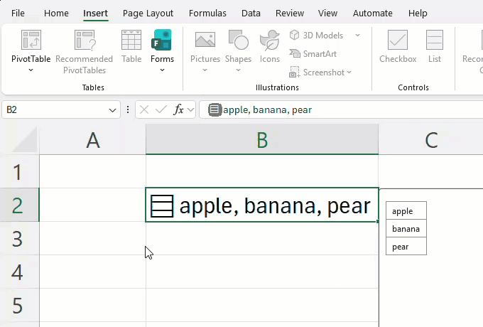
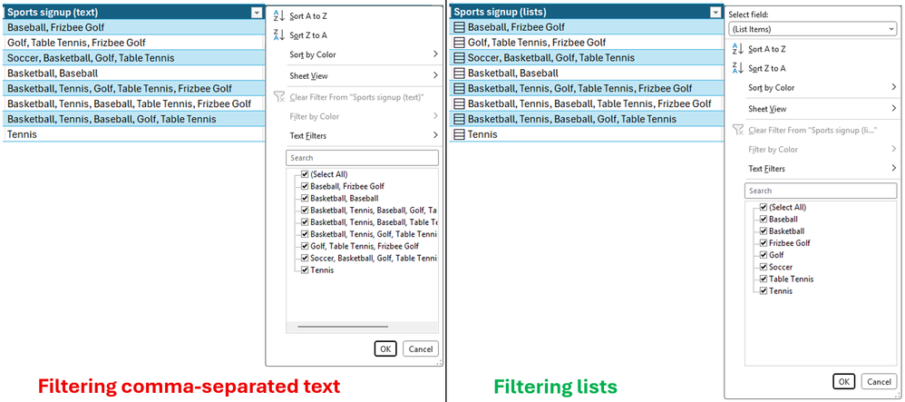
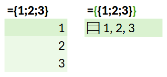
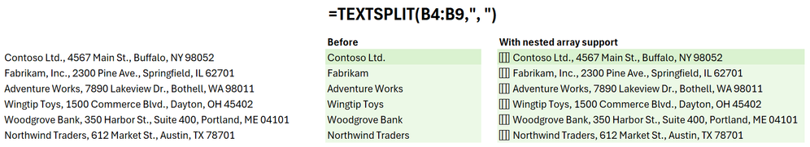
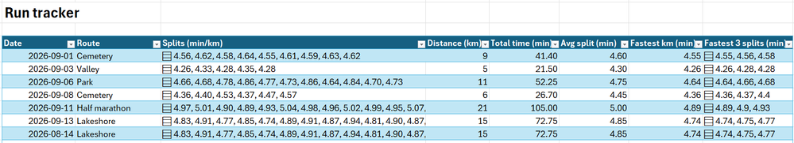
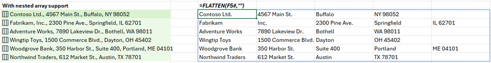
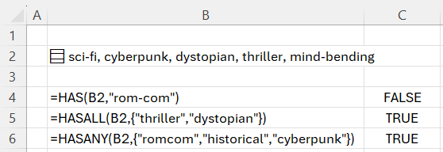

+++
author = "Yuichi Yazaki"
title = "One Cell, a Whole Array: Excel Lists and Arrays in Cells"
slug = "excel-lists-arrays-in-cells"
date = "2026-11-04"
description = "In September 2026, Excel's Beta Channel previewed a feature that lets a single cell hold an array as its value. Charts and PivotTables cannot yet work with the contents of those arrays."
categories = [
    "consume"
]
tags = [
    "Excel",
    "data shape",
    "spreadsheets"
]
image = "images/filter-compare.png"
+++

In September 2026, Microsoft released a preview in Excel's Beta Channel that lets a single cell hold a whole array as its value. Values that used to be crammed into one cell with commas can now be used item by item in calculations, and FLATTEN turns them back into a table with one value per cell. For now, however, charts, PivotTables, and Power Query cannot work with the contents of an array.

The source is the Microsoft 365 Insider Blog post "Put multiple values in one cell with lists and arrays in Excel" (September 24, 2026). On the same day, the Excel Blog introduced the same feature. What follows relies on those two posts and the reference pages for the new functions. The formula examples are taken as they are from the figures in the blog.

<!--more-->

## September 24, 2026: An Announcement That Changes "One Value per Cell"

The author is JakeArmstrong. In the same blog in 2024, he describes himself as a product manager on the Excel team. The post opens with "Throughout Excel's 40-year history, you've only been able to put one value per cell." For 40 years, a cell held one value. The post declares that this is changing.

| Item | Details |
|---|---|
| Features | lists, arrays in cells, nested arrays |
| New functions | FLATTEN, HAS, HASANY, HASALL |
| Availability | Beta Channel of Microsoft 365 Insider |
| Versions | Windows: Version 2610 (Build 20520.20000) or later. Mac: Version 16.114 (Build 26092111) or later. The Web version is not mentioned |

The post carries a note about the preview.

> NOTE: These are preview features. Their behavior may change before general release based on your feedback. We don't recommend using them in important workbooks until they're generally available.

Because behavior may change before general availability, the note **recommends not using them in important workbooks until then**. No date for general availability is given.

## Turning a Comma-Separated String into a List

The blog gives an example in which a project's owners are written in one cell as "Carlos, Henrietta, Jacob". A list keeps such values in one cell while letting you handle them item by item.

You create one with Insert > List or Ctrl+J. Items are separated by a comma or a semicolon, depending on your regional settings. The cell gets an icon, and selecting it shows the individual values.

Source: Microsoft / Microsoft 365 Insider Blog, "Put multiple values in one cell with lists and arrays in Excel"

This is the last frame of the blog's GIF. B2 shows "apple, banana, pear" on one line, but the three values line up separately on the right. It looks like one string, but it holds three values.

The difference shows most clearly in filtering.

Source: Microsoft / Microsoft 365 Insider Blog, "Put multiple values in one cell with lists and arrays in Excel"

Both are sign-up sheets for sports. In the string column on the left, combinations such as "Basketball, Baseball" appear whole among the filter choices. In the list column on the right, Baseball, Golf, and so on appear one by one. In the blog's words, you can "filter by one or more individual items instead of whole text entries".

Calculations also treat a list as the values inside it. If you reference B2, which holds a list, with `=B2`, the values spill down into separate cells.

## Fitting a Formula Result into One Cell with Curly Braces

Lists are one part of a larger change. The blog writes: "For the first time in Excel, arrays can exist natively in cells as values or as formula results." In other words, an array can now be a cell's value or a formula's result as it is.

The syntax is simply to wrap the body of the formula in curly braces `{ }`.

Source: Microsoft / Microsoft 365 Insider Blog, "Put multiple values in one cell with lists and arrays in Excel"

`={1;2;3}` spills down into three cells, as before. `={{1;2;3}}`, with braces added outside, wraps that array in a 1×1 array. So the result fits in a single cell as "1, 2, 3". The same goes for `=TEXTSPLIT(B3,, ", ")`, which splits an address and would normally spill into four cells. Wrapped as `={TEXTSPLIT(B3,, ", ")}`, the result fits in one cell.

An array inside an array is a nested array. An example is `={{1,2,3};{4,5,6}}`. According to the blog, a formula that returned an array of arrays used to have its result truncated or return a #CALC! error.

Source: Microsoft / Microsoft 365 Insider Blog, "Put multiple values in one cell with lists and arrays in Excel"

This is the result of `=TEXTSPLIT(B4:B9,", ")`. In Before, in the middle, only the company name at the start of each row is returned. On the right, each row returns one array of the split address.

As an example of a new way to build a table, the blog shows a running log.

Source: Microsoft / Microsoft 365 Insider Blog, "Put multiple values in one cell with lists and arrays in Excel"

Each row is one run, and the Splits column holds the per-kilometer split times as an array: five for a 5 km run, nine for a 9 km run. The distance, total time, and fastest kilometer are calculated within the same row.

The table below summarizes what each cell holds and how it appears on screen, based on the blog's text and figures.

| What the cell holds | How it appears on screen |
|---|---|
| List | A cell with an icon, with values shown separated by commas |
| Array in a cell | Shown in one cell like "1, 2, 3" |
| Nested array | One array cell spills per row |
| Reference to a list | The values spill down into separate cells |
| Filter choices | Individual items, not whole strings |
| Chart | Does not expand arrays into data points |

Lined up this way, it can be read as a division of roles: a list is a value that a person types in, and an array in a cell is the result of a formula.

## FLATTEN and HAS, and the Step Before the Chart

The first of the new functions is FLATTEN. It removes one or more levels of nesting from a nested array.

Source: Microsoft / Microsoft 365 Insider Blog, "Put multiple values in one cell with lists and arrays in Excel"

Applying `=FLATTEN(F5#,"")` to the earlier TEXTSPLIT result unravels the per-row arrays into a grid with one value per cell. Because addresses have different numbers of items, shorter rows leave gaps. According to the reference, Excel arrays must be rectangular, and the gaps become #N/A by default. The blog's example passes an empty string `""` as the second argument, pad_value, to leave them blank.

The remaining functions, HAS, HASANY, and HASALL, check whether an array contains a value.

Source: Microsoft / Microsoft 365 Insider Blog, "Put multiple values in one cell with lists and arrays in Excel"

B2 holds the movie tags "sci-fi, cyberpunk, dystopian, thriller, mind-bending". `=HAS(B2,"rom-com")` is FALSE, because it is not there. `=HASALL(B2,{"thriller","dystopian"})` is TRUE, because both are there. `=HASANY(B2,{"romcom","historical","cyberpunk"})` is TRUE, because cyberpunk is there.

Many calculations that use nested arrays require a per-workbook setting, Compatibility Version 3. Some existing formulas return different results under Version 3, so the blog says it is fine to stay on Version 1 or 2.

The blog lists six known limitations in the Beta Channel.

| Feature | Limitation |
|---|---|
| Conditional formatting | Does not look inside arrays unless you use a formula |
| Data validation | Lists and arrays cannot be used for drop-downs |
| Charts | Do not expand arrays into data points |
| PivotTables | Do not read array values as source data |
| Power Query | Does not load or output columns that hold array values |
| Find and replace | Cannot replace items in lists or arrays |

The ones that bear directly on visualization are charts, PivotTables, and Power Query. No plans to support them are given.

## How Third Parties Saw the Feature

Welcoming it from the user's side was Leila Gharani (Microsoft MVP) of XelPlus. In an explainer posted on September 25, she wrote:

> This changes what an Excel cell can be, and what you can build with it.

Her assessment is that what a cell can be has changed. She also sets it against the old workaround, noting that counting items with LEN and SUBSTITUTE is replaced by `=COUNTA(A2)`. At the same time, she states plainly that PivotTables and charts cannot be used yet. For reporting, her advice is to "FLATTEN the lists into regular cells first".

Cautious from the sharing side is Office Watch's article of September 27.

> don't send workbooks with list cells to anyone until Microsoft explains how other versions of Excel, Google Sheets and data tools will handle them.

The point is not to send such workbooks to anyone until it is clear how other versions of Excel and Google Sheets will handle them. The article also says that Microsoft has not published how lists are stored inside an .xlsx file.

There are also objections on data-design principle. In the comments on the Excel Blog, seez wrote on September 30:

> There is a reason for 40years of sticking to 2D principle IMHO.

The objection is that there is a reason Excel has stuck to the two-dimensional principle for 40 years. Behind it lies a long-standing rule of thumb. Ken Puls of Excelguru wrote in 2019 that for a PivotTable to read it, data must be in first normal form.

## Uses

Let us reread this from the standpoint of data shape. Until now, there were mainly two ways to hold multiple values in Excel.

| Way of holding | Example | Per-item calculation | Charts and PivotTables |
|---|---|---|---|
| Long format (one value per cell) | One row per owner | Possible | Usable as is |
| Delimited string crammed into a cell | "Carlos, Henrietta, Jacob" | Requires string processing | The whole string is one item |
| One row per subject, plus an array column | One run per row, splits as an array | Possible | Not usable at present |

This announcement can be read as Excel recognizing the third form as a formal kind of value. It lets a row hold values of varying length while still allowing calculation on the contents item by item.

But the visualization side does not yet read this form. At present, building a chart from an array column can be read as requiring the step of turning it back into one value per cell with FLATTEN, as a continuous part of the workflow. This is also the workaround that XelPlus and Office Watch both name.

This kind of conversion back is familiar work in visualization. In "[Unpivoting Pivot Tables in Excel](/en/excel-reverse-pivot/)", I introduced the steps for turning a wide table into long format with Power Query. FLATTEN can be read as a transformation in the same direction.

There are three takeaways.

- Use an array column for calculation and filtering. Before handing it to a chart or PivotTable, turn it back into one value per cell with FLATTEN.
- Aggregations such as counting how often each tag appears can also be read as something to do after restoring the data with FLATTEN (XelPlus gives an example that counts items using FLATTEN and GROUPBY).
- While this is a preview, do not use it in important workbooks or workbooks you hand to other people.

Before drawing a figure, the data still has to return to one value per cell. Everything up to that point can be done within a single row of a table. As it stands, the feature can be read as reaching that far and no further.

## References

**Primary sources**

- JakeArmstrong, "Put multiple values in one cell with lists and arrays in Excel," Microsoft 365 Insider Blog, 2026-09-24. https://techcommunity.microsoft.com/blog/Microsoft365InsiderBlog/put-multiple-values-in-one-cell-with-lists-and-arrays-in-excel/4559395
- msexcel, "Excel now supports multiple values in a single cell," Excel Blog, 2026-09-24. https://techcommunity.microsoft.com/blog/excelblog/excel-now-supports-multiple-values-in-a-single-cell/4549756
- Microsoft Support, "FLATTEN Function." https://support.microsoft.com/en-us/excel/functions/flatten-function
- Microsoft Support, "HAS Function." https://support.microsoft.com/en-us/excel/functions/has-function
- Microsoft Support, "HASANY Function." https://support.microsoft.com/en-us/excel/functions/hasany-function
- Microsoft Support, "HASALL Function." https://support.microsoft.com/en-us/excel/functions/hasall-function
- For the author's job title: Insider Blog, "Improving five Excel text functions ... + Compatibility Versions," 2024-12-03. https://techcommunity.microsoft.com/blog/microsoft365insiderblog/improving-five-excel-text-functions-len-mid-search-find-and-replace--compatibili/4339080

**Secondary sources**

- Leila Gharani, "Excel Lists in Cells: Put Multiple Values in One Cell," XelPlus, 2026-09-25. https://www.xelplus.com/excel-lists-in-cells/
- Office Watch, "Excel List in a Cell: One Cell Now Holds Many Values, but Don't Share It Yet," 2026-09-27. https://office-watch.com/2026/excel-list-in-a-cell/
- Comments on the Excel Blog (seez, 2026-09-30). https://techcommunity.microsoft.com/blog/excelblog/excel-now-supports-multiple-values-in-a-single-cell/4549756
- Background: Ken Puls, "Power Query Challenge 6," Excelguru, 2019-07-31. https://excelguru.ca/power-query-challenge-6/
