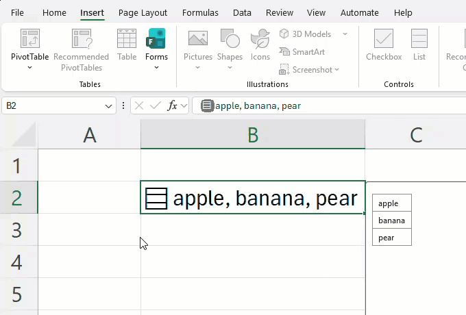
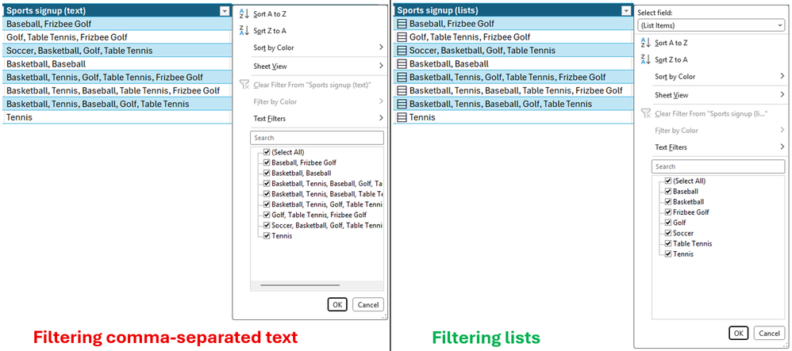
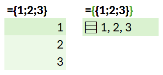
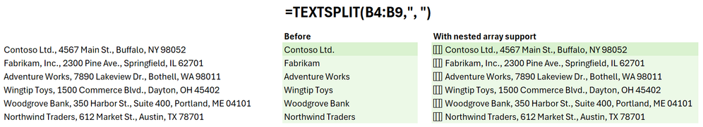
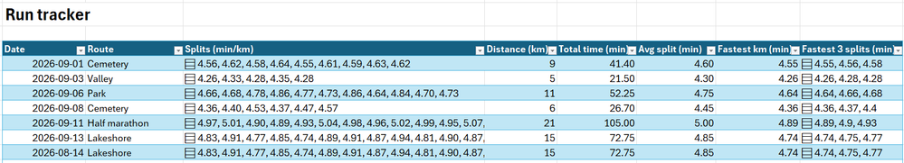
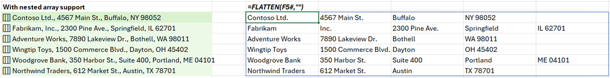
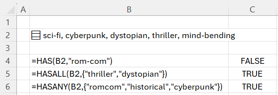

+++
author = "矢崎裕一"
title = "1つのセルに、配列をまるごと持つ──Excel のリストとセル内の配列"
slug = "excel-lists-arrays-in-cells"
date = "2026-11-04"
description = "2026年9月、Excel の Beta Channel で、1つのセルに配列を値として持てる機能がプレビュー公開されました。グラフやピボットテーブルは、まだ中身を扱えません。"
categories = [
    "consume"
]
tags = [
    "Excel",
    "データの持ち方",
    "スプレッドシート"
]
image = "images/filter-compare.png"
+++

2026年9月、Microsoft は Excel の Beta Channel で、1つのセルに配列をまるごと値として持てる機能をプレビュー公開しました。カンマ区切りで1セルに詰め込んでいた値を項目ごとに計算に使え、FLATTEN で1セル1値の表に戻せます。ただし現時点では、グラフ、ピボットテーブル、Power Query は配列の中身を扱えません。

出典は、Microsoft 365 Insider Blog の記事「Put multiple values in one cell with lists and arrays in Excel」（2026年9月24日）です。同じ日に Excel Blog も同じ機能を紹介しました。以下は、この2本と、新しい関数のリファレンスに沿います。数式の例は、ブログの図にあるものをそのまま引きます。

<!--more-->

## 2026年9月24日、「1セル1値」を変えるという発表

書き手は JakeArmstrong（ジェイク・アームストロング）です。2024年の同じブログでは、Excel チームのプロダクトマネージャーと名乗っています。記事は「Throughout Excel's 40-year history, you've only been able to put one value per cell.」と書き出します。40年間、1つのセルには値が1つだった。それを変える、という宣言です。

| 項目 | 内容 |
|---|---|
| 機能 | lists（リスト）、arrays in cells（セル内の配列）、nested arrays（入れ子の配列） |
| 新しい関数 | FLATTEN、HAS、HASANY、HASALL |
| 対象 | Microsoft 365 Insider の Beta Channel |
| 版 | Windows は Version 2610（Build 20520.20000）以降、Mac は Version 16.114（Build 26092111）以降。Web 版は言及なし |

記事には、プレビューについての注意が置かれています。

> NOTE: These are preview features. Their behavior may change before general release based on your feedback. We don't recommend using them in important workbooks until they're generally available.

一般提供までに動きが変わりうるので、**それまでは重要なブックで使わないよう勧める**、という注意です。一般提供の時期は書かれていません。

## カンマ区切りの文字列を、リストにする

ブログは、プロジェクトの担当者を「Carlos, Henrietta, Jacob」と1セルに書く例を挙げます。リストは、そうした値を1セルに置いたまま、項目ごとに分けて扱うためのものです。

作り方は、Insert > List（英語版の表記）か Ctrl+J です。項目はカンマかセミコロンで区切ります。どちらかは地域の設定によります。セルにはアイコンが付き、選ぶと個々の値が見えます。

Microsoft／Microsoft 365 Insider Blog「Put multiple values in one cell with lists and arrays in Excel」より引用

ブログの GIF の最後のコマです。B2 には「apple, banana, pear」と1行で出ていますが、右には3つの値が別々に並びます。見た目は1つの文字列でも、中身は3つの値です。

違いがはっきり出るのは、フィルターです。

Microsoft／Microsoft 365 Insider Blog「Put multiple values in one cell with lists and arrays in Excel」より引用

どちらもスポーツの申込表です。左の文字列の列では、「Basketball, Baseball」のような組み合わせが候補に丸ごと並びます。右のリストの列では、Baseball、Golf などが1つずつ並びます。ブログの言葉では「filter by one or more individual items instead of whole text entries」です。

計算でも、リストは中の値として扱われます。リストの入った B2 を `=B2` と参照すると、値が縦に別々のセルへスピルします。

## 数式の結果を、波かっこで1セルに収める

リストは、より大きな変更の一部です。ブログは「For the first time in Excel, arrays can exist natively in cells as values or as formula results.」と書きます。配列が、そのままセルの値や数式の結果になれる、ということです。

書き方は、数式の本体を波かっこ `{ }` で包むだけです。

Microsoft／Microsoft 365 Insider Blog「Put multiple values in one cell with lists and arrays in Excel」より引用

`={1;2;3}` は、これまでどおり縦に3セルへスピルします。外側に波かっこを足した `={{1;2;3}}` は、その配列を 1×1 の配列で包みます。だから結果は1つのセルに「1, 2, 3」として収まります。住所を分ける `=TEXTSPLIT(B3,, ", ")` も、ふつうは4セルにスピルします。`={TEXTSPLIT(B3,, ", ")}` と包めば、結果は1セルに収まります。

配列の中の配列が、入れ子の配列です。例は `={{1,2,3};{4,5,6}}` です。ブログによれば、配列の配列を返す数式は、これまで結果が切り詰められるか、#CALC! エラーになっていました。

Microsoft／Microsoft 365 Insider Blog「Put multiple values in one cell with lists and arrays in Excel」より引用

`=TEXTSPLIT(B4:B9,", ")` の結果です。中央の Before では、各行の先頭の社名しか返りません。右では、1行に1つ、分けた住所の配列が返ります。

ブログは、新しい表の作り方の例として、ランの記録表を載せています。

Microsoft／Microsoft 365 Insider Blog「Put multiple values in one cell with lists and arrays in Excel」より引用

1行が1回のランで、Splits の列に1kmごとの区間タイムが配列で入ります。5km なら5個、9km なら9個です。距離や合計時間、最速の1km は、同じ行の中で計算されています。

セルの中身と画面での見え方を、ブログの本文と図からまとめます。

| セルの中身 | 画面での見え方 |
|---|---|
| リスト | アイコン付きのセルに、値がカンマ区切りで並ぶ |
| セル内の配列 | 1つのセルに「1, 2, 3」のように並ぶ |
| 入れ子の配列 | 1行に1つずつ、配列のセルがスピルする |
| リストへの参照 | 値が別々のセルへ縦にスピルする |
| フィルターの候補 | 文字列全体ではなく、個々の項目が並ぶ |
| グラフ | 配列をデータ点に展開しない |

並べてみると、リストは人が入力する値、セル内の配列は数式の結果、という使い分けだと読めます。

## FLATTEN と HAS、そしてグラフの手前で

新しい関数の1つ目が FLATTEN です。入れ子の配列から、入れ子の段を1つ以上取り除きます。

Microsoft／Microsoft 365 Insider Blog「Put multiple values in one cell with lists and arrays in Excel」より引用

前の TEXTSPLIT の結果に `=FLATTEN(F5#,"")` を当てると、行ごとの配列が1セル1値の格子にほどけます。住所によって項目の数が違うので、短い行には空きが出ます。リファレンスによれば、Excel の配列は長方形でなければならず、空きは既定で #N/A になります。ブログの例は、2つ目の引数 pad_value に空文字 `""` を渡して空白にしています。

残りの HAS、HASANY、HASALL は、配列に値が含まれるかを調べます。

Microsoft／Microsoft 365 Insider Blog「Put multiple values in one cell with lists and arrays in Excel」より引用

B2 には、映画のタグ「sci-fi, cyberpunk, dystopian, thriller, mind-bending」が入っています。`=HAS(B2,"rom-com")` は、ないので FALSE。`=HASALL(B2,{"thriller","dystopian"})` は、2つともあるので TRUE。`=HASANY(B2,{"romcom","historical","cyberpunk"})` は、cyberpunk があるので TRUE です。

入れ子の配列を使う計算の多くには、ブックごとの設定 Compatibility Version 3 が要ります。既存の数式の一部は Version 3 で結果が変わるので、Version 1 か 2 のままでもよい、とブログは書きます。

ブログは、Beta Channel での既知の制限を6つ挙げています。

| 機能 | 制限 |
|---|---|
| 条件付き書式 | 数式を使わない限り、配列の中身を見ない |
| データの入力規則 | リストや配列をドロップダウンに使えない |
| グラフ | 配列をデータ点に展開しない |
| ピボットテーブル | 配列の値を元データとして読まない |
| Power Query | 配列の値を持つ列を読み込まず、出力もしない |
| 検索と置換 | リストや配列の項目を置換できない |

可視化に直接関わるのは、グラフ、ピボットテーブル、Power Query です。対応の予定は書かれていません。

## 第三者はこの機能をどう見たか

使う側から歓迎したのが、XelPlus の Leila Gharani（レイラ・ガラニ、Microsoft MVP）です。9月25日の解説記事で、こう書きました。

> This changes what an Excel cell can be, and what you can build with it.

セルが何でありうるかが変わる、という評価です。項目数を LEN と SUBSTITUTE で数えていたところは `=COUNTA(A2)` に置き換わる、と回避策との対照も並べます。一方で、ピボットテーブルやグラフはまだ使えないと明記しています。レポートに使うなら「FLATTEN the lists into regular cells first」という助言です。

共有の側から慎重なのが、Office Watch の9月27日の記事です。

> don't send workbooks with list cells to anyone until Microsoft explains how other versions of Excel, Google Sheets and data tools will handle them.

ほかの版の Excel や Google スプレッドシートでの扱いが分かるまで、人に送るな、という指摘です。リストが .xlsx の中でどう保存されるかを、Microsoft は公表していないとも書いています。

データ設計の原則から反対する声もあります。Excel Blog のコメント欄で、seez は9月30日にこう書きました。

> There is a reason for 40years of sticking to 2D principle IMHO.

40年、2次元の原則を守ってきたのには理由がある、という反対です。背景には、以前からの定説があります。Excelguru の Ken Puls（ケン・プルス）は2019年にこう書いています。ピボットテーブルが読むには、データが第1正規形でなければならない。

## 使い道

データの持ち方の側から読み直します。これまで Excel で複数の値を持つ方法は、主に2つでした。

| 持ち方 | 例 | 項目ごとの計算 | グラフ・ピボット |
|---|---|---|---|
| 縦持ち（1セル1値） | 担当者ごとに1行 | できる | そのまま使える |
| 区切り文字の詰め込み | 「Carlos, Henrietta, Jacob」 | 文字列の処理が要る | 文字列全体が1項目 |
| 1行1対象＋配列の列 | 1ラン1行、区間は配列 | できる | 現時点では使えない |

今回の発表は、3つ目の形を Excel の正式な値として認めたものと読めます。1行の中に長さの違う値を持ちながら、中身を項目ごとに計算できる形です。

ただ、可視化の側はまだこの形を読みません。現時点では、配列の列から図を作るまでに、FLATTEN で1セル1値に戻す手順が一続きで入ると読めます。XelPlus と Office Watch が同じ回避策を挙げているのも、この点です。

戻す作業は、可視化の仕事では見慣れたものです。横持ちの表を Power Query で縦持ちに戻す手順は、「[Excelでのピボットテーブルの解除](/excel-reverse-pivot/)」で紹介しました。FLATTEN は、それと同じ向きの変換と読めます。

持ち帰れることは3つです。

- 配列の列は、計算とフィルターに使う。グラフやピボットに渡す前に、FLATTEN で1セル1値に戻す。
- タグの出現数のような集計も、FLATTEN で戻してから数えると読めます（XelPlus は FLATTEN と GROUPBY で項目ごとの数を数える例を載せています）。
- プレビューのうちは、重要なブックや人に渡すブックでは使わない。

図を描く手前では、データはまだ1セル1値に戻る必要があります。その手前までを表の1行の中で済ませられる。現時点のこの機能は、そこまでのものと読めます。

## 参考・出典

**一次情報**

- JakeArmstrong「Put multiple values in one cell with lists and arrays in Excel」Microsoft 365 Insider Blog、2026-09-24. https://techcommunity.microsoft.com/blog/Microsoft365InsiderBlog/put-multiple-values-in-one-cell-with-lists-and-arrays-in-excel/4559395
- msexcel「Excel now supports multiple values in a single cell」Excel Blog、2026-09-24. https://techcommunity.microsoft.com/blog/excelblog/excel-now-supports-multiple-values-in-a-single-cell/4549756
- Microsoft Support「FLATTEN Function」. https://support.microsoft.com/en-us/excel/functions/flatten-function
- Microsoft Support「HAS Function」. https://support.microsoft.com/en-us/excel/functions/has-function
- Microsoft Support「HASANY Function」. https://support.microsoft.com/en-us/excel/functions/hasany-function
- Microsoft Support「HASALL Function」. https://support.microsoft.com/en-us/excel/functions/hasall-function
- 著者の役職：Insider Blog「Improving five Excel text functions ... + Compatibility Versions」2024-12-03. https://techcommunity.microsoft.com/blog/microsoft365insiderblog/improving-five-excel-text-functions-len-mid-search-find-and-replace--compatibili/4339080

**第三者評価**

- Leila Gharani「Excel Lists in Cells: Put Multiple Values in One Cell」XelPlus、2026-09-25. https://www.xelplus.com/excel-lists-in-cells/
- Office Watch「Excel List in a Cell: One Cell Now Holds Many Values, but Don't Share It Yet」2026-09-27. https://office-watch.com/2026/excel-list-in-a-cell/
- Excel Blog のコメント欄（seez、2026-09-30）. https://techcommunity.microsoft.com/blog/excelblog/excel-now-supports-multiple-values-in-a-single-cell/4549756
- 背景：Ken Puls「Power Query Challenge 6」Excelguru、2019-07-31. https://excelguru.ca/power-query-challenge-6/
