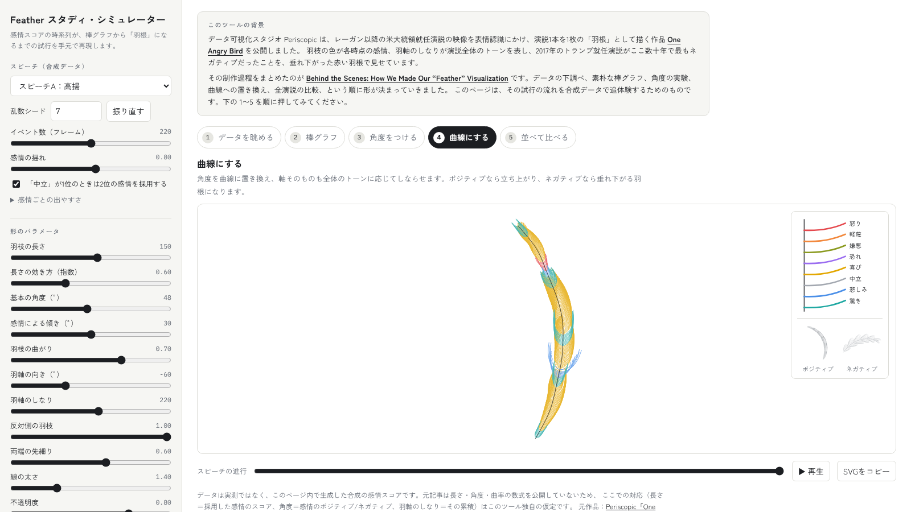

+++
author = "Yuichi Yazaki"
title = "Trying Out How a Bar Chart Becomes a Feather: The Feather Study Simulator"
slug = "feather-study-simulator"
date = "2026-11-22"
description = "An interactive simulator that follows Periscopic's making-of article for \"One Angry Bird\" and lets you reproduce, with synthetic data and adjustable parameters, the five steps by which a time series of emotion scores goes from a bar chart to a feather."
categories = [
    "technology"
]
tags = [
    "interactive",
    "Periscopic",
    "emotion analysis",
    "sketching"
]
image = "images/cover-compare-six.png"
series = ["interactive-explainers"]
work_id = "emotion-to-feather"
series_weight = 10
seriesTitle = "How a Bar Chart Becomes a Feather: The Feather Study Simulator"
+++

The Feather Study Simulator is an interactive page that reproduces the five steps by which a time series of emotion scores goes from a bar chart to the shape of a feather. It follows the making-of article for "One Angry Bird," a work by the data visualization studio Periscopic, and lets you trace how the form was settled by adjusting synthetic data and parameters.

**[Open the Feather Study Simulator](https://emotion-to-feather.visualizing.jp/)** (the simulator itself is in Japanese)

This page introduces the simulator. The simulator is at the link above and runs in the browser.

<!--more-->

## The original work and its making-of article

Periscopic's "One Angry Bird" ran facial-expression recognition on video of US presidential inaugural addresses from Reagan onward and drew each address as one feather. The color of the barbs shows the emotion at each moment, and the bend of the shaft shows the overall tone of the address.

Periscopic described the process in "Behind the Scenes: How We Made Our “Feather” Visualization." The form was settled in this order: exploring the data, a plain bar chart, experiments with angle, replacing bars with curves, and comparing all the addresses. The simulator turns that order into five buttons.

## Following the five steps

| Step | What you can do |
|---|---|
| 1. Look at the data | Check, as a stacked view, the time series of eight emotion scores per frame |
| 2. Bar chart | Line up the emotion adopted at each moment, by bar length and color |
| 3. Add angle | Give the bars an angle, and tilt them by whether the emotion is positive or negative |
| 4. Make curves | Replace the angle with curves, and bend the shaft itself according to the overall tone |
| 5. Compare side by side | Line up six speeches at the same scale and check whether posture and color alone tell them apart |

Yuichi Yazaki / Screen of the Feather Study Simulator

In the left column you can change the type of speech, the random seed, and how much the emotions fluctuate. Sliders also control the shape parameters, such as barb length, angle, curvature, and the bend of the shaft. Unchecking "when 'neutral' ranks first, adopt the second-ranked emotion" shows how the result becomes almost all neutral. The finished figure can be copied as SVG.

## What it shows

Looking only at the finished work, the feather shape seems to have been decided from the start. Pressing the steps in order shows that it is the result of adding angle and curvature to a bar chart, one at a time. You can check by hand which parameter affects which part of the appearance.

## Caveats

- The data is not measured. It is synthetic emotion scores generated within the page.
- The original article does not publish formulas for length, angle, or curvature. Mapping length to the score of the adopted emotion, angle to whether the emotion is positive or negative, and the bend of the shaft to the accumulation of that value is this tool's own assumption.
- It does not reproduce the figures of "One Angry Bird."

## References

- Feather Study Simulator (in Japanese). [emotion-to-feather.visualizing.jp](https://emotion-to-feather.visualizing.jp/)
- Periscopic, "One Angry Bird." [emotions.periscopic.com/inauguration](https://emotions.periscopic.com/inauguration/)
- Periscopic, "Behind the Scenes: How We Made Our “Feather” Visualization." [medium.com/@Periscopic](https://medium.com/@Periscopic/behind-the-scenes-how-we-made-our-feather-visualization-544d727fbe5c)
